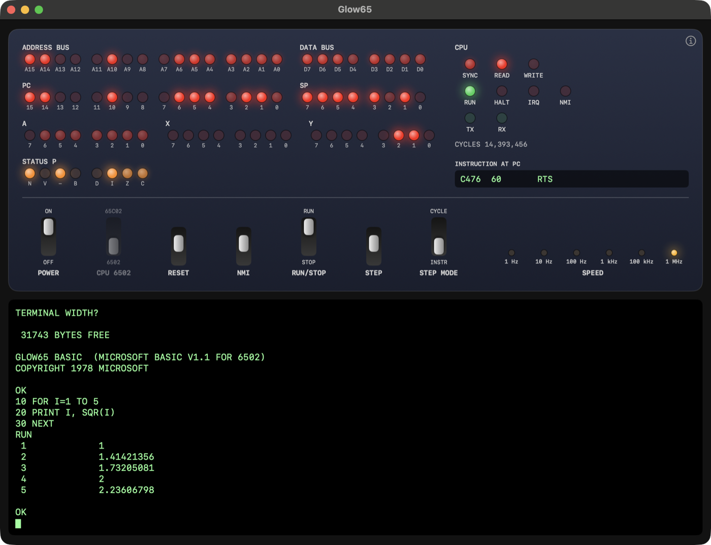
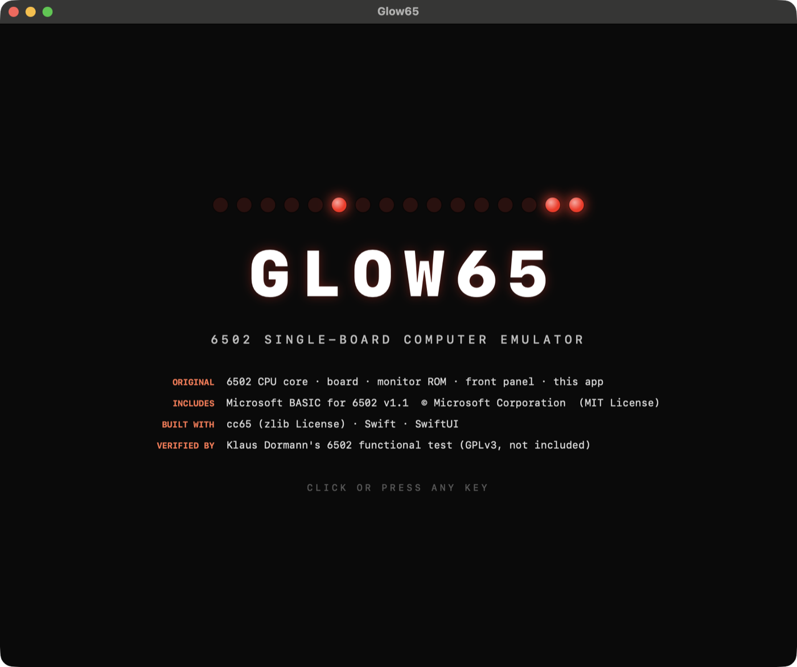

# Glow65

[English](README.md) | **日本語** | [Webサイト](https://masakai.github.io/Glow65/) | [紹介動画](https://masakai.github.io/Glow65/#video)

**6502 の学習用に、CPU の動作がわかるよう、昔のコンピュータのように LED が光る GUI を持ったエミュレータを作成しました。**

macOS 向けの 6502 ワンボードマイコン エミュレータ(Swift 製)です。CPU の動きが見えるフロントパネルを備え、Microsoft BASIC が動きます。

 

<p align="center"></p>

## 概要

Glow65 は、架空の 6502 ボードをエミュレートします。構成は CPU、RAM 32KB、シリアルポート(UART)、小さなモニタと Microsoft BASIC を載せた ROM です。ウインドウは2つの部分でできています。

- **フロントパネル**: アドレスバス、データバス、PC、SP、A、X、Y、ステータスフラグ、バス信号の LED と、PC の位置の命令(逆アセンブルしたもの)の表示。スイッチは POWER、RESET、NMI、RUN/STOP、STEP、STEP MODE、SPEED。
- **端末**: UART につながり、モニタと BASIC を操作します。

パネルは CPU の動きを観察するためのものです。1kHz 以下では、バスアクセスを1つずつ表示します。100kHz 以上では、各ビットが 1 だったアクセスの割合を LED の明るさにするので、昔のパネルの LED の光り方を模した残光が出ます。実機にある余分なダミーリード/ダミーライトは再現していないため、バスの表示は実際の 6502 と少し異なります。

起動バナーには、自作の部分とそうでない部分が表示されます(パネルの (i) ボタンで再表示できます)。

<p align="center"></p>

## 関連リソース

Glow65 は**全体が独自実装ではありません**。

| 部分 | 出どころ |
|---|---|
| 6502 CPU コア、ボード、モニタ ROM、フロントパネル、アプリ、BASIC 変換スクリプト | このプロジェクトのために書いたもの(MIT License) |
| Microsoft BASIC for 6502 v1.1 | Copyright (c) Microsoft Corporation、MIT License。入手元は [microsoft/BASIC-M6502](https://github.com/microsoft/BASIC-M6502) |
| cc65(アセンブラとリンカ) | ROM のビルドに使用。zlib License。同梱しない |
| Klaus Dormann の 6502 機能テスト | CPU の検証に使用。GPLv3。同梱しない |

詳細は [NOTICE.md](NOTICE.md) を参照してください。

## 必要なもの

- macOS 14 以降
- Xcode(Swift 5.9 以降)
- ROM のビルドに [cc65](https://cc65.github.io/): `brew install cc65`
- BASIC ソースの変換に Python 3(標準ライブラリのみ)

## 自作プログラムを動かす

Glow65 は学習用なので、最初に試すのは自作のプログラムです。[チュートリアル](tutorial/README.ja.md)は6章あります。[LED カウンタ](tutorial/README.ja.md)(アセンブルして、またはバイトを手入力して読み込み、実行し、CPU を遅くしてバスアクセスを1つずつ辿る)、[16 ビットの足し算とキャリーフラグ](tutorial/02-addition.ja.md)、[UART で文字を出す](tutorial/03-uart.ja.md)、[キーボードを読むエコー](tutorial/04-echo.ja.md)、[BASIC から機械語を呼ぶ USR](tutorial/05-usr.ja.md)、[割り込み](tutorial/06-interrupts.ja.md)(NMI ボタンと UART 受信 IRQ)です。

## クイックスタート

```bash
git clone https://github.com/Masakai/Glow65.git
cd Glow65

brew install cc65
Tools/build_monitor.sh     # ROM/monitor.bin を生成
Tools/build_basic.sh       # 変換して ROM/basic/build/basic.bin を生成

swift run Glow65App         # フロントパネルのアプリ
```

1. 端末の領域をクリックして、**POWER** スイッチを上げます。モニタが起動します。
2. `B` と入力して Return を押すと、BASIC が起動します。
3. `MEMORY SIZE?` と `TERMINAL WIDTH?` は、Return で既定値になります。

```
GLOW65 BASIC  (MICROSOFT BASIC V1.1 FOR 6502)
COPYRIGHT 1978 MICROSOFT

OK
10 FOR I=1 TO 5
20 PRINT I, SQR(I)
30 NEXT
RUN
```

`basic.bin` がなくても、アプリはモニタだけで起動します。

### コマンドライン版

```bash
swift run glow65-cli                    # リポジトリのルートで実行
swift run glow65-cli --mhz 2            # クロックを変える
swift run glow65-cli --rom file.bin@C000
swift run glow65-cli --load tutorial/counter.bin@0300   # RAM に置くプログラム(電源投入後に読み込む)
swift run glow65-cli --cpu 65c02        # 65C02 として動かす(既定は 6502)
```

`--rom` を指定すると既定の ROM は読み込まれません。必要な ROM をすべて並べてください(例: `ROM/monitor.bin@F000` と `ROM/basic/build/basic.bin@C000`)。終了は Ctrl-\\ です。Ctrl-C はプログラムに渡されます(BASIC の中断に使われます)。

### CPU の種類(6502 / 65C02)

既定では NMOS 6502 として動きます。`glow65-cli` または `Glow65App` に `--cpu 65c02` を渡すと、65C02 として動きます(WDC W65C02S 相当です。基本の 65C02 の命令、Rockwell/WDC 拡張の BBR/BBS/RMB/SMB、WAI/STP を含みます)。`--cpu 6502` が既定です。それ以外の値は、`glow65-cli` が使い方を表示して終了し、`Glow65App` は無視します。

アプリでは、パネルの **CPU** スイッチで切り替えます。POWER が OFF のときだけ操作でき、選んでいる CPU の名前を表示します。モニタの `L` コマンドは、実行時に CPU の種類を判定して(`INC A` を実行して結果を調べます)、65C02 のときだけ 65C02 の命令を表示します(例: `BBR0  $10,$0305`、`LDA   ($12)`)。6502 では、同じバイトが `.BYTE` と表示されます。

65C02 向けのプログラムは、ソースの先頭に `.setcpu "65C02"` と書くと `Tools/assemble.sh` で作れます(ca65 V2.18 で、STZ、BRA、BBR0、RMB7、SMB3、WAI、STP などがアセンブルできることを確認しました)。

## フロントパネル

| 操作 | 動作 |
|---|---|
| POWER | ON で RAM を消去してリセットから開始。OFF で全 LED が消灯 |
| RESET | CPU をリセット。RAM は保持 |
| NMI | マスク不可割り込みを1回かける。モニタは RAM の `$03F8` にあるハンドラのアドレスへ飛ばす |
| RUN/STOP | CPU の停止と再開 |
| STEP | 停止中に、1命令(INSTR)または1バスアクセス(CYCLE)進める |
| STEP MODE | INSTR と CYCLE の切り替え |
| SPEED | 1Hz、10Hz、100Hz、1kHz、100kHz、1MHz |
| CPU | 6502(下)と 65C02(上)の切り替え。POWER が OFF のときだけ操作できる。選んでいる CPU の名前を表示 |
| (i) ボタン | クレジットを表示 |
| INSTRUCTION AT PC | スイッチではなく表示です。PC の位置の命令を、`0302  8D F0 03  STA $03F0` のように出します。アクセスごとの再生中は、再生している命令を示します |

1アクセスずつ表示している間、レジスタの LED は命令を実行する前の値を示します。

HALT LED は、RUN/STOP スイッチが STOP のときに点きます。65C02 では、`WAI` で割り込みを待っている間と、`STP` で停止している間(RESET まで)も点きます。この 2 つの状態でも RUN LED は点いたままです(RUN LED はスイッチに従います)。待機中・停止中の CPU は、1 ステップで 1 サイクルを消費し、バスにはアクセスしません。

自作のプログラムを読み込むには、POWER を入れたあとに **File → Load Program…**(⌘O)を使うか、起動オプション `--load file.bin@0300` を使います。アセンブリから生のバイナリを作るには `Tools/assemble.sh` を使います(cc65 が必要)。

動作確認用に、`Glow65App --power-on --input 'd f000 f00f\r'` は電源を入れて文字列を入力します。`--no-splash` は起動バナーを出しません。`--script "3:poweron;5:input=g 0300\r;10:speed=10"` は、操作を時刻どおりに自動実行します(`poweron`、`poweroff`、`reset`、`run`、`stop`、`step`、`nmi`、`speed=<Hz>`、`mode=cycle|instr`、`input=<文字列>`)。画面収録に便利です。

## メモリマップ

| アドレス | 内容 |
|---|---|
| `$0000-$7FFF` | RAM 32KB |
| `$0200-$027F` | (RAM の中)モニタの行入力バッファ |
| `$0300-$03F7` | (RAM の中)自作プログラム用に空けてある領域 |
| `$03F8-$03F9` | (RAM の中)NMI ハンドラのアドレス(モニタがここ経由で飛ぶ) |
| `$03FA-$03FB` | (RAM の中)IRQ と BRK のハンドラのアドレス(同上) |
| `$0400-$7FFF` | (RAM の中)BASIC のプログラムと変数 |
| `$A000` | UART 状態(bit0: 受信可、bit1: 送信可、bit7: 割り込み要求)/制御(bit7: 受信割り込みの許可) |
| `$A001` | UART データ |
| `$C000-$EFFF` | Microsoft BASIC(約 8.6KB を使用) |
| `$F000-$FFFF` | モニタ ROM とベクタ |

UART は MC6850 風の最小構成です。割り当てのないアドレスは `$FF` を返します。

モニタには固定のジャンプテーブルがあり、BASIC やユーザープログラムから呼べます。

| アドレス | ルーチン |
|---|---|
| `$F000` | CHRIN: 1文字入力(待つ) |
| `$F003` | CHROUT: 1文字出力(bit7 は捨てる) |
| `$F006` | ISCNTC: Ctrl-C が押されていればキャリーを立てて戻る |
| `$F009` | モニタのウォームスタート |
| `$F00C` | GETKEY: 待たずに1文字入力(なければ A=0) |

### モニタのコマンド

| コマンド | 動作 |
|---|---|
| `D aaaa [bbbb]` | メモリダンプ(終了アドレスを省くと 128 バイト) |
| `E aaaa bb bb ...` | バイトを書き込む |
| `L aaaa [bbbb]` | 逆アセンブル(終了アドレスを省くと 16 命令) |
| `G aaaa` | `aaaa` のルーチンを呼ぶ(RTS でモニタに戻る) |
| `B` | BASIC を起動 |
| `?` | ヘルプ |

## BASIC のビルド方法

Microsoft のソースは、1970年代のクロスアセンブラ向け(MACRO-10 構文)で書かれています。`Tools/convert_m6502.py` が ca65 の構文に変換し、`Tools/build_basic.sh` がアセンブルとリンクを行います。変換の基にしたのは原典の OSI 構成で、本ボードと同じ 6850 系 UART を前提にしています。いくつかの定数(ROM アドレス、プログラム領域の開始、UART のアドレス、長いエラーメッセージ、バナー)を差し替えています。一覧はスクリプトの `PATCHES` と、[設計書](documents/designs/2026-10-11-6502-sbc-emulator.md)の第12節にあります。

## テスト

```bash
swift test
```

CPU、ボード、モニタ、フロントパネルの処理、BASIC を試験します。`basic.bin` が未生成の場合、BASIC のテストはスキップされます。

Klaus Dormann の機能テストを実行するには、[Klaus2m5/6502_65C02_functional_tests](https://github.com/Klaus2m5/6502_65C02_functional_tests) の `bin_files/6502_functional_test.bin` を取得して、`Tests/Fixtures/klaus/6502_functional_test.bin` に置きます。ファイルがなければスキップされます。リリースビルドのほうが大幅に速くなります。

```bash
swift test -c release -Xswiftc -enable-testing --filter KlausFunctionalTests
```

CPU コアはこのテストに合格しています(96,241,367 サイクル、10進モードを含む)。

65C02 モードも、Klaus Dormann の 65C02 拡張オペコードテストで同じように検証します。同じリポジトリから `65C02_extended_opcodes_test.bin` と `65C02_extended_opcodes_test.lst`(開始アドレスと成功アドレスを .lst から読みます)を取得して、どちらも `Tests/Fixtures/klaus/` に置きます。ファイルがなければスキップされます。CPU コアはこのテストに合格しています(66,907,084 サイクル、BBR/BBS/RMB/SMB と10進モードを含む)。このテストは10進モードの V フラグを判定しないため、65C02 の 10進モードの V の規則(`CPU6502.adc`)はテストでは確認していません。WAI と STP はこのテストの対象外(Klaus の割り込みテストの担当で、ここでは使いません)で、単体テストだけで確認しています。

## ディレクトリ構成

```
Sources/Core6502/     6502 CPU コアと Bus プロトコル(UI に依存しない)
Sources/Glow65/        ボード: バス、UART、マシン、実行制御、パネルの状態
Sources/glow65-cli/    コマンドライン版
Sources/Glow65App/     SwiftUI アプリ: フロントパネル、端末、起動バナー
ROM/monitor.s         モニタ ROM のソース(ca65)
ROM/basic/            BASIC: 原典、マクロ、リンカ設定
Tools/                ビルドと変換のスクリプト(assemble.sh は自作プログラムのビルド用)
tutorial/             チュートリアル: 6章(LED カウンタ、足し算、UART、エコー、USR、割り込み)とサンプルプログラム
Tests/                単体テストと結合テスト
documents/designs/    設計書(日本語)
```

## 制限事項

- CPU は NMOS 6502(既定)か、WDC W65C02S 相当の 65C02 です。6502 では公式命令だけを実装しており、未定義命令は2サイクルの NOP として動きます。65C02 ではすべてのオペコードが定義されています(未定義だったものは、仕様の長さとサイクル数の NOP です)。ほかの種類(Rockwell 拡張のない 65C02、65816 など)にはできません。
- 65C02 でも、6502 と同じくダミーリード/ダミーライトは再現しません。65C02 の 10進モードの V フラグは NMOS と同じ規則で、Bruce Clark の公開資料の記述とは一致しますが、実機との照合はしていません。
- ダミーリード/ダミーライト(インデックスがページを跨ぐときの余分な読み出しなど)は再現していません。そのため、サイクル単位のバス表示は実機と少し異なります。
- 割り込み源は NMI ボタンと UART の受信割り込みだけです。割り込みの受け付けは、実機の 7 サイクルではなく5つのバスアクセスで表示されます(ダミーリードは再現しません)。
- BASIC の `SAVE` と `LOAD` は使えません。
- BASIC の全機能は試験していません(`GET`、`WAIT`、`USR`、`ON GOTO` など)。

## ライセンス

このプロジェクトのために書いたコードは MIT License です。[LICENSE](LICENSE) を参照してください。`ROM/basic/upstream/` の Microsoft BASIC には、別の MIT License が付いています。[NOTICE.md](NOTICE.md) を参照してください。
