# Chapter 4 Addressing Modes

[English](04-addressing.md) | [日本語](../ja/04-addressing.md)

[← 3. Inside the CPU](03-cpu.md)

The operand of an instruction decides which value in memory the instruction works on. The way it decides is called the **addressing mode**. The 6502 has 13 modes.

This chapter explains, for each mode, how it is written, how many bytes it takes, and how the effective address is found, using diagrams.

## 4.1 What Is an Addressing Mode

Even for the same `LDA` (the instruction that loads a value into the A register), a different mode means a different action and a different number of bytes. As seen in section 3.5 of Chapter 3, the opcode determines the length of an instruction. The mode is part of the opcode.

| Notation | Mode | Opcode | Bytes |
|---|---|---|---|
| `LDA #$10` | Immediate | `A9` | 2 |
| `LDA $10` | Zero page | `A5` | 2 |
| `LDA $10,X` | Zero page,X | `B5` | 2 |
| `LDA $0400` | Absolute | `AD` | 3 |
| `LDA $0410,X` | Absolute,X | `BD` | 3 |
| `LDA $0420,Y` | Absolute,Y | `B9` | 3 |
| `LDA ($20,X)` | Indexed indirect | `A1` | 2 |
| `LDA ($30),Y` | Indirect indexed | `B1` | 2 |

The address in memory that the operand points to is called the **effective address**. The CPU first works out the effective address, then reads or writes that address. The difference between addressing modes is the difference in how the effective address is found.

### How to Read the Diagrams

All the diagrams in this chapter are built from the same parts.

- Top row: the bytes of the instruction. The leftmost is the opcode, and the blue boxes are the operand.
- Left: the registers. The orange box is the register that receives the result.
- White box in the center: the calculation that finds the effective address.
- Right: memory. Addresses and contents are lined up, and the blue box is the target byte.
- Arrow numbers: the order of the steps the CPU takes. The orange arrow shows the result going into a register.

### The Form of the Examples

The examples in this chapter all have the same form. The result of the instruction is written to memory with `STA $03F0`, and `RTS` returns to the monitor. You run it with `G 0300` and read the value of `$03F0` with `D 03F0 03F0`. `D` shows 16 bytes at a time, so the first byte of the line is the result. The following `24 F4 24 F4` are the monitor's interrupt vectors.

The program is placed at `$0300`. Data is written to RAM with `E`.

> **What you can try in Glow65**
>
> If you write the following bytes at `$0300` and read them with `L`, the notation of each mode is shown as it is.
>
> ```
> *E 0300 E8 0A A9 10 A5 10 B5 10 B6 10 AD 00 04 BD 10 04 B9 20 04 6C 30 04 A1 20 B1 30 D0 FE
> *L 0300 0319
> 0300  E8        INX
> 0301  0A        ASL   A
> 0302  A9 10     LDA   #$10
> 0304  A5 10     LDA   $10
> 0306  B5 10     LDA   $10,X
> 0308  B6 10     LDX   $10,Y
> 030A  AD 00 04  LDA   $0400
> 030D  BD 10 04  LDA   $0410,X
> 0310  B9 20 04  LDA   $0420,Y
> 0313  6C 30 04  JMP   ($0430)
> 0316  A1 20     LDA   ($20,X)
> 0318  B1 30     LDA   ($30),Y
> ```

## 4.2 Modes Without an Operand

### Implied

These instructions have no operand, only an opcode. The name of the instruction already contains its target (a register or a flag). Examples are `INX` (add 1 to X), `TAX`, and `CLC`. The length is 1 byte.

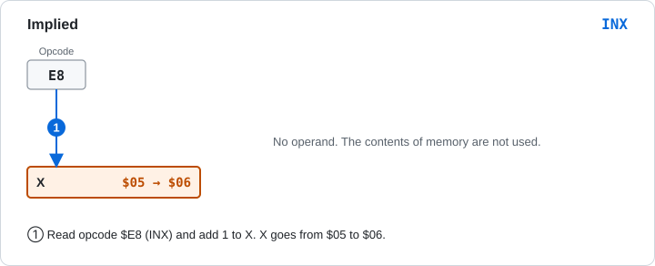

Figure 4-1 Implied (`INX`). The contents of memory are not used.

> **What you can try in Glow65**
>
> ```
> *E 0300 A2 05 E8 8E F0 03 60
> *G 0300
> *D 03F0 03F0
> 03F0: 06 00 00 00 00 00 00 00 24 F4 24 F4 00 00 00 00
> ```
>
> `LDX #$05` makes X 5, and `INX` makes it 6.

### Accumulator

The target of the operation is the A register itself. Four instructions have this mode: `ASL A` (shift left by 1 bit), `LSR A`, `ROL A`, and `ROR A` (the 65C02 adds `INC A` and `DEC A`). The length is 1 byte.

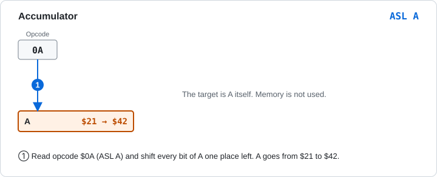

Figure 4-2 Accumulator (`ASL A`).

> **What you can try in Glow65**
>
> ```
> *E 0300 A9 21 0A 8D F0 03 60
> *G 0300
> *D 03F0 03F0
> 03F0: 42 00 00 00 00 00 00 00 24 F4 24 F4 00 00 00 00
> ```
>
> Shifting `$21` (`%00100001`) left by 1 bit gives `$42` (`%01000010`).

## 4.3 Immediate

The value in the operand is used as it is. It is not a memory address. You write it with `#` in front of the value.

| Item | Content |
|---|---|
| Notation | `LDA #$10` |
| Machine code | `A9 10` |
| Bytes | 2 |
| Effective address | None. The operand is the value itself |

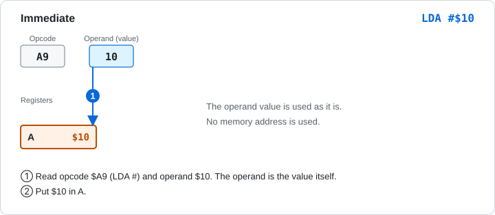

Figure 4-3 Immediate (`LDA #$10`).

`LDA #$10` means "put the value `$10` into A", and `LDA $10` means "put the contents of address `$0010` into A". The meaning changes depending on whether `#` is there.

> **What you can try in Glow65**
>
> ```
> *E 0300 A9 10 8D F0 03 60
> *G 0300
> *D 03F0 03F0
> 03F0: 10 00 00 00 00 00 00 00 24 F4 24 F4 00 00 00 00
> ```

## 4.4 Zero Page Modes

The zero page (the first 256 bytes, `$0000-$00FF`) can be specified with a 1-byte operand. This makes instructions shorter and faster to execute.

### Zero Page

| Item | Content |
|---|---|
| Notation | `LDA $10` |
| Machine code | `A5 10` |
| Bytes | 2 |
| Effective address | `$0010` (the high byte is `$00`) |

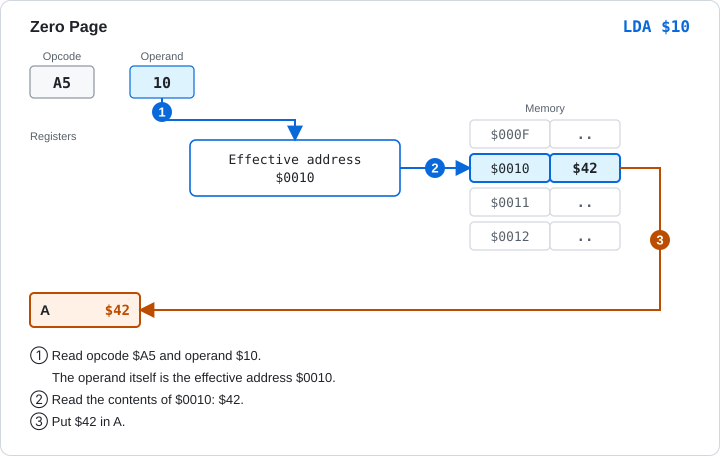

Figure 4-4 Zero page (`LDA $10`).

> **What you can try in Glow65**
>
> ```
> *E 0010 42
> *E 0300 A5 10 8D F0 03 60
> *G 0300
> *D 03F0 03F0
> 03F0: 42 00 00 00 00 00 00 00 24 F4 24 F4 00 00 00 00
> ```

### Zero Page,X

The address used is the operand plus the value of X. It is used, for example, to read data lined up like an array, one item after another.

| Item | Content |
|---|---|
| Notation | `LDA $10,X` |
| Machine code | `B5 10` |
| Bytes | 2 |
| Effective address | Operand + X. The result is the remainder after dividing by 256 (if it goes past `$FF`, it wraps around to `$00`) |

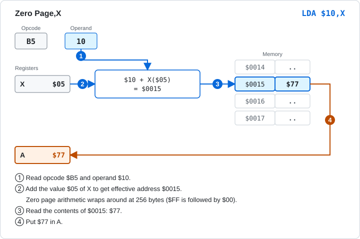

Figure 4-5 Zero page,X (`LDA $10,X`). When X is `$05`, it reads `$0015`.

The result of the calculation stays inside the zero page. For `LDA $FF,X` with X equal to `$02`, the effective address is `$0001`, not `$0101`. If the sum goes past `$FF`, counting starts again from `$00`[1].

> **What you can try in Glow65**
>
> ```
> *E 0015 77
> *E 0300 A2 05 B5 10 8D F0 03 60
> *G 0300
> *D 03F0 03F0
> 03F0: 77 00 00 00 00 00 00 00 24 F4 24 F4 00 00 00 00
> ```
>
> You can check the wrap-around as follows. `LDA $FF,X` reads `$0001`, while the absolute,X `LDA $00FF,X` (whose second byte is `$00`) reads `$0101`.
>
> ```
> *E 0001 7B
> *E 0101 3D
> *E 0300 A2 02 B5 FF 8D F0 03 60
> *G 0300
> *D 03F0 03F0
> 03F0: 7B 00 00 00 00 00 00 00 24 F4 24 F4 00 00 00 00
> *E 0300 A2 02 BD FF 00 8D F0 03 60
> *G 0300
> *D 03F0 03F0
> 03F0: 3D 00 00 00 00 00 00 00 24 F4 24 F4 00 00 00 00
> ```

### Zero Page,Y

This works like zero page,X, except that the register added is Y. Only `LDX` and `STX` have this mode.

| Item | Content |
|---|---|
| Notation | `LDX $10,Y` |
| Machine code | `B6 10` |
| Bytes | 2 |
| Effective address | Operand + Y. Wraps around at 256 |

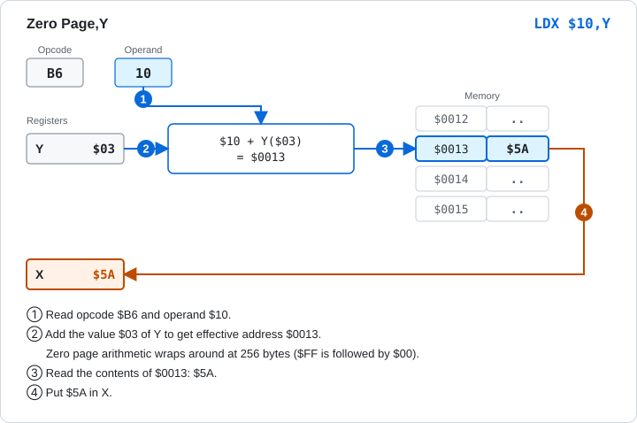

Figure 4-6 Zero page,Y (`LDX $10,Y`). The result goes into X.

> **What you can try in Glow65**
>
> ```
> *E 0013 5A
> *E 0300 A0 03 B6 10 8E F0 03 60
> *G 0300
> *D 03F0 03F0
> 03F0: 5A 00 00 00 00 00 00 00 24 F4 24 F4 00 00 00 00
> ```

## 4.5 Absolute Modes

Any address in the 64 KB can be specified with a 2-byte operand. The operand is little-endian (low byte first).

### Absolute

| Item | Content |
|---|---|
| Notation | `LDA $0400` |
| Machine code | `AD 00 04` |
| Bytes | 3 |
| Effective address | The 2 bytes of the operand (`$0400`) |

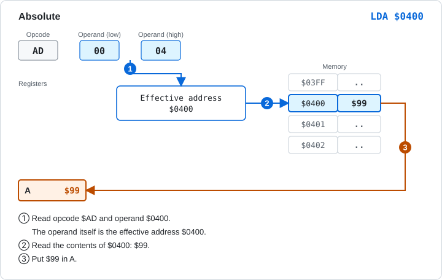

Figure 4-7 Absolute (`LDA $0400`).

> **What you can try in Glow65**
>
> ```
> *E 0400 99
> *E 0300 AD 00 04 8D F0 03 60
> *G 0300
> *D 03F0 03F0
> 03F0: 99 00 00 00 00 00 00 00 24 F4 24 F4 00 00 00 00
> ```

### Absolute,X

The address used is the 2-byte operand plus the value of X.

| Item | Content |
|---|---|
| Notation | `LDA $0410,X` |
| Machine code | `BD 10 04` |
| Bytes | 3 |
| Effective address | Operand + X (a 16-bit addition) |


Figure 4-8 Absolute,X (`LDA $0410,X`).

When the sum lands on a different page from the original address (an address with a different high byte), this is called **crossing a page**. For `LDA $04FF,X` with X equal to `$01`, the effective address is `$0500`, which crosses a page. On a real 6502, a read instruction such as `LDA` takes 1 extra cycle when it crosses a page[1]. A write instruction such as `STA` always takes the longer cycle count, even when it does not cross a page.

> **What you can try in Glow65**
>
> ```
> *E 0415 C3
> *E 0300 A2 05 BD 10 04 8D F0 03 60
> *G 0300
> *D 03F0 03F0
> 03F0: C3 00 00 00 00 00 00 00 24 F4 24 F4 00 00 00 00
> ```
>
> The value read is found in the same way when a page is crossed.
>
> ```
> *E 0500 5E
> *E 0300 A2 01 BD FF 04 8D F0 03 60
> *G 0300
> *D 03F0 03F0
> 03F0: 5E 00 00 00 00 00 00 00 24 F4 24 F4 00 00 00 00
> ```

### Absolute,Y

This works like absolute,X, except that the register added is Y.

| Item | Content |
|---|---|
| Notation | `LDA $0420,Y` |
| Machine code | `B9 20 04` |
| Bytes | 3 |
| Effective address | Operand + Y |

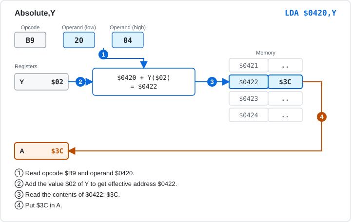

Figure 4-9 Absolute,Y (`LDA $0420,Y`).

> **What you can try in Glow65**
>
> ```
> *E 0422 3C
> *E 0300 A0 02 B9 20 04 8D F0 03 60
> *G 0300
> *D 03F0 03F0
> 03F0: 3C 00 00 00 00 00 00 00 24 F4 24 F4 00 00 00 00
> ```

## 4.6 Indirect

The 2 bytes stored at the address in the operand are used as the jump target. Only `JMP` has this mode.

| Item | Content |
|---|---|
| Notation | `JMP ($0430)` |
| Machine code | `6C 30 04` |
| Bytes | 3 |
| Jump target | The byte at `$0430` is the low byte, and the byte at `$0431` is the high byte |

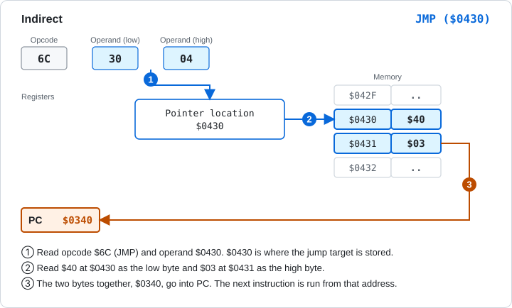

Figure 4-10 Indirect (`JMP ($0430)`). The result goes into the PC.

The NMOS 6502 has a quirk in this mode. It appears when the pointer is at the last byte of a page (`$xxFF`). The high byte is read not from the start of the next page but from **the start of the same page**. For `JMP ($04FF)`, the low byte is read from `$04FF` and the high byte from `$0400`, not from `$0500`. The 65C02 has fixed this quirk.

> **What you can try in Glow65**
>
> ```
> *E 0430 40 03
> *E 0340 A9 AB 8D F0 03 60
> *E 0300 6C 30 04
> *G 0300
> *D 03F0 03F0
> 03F0: AB 00 00 00 00 00 00 00 24 F4 24 F4 00 00 00 00
> ```
>
> The program starting at `$0340` writes `$AB`.
>
> You can check the quirk at the last byte of a page as follows. Put `40` at `$04FF`, `05` at `$0500`, and `03` at `$0400`. If the high byte is read from `$0500`, the jump goes to `$0540`. If it is read from `$0400`, the jump goes to `$0340`.
>
> ```
> *E 04FF 40
> *E 0500 05
> *E 0400 03
> *E 0340 A9 AB 8D F0 03 60
> *E 0540 A9 CD 8D F0 03 60
> *E 0300 6C FF 04
> *G 0300
> *D 03F0 03F0
> 03F0: AB 00 00 00 00 00 00 00 24 F4 24 F4 00 00 00 00
> ```
>
> With the default NMOS 6502, the jump goes to `$0340` and `AB` is written. If you do the same with `glow65-cli --cpu 65c02`, the jump goes to `$0540` and `CD` is written.

## 4.7 Indexed Indirect

You place a table of addresses (2 bytes each) in the zero page. The instruction takes the X-th address from the table and uses the contents of that address. It is written `(zp,X)`.

| Item | Content |
|---|---|
| Notation | `LDA ($20,X)` |
| Machine code | `A1 20` |
| Bytes | 2 |
| Effective address | The 2 bytes (low byte first) at `$20 + X` in the zero page. The sum wraps around at 256 |

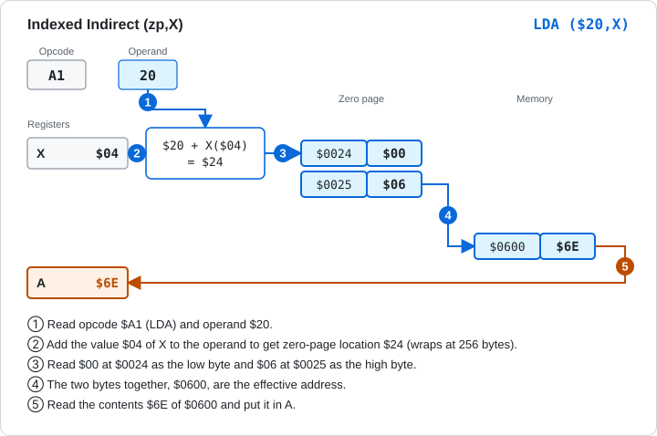

Figure 4-11 Indexed indirect (`LDA ($20,X)`). The address `$0600` is stored in zero page `$0024` and `$0025`.

X selects which entry of the table to use. An address is 2 bytes, so X is increased in steps of 2.

> **What you can try in Glow65**
>
> ```
> *E 0024 00 06
> *E 0600 6E
> *E 0300 A2 04 A1 20 8D F0 03 60
> *G 0300
> *D 03F0 03F0
> 03F0: 6E 00 00 00 00 00 00 00 24 F4 24 F4 00 00 00 00
> ```

## 4.8 Indirect Indexed

The 2-byte address in the zero page is the base, and the value of Y is added to it. It is written `(zp),Y`. You can use it by putting the start address of an array in memory into the zero page and choosing an element with Y.

| Item | Content |
|---|---|
| Notation | `LDA ($30),Y` |
| Machine code | `B1 30` |
| Bytes | 2 |
| Effective address | The 2 bytes (low byte first) at `$30` in the zero page are the base address, and Y is added to it |

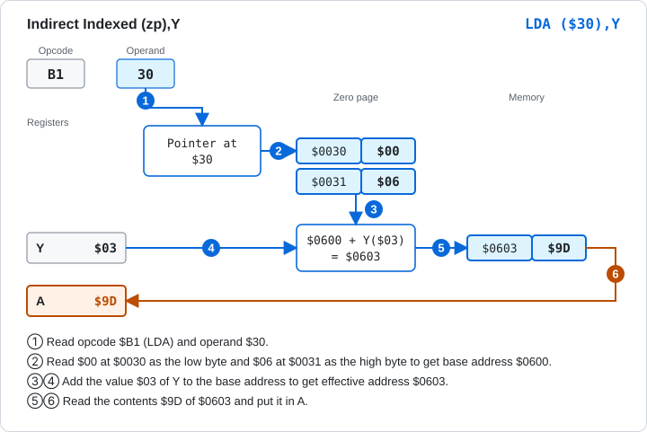

Figure 4-12 Indirect indexed (`LDA ($30),Y`). Y (`$03`) is added to the base address `$0600`.

When adding Y to the base address lands on a different page, a real 6502 takes 1 extra cycle[1].

> **What you can try in Glow65**
>
> ```
> *E 0030 00 06
> *E 0603 9D
> *E 0300 A0 03 B1 30 8D F0 03 60
> *G 0300
> *D 03F0 03F0
> 03F0: 9D 00 00 00 00 00 00 00 24 F4 24 F4 00 00 00 00
> ```

## 4.9 Relative

This is the mode used by branch instructions (`BNE`, `BEQ`, `BCC`, and others). The operand is a signed 1-byte value that gives the **distance from the address of the next instruction**. The range is -128 to +127. A negative number is written in two's complement, as in Chapter 2.

| Item | Content |
|---|---|
| Notation | `BNE $0306` (the assembler calculates the distance) |
| Machine code | `D0 02` |
| Bytes | 2 |
| Jump target | The PC after the instruction has been read + the distance |

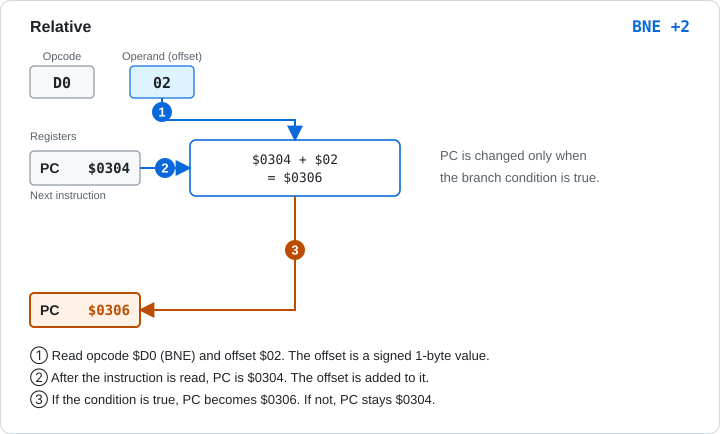

Figure 4-13 Relative (`BNE`). With a distance of `$02`, the jump target is `$0306`.

The distance is measured not from the start of the instruction but from the position after the instruction has been read. `D0 02` is a 2-byte instruction, so if it is at `$0302`, the PC after reading it is `$0304`. If the distance is `$FB` (-5), going back 5 from `$0304` gives `$02FF`.

If the condition does not hold, the CPU does not branch and goes on to the next instruction. The cycles needed are 2 when the condition does not hold, 3 when it holds, and 4 when it holds and the jump goes to another page.

> **What you can try in Glow65**
>
> ```
> *E 0300 A9 01 D0 02 A9 EE 8D F0 03 60
> *L 0300 0309
> 0300  A9 01     LDA   #$01
> 0302  D0 02     BNE   $0306
> 0304  A9 EE     LDA   #$EE
> 0306  8D F0 03  STA   $03F0
> 0309  60        RTS
> *G 0300
> *D 03F0 03F0
> 03F0: 01 00 00 00 00 00 00 00 24 F4 24 F4 00 00 00 00
> ```
>
> After `LDA #$01`, the Z flag is 0. `BNE` branches, skips `LDA #$EE`, and goes to `$0306`. `01` is written to `$03F0`.
>
> A branch can also go backward. In `BNE $0302`, the distance is `$FD` (-3).
>
> ```
> *E 0300 A2 03 CA D0 FD 8E F0 03 60
> *L 0300 0308
> 0300  A2 03     LDX   #$03
> 0302  CA        DEX
> 0303  D0 FD     BNE   $0302
> 0305  8E F0 03  STX   $03F0
> 0308  60        RTS
> ```
>
> `DEX` decreases X by 1 each time, and the program goes back to `$0302` until X becomes 0.

## 4.10 Summary of All Modes

The cycle counts are those of a typical instruction that has the mode, such as `LDA`. A `+` means 1 more cycle when a read instruction crosses a page.

| Mode | Notation | Bytes | Cycles | Example |
|---|---|---|---|---|
| Implied | (none) | 1 | 2 | `INX` |
| Accumulator | `A` | 1 | 2 | `ASL A` |
| Immediate | `#$nn` | 2 | 2 | `LDA #$10` |
| Zero page | `$nn` | 2 | 3 | `LDA $10` |
| Zero page,X | `$nn,X` | 2 | 4 | `LDA $10,X` |
| Zero page,Y | `$nn,Y` | 2 | 4 | `LDX $10,Y` |
| Absolute | `$nnnn` | 3 | 4 | `LDA $0400` |
| Absolute,X | `$nnnn,X` | 3 | 4 + | `LDA $0410,X` |
| Absolute,Y | `$nnnn,Y` | 3 | 4 + | `LDA $0420,Y` |
| Indirect | `($nnnn)` | 3 | 5 | `JMP ($0430)` |
| Indexed indirect | `($nn,X)` | 2 | 6 | `LDA ($20,X)` |
| Indirect indexed | `($nn),Y` | 2 | 5 + | `LDA ($30),Y` |
| Relative | `$nnnn` | 2 | 2 (3 if taken, 4 if taken to another page) | `BNE $0306` |

For instructions other than `LDA`, the cycle count can differ. For example, `STA $0410,X` takes 5 cycles, whether or not it crosses a page. The cycle count of each instruction is collected in the instruction reference in Chapter 5.

## 4.11 Modes Added by the 65C02

The 65C02 adds the following modes and instructions. This includes cases where an instruction that already existed on the 6502, such as `BIT` or `INC`, gets a new mode.

| Mode | Notation | Bytes | Example |
|---|---|---|---|
| Zero page indirect | `($nn)` | 2 | `LDA ($12)` |
| Absolute,X indirect | `($nnnn,X)` | 3 | `JMP ($1234,X)` |
| Zero page,X (new instruction) | `$nn,X` | 2 | `BIT $10,X` |
| Immediate (new instruction) | `#$nn` | 2 | `BIT #$10` |
| Accumulator (new instruction) | `A` | 1 | `INC A` |
| Relative (new instruction) | `$nnnn` | 2 | `BRA $0309` |
| Zero page relative | `$nn,$nnnn` | 3 | `BBR0 $10,$030C` |

`BRA` is an instruction that always branches. `BBR0` branches when bit 0 of the zero page value is 0. In Glow65 you can switch to the 65C02 with the CPU switch on the panel (or the startup option `--cpu 65c02`). On the 65C02, the monitor's `L` displays these instructions.

> **What you can try in Glow65**
>
> ```
> glow65-cli --cpu 65c02
> *E 0300 B2 12 7C 34 12 34 10 89 10 80 FE 0F 10 FE 1A
> *L 0300 030E
> 0300  B2 12     LDA   ($12)
> 0302  7C 34 12  JMP   ($1234,X)
> 0305  34 10     BIT   $10,X
> 0307  89 10     BIT   #$10
> 0309  80 FE     BRA   $0309
> 030B  0F 10 FE  BBR0  $10,$030C
> 030E  1A        INC   A
> ```

## 4.12 Practice Problems

The answers and explanations are in the next section.

**Problem 1** Give the addressing mode of each instruction. (1) `STA $0300,X` (2) `LDX $20,Y` (3) `JMP ($0430)` (4) `LDA ($20,X)` (5) `LDA #$05`

**Problem 2** Give the length (in bytes) of each instruction. (1) `LDA $0410,X` (2) `LDA ($20),Y` (3) `INX` (4) `BNE $0306` (5) `LDA #$05`

**Problem 3** When X is `$05`, which address does `LDA $10,X` read?

**Problem 4** When X is `$20`, which address does `LDA $F0,X` (zero page,X) read? Which address does `LDA $00F0,X` (absolute,X) read?

**Problem 5** When Y is `$FF`, which address does `LDA $0420,Y` read? Does it cross a page?

**Problem 6** Zero page `$0042` contains `00` and `$0043` contains `07`. When X is `$02`, which address does `LDA ($40,X)` read?

**Problem 7** Zero page `$0050` contains `FF` and `$0051` contains `05`. When Y is `$01`, which address does `LDA ($50),Y` read? Does it cross a page?

**Problem 8** Where does the `BNE` (`D0 F0`) at `$0310` jump to?

**Problem 9** `$06FF` contains `50`, `$0700` contains `05`, and `$0600` contains `04`. Where does `JMP ($06FF)` jump to on the NMOS 6502 and on the 65C02?

## 4.13 Answers and Explanations

**Problem 1** (1) Absolute,X (2) Zero page,Y (3) Indirect (4) Indexed indirect (5) Immediate
- (1) A 2-byte address followed by `,X`. (2) A 1-byte address followed by `,Y`. This is a mode that `LDX` has. (3) A mode only `JMP` has, and the value in parentheses is an address. (4) `,X` inside the parentheses is `(zp,X)`. (5) `#` means the value itself.

**Problem 2** (1) 3 bytes (2) 2 bytes (3) 1 byte (4) 2 bytes (5) 2 bytes
- (1) The opcode and a 2-byte address. (2) The opcode and 1 zero page byte. (3) No operand. (4) A branch has 1 byte for the distance. (5) The opcode and 1 byte for the value.

**Problem 3** `$0015`
- `$10 + $05 = $15`. The high byte is `$00`.

**Problem 4** Zero page,X reads `$0010`. Absolute,X reads `$0110`.
- Zero page,X wraps `$F0 + $20 = $110` at 256 and gets `$10`. Absolute,X does not wrap: `$00F0 + $20 = $0110`.

**Problem 5** `$051F`. It crosses a page.
- `$0420 + $FF = $051F`. The high byte changes from `$04` to `$05`.

**Problem 6** `$0700`
- `$40 + $02 = $42`. `00` at `$0042` is the low byte and `07` at `$0043` is the high byte, giving `$0700`.

**Problem 7** `$0600`. It crosses a page.
- The base address is `FF` at `$0050` (low byte) and `05` at `$0051` (high byte), which is `$05FF`. Adding Y gives `$0600`. The high byte changes from `$05` to `$06`.

**Problem 8** `$0302`
- `BNE` is a 2-byte instruction, so the PC after reading it is `$0312`. `$F0` is -16. `$0312 - 16 = $0302`.

**Problem 9** `$0450` on the NMOS 6502, `$0550` on the 65C02.
- The NMOS reads the low byte from `$06FF` (`50`) and the high byte from the start of the same page, `$0600` (`04`), giving `$0450`. The 65C02 reads the high byte from `$0700` (`05`), giving `$0550`.

## Sources

1. MOS Technology, "MCS6500 Microcomputer Family Hardware Manual", January 1976 edition: https://www.commodore.ca/wp-content/uploads/2018/11/kim1_hardware.txt

Next chapter: [5. Instruction Reference →](05-reference.md)
