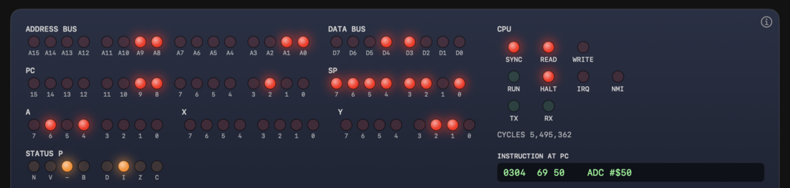
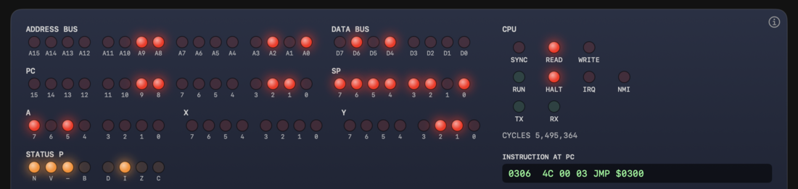

# 5.3 Arithmetic and Comparison

[English](05-3-arithmetic.md) | [日本語](../ja/05-3-arithmetic.md)

[← 5.2 Register Transfer](05-2-transfer.md) &nbsp;·&nbsp; [5.4 Logic, Shift, and Bit Test →](05-4-logic-shift.md) &nbsp;·&nbsp; [Chapter start](05-reference.md)

This group covers addition, subtraction, comparison, and adding or subtracting 1. ADC and SBC use C (carry) in the calculation. Set C before them: CLC before ADC, and SEC before SBC.

CMP, CPX, and CPY discard the result of a subtraction and change only the flags. Read the result from C (greater than or equal), Z (equal), and N.

<a id="adc"></a>

### ADC (Add with Carry)

Adds the memory value and C to A, and puts the result in A. If the result exceeds `$FF`, C becomes 1. N, V, and Z also change.

**Flags affected**

<!-- flags:ADC -->
| N | V | D | I | Z | C |
|---|---|---|---|---|---|
| ○ | ○ | - | - | ○ | ○ |
<!-- /flags:ADC -->

**Opcodes**

<!-- opcodes:ADC -->
| Addressing mode | Syntax | Opcode | Bytes | Cycles |
|---|---|---|---|---|
| Immediate | `ADC #$nn` | `$69` | 2 | 2 |
| Zero page | `ADC $nn` | `$65` | 2 | 3 |
| Zero page,X | `ADC $nn,X` | `$75` | 2 | 4 |
| Absolute | `ADC $nnnn` | `$6D` | 3 | 4 |
| Absolute,X | `ADC $nnnn,X` | `$7D` | 3 | 4+ |
| Absolute,Y | `ADC $nnnn,Y` | `$79` | 3 | 4+ |
| Indexed indirect `(zp,X)` | `ADC ($nn,X)` | `$61` | 2 | 6 |
| Indirect indexed `(zp),Y` | `ADC ($nn),Y` | `$71` | 2 | 5+ |
<!-- /opcodes:ADC -->

**Examples**

```
        CLC
        LDA #$50
        ADC #$50
```

`$50 + $50 = $A0`. As signed numbers, 80 + 80 is outside the range (-128 to 127), so V becomes 1. N is also 1.

```
        CLC
        LDA #$FF
        ADC #$01
```

`$FF + $01` does not fit in 8 bits. A becomes `$00`, C becomes 1, and Z becomes 1.

```
        SEC
        LDA #$01
        ADC #$01
```

With C at 1, `1 + 1 + 1` makes A `$03`.

Before: memory from `$0400` holds `FF 12 01 00`.

```
        CLC
        LDA $0400
        ADC $0402
        STA $0404
        LDA $0401
        ADC $0403
        STA $0405
```

This is a 16-bit addition. It adds `$12FF + $0001`, starting from the low byte. The carry out of the low byte stays in C, and the ADC on the high byte picks it up. The result `$1300` is written to `$0404` (low byte) and `$0405` (high byte).

**V flag**: When the operands are treated as signed numbers, V becomes 1 if the result is outside -128 to 127. In other words, V becomes 1 when two numbers with the same sign are added and the sign of the result differs.

**Decimal mode**: When D is 1, ADC adds in BCD (a format that treats each 4 bits as a digit from 0 to 9). `$09 + $01` gives `$10`, not `$0A`. C shows the decimal carry. On the NMOS 6502, N, V, and Z in decimal mode may not match the value of the result. When you finish using decimal mode, return to normal with CLD.

<a id="sbc"></a>

> **What you can try in Glow65**
>
> The panel shows the V flag changing. Enter `E 0300 B8 A9 50 18 69 50 4C 00 03`, run `G 0300`, then set **RUN/STOP** to STOP and **STEP MODE** to INSTR. The program repeats `CLV`, `LDA #$50`, `CLC`, `ADC #$50`, and `JMP $0300`.
>
> Right after `CLC`, A is `$50` (A6 and A4 are lit), and N and V are off (Figure 5-7). After `ADC #$50`, A is `$A0` (A7 and A5), and N and V are lit (Figure 5-8). As signed numbers, the sum of two positive numbers (80 + 80) became a negative number (-96), so V is 1. C stays 0.
>
> 
>
> Figure 5-7 After `CLC`. A is `$50` and V is off
>
> 
>
> Figure 5-8 After `ADC #$50`. A is `$A0`, and N and V are lit

### SBC (Subtract with Carry)

Subtracts the memory value and the borrow from A, and puts the result in A. The borrow is the inverse of C: if C is 1 there is no borrow, and if C is 0 there is a borrow. Set C to 1 with SEC before a subtraction.

**Flags affected**

<!-- flags:SBC -->
| N | V | D | I | Z | C |
|---|---|---|---|---|---|
| ○ | ○ | - | - | ○ | ○ |
<!-- /flags:SBC -->

**Opcodes**

<!-- opcodes:SBC -->
| Addressing mode | Syntax | Opcode | Bytes | Cycles |
|---|---|---|---|---|
| Immediate | `SBC #$nn` | `$E9` | 2 | 2 |
| Zero page | `SBC $nn` | `$E5` | 2 | 3 |
| Zero page,X | `SBC $nn,X` | `$F5` | 2 | 4 |
| Absolute | `SBC $nnnn` | `$ED` | 3 | 4 |
| Absolute,X | `SBC $nnnn,X` | `$FD` | 3 | 4+ |
| Absolute,Y | `SBC $nnnn,Y` | `$F9` | 3 | 4+ |
| Indexed indirect `(zp,X)` | `SBC ($nn,X)` | `$E1` | 2 | 6 |
| Indirect indexed `(zp),Y` | `SBC ($nn),Y` | `$F1` | 2 | 5+ |
<!-- /opcodes:SBC -->

**Examples**

```
        SEC
        LDA #$50
        SBC #$30
```

After `SEC`, `$50 - $30 = $20`. The result is not negative, so C stays 1.

```
        SEC
        LDA #$30
        SBC #$50
```

`$30 - $50` is negative. A becomes `$E0` (-32), C becomes 0 (a borrow occurred), and N becomes 1.

```
        SEC
        LDA #$50
        SBC #$B0
```

`$50 - $B0` is 80 - (-80) = 160 as signed numbers, which is out of range. V becomes 1.

**Decimal mode**: When D is 1, SBC also subtracts in BCD. After `SED`, `SEC`, and `LDA #$10`, running `SBC #$01` makes A `$09`. C stays 1 if there is no borrow.

<a id="cmp"></a>

### CMP (Compare Accumulator)

Compares A with a memory value. It calculates A minus the value, discards the result, and changes only the flags. A does not change. C becomes 1 if A is greater than or equal to the value, Z becomes 1 if they are equal, and N takes the most significant bit of the result.

**Flags affected**

<!-- flags:CMP -->
| N | V | D | I | Z | C |
|---|---|---|---|---|---|
| ○ | - | - | - | ○ | ○ |
<!-- /flags:CMP -->

**Opcodes**

<!-- opcodes:CMP -->
| Addressing mode | Syntax | Opcode | Bytes | Cycles |
|---|---|---|---|---|
| Immediate | `CMP #$nn` | `$C9` | 2 | 2 |
| Zero page | `CMP $nn` | `$C5` | 2 | 3 |
| Zero page,X | `CMP $nn,X` | `$D5` | 2 | 4 |
| Absolute | `CMP $nnnn` | `$CD` | 3 | 4 |
| Absolute,X | `CMP $nnnn,X` | `$DD` | 3 | 4+ |
| Absolute,Y | `CMP $nnnn,Y` | `$D9` | 3 | 4+ |
| Indexed indirect `(zp,X)` | `CMP ($nn,X)` | `$C1` | 2 | 6 |
| Indirect indexed `(zp),Y` | `CMP ($nn),Y` | `$D1` | 2 | 5+ |
<!-- /opcodes:CMP -->

**Examples**

```
        LDA #$30
        CMP #$30
```

When A equals the value, Z becomes 1 and C becomes 1.

```
        LDA #$30
        CMP #$40
```

When A is less than the value, C becomes 0. The result is negative, so N is 1.

```
        LDA #$30
        CMP #$20
```

When A is greater than the value, C becomes 1 and Z becomes 0.

After a comparison, branch with BEQ (equal), BNE (not equal), BCS (greater than or equal), or BCC (less than). The comparison treats the numbers as unsigned.

<a id="cpx"></a>

### CPX (Compare X Register)

Compares X with a memory value. C, Z, and N change by the same rules as CMP. X does not change.

**Flags affected**

<!-- flags:CPX -->
| N | V | D | I | Z | C |
|---|---|---|---|---|---|
| ○ | - | - | - | ○ | ○ |
<!-- /flags:CPX -->

**Opcodes**

<!-- opcodes:CPX -->
| Addressing mode | Syntax | Opcode | Bytes | Cycles |
|---|---|---|---|---|
| Immediate | `CPX #$nn` | `$E0` | 2 | 2 |
| Zero page | `CPX $nn` | `$E4` | 2 | 3 |
| Absolute | `CPX $nnnn` | `$EC` | 3 | 4 |
<!-- /opcodes:CPX -->

**Examples**

```
        LDX #$10
        CPX #$20
```

X is `$10` and the value is `$20`, so C becomes 0 and N becomes 1.

<a id="cpy"></a>

### CPY (Compare Y Register)

Compares Y with a memory value. C, Z, and N change by the same rules as CMP. Y does not change.

**Flags affected**

<!-- flags:CPY -->
| N | V | D | I | Z | C |
|---|---|---|---|---|---|
| ○ | - | - | - | ○ | ○ |
<!-- /flags:CPY -->

**Opcodes**

<!-- opcodes:CPY -->
| Addressing mode | Syntax | Opcode | Bytes | Cycles |
|---|---|---|---|---|
| Immediate | `CPY #$nn` | `$C0` | 2 | 2 |
| Zero page | `CPY $nn` | `$C4` | 2 | 3 |
| Absolute | `CPY $nnnn` | `$CC` | 3 | 4 |
<!-- /opcodes:CPY -->

**Examples**

```
        LDY #$20
        CPY #$20
```

Y equals the value, so Z becomes 1 and C becomes 1.

<a id="inc"></a>

### INC (Increment Memory)

Adds 1 to a memory value. After `$FF` it wraps around to `$00`. N and Z change. C does not change.

**Flags affected**

<!-- flags:INC -->
| N | V | D | I | Z | C |
|---|---|---|---|---|---|
| ○ | - | - | - | ○ | - |
<!-- /flags:INC -->

**Opcodes**

<!-- opcodes:INC -->
| Addressing mode | Syntax | Opcode | Bytes | Cycles |
|---|---|---|---|---|
| Zero page | `INC $nn` | `$E6` | 2 | 5 |
| Zero page,X | `INC $nn,X` | `$F6` | 2 | 6 |
| Absolute | `INC $nnnn` | `$EE` | 3 | 6 |
| Absolute,X | `INC $nnnn,X` | `$FE` | 3 | 7 |
<!-- /opcodes:INC -->

**Examples**

Before: memory `$0400` holds `$FF`.

```
        INC $0400
```

`$FF` at `$0400` becomes `$00`, and Z becomes 1.

<a id="dec"></a>

### DEC (Decrement Memory)

Subtracts 1 from a memory value. After `$00` it wraps around to `$FF`. N and Z change. C does not change.

**Flags affected**

<!-- flags:DEC -->
| N | V | D | I | Z | C |
|---|---|---|---|---|---|
| ○ | - | - | - | ○ | - |
<!-- /flags:DEC -->

**Opcodes**

<!-- opcodes:DEC -->
| Addressing mode | Syntax | Opcode | Bytes | Cycles |
|---|---|---|---|---|
| Zero page | `DEC $nn` | `$C6` | 2 | 5 |
| Zero page,X | `DEC $nn,X` | `$D6` | 2 | 6 |
| Absolute | `DEC $nnnn` | `$CE` | 3 | 6 |
| Absolute,X | `DEC $nnnn,X` | `$DE` | 3 | 7 |
<!-- /opcodes:DEC -->

**Examples**

Before: memory `$0400` holds `$00`.

```
        DEC $0400
```

`$00` at `$0400` becomes `$FF`, and N becomes 1.

<a id="inx"></a>

### INX (Increment X Register)

Adds 1 to X. N and Z change.

**Flags affected**

<!-- flags:INX -->
| N | V | D | I | Z | C |
|---|---|---|---|---|---|
| ○ | - | - | - | ○ | - |
<!-- /flags:INX -->

**Opcodes**

<!-- opcodes:INX -->
| Addressing mode | Syntax | Opcode | Bytes | Cycles |
|---|---|---|---|---|
| Implied | `INX` | `$E8` | 1 | 2 |
<!-- /opcodes:INX -->

**Examples**

```
        LDX #$FF
        INX
```

X (`$FF`) becomes `$00`, and Z becomes 1.

<a id="iny"></a>

### INY (Increment Y Register)

Adds 1 to Y. N and Z change.

**Flags affected**

<!-- flags:INY -->
| N | V | D | I | Z | C |
|---|---|---|---|---|---|
| ○ | - | - | - | ○ | - |
<!-- /flags:INY -->

**Opcodes**

<!-- opcodes:INY -->
| Addressing mode | Syntax | Opcode | Bytes | Cycles |
|---|---|---|---|---|
| Implied | `INY` | `$C8` | 1 | 2 |
<!-- /opcodes:INY -->

**Examples**

```
        LDY #$7F
        INY
```

Y (`$7F`) becomes `$80`, and N becomes 1.

<a id="dex"></a>

### DEX (Decrement X Register)

Subtracts 1 from X. N and Z change.

**Flags affected**

<!-- flags:DEX -->
| N | V | D | I | Z | C |
|---|---|---|---|---|---|
| ○ | - | - | - | ○ | - |
<!-- /flags:DEX -->

**Opcodes**

<!-- opcodes:DEX -->
| Addressing mode | Syntax | Opcode | Bytes | Cycles |
|---|---|---|---|---|
| Implied | `DEX` | `$CA` | 1 | 2 |
<!-- /opcodes:DEX -->

**Examples**

```
        LDX #$01
        DEX
```

X (`$01`) becomes `$00`, and Z becomes 1.

<a id="dey"></a>

### DEY (Decrement Y Register)

Subtracts 1 from Y. N and Z change.

**Flags affected**

<!-- flags:DEY -->
| N | V | D | I | Z | C |
|---|---|---|---|---|---|
| ○ | - | - | - | ○ | - |
<!-- /flags:DEY -->

**Opcodes**

<!-- opcodes:DEY -->
| Addressing mode | Syntax | Opcode | Bytes | Cycles |
|---|---|---|---|---|
| Implied | `DEY` | `$88` | 1 | 2 |
<!-- /opcodes:DEY -->

**Examples**

```
        LDY #$00
        DEY
```

Y (`$00`) becomes `$FF`, and N becomes 1.

INC and DEC work on memory. The NMOS 6502 has no instruction that adds 1 to A. Use `CLC` followed by `ADC #$01`.

> **What you can try in Glow65**
>
> The program runs `CLC`, `LDA #$50`, and `ADC #$50`, then writes the resulting A to `$03F0` and P to `$03F1`.
>
> ```
> *E 0300 18 A9 50 69 50 8D F0 03 08 68 8D F1 03 60
> *G 0300
> *D 03F0 03F1
> 03F0: A0 F4 00 00 00 00 00 00 24 F4 24 F4 00 00 00 00
> ```
>
> A is `$A0`. P (`$F4`) is `%11110100`: N (bit 7) and V (bit 6) are 1, and C (bit 0) is 0.

> **What you can try in Glow65**
>
> This is a 16-bit addition. It adds `$12FF` (at `$0400` and `$0401`) and `$0001` (at `$0402` and `$0403`), and writes the result to `$0404` and `$0405`.
>
> ```
> *E 0400 FF 12 01 00 00 00
> *E 0300 18 AD 00 04 6D 02 04 8D 04 04 AD 01 04 6D 03 04
> *E 0310 8D 05 04 60
> *G 0300
> *D 0400 0405
> 0400: FF 12 01 00 00 13 00 00 00 00 00 00 00 00 00 00
> ```
>
> `$0404` holds `00` and `$0405` holds `13`, so the answer is `$1300`.

> **What you can try in Glow65**
>
> Add `$09 + $01` in decimal mode.
>
> ```
> *E 0300 F8 18 A9 09 69 01 D8 8D F0 03 60
> *G 0300
> *D 03F0 03F0
> 03F0: 10 00 00 00 00 00 00 00 24 F4 24 F4 00 00 00 00
> ```
>
> The result is `$10`. In plain binary it would be `$0A`.

---

[← 5.2 Register Transfer](05-2-transfer.md) &nbsp;·&nbsp; [5.4 Logic, Shift, and Bit Test →](05-4-logic-shift.md) &nbsp;·&nbsp; [Chapter start](05-reference.md)
