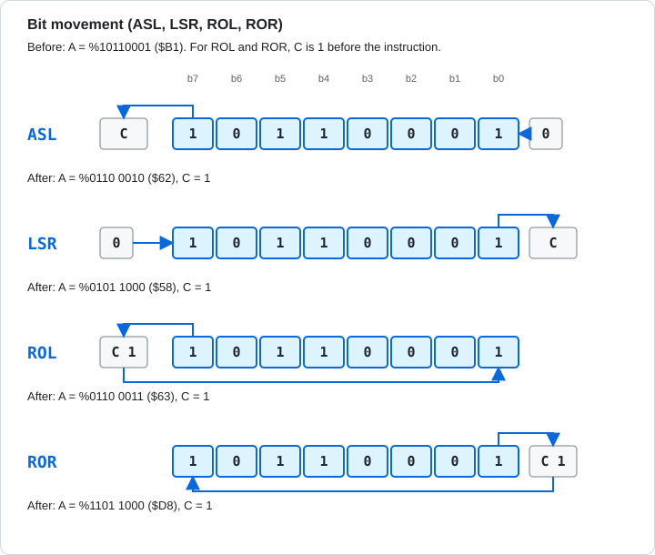
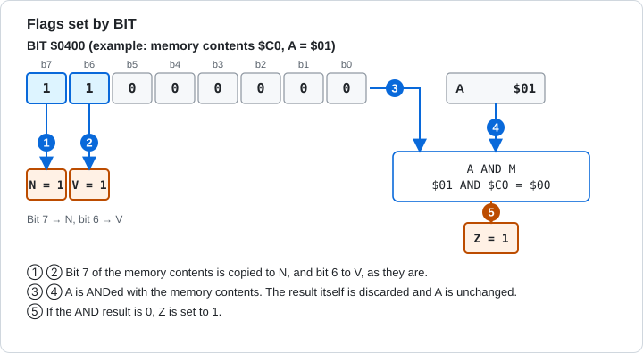

# 5.4 Logic, Shift, and Bit Test

[English](05-4-logic-shift.md) | [日本語](../ja/05-4-logic-shift.md)

[← 5.3 Arithmetic and Comparison](05-3-arithmetic.md) &nbsp;·&nbsp; [5.5 Branch and Jump →](05-5-branch-jump.md) &nbsp;·&nbsp; [Chapter start](05-reference.md)

This group covers the bitwise logic operations (AND, OR, XOR), shifts that move bits sideways, and rotates that move bits around through the carry.

As Figure 5-1 shows, shifts and rotates use the carry (C) as their entrance and exit. They work on both the accumulator and memory.



Figure 5-1 How the bits move in ASL, LSR, ROL, and ROR.



Figure 5-2 How BIT sets N, V, and Z.

<a id="and"></a>

### AND (Logical AND)

ANDs A with a memory value, bit by bit. A bit is 1 only when both bits are 1. Use it to pick out specific bits (all other bits become 0). N and Z change.

**Flags affected**

<!-- flags:AND -->
| N | V | D | I | Z | C |
|---|---|---|---|---|---|
| ○ | - | - | - | ○ | - |
<!-- /flags:AND -->

**Opcodes**

<!-- opcodes:AND -->
| Addressing mode | Syntax | Opcode | Bytes | Cycles |
|---|---|---|---|---|
| Immediate | `AND #$nn` | `$29` | 2 | 2 |
| Zero page | `AND $nn` | `$25` | 2 | 3 |
| Zero page,X | `AND $nn,X` | `$35` | 2 | 4 |
| Absolute | `AND $nnnn` | `$2D` | 3 | 4 |
| Absolute,X | `AND $nnnn,X` | `$3D` | 3 | 4+ |
| Absolute,Y | `AND $nnnn,Y` | `$39` | 3 | 4+ |
| Indexed indirect `(zp,X)` | `AND ($nn,X)` | `$21` | 2 | 6 |
| Indirect indexed `(zp),Y` | `AND ($nn),Y` | `$31` | 2 | 5+ |
<!-- /opcodes:AND -->

**Examples**

```
        LDA #$B5
        AND #$0F
```

`$B5 AND $0F` is `$05`. Only the low 4 bits remain.

```
        LDA #$F0
        AND #$3C
```

`$F0 AND $3C` is `$30`.

<a id="ora"></a>

### ORA (Logical OR)

ORs A with a memory value, bit by bit. A bit is 1 if either bit is 1. Use it to set specific bits to 1. N and Z change.

**Flags affected**

<!-- flags:ORA -->
| N | V | D | I | Z | C |
|---|---|---|---|---|---|
| ○ | - | - | - | ○ | - |
<!-- /flags:ORA -->

**Opcodes**

<!-- opcodes:ORA -->
| Addressing mode | Syntax | Opcode | Bytes | Cycles |
|---|---|---|---|---|
| Immediate | `ORA #$nn` | `$09` | 2 | 2 |
| Zero page | `ORA $nn` | `$05` | 2 | 3 |
| Zero page,X | `ORA $nn,X` | `$15` | 2 | 4 |
| Absolute | `ORA $nnnn` | `$0D` | 3 | 4 |
| Absolute,X | `ORA $nnnn,X` | `$1D` | 3 | 4+ |
| Absolute,Y | `ORA $nnnn,Y` | `$19` | 3 | 4+ |
| Indexed indirect `(zp,X)` | `ORA ($nn,X)` | `$01` | 2 | 6 |
| Indirect indexed `(zp),Y` | `ORA ($nn),Y` | `$11` | 2 | 5+ |
<!-- /opcodes:ORA -->

**Examples**

```
        LDA #$30
        ORA #$05
```

`$30 ORA $05` is `$35`.

```
        LDA #$00
        ORA #$80
```

ORA with `$80` sets the most significant bit to 1. N is 1.

<a id="eor"></a>

### EOR (Exclusive OR)

XORs (exclusive OR) A with a memory value, bit by bit. A bit is 1 only when the two bits differ. Use it to flip specific bits. N and Z change.

**Flags affected**

<!-- flags:EOR -->
| N | V | D | I | Z | C |
|---|---|---|---|---|---|
| ○ | - | - | - | ○ | - |
<!-- /flags:EOR -->

**Opcodes**

<!-- opcodes:EOR -->
| Addressing mode | Syntax | Opcode | Bytes | Cycles |
|---|---|---|---|---|
| Immediate | `EOR #$nn` | `$49` | 2 | 2 |
| Zero page | `EOR $nn` | `$45` | 2 | 3 |
| Zero page,X | `EOR $nn,X` | `$55` | 2 | 4 |
| Absolute | `EOR $nnnn` | `$4D` | 3 | 4 |
| Absolute,X | `EOR $nnnn,X` | `$5D` | 3 | 4+ |
| Absolute,Y | `EOR $nnnn,Y` | `$59` | 3 | 4+ |
| Indexed indirect `(zp,X)` | `EOR ($nn,X)` | `$41` | 2 | 6 |
| Indirect indexed `(zp),Y` | `EOR ($nn),Y` | `$51` | 2 | 5+ |
<!-- /opcodes:EOR -->

**Examples**

```
        LDA #$FF
        EOR #$0F
```

`$FF EOR $0F` is `$F0`. The bits that are 1 in `$0F` are flipped.

```
        LDA #$5A
        EOR #$5A
```

The XOR of equal values is `$00`. Z becomes 1.

<a id="bit"></a>

### BIT (Bit Test)

ANDs A with a memory value and sets Z to 1 if the result is 0. The result itself is discarded, and A does not change. Bit 7 of the memory value is copied to N, and bit 6 is copied to V.

**Flags affected**

<!-- flags:BIT -->
| N | V | D | I | Z | C |
|---|---|---|---|---|---|
| M7 | M6 | - | - | ○ | - |
<!-- /flags:BIT -->

**Opcodes**

<!-- opcodes:BIT -->
| Addressing mode | Syntax | Opcode | Bytes | Cycles |
|---|---|---|---|---|
| Zero page | `BIT $nn` | `$24` | 2 | 3 |
| Absolute | `BIT $nnnn` | `$2C` | 3 | 4 |
<!-- /opcodes:BIT -->

**Examples**

Before: memory `$0400` holds `$C0`.

```
        LDA #$01
        BIT $0400
```

The memory value `$C0` has bits 7 and 6 set to 1, so N and V become 1. `$01 AND $C0` is 0, so Z is also 1.

Before: memory `$0400` holds `$3F`.

```
        LDA #$01
        BIT $0400
```

The memory value `$3F` has bits 7 and 6 at 0, so N and V become 0. `$01 AND $3F` is 1, so Z is 0.

Use BIT to examine bits without destroying A. N and V are decided by the memory value, not by A.

<a id="asl"></a>

### ASL (Arithmetic Shift Left)

Shifts left by 1 bit. The most significant bit goes out to C, and 0 enters the least significant bit. The value doubles (anything above 255 goes out to C). N, Z, and C change.

**Flags affected**

<!-- flags:ASL -->
| N | V | D | I | Z | C |
|---|---|---|---|---|---|
| ○ | - | - | - | ○ | ○ |
<!-- /flags:ASL -->

**Opcodes**

<!-- opcodes:ASL -->
| Addressing mode | Syntax | Opcode | Bytes | Cycles |
|---|---|---|---|---|
| Accumulator | `ASL A` | `$0A` | 1 | 2 |
| Zero page | `ASL $nn` | `$06` | 2 | 5 |
| Zero page,X | `ASL $nn,X` | `$16` | 2 | 6 |
| Absolute | `ASL $nnnn` | `$0E` | 3 | 6 |
| Absolute,X | `ASL $nnnn,X` | `$1E` | 3 | 7 |
<!-- /opcodes:ASL -->

**Examples**

```
        LDA #$81
        ASL A
```

`%10000001` becomes `%00000010`. The 1 that was the most significant bit goes out to C.

Before: memory `$0400` holds `$40`.

```
        ASL $0400
```

`$40` at `$0400` becomes `$80`. N is 1 and C is 0.

<a id="lsr"></a>

### LSR (Logical Shift Right)

Shifts right by 1 bit. The least significant bit goes out to C, and 0 enters the most significant bit. The value is halved (the remainder goes out to C). N is always 0. Z and C also change.

**Flags affected**

<!-- flags:LSR -->
| N | V | D | I | Z | C |
|---|---|---|---|---|---|
| 0 | - | - | - | ○ | ○ |
<!-- /flags:LSR -->

**Opcodes**

<!-- opcodes:LSR -->
| Addressing mode | Syntax | Opcode | Bytes | Cycles |
|---|---|---|---|---|
| Accumulator | `LSR A` | `$4A` | 1 | 2 |
| Zero page | `LSR $nn` | `$46` | 2 | 5 |
| Zero page,X | `LSR $nn,X` | `$56` | 2 | 6 |
| Absolute | `LSR $nnnn` | `$4E` | 3 | 6 |
| Absolute,X | `LSR $nnnn,X` | `$5E` | 3 | 7 |
<!-- /opcodes:LSR -->

**Examples**

```
        LDA #$03
        LSR A
```

`$03` becomes `$01`. The 1 that was the least significant bit goes out to C.

```
        LDA #$80
        LSR A
```

`$80` becomes `$40`. C is 0.

<a id="rol"></a>

### ROL (Rotate Left)

Rotates left by 1 bit, through C. The most significant bit goes out to C, and the old C enters the least significant bit. N, Z, and C change.

**Flags affected**

<!-- flags:ROL -->
| N | V | D | I | Z | C |
|---|---|---|---|---|---|
| ○ | - | - | - | ○ | ○ |
<!-- /flags:ROL -->

**Opcodes**

<!-- opcodes:ROL -->
| Addressing mode | Syntax | Opcode | Bytes | Cycles |
|---|---|---|---|---|
| Accumulator | `ROL A` | `$2A` | 1 | 2 |
| Zero page | `ROL $nn` | `$26` | 2 | 5 |
| Zero page,X | `ROL $nn,X` | `$36` | 2 | 6 |
| Absolute | `ROL $nnnn` | `$2E` | 3 | 6 |
| Absolute,X | `ROL $nnnn,X` | `$3E` | 3 | 7 |
<!-- /opcodes:ROL -->

**Examples**

```
        SEC
        LDA #$80
        ROL A
```

With C at 1, `$80` becomes `$01`. The old C (1) enters the least significant bit, and the 1 that was the most significant bit goes out to C.

```
        CLC
        LDA #$40
        ROL A
```

With C at 0, `$40` becomes `$80`. N is 1.

Before: memory from `$0400` holds `81 42`.

```
        ASL $0400
        ROL $0401
```

This shifts a 16-bit value left. It doubles `$4281` with `ASL` and `ROL` and gets `$8502`. The C that the low-byte ASL shifts out enters the least significant bit in the high-byte ROL.

<a id="ror"></a>

### ROR (Rotate Right)

Rotates right by 1 bit, through C. The least significant bit goes out to C, and the old C enters the most significant bit. N, Z, and C change.

**Flags affected**

<!-- flags:ROR -->
| N | V | D | I | Z | C |
|---|---|---|---|---|---|
| ○ | - | - | - | ○ | ○ |
<!-- /flags:ROR -->

**Opcodes**

<!-- opcodes:ROR -->
| Addressing mode | Syntax | Opcode | Bytes | Cycles |
|---|---|---|---|---|
| Accumulator | `ROR A` | `$6A` | 1 | 2 |
| Zero page | `ROR $nn` | `$66` | 2 | 5 |
| Zero page,X | `ROR $nn,X` | `$76` | 2 | 6 |
| Absolute | `ROR $nnnn` | `$6E` | 3 | 6 |
| Absolute,X | `ROR $nnnn,X` | `$7E` | 3 | 7 |
<!-- /opcodes:ROR -->

**Examples**

```
        SEC
        LDA #$01
        ROR A
```

With C at 1, `$01` becomes `$80`. N is 1 and C is also 1.

```
        CLC
        LDA #$01
        ROR A
```

With C at 0, `$01` becomes `$00`. Z is 1 and C is 1.

The absolute,X mode of shifts and rotates (for example `ASL $0410,X`) reads memory and writes the result back. It takes the same number of cycles whether or not the access crosses a page.

> **What you can try in Glow65**
>
> The results of `AND`, `ORA`, and `EOR` are written to `$03F0`, `$03F1`, and `$03F2`.
>
> ```
> *E 0300 A9 B5 29 0F 8D F0 03 A9 30 09 05 8D F1 03 A9 FF
> *E 0310 49 0F 8D F2 03 60
> *G 0300
> *D 03F0 03F2
> 03F0: 05 35 F0 00 00 00 00 00 24 F4 24 F4 00 00 00 00
> ```
>
> `$B5 AND $0F` is `05`, `$30 ORA $05` is `35`, and `$FF EOR $0F` is `F0`.

> **What you can try in Glow65**
>
> Put `$4281` at `$0400` and `$0401` (`81 42`, low byte first), and double it with `ASL` and `ROL`.
>
> ```
> *E 0400 81 42
> *E 0300 0E 00 04 2E 01 04 60
> *G 0300
> *D 0400 0401
> 0400: 02 85 00 00 00 00 00 00 00 00 00 00 00 00 00 00
> ```
>
> `$0400` holds `02` and `$0401` holds `85`, so the answer is `$8502`.

> **What you can try in Glow65**
>
> Put `$C0` at `$0400`, run `LDA #$01` and `BIT $0400`, and write P to `$03F0`.
>
> ```
> *E 0400 C0
> *E 0300 A9 01 2C 00 04 08 68 8D F0 03 60
> *G 0300
> *D 03F0 03F0
> 03F0: F6 00 00 00 00 00 00 00 24 F4 24 F4 00 00 00 00
> ```
>
> `$F6` is `%11110110`. N (bit 7), V (bit 6), and Z (bit 1) are 1. Bit 5 and B (bit 4) are set to 1 by PHP, and I (bit 2) is also 1.

---

[← 5.3 Arithmetic and Comparison](05-3-arithmetic.md) &nbsp;·&nbsp; [5.5 Branch and Jump →](05-5-branch-jump.md) &nbsp;·&nbsp; [Chapter start](05-reference.md)
