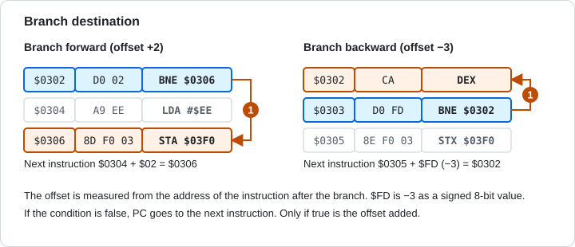
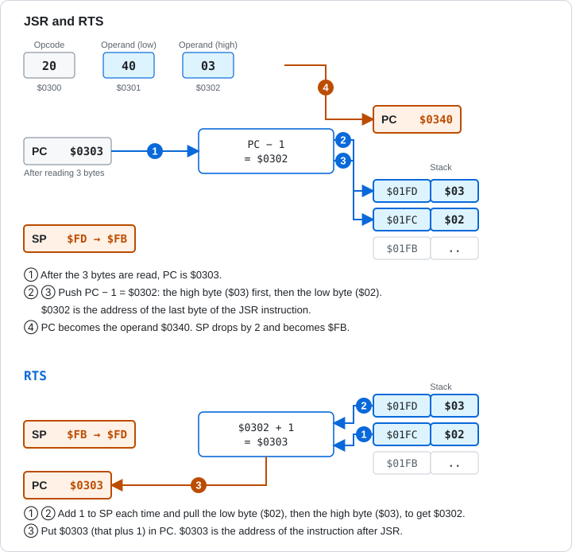
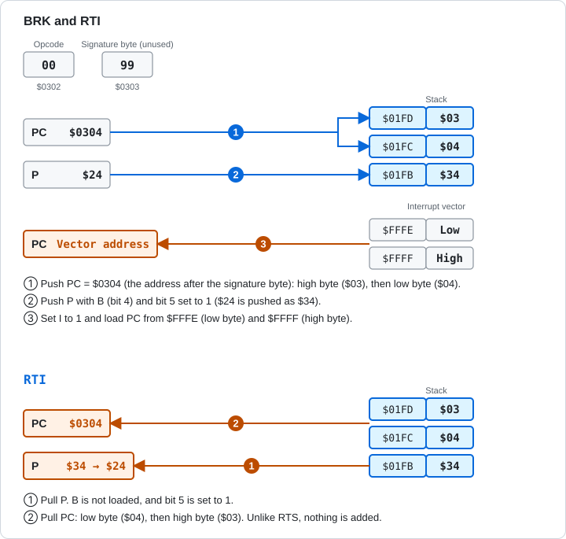

# 5.5 Branch and Jump

[English](05-5-branch-jump.md) | [日本語](../ja/05-5-branch-jump.md)

[← 5.4 Logic, Shift, and Bit Test](05-4-logic-shift.md) &nbsp;·&nbsp; [5.6 Stack and Flag Operations →](05-6-stack-flags.md) &nbsp;·&nbsp; [Chapter start](05-reference.md)

These instructions change the flow of execution. The conditional branches (BCC, BCS, BEQ, BNE, BMI, BPL, BVC, BVS) look at a flag and jump by a distance measured from the address of the next instruction. JMP jumps to the given address without any condition.

JSR and RTS call and return from a subroutine (a small program that other code calls). BRK and RTI are the entrance and exit of an interrupt. These use the stack.



Figure 5-3 The target of a branch. It can go forward or backward.



Figure 5-4 JSR and RTS. The pushed return address is the address of the last byte of the JSR.



Figure 5-5 BRK and RTI.

Branch instructions do not change the flags. The distance is a signed 1-byte value, from -128 to +127. A branch takes 2 cycles when the condition is false, 3 when it is true, and 4 when it is true and the target is on another page[1].

<a id="bcc"></a>

### BCC (Branch if Carry Clear)

Branches when C is 0. It is also used to test "less than" after CMP.

**Flags affected**

<!-- flags:BCC -->
| N | V | D | I | Z | C |
|---|---|---|---|---|---|
| - | - | - | - | - | - |
<!-- /flags:BCC -->

**Opcodes**

<!-- opcodes:BCC -->
| Addressing mode | Syntax | Opcode | Bytes | Cycles |
|---|---|---|---|---|
| Relative | `BCC label` | `$90` | 2 | 2 (+1, +2) |
<!-- /opcodes:BCC -->

**Examples**

```
        CLC
        LDX #$00
        BCC skip
        LDX #$EE
skip:   NOP
```

C is 0, so the branch is taken and `LDX #$EE` is skipped. X stays `$00`.

<a id="bcs"></a>

### BCS (Branch if Carry Set)

Branches when C is 1. It is also used to test "greater than or equal" after CMP.

**Flags affected**

<!-- flags:BCS -->
| N | V | D | I | Z | C |
|---|---|---|---|---|---|
| - | - | - | - | - | - |
<!-- /flags:BCS -->

**Opcodes**

<!-- opcodes:BCS -->
| Addressing mode | Syntax | Opcode | Bytes | Cycles |
|---|---|---|---|---|
| Relative | `BCS label` | `$B0` | 2 | 2 (+1, +2) |
<!-- /opcodes:BCS -->

**Examples**

```
        CLC
        LDX #$00
        BCS skip
        LDX #$EE
skip:   NOP
```

C is 0, so the branch is not taken. `LDX #$EE` runs and X becomes `$EE`.

<a id="beq"></a>

### BEQ (Branch if Equal)

Branches when Z is 1. This is the case when the previous result was 0, or when CMP found the values equal.

**Flags affected**

<!-- flags:BEQ -->
| N | V | D | I | Z | C |
|---|---|---|---|---|---|
| - | - | - | - | - | - |
<!-- /flags:BEQ -->

**Opcodes**

<!-- opcodes:BEQ -->
| Addressing mode | Syntax | Opcode | Bytes | Cycles |
|---|---|---|---|---|
| Relative | `BEQ label` | `$F0` | 2 | 2 (+1, +2) |
<!-- /opcodes:BEQ -->

**Examples**

```
        LDX #$00
        LDA #$00
        BEQ skip
        LDX #$EE
skip:   NOP
```

`LDA #$00` set Z to 1, so the branch is taken. X stays `$00`.

<a id="bne"></a>

### BNE (Branch if Not Equal)

Branches when Z is 0. It is often used to test for the end of a loop.

**Flags affected**

<!-- flags:BNE -->
| N | V | D | I | Z | C |
|---|---|---|---|---|---|
| - | - | - | - | - | - |
<!-- /flags:BNE -->

**Opcodes**

<!-- opcodes:BNE -->
| Addressing mode | Syntax | Opcode | Bytes | Cycles |
|---|---|---|---|---|
| Relative | `BNE label` | `$D0` | 2 | 2 (+1, +2) |
<!-- /opcodes:BNE -->

**Examples**

```
        LDY #$00
        LDX #$03
loop:   INY
        DEX
        BNE loop
```

`INY` repeats until `DEX` makes X 0. The loop runs 3 times, and Y becomes `$03`.

<a id="bmi"></a>

### BMI (Branch if Minus)

Branches when N is 1. This is the case when the most significant bit of the previous result is 1.

**Flags affected**

<!-- flags:BMI -->
| N | V | D | I | Z | C |
|---|---|---|---|---|---|
| - | - | - | - | - | - |
<!-- /flags:BMI -->

**Opcodes**

<!-- opcodes:BMI -->
| Addressing mode | Syntax | Opcode | Bytes | Cycles |
|---|---|---|---|---|
| Relative | `BMI label` | `$30` | 2 | 2 (+1, +2) |
<!-- /opcodes:BMI -->

**Examples**

```
        LDX #$00
        LDA #$80
        BMI skip
        LDX #$EE
skip:   NOP
```

`LDA #$80` set N to 1, so the branch is taken. X stays `$00`.

<a id="bpl"></a>

### BPL (Branch if Plus)

Branches when N is 0.

**Flags affected**

<!-- flags:BPL -->
| N | V | D | I | Z | C |
|---|---|---|---|---|---|
| - | - | - | - | - | - |
<!-- /flags:BPL -->

**Opcodes**

<!-- opcodes:BPL -->
| Addressing mode | Syntax | Opcode | Bytes | Cycles |
|---|---|---|---|---|
| Relative | `BPL label` | `$10` | 2 | 2 (+1, +2) |
<!-- /opcodes:BPL -->

**Examples**

```
        LDX #$00
        LDA #$7F
        BPL skip
        LDX #$EE
skip:   NOP
```

`LDA #$7F` set N to 0, so the branch is taken. X stays `$00`.

<a id="bvc"></a>

### BVC (Branch if Overflow Clear)

Branches when V is 0.

**Flags affected**

<!-- flags:BVC -->
| N | V | D | I | Z | C |
|---|---|---|---|---|---|
| - | - | - | - | - | - |
<!-- /flags:BVC -->

**Opcodes**

<!-- opcodes:BVC -->
| Addressing mode | Syntax | Opcode | Bytes | Cycles |
|---|---|---|---|---|
| Relative | `BVC label` | `$50` | 2 | 2 (+1, +2) |
<!-- /opcodes:BVC -->

**Examples**

```
        CLV
        LDX #$00
        BVC skip
        LDX #$EE
skip:   NOP
```

`CLV` set V to 0, so the branch is taken. X stays `$00`.

<a id="bvs"></a>

### BVS (Branch if Overflow Set)

Branches when V is 1.

**Flags affected**

<!-- flags:BVS -->
| N | V | D | I | Z | C |
|---|---|---|---|---|---|
| - | - | - | - | - | - |
<!-- /flags:BVS -->

**Opcodes**

<!-- opcodes:BVS -->
| Addressing mode | Syntax | Opcode | Bytes | Cycles |
|---|---|---|---|---|
| Relative | `BVS label` | `$70` | 2 | 2 (+1, +2) |
<!-- /opcodes:BVS -->

**Examples**

```
        CLV
        LDX #$00
        BVS skip
        LDX #$EE
skip:   NOP
```

`CLV` set V to 0, so the branch is not taken. `LDX #$EE` runs and X becomes `$EE`.

<a id="jmp"></a>

### JMP (Jump)

Jumps to the given address. The flags do not change. It has absolute and indirect modes.

**Flags affected**

<!-- flags:JMP -->
| N | V | D | I | Z | C |
|---|---|---|---|---|---|
| - | - | - | - | - | - |
<!-- /flags:JMP -->

**Opcodes**

<!-- opcodes:JMP -->
| Addressing mode | Syntax | Opcode | Bytes | Cycles |
|---|---|---|---|---|
| Absolute | `JMP $nnnn` | `$4C` | 3 | 3 |
| Indirect | `JMP ($nnnn)` | `$6C` | 3 | 5 |
<!-- /opcodes:JMP -->

**Examples**

```
        LDA #$00
        JMP skip
        LDA #$EE
skip:   LDX #$11
```

`LDA #$EE` is skipped, and execution continues from `LDX #$11`. A stays `$00`.

The indirect mode (`JMP ($nnnn)`) has a quirk on the NMOS 6502 when the pointer is at the last byte of a page (`$xxFF`). Section 4.6 in Chapter 4 explains it.

<a id="jsr"></a>

### JSR (Jump to Subroutine)

Pushes the address of the next instruction minus 1 (the address of the last byte of the JSR) onto the stack, and jumps to the given address. The high byte is pushed first, then the low byte[1]. The flags do not change.

**Flags affected**

<!-- flags:JSR -->
| N | V | D | I | Z | C |
|---|---|---|---|---|---|
| - | - | - | - | - | - |
<!-- /flags:JSR -->

**Opcodes**

<!-- opcodes:JSR -->
| Addressing mode | Syntax | Opcode | Bytes | Cycles |
|---|---|---|---|---|
| Absolute | `JSR $nnnn` | `$20` | 3 | 6 |
<!-- /opcodes:JSR -->

**Examples**

```
        LDA #$00
        JSR $0340
        TAX
```

The subroutine at `$0340`:

```
        LDA #$AB
        RTS
```

The subroutine at `$0340` sets A to `$AB` and returns. After the return, `TAX` makes X `$AB` as well.

```
        JSR $0340
```

The subroutine at `$0340`:

```
        TSX
        LDA $0101,X
        STA $03E4
        LDA $0102,X
        STA $03E5
        RTS
```

The subroutine reads the return address that was pushed onto the stack. The JSR at `$0300` pushed the address of its last byte, `$0302`, so the low byte is `$02` and the high byte is `$03`.

<a id="rts"></a>

### RTS (Return from Subroutine)

Pulls the return address from the stack, adds 1, and puts it in PC[1]. Execution returns to the instruction after the JSR. The flags do not change.

**Flags affected**

<!-- flags:RTS -->
| N | V | D | I | Z | C |
|---|---|---|---|---|---|
| - | - | - | - | - | - |
<!-- /flags:RTS -->

**Opcodes**

<!-- opcodes:RTS -->
| Addressing mode | Syntax | Opcode | Bytes | Cycles |
|---|---|---|---|---|
| Implied | `RTS` | `$60` | 1 | 6 |
<!-- /opcodes:RTS -->

**Examples**

```
        LDX #$00
        LDA #$03
        PHA
        LDA #$0A
        PHA
        RTS
        LDX #$EE
        LDY #$01
```

Push `$030A` yourself and run RTS, and execution continues from `$030B` (`LDY #$01`), one past `$030A`. `LDX #$EE` is skipped.

The value that JSR pushes is 1 less than the address of the next instruction, and RTS adds 1. If you push a return address onto the stack yourself and use RTS, execution continues from the address after it.

<a id="brk"></a>

### BRK (Break)

Causes a software interrupt. It pushes PC (the address of the BRK + 2) and P with B set to 1 onto the stack, sets I to 1, and jumps to the address stored at `$FFFE` and `$FFFF`.

**Flags affected**

<!-- flags:BRK -->
| N | V | D | I | Z | C |
|---|---|---|---|---|---|
| - | - | - | 1 | - | - |
<!-- /flags:BRK -->

**Opcodes**

<!-- opcodes:BRK -->
| Addressing mode | Syntax | Opcode | Bytes | Cycles |
|---|---|---|---|---|
| Implied | `BRK` | `$00` | 1 | 7 |
<!-- /opcodes:BRK -->

**Examples**

```
        LDX #$00
        LDY #$00
        BRK
        .byte $99
        LDY #$55
```

The interrupt handler at `$0340`:

```
        TSX
        LDA $0101,X
        STA $03E4
        LDA $0102,X
        STA $03E5
        LDA $0103,X
        STA $03E6
        LDX #$77
        RTI
```

The byte after `BRK` is a signature byte and is not used. The return address is `$0306`, the address after the signature byte. The handler sets X to `$77` and returns with RTI, so `LDY #$55` runs next.

BRK is a 1-byte instruction, but PC advances by 2 bytes. The following byte can serve as a signature that shows which kind of BRK it is.

The Glow65 monitor jumps from the vector at `$FFFE` and `$FFFF` to the handler address stored in RAM at `$03FA` and `$03FB`. In this example, `E 03FA 40 03` sets the handler address to `$0340`. Interrupts are explained in Chapter 6.

<a id="rti"></a>

### RTI (Return from Interrupt)

Pulls P, the low byte of PC, and the high byte of PC from the stack, in this order, and returns from the interrupt. Unlike RTS, it does not add 1 to PC. RTI does not load B (bit 4) of P.

**Flags affected**

<!-- flags:RTI -->
| N | V | D | I | Z | C |
|---|---|---|---|---|---|
| Restored | Restored | Restored | Restored | Restored | Restored |
<!-- /flags:RTI -->

**Opcodes**

<!-- opcodes:RTI -->
| Addressing mode | Syntax | Opcode | Bytes | Cycles |
|---|---|---|---|---|
| Implied | `RTI` | `$40` | 1 | 6 |
<!-- /opcodes:RTI -->

**Examples**

In the `BRK` example, the handler's last `RTI` returns to `$0306`, the address after the signature byte.

> **What you can try in Glow65**
>
> `BNE` repeats `INY` and `DEX` 3 times. `L` shows where `BNE $0304` jumps.
>
> ```
> *E 0300 A0 00 A2 03 C8 CA D0 FC 8C F0 03 60
> *L 0300 030A
> 0300  A0 00     LDY   #$00
> 0302  A2 03     LDX   #$03
> 0304  C8        INY
> 0305  CA        DEX
> 0306  D0 FC     BNE   $0304
> 0308  8C F0 03  STY   $03F0
> *G 0300
> *D 03F0 03F0
> 03F0: 03 00 00 00 00 00 00 00 24 F4 24 F4 00 00 00 00
> ```
>
> The distance `$FC` in `D0 FC` is -4. Counting back 4 from the next instruction, `$0308`, gives `$0304`.

> **What you can try in Glow65**
>
> The subroutine at `$0340` writes the return address that was pushed onto the stack to `$03F2` and `$03F3`.
>
> ```
> *E 0340 BA BD 01 01 8D F2 03 BD 02 01 8D F3 03 60
> *E 0300 20 40 03 60
> *L 0300 0300
> 0300  20 40 03  JSR   $0340
> *G 0300
> *D 03F2 03F3
> 03F2: 02 03 00 00 00 00 24 F4 24 F4 00 00 00 00 00 00
> ```
>
> The low byte `02` and the high byte `03` make the pushed value `$0302`. This is the address of the last byte of the `JSR`.

> **What you can try in Glow65**
>
> `BRK` jumps to the handler at `$0340`, which writes the pushed return address to `$03F2` (high byte) and `$03F3` (low byte), and returns with RTI.
>
> ```
> *E 03FA 40 03
> *E 0340 BA BD 03 01 8D F2 03 BD 02 01 8D F3 03 A2 77 40
> *E 0300 A2 00 A0 00 00 99 A0 55 8E F0 03 8C F1 03 60
> *L 0300 0304
> 0300  A2 00     LDX   #$00
> 0302  A0 00     LDY   #$00
> 0304  00        BRK
> *G 0300
> *D 03F0 03F3
> 03F0: 77 55 03 06 00 00 00 00 24 F4 40 03 00 00 00 00
> ```
>
> `$03F0` and `$03F1` hold X and Y after the return, `77` and `55`. `$03F2` and `$03F3` hold the return address, `$0306`. This is the address after the signature byte at `$0305`. The `40 03` at `$03FA` and `$03FB` is the handler address written in this example.

## Sources

1. MOS Technology, "MCS6500 Microcomputer Family Hardware Manual", January 1976 edition: https://www.commodore.ca/wp-content/uploads/2018/11/kim1_hardware.txt

---

[← 5.4 Logic, Shift, and Bit Test](05-4-logic-shift.md) &nbsp;·&nbsp; [5.6 Stack and Flag Operations →](05-6-stack-flags.md) &nbsp;·&nbsp; [Chapter start](05-reference.md)
