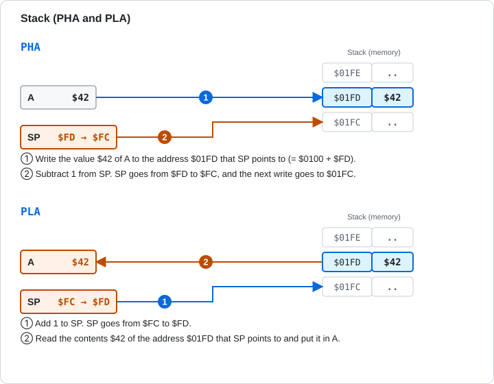

# 5.6 Stack and Flag Operations

[English](05-6-stack-flags.md) | [日本語](../ja/05-6-stack-flags.md)

[← 5.5 Branch and Jump](05-5-branch-jump.md) &nbsp;·&nbsp; [Chapter start](05-reference.md)

The stack is an area of memory from `$0100` to `$01FF`, used in last-in, first-out order: the value put in last is taken out first. SP (the stack pointer) points to the low byte of the address to write next. To push, the CPU writes the value and then subtracts 1 from SP. To pull, it adds 1 to SP and then reads.

This group contains the instructions that push (PHA, PHP) and pull (PLA, PLP), the instructions that change a flag directly, and NOP, which does nothing.



Figure 5-6 PHA and PLA. The stack grows from higher addresses to lower addresses.

<a id="pha"></a>

### PHA (Push Accumulator)

Writes the value of A to `$0100 + SP`, then subtracts 1 from SP. Neither A nor the flags change.

**Flags affected**

<!-- flags:PHA -->
| N | V | D | I | Z | C |
|---|---|---|---|---|---|
| - | - | - | - | - | - |
<!-- /flags:PHA -->

**Opcodes**

<!-- opcodes:PHA -->
| Addressing mode | Syntax | Opcode | Bytes | Cycles |
|---|---|---|---|---|
| Implied | `PHA` | `$48` | 1 | 3 |
<!-- /opcodes:PHA -->

**Examples**

```
        LDA #$42
        PHA
        TSX
        LDA $0101,X
        STA $03E4
        LDA #$00
        PLA
```

After A (`$42`) is pushed, `TSX` reads SP into X, and `LDA $0101,X` reads the address one above SP, where the pushed `$42` is found. Then A is set to `$00`, and `PLA` brings `$42` back.

<a id="pla"></a>

### PLA (Pull Accumulator)

Adds 1 to SP and loads the value at `$0100 + SP` into A. N and Z are set from the pulled value.

**Flags affected**

<!-- flags:PLA -->
| N | V | D | I | Z | C |
|---|---|---|---|---|---|
| ○ | - | - | - | ○ | - |
<!-- /flags:PLA -->

**Opcodes**

<!-- opcodes:PLA -->
| Addressing mode | Syntax | Opcode | Bytes | Cycles |
|---|---|---|---|---|
| Implied | `PLA` | `$68` | 1 | 4 |
<!-- /opcodes:PLA -->

**Examples**

```
        LDA #$42
        PHA
        LDA #$00
        PLA
```

The `$42` that was pushed returns to A with `PLA`. Both N and Z are 0.

<a id="php"></a>

### PHP (Push Processor Status)

Pushes P onto the stack. The pushed value is P with B (bit 4) and bit 5 set to 1. P itself does not change.

**Flags affected**

<!-- flags:PHP -->
| N | V | D | I | Z | C |
|---|---|---|---|---|---|
| - | - | - | - | - | - |
<!-- /flags:PHP -->

**Opcodes**

<!-- opcodes:PHP -->
| Addressing mode | Syntax | Opcode | Bytes | Cycles |
|---|---|---|---|---|
| Implied | `PHP` | `$08` | 1 | 3 |
<!-- /opcodes:PHP -->

**Examples**

```
        SEI
        CLD
        CLV
        LDA #$01
        SEC
        PHP
        PLA
```

`SEI`, `CLD`, `CLV`, `LDA #$01`, and `SEC` leave only C and I at 1, and then P is pushed. The pulled value is `$35` (`%00110101`). Bit 5 and B are 1.

<a id="plp"></a>

### PLP (Pull Processor Status)

Replaces P with the value pulled from the stack. B (bit 4) of the pulled value is not taken in, and bit 5 stays 1. N, V, D, I, Z, and C all take the pulled value.

**Flags affected**

<!-- flags:PLP -->
| N | V | D | I | Z | C |
|---|---|---|---|---|---|
| Restored | Restored | Restored | Restored | Restored | Restored |
<!-- /flags:PLP -->

**Opcodes**

<!-- opcodes:PLP -->
| Addressing mode | Syntax | Opcode | Bytes | Cycles |
|---|---|---|---|---|
| Implied | `PLP` | `$28` | 1 | 4 |
<!-- /opcodes:PLP -->

**Examples**

```
        SEC
        PHP
        CLC
        PLP
```

After `SEC`, P is pushed, `CLC` sets C to 0, and `PLP` restores P. C returns to 1.

```
        LDA #$C3
        PHA
        PLP
```

Push `$C3` (`%11000011`) and take it in with `PLP`, and N, V, Z, and C become 1 and D becomes 0.

PHP and PLP are used to save and restore the flags around an interrupt or a subroutine.

<a id="clc"></a>

### CLC (Clear Carry Flag)

Sets C to 0. Use it before ADC.

**Flags affected**

<!-- flags:CLC -->
| N | V | D | I | Z | C |
|---|---|---|---|---|---|
| - | - | - | - | - | 0 |
<!-- /flags:CLC -->

**Opcodes**

<!-- opcodes:CLC -->
| Addressing mode | Syntax | Opcode | Bytes | Cycles |
|---|---|---|---|---|
| Implied | `CLC` | `$18` | 1 | 2 |
<!-- /opcodes:CLC -->

**Examples**

```
        SEC
        CLC
```

C becomes 0.

<a id="sec"></a>

### SEC (Set Carry Flag)

Sets C to 1. Use it before SBC.

**Flags affected**

<!-- flags:SEC -->
| N | V | D | I | Z | C |
|---|---|---|---|---|---|
| - | - | - | - | - | 1 |
<!-- /flags:SEC -->

**Opcodes**

<!-- opcodes:SEC -->
| Addressing mode | Syntax | Opcode | Bytes | Cycles |
|---|---|---|---|---|
| Implied | `SEC` | `$38` | 1 | 2 |
<!-- /opcodes:SEC -->

**Examples**

```
        CLC
        SEC
```

C becomes 1.

<a id="cli"></a>

### CLI (Clear Interrupt Disable)

Sets I to 0. The CPU now accepts interrupts (IRQ).

**Flags affected**

<!-- flags:CLI -->
| N | V | D | I | Z | C |
|---|---|---|---|---|---|
| - | - | - | 0 | - | - |
<!-- /flags:CLI -->

**Opcodes**

<!-- opcodes:CLI -->
| Addressing mode | Syntax | Opcode | Bytes | Cycles |
|---|---|---|---|---|
| Implied | `CLI` | `$58` | 1 | 2 |
<!-- /opcodes:CLI -->

**Examples**

```
        SEI
        CLI
```

I becomes 0.

<a id="sei"></a>

### SEI (Set Interrupt Disable)

Sets I to 1. The CPU no longer accepts interrupts (IRQ).

**Flags affected**

<!-- flags:SEI -->
| N | V | D | I | Z | C |
|---|---|---|---|---|---|
| - | - | - | 1 | - | - |
<!-- /flags:SEI -->

**Opcodes**

<!-- opcodes:SEI -->
| Addressing mode | Syntax | Opcode | Bytes | Cycles |
|---|---|---|---|---|
| Implied | `SEI` | `$78` | 1 | 2 |
<!-- /opcodes:SEI -->

**Examples**

```
        CLI
        SEI
```

I becomes 1.

<a id="cld"></a>

### CLD (Clear Decimal Mode)

Sets D to 0. ADC and SBC calculate in binary again.

**Flags affected**

<!-- flags:CLD -->
| N | V | D | I | Z | C |
|---|---|---|---|---|---|
| - | - | 0 | - | - | - |
<!-- /flags:CLD -->

**Opcodes**

<!-- opcodes:CLD -->
| Addressing mode | Syntax | Opcode | Bytes | Cycles |
|---|---|---|---|---|
| Implied | `CLD` | `$D8` | 1 | 2 |
<!-- /opcodes:CLD -->

**Examples**

```
        SED
        CLD
```

D becomes 0.

<a id="sed"></a>

### SED (Set Decimal Mode)

Sets D to 1. ADC and SBC calculate in BCD.

**Flags affected**

<!-- flags:SED -->
| N | V | D | I | Z | C |
|---|---|---|---|---|---|
| - | - | 1 | - | - | - |
<!-- /flags:SED -->

**Opcodes**

<!-- opcodes:SED -->
| Addressing mode | Syntax | Opcode | Bytes | Cycles |
|---|---|---|---|---|
| Implied | `SED` | `$F8` | 1 | 2 |
<!-- /opcodes:SED -->

**Examples**

```
        CLD
        SED
```

D becomes 1.

After you use decimal mode, return to normal with CLD. If D stays 1, the results of later additions and subtractions change.

<a id="clv"></a>

### CLV (Clear Overflow Flag)

Sets V to 0. The 6502 has no instruction that sets V to 1. ADC, SBC, and BIT set it to 1 depending on their results.

**Flags affected**

<!-- flags:CLV -->
| N | V | D | I | Z | C |
|---|---|---|---|---|---|
| - | 0 | - | - | - | - |
<!-- /flags:CLV -->

**Opcodes**

<!-- opcodes:CLV -->
| Addressing mode | Syntax | Opcode | Bytes | Cycles |
|---|---|---|---|---|
| Implied | `CLV` | `$B8` | 1 | 2 |
<!-- /opcodes:CLV -->

**Examples**

```
        CLC
        LDA #$7F
        ADC #$01
        CLV
```

`ADC` gives `$7F + $01 = $80` and sets V to 1, and then `CLV` returns it to 0. N stays 1.

<a id="nop"></a>

### NOP (No Operation)

Does nothing. It is a 1-byte instruction and takes 2 cycles. No register or flag changes.

**Flags affected**

<!-- flags:NOP -->
| N | V | D | I | Z | C |
|---|---|---|---|---|---|
| - | - | - | - | - | - |
<!-- /flags:NOP -->

**Opcodes**

<!-- opcodes:NOP -->
| Addressing mode | Syntax | Opcode | Bytes | Cycles |
|---|---|---|---|---|
| Implied | `NOP` | `$EA` | 1 | 2 |
<!-- /opcodes:NOP -->

**Examples**

```
        LDA #$80
        NOP
```

After `NOP`, A (`$80`) and N (1) are unchanged.

NOP is used to leave a temporary gap in the middle of a program, to adjust execution time, and so on.

> **What you can try in Glow65**
>
> After `SEI`, `CLD`, `CLV`, `LDA #$01`, and `SEC`, `PHP` pushes P, `PLA` pulls it into A, and the program writes it to `$03F0`.
>
> ```
> *E 0300 78 D8 B8 A9 01 38 08 68 8D F0 03 60
> *G 0300
> *D 03F0 03F0
> 03F0: 35 00 00 00 00 00 00 00 24 F4 24 F4 00 00 00 00
> ```
>
> `$35` is `%00110101`. C (bit 0) and I (bit 2) are 1. Bit 5 and B (bit 4) are set to 1 by PHP.

> **What you can try in Glow65**
>
> `PHA` and `PLA` save and restore the value of A. Even after `LDA #$00` clears A, `PLA` brings `$42` back.
>
> ```
> *E 0300 A9 42 48 A9 00 68 8D F0 03 60
> *G 0300
> *D 03F0 03F0
> 03F0: 42 00 00 00 00 00 00 00 24 F4 24 F4 00 00 00 00
> ```

> **What you can try in Glow65**
>
> `SEC`, `PHP`, `CLC`, and `PLP` save C and restore it.
>
> ```
> *E 0300 38 08 18 28 08 68 8D F0 03 60
> *G 0300
> *D 03F0 03F0
> 03F0: 35 00 00 00 00 00 00 00 24 F4 24 F4 00 00 00 00
> ```
>
> `$35` shows that C is back to 1.

---

[← 5.5 Branch and Jump](05-5-branch-jump.md) &nbsp;·&nbsp; [Chapter start](05-reference.md)

Next chapter: [6. Flags, the Stack, and Interrupts →](06-flags-stack-interrupts.md)
