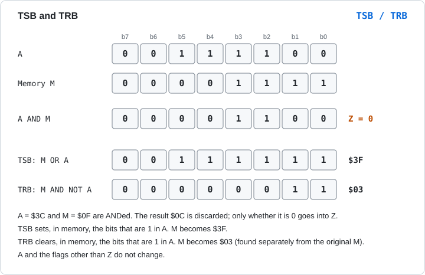
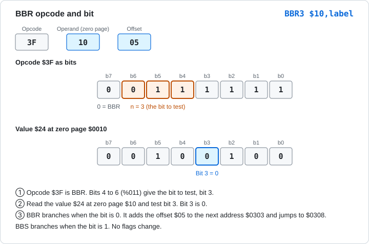
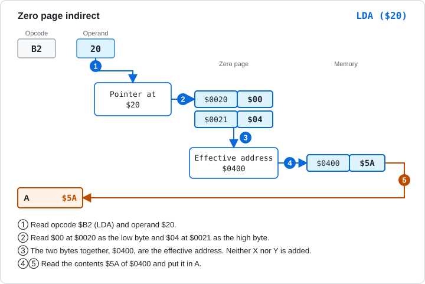

# 5.7 Instructions Added by the 65C02

[English](05-7-65c02.md) | [日本語](../ja/05-7-65c02.md)

[← 5.6 Stack and Flag Operations](05-6-stack-flags.md) &nbsp;·&nbsp; [Chapter start](05-reference.md)

The 65C02 is an improved version of the 6502. The 6502 is built with a process called NMOS, and the 65C02 is built with a process called CMOS. CMOS uses less power. All 151 official opcodes of the 6502 also exist on the 65C02. The 65C02 adds new instructions and modes to them, and fixes some behavior.

The 65C02 in Glow65 has the same instructions as the WDC W65C02S. These are the base 65C02 instructions, plus BBR, BBS, RMB, and SMB (added by Rockwell), and WAI and STP (added by WDC).

## Differences from the 6502

There are 14 new instructions. They are listed in "List of New Instructions".

There are 3 new modes: zero page indirect `($nn)`, absolute,X indirect `($nnnn,X)`, and zero page relative `$nn,label`. Some 6502 instructions also get new forms, such as `INC A`, `DEC A`, `BIT #$nn`, `BIT $nn,X`, and `BIT $nnnn,X`.

The following behavior changes.

| Item | NMOS 6502 | 65C02 |
|---|---|---|
| `JMP ($xxFF)` | Reads the high byte from the start of the same page. 5 cycles | Reads the high byte from the address after the pointer. 6 cycles |
| When an interrupt (IRQ, NMI, BRK) is accepted | D does not change | D is set to 0 |
| ADC in decimal mode | Z comes from the binary sum, and N from an intermediate value | N and Z come from the adjusted A. 1 cycle more |
| SBC in decimal mode | N and Z come from the binary difference | N and Z come from the adjusted A. 1 cycle more |
| `$nnnn,X` of ASL, LSR, ROL, ROR | 7 cycles | 6 cycles. 7 when it crosses into another page |
| Undefined opcodes | In Glow65, a 1-byte, 2-cycle NOP | All are NOPs. The length and cycles are fixed for each opcode |

D is set to 0 so that an interrupt handler is not affected by decimal mode. The behavior of `JMP ($xxFF)` is explained under "Indirect" in chapter 4.

## Running the 65C02 in Glow65

The **CPU** switch on the panel selects the 6502 or the 65C02. The switch works only while POWER is OFF. On the command line, give `glow65-cli --cpu 65c02`. Without the option, the CPU is a 6502.

Only when the 65C02 is selected does the monitor's `L` command disassemble the new instructions. On a 6502, the same bytes are shown as `.BYTE`.

> **What you can try in Glow65**
>
> Disassemble the same 5 bytes on the 65C02 and on the 6502. `$CB` is WAI and `$DB` is STP.
>
> 65C02:
>
> ```
> *E 0300 1A DA FA CB DB
> *L 0300 0304
> 0300  1A        INC   A
> 0301  DA        PHX
> 0302  FA        PLX
> 0303  CB        WAI
> 0304  DB        STP
> ```
>
> 6502:
>
> ```
> *E 0300 1A DA FA CB DB
> *L 0300 0304
> 0300  1A        .BYTE $1A
> 0301  DA        .BYTE $DA
> 0302  FA        .BYTE $FA
> 0303  CB        .BYTE $CB
> 0304  DB        .BYTE $DB
> ```

The results of running them differ too. The following program adds 1 to A with `INC A`, pushes X and pulls it back with `PHX` and `PLX`, and writes 0 to `$03F2` with `STZ`. `$FF` is put in `$03F2` beforehand.

```
        LDA #$05
        INC A
        STA $03F0
        LDX #$07
        PHX
        LDX #$00
        PLX
        STX $03F1
        STZ $03F2
        RTS
```

> **What you can try in Glow65**
>
> 65C02:
>
> ```
> *E 03F2 FF
> *E 0300 A9 05 1A 8D F0 03 A2 07 DA A2 00 FA 8E F1 03 9C F2 03 60
> *G 0300
> *D 03F0 03F2
> 03F0: 06 07 00 00 00 00 00 00 24 F4 24 F4 00 00 00 00
> ```
>
> On a 6502, the same bytes give a different result. `1A`, `DA`, `FA`, and `9C` run as instructions that do nothing, and the `$FF` in `$03F2` is not overwritten.
>
> ```
> *E 03F2 FF
> *E 0300 A9 05 1A 8D F0 03 A2 07 DA A2 00 FA 8E F1 03 9C F2 03 60
> *G 0300
> *D 03F0 03F2
> 03F0: 05 00 FF 00 00 00 00 00 24 F4 24 F4 00 00 00 00
> ```

To assemble with ca65, write `.setcpu "65C02"` at the top of the source. `Tools/assemble.sh` turns it into a binary to be placed at `$0300`.

```
        .setcpu "65C02"
        LDA #$05
        INC A
```

## List of New Instructions

<!-- list65 -->
| Mnemonic | Name | Function | Flags affected |
|---|---|---|---|
| [BRA](#bra-branch-always) | Branch Always | Always branches | None |
| [PHX](#phx-push-x-register) | Push X Register | Pushes X onto the stack | None |
| [PHY](#phy-push-y-register) | Push Y Register | Pushes Y onto the stack | None |
| [PLX](#plx-pull-x-register) | Pull X Register | Pulls X from the stack | N Z |
| [PLY](#ply-pull-y-register) | Pull Y Register | Pulls Y from the stack | N Z |
| [STZ](#stz-store-zero) | Store Zero | Writes 0 to memory | None |
| [TRB](#trb-test-and-reset-bits) | Test and Reset Bits | ANDs A with memory to set Z, then clears in memory the bits that are 1 in A | Z |
| [TSB](#tsb-test-and-set-bits) | Test and Set Bits | ANDs A with memory to set Z, then sets in memory the bits that are 1 in A | Z |
| [WAI](#wai-wait-for-interrupt) | Wait for Interrupt | Waits until an interrupt arrives | None |
| [STP](#stp-stop-the-clock) | Stop the Clock | Stops until RESET | None |
| [BBR](#bbr-branch-on-bit-reset) | Branch on Bit Reset | Branches if bit n of a zero page value is 0 | None |
| [BBS](#bbs-branch-on-bit-set) | Branch on Bit Set | Branches if bit n of a zero page value is 1 | None |
| [RMB](#rmb-reset-memory-bit) | Reset Memory Bit | Clears bit n of a zero page value | None |
| [SMB](#smb-set-memory-bit) | Set Memory Bit | Sets bit n of a zero page value | None |
<!-- /list65 -->

`BBR`, `BBS`, `RMB`, and `SMB` have a separate opcode for each bit number. They are written with the number, as in `BBR0` to `BBR7`.

## New Instructions

<a id="bra"></a>

### BRA (Branch Always)

Always branches, with no condition. The offset is a signed 1-byte value, from -128 to +127, as for the other branch instructions. No flags change.

It takes 3 cycles. If the target is on another page, it takes 4.

**Flags affected**

<!-- flags:BRA -->
| N | V | D | I | Z | C |
|---|---|---|---|---|---|
| - | - | - | - | - | - |
<!-- /flags:BRA -->

**Opcodes**

<!-- opcodes:BRA -->
| Addressing mode | Syntax | Opcode | Bytes | Cycles |
|---|---|---|---|---|
| Relative | `BRA label` | `$80` | 2 | 3 (+1) |
<!-- /opcodes:BRA -->

**Examples**

```
        LDX #$00
        BRA skip
        LDX #$EE
skip:   STX $03F0
```

`BRA` always branches, so `LDX #$EE` is skipped. X stays `$00`. On a 6502, to branch every time, you used `JMP` or a branch on a flag whose value you knew. `BRA` takes only 2 bytes, and it needs no rewriting if the code is moved.

> **What you can try in Glow65**
>
> ```
> *E 0300 A2 00 80 02 A2 EE 8E F0 03 60
> *G 0300
> *D 03F0 03F0
> 03F0: 00 00 00 00 00 00 00 00 24 F4 24 F4 00 00 00 00
> ```

<a id="phx"></a>

### PHX (Push X Register)

Writes the value of X to `$0100 + SP`, then subtracts 1 from SP. Neither X nor the flags change. On a 6502, you pushed X with `TXA` and `PHA`, which destroyed A.

**Flags affected**

<!-- flags:PHX -->
| N | V | D | I | Z | C |
|---|---|---|---|---|---|
| - | - | - | - | - | - |
<!-- /flags:PHX -->

**Opcodes**

<!-- opcodes:PHX -->
| Addressing mode | Syntax | Opcode | Bytes | Cycles |
|---|---|---|---|---|
| Implied | `PHX` | `$DA` | 1 | 3 |
<!-- /opcodes:PHX -->

**Examples**

```
        LDX #$07
        PHX
        LDX #$00
        PLX
```

This pushes the `$07` in X, sets X to `$00`, and brings it back to `$07` with `PLX`.

<a id="phy"></a>

### PHY (Push Y Register)

Pushes the value of Y onto the stack. It works like PHX, but on Y.

**Flags affected**

<!-- flags:PHY -->
| N | V | D | I | Z | C |
|---|---|---|---|---|---|
| - | - | - | - | - | - |
<!-- /flags:PHY -->

**Opcodes**

<!-- opcodes:PHY -->
| Addressing mode | Syntax | Opcode | Bytes | Cycles |
|---|---|---|---|---|
| Implied | `PHY` | `$5A` | 1 | 3 |
<!-- /opcodes:PHY -->

**Examples**

```
        LDY #$33
        PHY
        LDY #$00
        PLY
        STY $03F0
```

This pushes the `$33` in Y, sets Y to `$00`, and brings it back to `$33` with `PLY`. `$33` is written to `$03F0`.

> **What you can try in Glow65**
>
> ```
> *E 0300 A0 33 5A A0 00 7A 8C F0 03 60
> *G 0300
> *D 03F0 03F0
> 03F0: 33 00 00 00 00 00 00 00 24 F4 24 F4 00 00 00 00
> ```

<a id="plx"></a>

### PLX (Pull X Register)

Adds 1 to SP and puts the value at `$0100 + SP` into X. N and Z are set from the pulled value.

**Flags affected**

<!-- flags:PLX -->
| N | V | D | I | Z | C |
|---|---|---|---|---|---|
| ○ | - | - | - | ○ | - |
<!-- /flags:PLX -->

**Opcodes**

<!-- opcodes:PLX -->
| Addressing mode | Syntax | Opcode | Bytes | Cycles |
|---|---|---|---|---|
| Implied | `PLX` | `$FA` | 1 | 4 |
<!-- /opcodes:PLX -->

**Examples**

See the PHX example. `PLX` brings X back to `$07`, and N and Z are 0.

<a id="ply"></a>

### PLY (Pull Y Register)

Pulls a value from the stack into Y. N and Z are set from the pulled value.

**Flags affected**

<!-- flags:PLY -->
| N | V | D | I | Z | C |
|---|---|---|---|---|---|
| ○ | - | - | - | ○ | - |
<!-- /flags:PLY -->

**Opcodes**

<!-- opcodes:PLY -->
| Addressing mode | Syntax | Opcode | Bytes | Cycles |
|---|---|---|---|---|
| Implied | `PLY` | `$7A` | 1 | 4 |
<!-- /opcodes:PLY -->

**Examples**

See the PHY example. `PLY` brings Y back to `$33`.

<a id="stz"></a>

### STZ (Store Zero)

Writes 0 to memory. No register or flag changes. On a 6502, to clear memory you set A to `$00` and used `STA`, which destroyed A.

**Flags affected**

<!-- flags:STZ -->
| N | V | D | I | Z | C |
|---|---|---|---|---|---|
| - | - | - | - | - | - |
<!-- /flags:STZ -->

**Opcodes**

<!-- opcodes:STZ -->
| Addressing mode | Syntax | Opcode | Bytes | Cycles |
|---|---|---|---|---|
| Zero page | `STZ $nn` | `$64` | 2 | 3 |
| Zero page,X | `STZ $nn,X` | `$74` | 2 | 4 |
| Absolute | `STZ $nnnn` | `$9C` | 3 | 4 |
| Absolute,X | `STZ $nnnn,X` | `$9E` | 3 | 5 |
<!-- /opcodes:STZ -->

**Examples**

```
        LDA #$55
        STZ $03F2
```

`$03F2` becomes `$00`. A stays `$55`. A run is shown in "Running the 65C02 in Glow65".

<a id="trb"></a>

### TRB (Test and Reset Bits)

ANDs A with the memory value and sets Z to 1 only if the result is 0. The result itself is discarded. Then, in the memory value, it clears the bits that are 1 in A and writes the value back. A does not change.



Figure 5-9 TSB and TRB. The 1 bits of A decide which bits of memory are rewritten.

**Flags affected**

<!-- flags:TRB -->
| N | V | D | I | Z | C |
|---|---|---|---|---|---|
| - | - | - | - | ○ | - |
<!-- /flags:TRB -->

**Opcodes**

<!-- opcodes:TRB -->
| Addressing mode | Syntax | Opcode | Bytes | Cycles |
|---|---|---|---|---|
| Zero page | `TRB $nn` | `$14` | 2 | 5 |
| Absolute | `TRB $nnnn` | `$1C` | 3 | 6 |
<!-- /opcodes:TRB -->

**Examples**

```
        LDA #$0F
        STA $20
        LDA #$3C
        TRB $20
```

`$0F` at `$20` AND `$3C` in A is `$0C`, which is not 0, so Z is 0. The 1 bits of A are cleared in `$20`, so `$20` becomes `$03`.

<a id="tsb"></a>

### TSB (Test and Set Bits)

ANDs A with the memory value and sets Z to 1 only if the result is 0. Then, in the memory value, it sets the bits that are 1 in A and writes the value back. A does not change.

**Flags affected**

<!-- flags:TSB -->
| N | V | D | I | Z | C |
|---|---|---|---|---|---|
| - | - | - | - | ○ | - |
<!-- /flags:TSB -->

**Opcodes**

<!-- opcodes:TSB -->
| Addressing mode | Syntax | Opcode | Bytes | Cycles |
|---|---|---|---|---|
| Zero page | `TSB $nn` | `$04` | 2 | 5 |
| Absolute | `TSB $nnnn` | `$0C` | 3 | 6 |
<!-- /opcodes:TSB -->

**Examples**

```
        LDA #$0F
        STA $20
        LDA #$3C
        TSB $20
```

`$20` becomes `$0F | $3C = $3F`. Z is 0.

TSB and TRB are used to set or clear particular bits of memory with a single instruction. You do not need to write a test and a rewrite one after the other.

> **What you can try in Glow65**
>
> Put `$0F` in `$20` and `$3C` in A. Write `$20` after `TSB` to `$03F0`, and `$20` after `TRB` to `$03F1`.
>
> ```
> *E 0300 A9 0F 85 20 A9 3C 04 20 A6 20 8E F0 03 14 20 A6 20 8E F1 03 60
> *L 0300 0310
> 0300  A9 0F     LDA   #$0F
> 0302  85 20     STA   $20
> 0304  A9 3C     LDA   #$3C
> 0306  04 20     TSB   $20
> 0308  A6 20     LDX   $20
> 030A  8E F0 03  STX   $03F0
> 030D  14 20     TRB   $20
> 030F  A6 20     LDX   $20
> *G 0300
> *D 03F0 03F1
> 03F0: 3F 03 00 00 00 00 00 00 24 F4 24 F4 00 00 00 00
> ```
>
> After `TSB` the value is `$3F`, and after the following `TRB` it is `$03`. `TRB` clears the 1 bits of A from the bits that `TSB` set.

<a id="wai"></a>

### WAI (Wait for Interrupt)

Stops execution and waits for an interrupt. It resumes when an NMI or IRQ signal arrives. No flags change.

If I is 0, the interrupt is accepted and the handler runs. When the handler returns with RTI, execution continues from the instruction after WAI. If I is 1, the interrupt is not accepted, and execution goes on to the instruction after WAI.

While waiting, the CPU does not touch the bus. In Glow65, the HALT LED on the panel lights up. During the wait, one step is one cycle.

**Flags affected**

<!-- flags:WAI -->
| N | V | D | I | Z | C |
|---|---|---|---|---|---|
| - | - | - | - | - | - |
<!-- /flags:WAI -->

**Opcodes**

<!-- opcodes:WAI -->
| Addressing mode | Syntax | Opcode | Bytes | Cycles |
|---|---|---|---|---|
| Implied | `WAI` | `$CB` | 1 | 3 |
<!-- /opcodes:WAI -->

**Examples**

```
        CLI
        WAI
        INX
```

This sets I to 0 and waits for an interrupt. `INX` runs after an interrupt arrives and its handler returns.

<a id="stp"></a>

### STP (Stop the Clock)

Stops the CPU. It does not resume until RESET is pressed. An NMI or IRQ does not resume it. No flags change.

While stopped, the CPU does not touch the bus. In Glow65, as with WAI, the HALT LED on the panel lights up.

**Flags affected**

<!-- flags:STP -->
| N | V | D | I | Z | C |
|---|---|---|---|---|---|
| - | - | - | - | - | - |
<!-- /flags:STP -->

**Opcodes**

<!-- opcodes:STP -->
| Addressing mode | Syntax | Opcode | Bytes | Cycles |
|---|---|---|---|---|
| Implied | `STP` | `$DB` | 1 | 3 |
<!-- /opcodes:STP -->

**Examples**

```
        LDA #$01
        STA $03F0
        STP
```

After writing to `$03F0`, the CPU stops.

<a id="bbr"></a>

### BBR (Branch on Bit Reset)

Tests bit n of a zero page value and branches if it is 0. n is 0 to 7, and there are 8 opcodes, `BBR0` to `BBR7`. The instruction is 3 bytes: the opcode, the zero page address, and the branch offset, in this order.

The offset is measured from the address of the next instruction, as for the other branch instructions. No flags change.

The bit number n is in bits 4 to 6 of the opcode. `$3F` is `%0011 1111`, and bits 6 to 4 are `011`, so it is `BBR3`.



Figure 5-10 BBR3. Bit 3 of the value `$24` at zero page `$10` is 0, so the branch is taken.

It takes 5 cycles. It takes 1 more when the branch is taken, and 1 more again when it goes to another page.

**Flags affected**

<!-- flags:BBR -->
| N | V | D | I | Z | C |
|---|---|---|---|---|---|
| - | - | - | - | - | - |
<!-- /flags:BBR -->

**Opcodes**

<!-- opcodes:BBR -->
| Addressing mode | Syntax | Opcode | Bytes | Cycles |
|---|---|---|---|---|
| Zero page relative | `BBR0 $nn,label` | `$0F` | 3 | 5 (+1, +2) |
| Zero page relative | `BBR1 $nn,label` | `$1F` | 3 | 5 (+1, +2) |
| Zero page relative | `BBR2 $nn,label` | `$2F` | 3 | 5 (+1, +2) |
| Zero page relative | `BBR3 $nn,label` | `$3F` | 3 | 5 (+1, +2) |
| Zero page relative | `BBR4 $nn,label` | `$4F` | 3 | 5 (+1, +2) |
| Zero page relative | `BBR5 $nn,label` | `$5F` | 3 | 5 (+1, +2) |
| Zero page relative | `BBR6 $nn,label` | `$6F` | 3 | 5 (+1, +2) |
| Zero page relative | `BBR7 $nn,label` | `$7F` | 3 | 5 (+1, +2) |
<!-- /opcodes:BBR -->

**Examples**

```
        LDA #$00
        STA $10
        SMB3 $10
        LDX #$00
        BBS3 $10,yes
        BRA done
yes:    LDX #$AA
done:   STX $03F0
```

`SMB3` sets bit 3 of zero page `$10` to 1, and `BBS3` tests it and branches to `yes`. X becomes `$AA`.

BBR and BBS can test a bit in zero page without using A or X.

<a id="bbs"></a>

### BBS (Branch on Bit Set)

Tests bit n of a zero page value and branches if it is 1. There are 8 opcodes, `BBS0` to `BBS7`. The length, the way the offset is measured, the cycles, and the way the bit number is stored are the same as for BBR. The difference from BBR is that bit 7 of the opcode is 1.

**Flags affected**

<!-- flags:BBS -->
| N | V | D | I | Z | C |
|---|---|---|---|---|---|
| - | - | - | - | - | - |
<!-- /flags:BBS -->

**Opcodes**

<!-- opcodes:BBS -->
| Addressing mode | Syntax | Opcode | Bytes | Cycles |
|---|---|---|---|---|
| Zero page relative | `BBS0 $nn,label` | `$8F` | 3 | 5 (+1, +2) |
| Zero page relative | `BBS1 $nn,label` | `$9F` | 3 | 5 (+1, +2) |
| Zero page relative | `BBS2 $nn,label` | `$AF` | 3 | 5 (+1, +2) |
| Zero page relative | `BBS3 $nn,label` | `$BF` | 3 | 5 (+1, +2) |
| Zero page relative | `BBS4 $nn,label` | `$CF` | 3 | 5 (+1, +2) |
| Zero page relative | `BBS5 $nn,label` | `$DF` | 3 | 5 (+1, +2) |
| Zero page relative | `BBS6 $nn,label` | `$EF` | 3 | 5 (+1, +2) |
| Zero page relative | `BBS7 $nn,label` | `$FF` | 3 | 5 (+1, +2) |
<!-- /opcodes:BBS -->

**Examples**

See the BBR example. `BBS3 $10,yes` branches to `yes` if bit 3 of `$10` is 1.

<a id="rmb"></a>

### RMB (Reset Memory Bit)

Sets bit n of a zero page value to 0. n is 0 to 7, and there are 8 opcodes, `RMB0` to `RMB7`. The other bits do not change. No flags change.

**Flags affected**

<!-- flags:RMB -->
| N | V | D | I | Z | C |
|---|---|---|---|---|---|
| - | - | - | - | - | - |
<!-- /flags:RMB -->

**Opcodes**

<!-- opcodes:RMB -->
| Addressing mode | Syntax | Opcode | Bytes | Cycles |
|---|---|---|---|---|
| Zero page | `RMB0 $nn` | `$07` | 2 | 5 |
| Zero page | `RMB1 $nn` | `$17` | 2 | 5 |
| Zero page | `RMB2 $nn` | `$27` | 2 | 5 |
| Zero page | `RMB3 $nn` | `$37` | 2 | 5 |
| Zero page | `RMB4 $nn` | `$47` | 2 | 5 |
| Zero page | `RMB5 $nn` | `$57` | 2 | 5 |
| Zero page | `RMB6 $nn` | `$67` | 2 | 5 |
| Zero page | `RMB7 $nn` | `$77` | 2 | 5 |
<!-- /opcodes:RMB -->

**Examples**

```
        LDA #$FF
        STA $10
        RMB0 $10
        RMB7 $10
```

Bits 0 and 7 of `$FF` are cleared, so `$10` becomes `$7E`.

> **What you can try in Glow65**
>
> ```
> *E 0300 A9 FF 85 10 07 10 77 10 60
> *L 0304 0306
> 0304  07 10     RMB0  $10
> 0306  77 10     RMB7  $10
> *G 0300
> *D 0010 0010
> 0010: 7E 00 00 00 00 00 00 00 00 00 00 00 00 00 00 00
> ```

<a id="smb"></a>

### SMB (Set Memory Bit)

Sets bit n of a zero page value to 1. There are 8 opcodes, `SMB0` to `SMB7`. The other bits do not change. No flags change.

**Flags affected**

<!-- flags:SMB -->
| N | V | D | I | Z | C |
|---|---|---|---|---|---|
| - | - | - | - | - | - |
<!-- /flags:SMB -->

**Opcodes**

<!-- opcodes:SMB -->
| Addressing mode | Syntax | Opcode | Bytes | Cycles |
|---|---|---|---|---|
| Zero page | `SMB0 $nn` | `$87` | 2 | 5 |
| Zero page | `SMB1 $nn` | `$97` | 2 | 5 |
| Zero page | `SMB2 $nn` | `$A7` | 2 | 5 |
| Zero page | `SMB3 $nn` | `$B7` | 2 | 5 |
| Zero page | `SMB4 $nn` | `$C7` | 2 | 5 |
| Zero page | `SMB5 $nn` | `$D7` | 2 | 5 |
| Zero page | `SMB6 $nn` | `$E7` | 2 | 5 |
| Zero page | `SMB7 $nn` | `$F7` | 2 | 5 |
<!-- /opcodes:SMB -->

**Examples**

`SMB3 $10` in the BBR example sets bit 3 of `$10` to 1. `$10` was `$00`, so it becomes `$08`.

> **What you can try in Glow65**
>
> `SMB3` sets bit 3 of `$10`, `BBS3` branches, and X is set to `$AA` and written to `$03F0`.
>
> ```
> *E 0300 A9 00 85 10 B7 10 A2 00 BF 10 02 80 02 A2 AA 8E F0 03 60
> *L 0304 030C
> 0304  B7 10     SMB3  $10
> 0306  A2 00     LDX   #$00
> 0308  BF 10 02  BBS3  $10,$030D
> 030B  80 02     BRA   $030F
> *G 0300
> *D 03F0 03F0
> 03F0: AA 00 00 00 00 00 00 00 24 F4 24 F4 00 00 00 00
> *D 0010 0010
> 0010: 08 00 00 00 00 00 00 00 00 00 00 00 00 00 00 00
> ```
>
> The offset `$02` of `BBS3` is added to the address of the next instruction, `$030B`, giving `$030D`.

## New Modes of 6502 Instructions

The following instructions also existed on the 6502. On the 65C02, they have new modes.

<a id="inc-a"></a>

### INC A

Adds 1 to A. On the 6502, `INC` worked only on memory. On the 65C02, it works directly on A.

**Flags affected**

<!-- flags:INC -->
| N | V | D | I | Z | C |
|---|---|---|---|---|---|
| ○ | - | - | - | ○ | - |
<!-- /flags:INC -->

**Opcodes**

<!-- opcodes:INC -->
| Addressing mode | Syntax | Opcode | Bytes | Cycles |
|---|---|---|---|---|
| Accumulator | `INC A` | `$1A` | 1 | 2 |
<!-- /opcodes:INC -->

**Examples**

```
        LDA #$05
        INC A
```

A becomes `$06`. A run is shown in "Running the 65C02 in Glow65".

<a id="dec-a"></a>

### DEC A

Subtracts 1 from A.

**Flags affected**

<!-- flags:DEC -->
| N | V | D | I | Z | C |
|---|---|---|---|---|---|
| ○ | - | - | - | ○ | - |
<!-- /flags:DEC -->

**Opcodes**

<!-- opcodes:DEC -->
| Addressing mode | Syntax | Opcode | Bytes | Cycles |
|---|---|---|---|---|
| Accumulator | `DEC A` | `$3A` | 1 | 2 |
<!-- /opcodes:DEC -->

**Examples**

```
        LDA #$00
        DEC A
```

A becomes `$FF`, N becomes 1, and Z becomes 0.

<a id="zp-indirect"></a>

### Zero Page Indirect `($nn)`

ORA, AND, EOR, ADC, STA, LDA, CMP, and SBC have this mode. The 2 bytes in zero page are used as the effective address. Unlike `($nn),Y`, Y is not added.



Figure 5-11 Zero page indirect (`LDA ($20)`). The effective address is `$0400`.

The flag changes and the operation are the same as for each instruction. Every instruction takes 5 cycles. ADC and SBC take 1 more in decimal mode.

**Opcodes**

<!-- opcodes:ZPIND -->
| Addressing mode | Syntax | Opcode | Bytes | Cycles |
|---|---|---|---|---|
| Zero page indirect `(zp)` | `ORA ($nn)` | `$12` | 2 | 5 |
| Zero page indirect `(zp)` | `AND ($nn)` | `$32` | 2 | 5 |
| Zero page indirect `(zp)` | `EOR ($nn)` | `$52` | 2 | 5 |
| Zero page indirect `(zp)` | `ADC ($nn)` | `$72` | 2 | 5 |
| Zero page indirect `(zp)` | `STA ($nn)` | `$92` | 2 | 5 |
| Zero page indirect `(zp)` | `LDA ($nn)` | `$B2` | 2 | 5 |
| Zero page indirect `(zp)` | `CMP ($nn)` | `$D2` | 2 | 5 |
| Zero page indirect `(zp)` | `SBC ($nn)` | `$F2` | 2 | 5 |
<!-- /opcodes:ZPIND -->

**Examples**

```
        LDA ($20)
        STA $03F0
```

When `$0020` holds `00` and `$0021` holds `04`, `LDA ($20)` reads `$0400`. If `$0400` is `$5A`, A becomes `$5A`.

On a 6502, to do the same you had to set Y to `$00` and write `LDA ($20),Y`.

> **What you can try in Glow65**
>
> ```
> *E 0020 00 04
> *E 0400 5A
> *E 0300 B2 20 8D F0 03 60
> *L 0300 0300
> 0300  B2 20     LDA   ($20)
> *G 0300
> *D 03F0 03F0
> 03F0: 5A 00 00 00 00 00 00 00 24 F4 24 F4 00 00 00 00
> ```

<a id="bit-modes"></a>

### New Modes of BIT

BIT gains immediate `#$nn`, zero page,X `$nn,X`, and absolute,X `$nnnn,X`.

Zero page,X and absolute,X change N, V, and Z, as [BIT](05-4-logic-shift.md#bit-bit-test) does. Absolute,X takes 1 more cycle when it crosses into another page.

Immediate BIT changes only Z. N and V do not change. The operand is the value itself, so there is no memory bit 7 or 6 to copy.

**Flags affected (zero page,X and absolute,X)**

<!-- flags:BIT -->
| N | V | D | I | Z | C |
|---|---|---|---|---|---|
| M7 | M6 | - | - | ○ | - |
<!-- /flags:BIT -->

**Flags affected (immediate)**

<!-- flags:BIT-IMM -->
| N | V | D | I | Z | C |
|---|---|---|---|---|---|
| - | - | - | - | ○ | - |
<!-- /flags:BIT-IMM -->

**Opcodes**

<!-- opcodes:BIT -->
| Addressing mode | Syntax | Opcode | Bytes | Cycles |
|---|---|---|---|---|
| Immediate | `BIT #$nn` | `$89` | 2 | 2 |
| Zero page,X | `BIT $nn,X` | `$34` | 2 | 4 |
| Absolute,X | `BIT $nnnn,X` | `$3C` | 3 | 4+ |
<!-- /opcodes:BIT -->

**Examples**

```
        LDA #$01
        BIT #$80
        PHP
        PLA
        STA $03F0
```

`$01` AND `$80` is 0, so Z becomes 1. N stays 0. With `BIT $10`, when the memory is `$80`, N becomes 1.

> **What you can try in Glow65**
>
> The first half is `BIT #$80`. The second half is `BIT $10` with `$80` placed in `$10`. In both, A is `$01` and the AND result is 0. P is pulled and written to `$03F0` and `$03F1`.
>
> ```
> *E 0300 A9 01 89 80 08 68 8D F0 03 A9 80 85 10 A9 01 24 10 08
> *E 0312 68 8D F1 03 60
> *G 0300
> *D 03F0 03F1
> 03F0: 36 B6 00 00 00 00 00 00 24 F4 24 F4 00 00 00 00
> ```
>
> `$36` is `%00110110`: Z (bit 1) is 1 and N (bit 7) is 0. `$B6` is `%10110110`: N is 1 as well.

<a id="jmp-abs-x"></a>

### JMP Absolute,X Indirect `($nnnn,X)`

The 2 bytes at address `$nnnn + X` are used as the jump target. From a jump table (a table of target addresses), you can jump to the entry chosen by X. An address is 2 bytes, so X goes up in steps of 2. It takes 6 cycles.

One behavior of `JMP ($nnnn)` has changed. The high byte is read from the address after the pointer. On a 6502, when the pointer was at the end of a page (`$xxFF`), it was read from the start of the same page. The cycles go from 5 to 6.

**Flags affected**

No flags change.

**Opcodes**

<!-- opcodes:JMP -->
| Addressing mode | Syntax | Opcode | Bytes | Cycles |
|---|---|---|---|---|
| Indirect | `JMP ($nnnn)` | `$6C` | 3 | 6 |
| Absolute,X indirect `(abs,X)` | `JMP ($nnnn,X)` | `$7C` | 3 | 6 |
<!-- /opcodes:JMP -->

**Examples**

```
        LDX #$02
        JMP ($0340,X)
```

X is `$02`, so the 2 bytes at `$0342` and `$0343` are the target. If a table is placed from `$0340`, with `$0320` and then `$0330`, the jump goes to `$0330`.

> **What you can try in Glow65**
>
> Two addresses (`$0320` and `$0330`) are placed at `$0340`. The code at each writes `$11` or `$22` to `$03F0`. X is `$02`, so the jump goes to the second one, `$0330`.
>
> ```
> *E 0340 20 03 30 03
> *E 0330 A9 22 8D F0 03 60
> *E 0320 A9 11 8D F0 03 60
> *E 0300 A2 02 7C 40 03
> *L 0300 0302
> 0300  A2 02     LDX   #$02
> 0302  7C 40 03  JMP   ($0340,X)
> *G 0300
> *D 03F0 03F0
> 03F0: 22 00 00 00 00 00 00 00 24 F4 24 F4 00 00 00 00
> ```

<a id="shift-abs-x"></a>

### ASL, LSR, ROL, ROR Absolute,X

The operation does not change. The cycles go down from 7 to 6. When it crosses into another page, it takes 1 more, which is 7.

**Opcodes**

<!-- opcodes:SHIFT -->
| Addressing mode | Syntax | Opcode | Bytes | Cycles |
|---|---|---|---|---|
| Absolute,X | `ASL $nnnn,X` | `$1E` | 3 | 6+ |
| Absolute,X | `LSR $nnnn,X` | `$5E` | 3 | 6+ |
| Absolute,X | `ROL $nnnn,X` | `$3E` | 3 | 6+ |
| Absolute,X | `ROR $nnnn,X` | `$7E` | 3 | 6+ |
<!-- /opcodes:SHIFT -->

## Opcodes That Were Undefined

On the 65C02, every opcode that was undefined on the 6502 is a NOP. The length and cycles are fixed for each opcode. No register or flag changes. No memory is read.

<!-- opcodes:NOP -->
| Bytes | Cycles | Opcodes |
|---|---|---|
| 1 | 1 | `$03`, `$0B`, `$13`, `$1B`, `$23`, `$2B`, `$33`, `$3B`, `$43`, `$4B`, `$53`, `$5B`, `$63`, `$6B`, `$73`, `$7B`, `$83`, `$8B`, `$93`, `$9B`, `$A3`, `$AB`, `$B3`, `$BB`, `$C3`, `$D3`, `$E3`, `$EB`, `$F3`, `$FB` |
| 2 | 2 | `$02`, `$22`, `$42`, `$62`, `$82`, `$C2`, `$E2` |
| 2 | 3 | `$44` |
| 2 | 4 | `$54`, `$D4`, `$F4` |
| 3 | 4 | `$DC`, `$FC` |
| 3 | 8 | `$5C` |
<!-- /opcodes:NOP -->

## A Difference in Decimal Mode

In decimal mode, `ADC` and `SBC` set N and Z differently. The following program adds `$99 + $01` in decimal mode.

```
        SED
        CLC
        LDA #$99
        ADC #$01
        PHP
        STA $03F0
        PLA
        STA $03F1
        CLD
```

The answer is `$00`, and C becomes 1. The result is 0, so it is natural for Z to be 1.

> **What you can try in Glow65**
>
> The value of A is written to `$03F0`, and P right after `ADC` is written to `$03F1`.
>
> 65C02:
>
> ```
> *E 0300 F8 18 A9 99 69 01 08 8D F0 03 68 8D F1 03 D8 60
> *G 0300
> *D 03F0 03F1
> 03F0: 00 3F 00 00 00 00 00 00 24 F4 24 F4 00 00 00 00
> ```
>
> 6502:
>
> ```
> *E 0300 F8 18 A9 99 69 01 08 8D F0 03 68 8D F1 03 D8 60
> *G 0300
> *D 03F0 03F1
> 03F0: 00 BD 00 00 00 00 00 00 24 F4 24 F4 00 00 00 00
> ```
>
> A is `$00` on both. On the 65C02, P is `$3F` (`%00111111`): N is 0, Z is 1, and C is 1. On the 6502, P is `$BD` (`%10111101`): N is 1, Z is 0, and C is 1. On the 6502, Z is 0 even though A is `$00`.

## Practice Problems

The answers and explanations are in the next section.

**Problem 1** Write the machine code (a sequence of hexadecimal bytes) for each instruction. (1) `STZ $0310` (2) `INC A` (3) `LDA ($30)` (4) `BBS5 $40,label` (`label` is 2 bytes after the address of the instruction that follows this one)

**Problem 2** `80 F4` is at `$0310`. Where does it jump to on the 65C02?

**Problem 3** Zero page `$10` holds `$81` (`%10000001`). Which of `BBR0`, `BBR1`, `BBS6`, and `BBS7` branch?

**Problem 4** A is `$0F` and zero page `$21` is `$F0`. `TSB $21` and `TRB $21` are each executed. Give `$21` and Z after each. Run each instruction starting from `$F0`.

**Problem 5** Zero page `$30` holds `00` and `$31` holds `05`. `$0500` is `$7E` and `$0501` is `$9C`. Y is `$01`. What values go into A for `LDA ($30)` and for `LDA ($30),Y`?

**Problem 6** The byte sequence `A9 05 1A 8D F0 03 60` is placed at `$0300` and run. What value is written to `$03F0` on the 65C02 and on the 6502?

## Answers and Explanations

**Problem 1** (1) `9C 10 03` (2) `1A` (3) `B2 30` (4) `DF 40 02`

- (1) The absolute form of `STZ` is `$9C`. The address is written low byte first, `10 03`. (2) `INC A` is 1 byte, `$1A`. (3) `LDA` in zero page indirect mode is `$B2`. (4) `BBS5` is `$DF` (bits 4 to 6 are `101`, and bit 7 is 1). It is followed by the zero page address `40` and the offset `02`.

**Problem 2** `$0306`

- `80 F4` is a 2-byte instruction, so PC is `$0312` after it is read. `$F4` is -12. `$0312 - 12 = $0306`.

**Problem 3** `BBR1` and `BBS7`

- `$81` has bits 7 and 0 set to 1, and the others 0. `BBR0` does not branch, because bit 0 is 1. `BBR1` branches, because bit 1 is 0. `BBS6` does not branch, because bit 6 is 0. `BBS7` branches, because bit 7 is 1.

**Problem 4** `TSB $21` gives `$FF`, and Z is 1. `TRB $21` leaves `$F0`, and Z is 1.

- In both, the AND result is `$0F AND $F0 = $00`, so Z is 1. TSB sets the 1 bits of A (the low 4 bits), so `$F0 OR $0F = $FF`. TRB clears the 1 bits of A, but the low 4 bits of `$F0` are already 0, so nothing changes.

**Problem 5** `LDA ($30)` gives `$7E`. `LDA ($30),Y` gives `$9C`.

- `$30` and `$31` give the base address `$0500`. `($30)` does not add Y, so it reads `$0500`, which is `$7E`. `($30),Y` adds Y (`$01`) and reads `$0501`, which is `$9C`.

**Problem 6** `$06` on the 65C02. `$05` on the 6502.

- On the 65C02, `1A` is `INC A`, so A goes from `$05` to `$06`. On the 6502, `1A` is an undefined opcode that does nothing, so A stays `$05`.

---

[← 5.6 Stack and Flag Operations](05-6-stack-flags.md) &nbsp;·&nbsp; [Chapter start](05-reference.md)

Next chapter: [6. Flags, the Stack, and Interrupts →](06-flags-stack-interrupts.md)
