# Chapter 6 Flags, the Stack, and Interrupts

[English](06-flags-stack-interrupts.md) | [日本語](../ja/06-flags-stack-interrupts.md)

[← 5. Instruction Reference](05-reference.md)

Chapters 3 to 5 covered the registers and the instructions. This chapter explains three mechanisms that work behind them: **flags**, which remember the result of an operation; the **stack**, which holds return addresses and temporary values; and **interrupts**, which pause the running program and move to another piece of code. The chapter ends with the **reset**, which sets the starting conditions.

The hands-on interrupt exercises are in [tutorial chapter 6](../../tutorial/06-interrupts.md). This chapter gives the background and the overall picture.

## 6.1 Flags (the P Register)

The P register has 8 bits, and each bit is a **flag**. Six flags are real: N, V, D, I, Z, and C. Bit 5 and bit 4 (B) do not exist inside P.

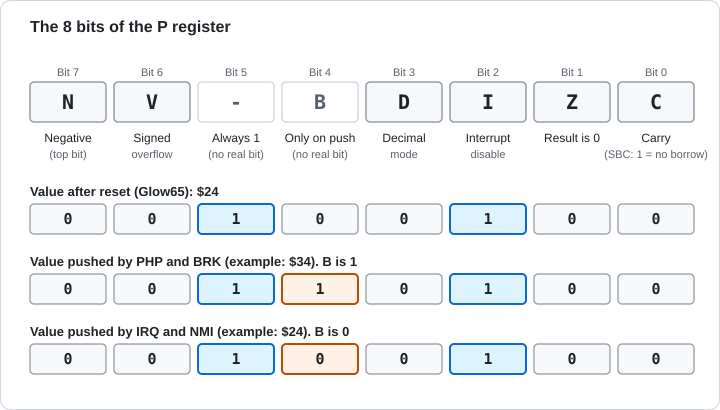

Figure 6-1 The 8 bits of the P register.

### 6.1.1 N and Z (Result Flags)

**N** (negative) is a copy of the most significant bit (bit 7) of the last result. Read as a signed number, 1 means negative. **Z** (zero) becomes 1 when the result is 0.

Load, transfer, add, logic, shift, and increment/decrement instructions set N and Z according to the result. Store, branch, and jump instructions do not change them. The example in section 3.6 continues here.

### 6.1.2 C (Carry)

**C** holds the digit that did not fit in 8 bits. Each instruction uses it in its own way.

| Instruction | What C does |
|---|---|
| ADC | Becomes 1 if the result exceeds `$FF`. In an addition, C is also added |
| SBC | Becomes 1 if the subtraction needs no borrow, 0 if it does. Set C to 1 with SEC before subtracting |
| ASL, ROL | The most significant bit moves out into C |
| LSR, ROR | The least significant bit moves out into C |
| ROL, ROR | The old C moves into the vacated bit |
| CMP, CPX, CPY | Becomes 1 if the register is greater than or equal to the value |

In a 16-bit addition, the ADC on the low byte produces a C, and the ADC on the high byte takes it in. This hand-over is shown in the 16-bit example in section 5.3 and in [tutorial chapter 2](../../tutorial/02-addition.md).

> **What you can try in Glow65**
>
> Write P after `$FF + $01`, `$30 - $50`, and `$50 - $30`, in order, starting at `$03F0`.
>
> ```
> *E 0300 18 A9 FF 69 01 08 68 8D F0 03 38 A9 30 E9 50 08
> *E 0310 68 8D F1 03 38 A9 50 E9 30 08 68 8D F2 03 60
> *G 0300
> *D 03F0 03F2
> 03F0: 37 B4 35 00 00 00 00 00 24 F4 24 F4 00 00 00 00
> ```
>
> `$37` has C and Z set to 1 (`$FF + $01` becomes 0 and a carry comes out). `$B4` has C = 0 and N = 1 (`$30 - $50` needed a borrow). `$35` has C = 1 (`$50 - $30` needs no borrow).

### 6.1.3 V (Overflow)

**V** shows overflow when the calculation is read as signed numbers. An 8-bit signed number ranges from -128 to 127. If you add two numbers with the same sign and the sign of the result changes, V becomes 1.

| Calculation | Result | Read as signed | V |
|---|---|---|---|
| `$50 + $50` | `$A0` | 80 + 80 = 160 (out of range) | 1 |
| `$7F + $01` | `$80` | 127 + 1 = 128 (out of range) | 1 |
| `$50 + $10` | `$60` | 80 + 16 = 96 (in range) | 0 |
| `$80 + $80` | `$00` | -128 + -128 = -256 (out of range) | 1 |

Look at C when you treat the numbers as unsigned, and at V when you treat them as signed. The same addition gives the two flags different meanings. For example, `$80 + $80` is 128 + 128 = 256 as unsigned numbers, so C is also 1.

> **What you can try in Glow65**
>
> Write P after four additions, in order, starting at `$03F0`. Before each addition, `CLC` sets C to 0.
>
> ```
> *E 0300 18 A9 50 69 50 08 68 8D F0 03 18 A9 7F 69 01 08
> *E 0310 68 8D F1 03 18 A9 50 69 10 08 68 8D F2 03 18 A9
> *E 0320 80 69 80 08 68 8D F3 03 60
> *G 0300
> *D 03F0 03F3
> 03F0: F4 F4 34 77 00 00 00 00 24 F4 24 F4 00 00 00 00
> ```
>
> `$F4` has N and V set to 1. `$34` has N and V set to 0. `$77` has V, Z, and C set to 1 and N = 0 (`$80 + $80` gives `$00` and a carry out).

### 6.1.4 D (Decimal Mode)

When **D** is 1, ADC and SBC calculate each 4-bit half as a digit from 0 to 9 (BCD). `$09 + $01` gives `$10`, not `$0A`. An example is in the decimal mode explanation in section 5.3.

The Glow65 CPU behaves like an NMOS 6502 by default. On an NMOS 6502, N, V, and Z in decimal mode may not match the result. An NMOS 6502 also leaves D unchanged when it accepts an interrupt. If a handler uses addition or subtraction, run CLD at the start of the handler.

> **What you can try in Glow65**
>
> After `SED`, write P to `$03F0`. After `CLD`, write it again to `$03F1`.
>
> ```
> *E 0300 F8 08 68 8D F0 03 D8 08 68 8D F1 03 60
> *G 0300
> *D 03F0 03F1
> 03F0: 3C 34 00 00 00 00 00 00 24 F4 24 F4 00 00 00 00
> ```
>
> D is bit 3. `$3C` (`%00111100`) has D = 1, and `$34` (`%00110100`) has D = 0.

### 6.1.5 I (Interrupt Disable)

While **I** is 1, the CPU does not accept IRQ. It accepts NMI regardless of I. SEI sets I to 1, and CLI sets it to 0. I is 1 after a reset, and also right after the CPU accepts an interrupt.

### 6.1.6 B and Bit 5

B (bit 4) is not a flag inside P. B is 1 only in the P that PHP and BRK push onto the stack. In the P pushed by IRQ and NMI, B is 0. A handler can look at B in the pushed P to tell whether it was called by BRK or by IRQ.

Bit 5 is always 1. PLP and RTI do not take B from the pulled value, and they leave bit 5 as 1. The bottom two rows of Figure 6-1 show the differences in the pushed values.

### 6.1.7 Flags Tested by Conditional Branches

A conditional branch instruction looks at one flag and decides whether to branch.

| Instruction | Flag tested | Branches when |
|---|---|---|
| BCC | C | 0 |
| BCS | C | 1 |
| BEQ | Z | 1 |
| BNE | Z | 0 |
| BMI | N | 1 |
| BPL | N | 0 |
| BVC | V | 0 |
| BVS | V | 1 |

### 6.1.8 After a Comparison (CMP)

CMP subtracts a value from A, throws the result away, and changes only the flags. C is 1 when A is greater than or equal to the value, and Z is 1 when they are equal. N is the most significant bit of the result of A minus the value.

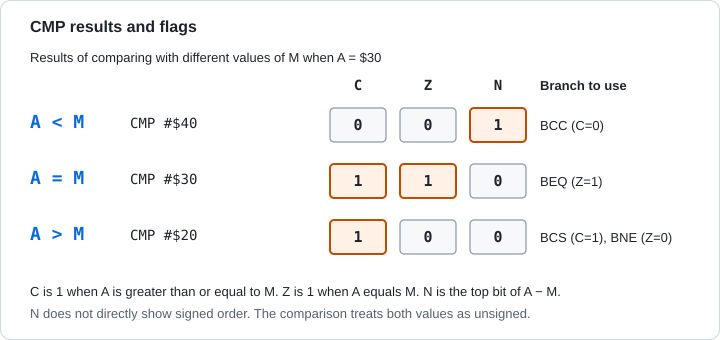

Figure 6-2 Flags and branches after CMP.

When A is less than the value, C is 0. When they are equal, Z is 1. When A is greater, C is 1 and Z is 0. Use C and Z to compare unsigned numbers. N does not directly tell you the signed order.

> **What you can try in Glow65**
>
> After `LDA #$30`, write P after `CMP #$30`, `CMP #$40`, and `CMP #$20`, in order, starting at `$03F0`.
>
> ```
> *E 0300 A9 30 C9 30 08 68 8D F0 03 A9 30 C9 40 08 68 8D
> *E 0310 F1 03 A9 30 C9 20 08 68 8D F2 03 60
> *G 0300
> *D 03F0 03F2
> 03F0: 37 B4 35 00 00 00 00 00 24 F4 24 F4 00 00 00 00
> ```
>
> `$37` has C and Z set to 1 (equal). `$B4` has C = 0 (less). `$35` has C = 1 and Z = 0 (greater).

## 6.2 The Stack

### 6.2.1 Location and SP

The stack is the 256 bytes of memory from `$0100` to `$01FF`. The value put in last is taken out first (last in, first out). SP (the stack pointer) is 8 bits, and the address `$0100` plus SP is the place where the next value is written.

To push, the CPU writes to that place and then subtracts 1 from SP. To pull, it adds 1 to SP and then reads that address. The stack grows from high addresses toward low addresses. The diagram is Figure 5-6 in section 5.6.

The Glow65 CPU sets SP to `$FD` on reset. The monitor sets SP to `$FF` right after reset. A program called with the monitor's `G` starts with SP at `$FD`, after the return address (2 bytes) has been pushed.

### 6.2.2 What Goes on the Stack

| Operation | What is pushed | Instruction that pulls it |
|---|---|---|
| PHA | A (1 byte) | PLA |
| PHP | P (1 byte, with B and bit 5 set to 1) | PLP |
| JSR | Return address (2 bytes: the address of the last byte of the JSR, high byte first) | RTS (adds 1 and puts it in PC) |
| BRK, IRQ, NMI | High byte of PC, low byte of PC, P (3 bytes) | RTI |

> **What you can try in Glow65**
>
> Push three values with `PHA` and read SP with `TSX`. Copy the stack page to `$0500`, then pull the three values with `PLA`.
>
> ```
> *E 0300 A9 11 48 A9 22 48 A9 33 48 BA 8E F0 03 A2 0F BD
> *E 0310 F0 01 9D 00 05 CA 10 F7 68 8D F1 03 68 8D F2 03
> *E 0320 68 8D F3 03 60
> *G 0300
> *D 03F0 03F3
> 03F0: FA 33 22 11 00 00 00 00 24 F4 24 F4 00 00 00 00
> *D 0500 050F
> 0500: 00 00 00 00 00 00 00 00 00 00 00 33 22 11 37 F2
> ```
>
> `$03F0` holds SP after the pushes: `$FA`. `$03F1` to `$03F3` hold `33`, `22`, `11` in the order they were pulled, the reverse of the order they were pushed. In the copy at `$0500`, `$050B` to `$050D` correspond to `$01FB` to `$01FD`, and `33 22 11` are laid out from the lower address. The following `37 F2` is the return address that the monitor's `G` pushed.

### 6.2.3 Nested JSR

A subroutine can call another subroutine. Each call pushes a return address, and each RTS pulls the newest one first.

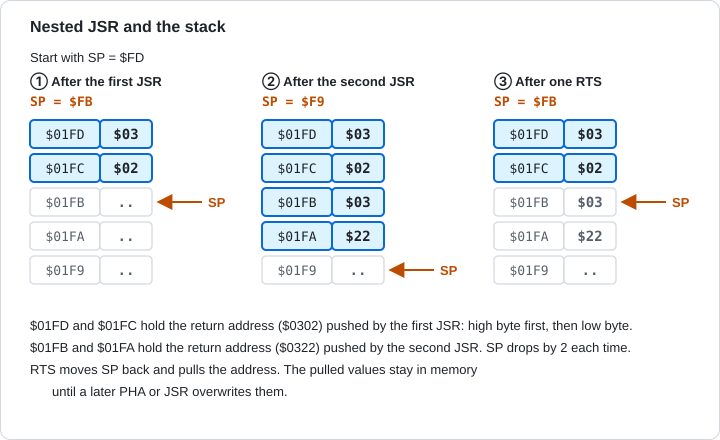

Figure 6-3 The stack with two nested JSR calls.

> **What you can try in Glow65**
>
> The program at `$0300` calls the subroutine at `$0320`, and `$0320` calls `$0330`. `$0330` writes SP to `$03F0` and copies the stack page to `$0500`.
>
> ```
> *E 0320 20 30 03 60
> *E 0330 BA 8E F0 03 A2 0F BD F0 01 9D 00 05 CA 10 F7 60
> *E 0300 20 20 03 60
> *G 0300
> *D 03F0 03F0
> 03F0: F9 00 00 00 00 00 00 00 24 F4 24 F4 00 00 00 00
> *D 0500 050F
> 0500: 00 00 00 00 00 00 00 00 00 00 22 03 02 03 37 F2
> ```
>
> `F9` at `$03F0` is SP after the second JSR. `$050A` to `$050D` of the copy hold `22 03 02 03`, which correspond to `$01FA` to `$01FD`. The high byte `03` is at `$01FD` and the low byte `02` at `$01FC`, which is the return address `$0302` of the first JSR. `$01FB` and `$01FA` hold the second one, `$0322`.

### 6.2.4 SP Wrap-Around

SP is 8 bits, so after `$00` it goes back to `$FF`. The stack goes around inside `$0100` to `$01FF` and never appears in other pages. If you push too much, old values are overwritten.

> **What you can try in Glow65**
>
> Set SP to `$00` and run `PHA`. Write the original SP to `$03F0` and the SP after the push to `$03F1`, then read `$0100`.
>
> ```
> *E 0300 BA 8E F0 03 A2 00 9A A9 AA 48 BA 8E F1 03 AE F0
> *E 0310 03 9A 60
> *G 0300
> *D 03F0 03F1
> 03F0: FD FF 00 00 00 00 00 00 24 F4 24 F4 00 00 00 00
> *D 0100 0100
> 0100: AA 00 00 00 00 00 00 00 00 00 00 00 00 00 00 00
> ```
>
> `FD` at `$03F0` is the original SP, and `FF` at `$03F1` is the SP after the push. The `$AA` from A was written to `$0100`.

### 6.2.5 TSX and TXS

TSX reads SP into X, and TXS writes X into SP. Changing SP moves the stack. If a program running under the monitor changes SP, it must restore the original value before returning to the monitor.

Keep `$0100` to `$01FF` for the stack only. A variable placed here is destroyed by pushed values. In Glow65, `$0200` to `$027F` is the monitor's line input buffer, and `$0300` to `$03F7` is the area for your own programs.

## 6.3 Interrupts

### 6.3.1 The Four Interrupts

There are four causes that make the CPU pause the running program and move elsewhere.

| Name | Source | Masked by I | Trigger | Vector | B in the pushed P |
|---|---|---|---|---|---|
| NMI | NMI button on the panel | No | Edge (once per change) | `$FFFA` `$FFFB` | 0 |
| IRQ | UART receive interrupt | Yes | Level (while the request continues) | `$FFFE` `$FFFF` | 0 |
| BRK | BRK instruction | No (always runs) | None | `$FFFE` `$FFFF` | 1 |
| Reset | RESET switch | No | None | `$FFFC` `$FFFD` | Nothing is pushed |

A vector is a place that holds the destination address in 2 bytes (low byte first). BRK and IRQ share the same vector.

### 6.3.2 The Acceptance Sequence

An interrupt request is accepted after the running instruction finishes [1]. When the CPU accepts it, it does the following automatically.

1. Push the high byte of PC, the low byte of PC, and P, in that order, onto the stack.
2. Set I to 1.
3. Read the vector address and put it in PC.
4. The handler (the program that deals with the interrupt) starts.

The pushed PC is the address of the next instruction for IRQ and NMI. For BRK, it is the address of the BRK plus 2. The handler ends with RTI. RTI pulls P and PC and returns without adding 1 to PC. The flags are restored as well.

A real 6502 takes 7 cycles to accept an interrupt. Glow65 does not reproduce the extra dummy reads, so only 5 bus accesses appear.

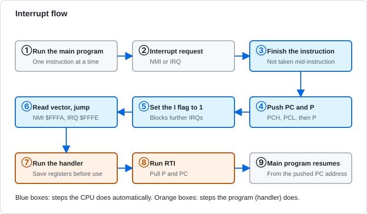

Figure 6-4 The flow of an interrupt.

### 6.3.3 The Difference between NMI and IRQ

NMI is accepted once each time the request changes from "none" to "present". It is accepted regardless of the I flag.

IRQ is accepted again and again while the request continues, as long as I is 0. If the handler returns with RTI without clearing the cause, the CPU accepts it again at once, because RTI restores P and I goes back to 0.

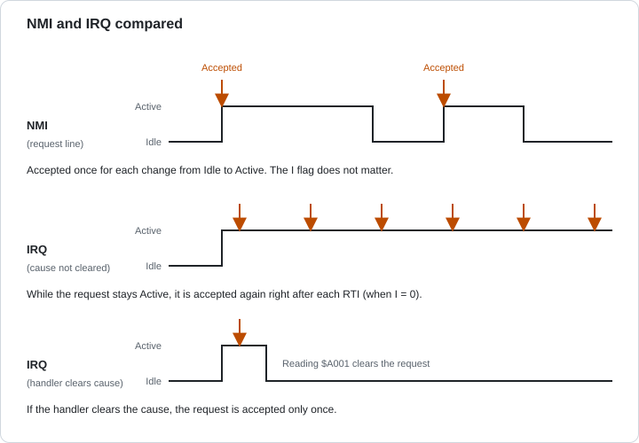

Figure 6-5 The difference between NMI and IRQ.

> **What you can try in Glow65**
>
> Enable the UART receive interrupt and send one character. The handler does not read `$A001`; it increments `$03F2` and returns with RTI. On the fifth call, it reads `$A001` and stops the interrupt.
>
> ```
> *E 0340 EE F2 03 AD F2 03 C9 05 D0 08 AD 01 A0 A9 00 8D
> *E 0350 00 A0 40
> *E 0300 78 A9 40 8D FA 03 A9 03 8D FB 03 A9 00 8D F2 03
> *E 0310 8D F1 03 A9 80 8D 00 A0 58 AD F2 03 C9 05 D0 F9
> *E 0320 78 A9 00 8D 00 A0 60
> *G 0300
> *D 03F2 03F2
> 03F2: 05 00 00 00 00 00 24 F4 40 03 00 00 00 00 00 00
> ```
>
> One received character called the handler 5 times, because the cause (unread received data) remained.

### 6.3.4 BRK

BRK is an instruction that causes an interrupt from a program. It uses the IRQ vector and is not masked by I. The byte after BRK is the signature byte. The CPU does not use this byte and skips it (the pushed PC is the address of the BRK + 2). If the handler reads the pushed PC, the address of the signature byte is one before that PC.

> **What you can try in Glow65**
>
> The BRK handler writes the P pushed on the stack to `$03F0`.
>
> ```
> *E 03FA 40 03
> *E 0340 BA BD 01 01 8D F0 03 40
> *E 0300 A2 00 A0 00 00 99 A0 55 60
> *G 0300
> *D 03F0 03F0
> 03F0: 36 00 00 00 00 00 00 00 24 F4 40 03 00 00 00 00
> ```
>
> `$36` is `%00110110`, and B (bit 4) is 1. Z and I are also 1.

### 6.3.5 Writing a Handler

The CPU saves only PC and P. If the handler uses A, X, or Y, it must save them at the start and restore them before RTI. Restore them by pulling in the reverse order of the pushes.

```
handler:
        pha             ; save A
        txa
        pha             ; save X
        ...             ; do the work
        pla
        tax             ; restore X
        pla             ; restore A
        rti
```

The next example is a handler called by the UART receive interrupt. It writes the pushed P to `$03F0`, and the I flag inside the handler to `$03F2`. The main program waits until `$03F1` becomes 1.

> **What you can try in Glow65**
>
> When you send one character, the handler is called.
>
> ```
> *E 0340 48 8A 48 BA BD 03 01 8D F0 03 08 68 29 04 8D F2
> *E 0350 03 AD 01 A0 A9 01 8D F1 03 68 AA 68 40
> *E 0300 78 A9 40 8D FA 03 A9 03 8D FB 03 A9 00 8D F1 03
> *E 0310 A9 80 8D 00 A0 58 AD F1 03 F0 FB 78 A9 00 8D 00
> *E 0320 A0 60
> *G 0300
> *D 03F0 03F2
> 03F0: 22 01 04 00 00 00 00 00 24 F4 40 03 00 00 00 00
> ```
>
> `22` at `$03F0` is the pushed P: B (bit 4) is 0, I (bit 2) is 0, bit 5 is 1, and Z is 1. `01` at `$03F1` is the done flag the handler set. `04` at `$03F2` shows that I was 1 inside the handler.

### 6.3.6 Interrupts in Glow65

The vectors are in ROM at `$FFFA` to `$FFFF` and cannot be rewritten. The monitor sends NMI, IRQ (and BRK) to your handler through two addresses in RAM.

| RAM address | Contents |
|---|---|
| `$03F8` `$03F9` | Address of the NMI handler (low byte first) |
| `$03FA` `$03FB` | Address of the IRQ and BRK handler (low byte first) |

At reset, the monitor points both at a routine that contains only RTI. To use your own handler, write its address there.

The UART interrupt is enabled by bit 7 of the control register (written at `$A000`). While it is enabled and there is unread received data, an IRQ request is raised. Bit 7 of the status register (read at `$A000`) is 1 while an interrupt is being requested. Reading `$A001` lowers the request. NMI is raised with the NMI button on the panel.

> **What you can try in Glow65**
>
> Load `tutorial/irq_echo.bin` at `$0300`, run it, and send `A`, `B`, and Enter.
>
> ```
> *G 0300
> AB
> *D 03F0 03F2
> 03F0: CA E9 0D 00 00 00 00 00 24 F4 3A 03 00 00 00 00
> ```
>
> The handler, called by the interrupt, echoes the characters. `$03F0` and `$03F1` hold a value the main program counted in the meantime, and it changes with each run. `0D` at `$03F2` is the sign that Enter was received.

### 6.3.7 Watching Interrupts on the Panel

> **What you can try in Glow65**
>
> You can follow the acceptance of an interrupt and the return from the handler one step at a time on the panel. Watch NMI with `nmi_count.bin` from [tutorial chapter 6](../../tutorial/06-interrupts.md).
>
> 1. Load `tutorial/nmi_count.bin` and run `G 0300` in the monitor. The program repeats `JMP $030F` at `$030F`.
> 2. Set **RUN/STOP** to STOP to stop the CPU. Set **STEP MODE** to CYCLE.
> 3. Press the **NMI** button.
>
> The state right after the press is as follows (Figure 6-6). The NMI LED lights, the CPU stays stopped, PC is `$030F`, and SP is `$FD`. The NMI LED shows the request before it is accepted.
>
> 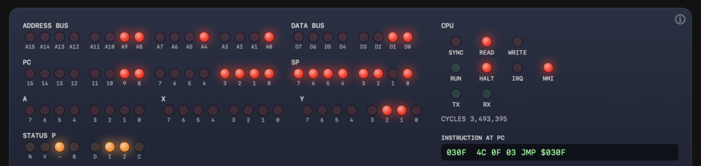
>
> Figure 6-6 Right after the NMI button is pressed
>
> Each press of **STEP** advances the acceptance by one step.
>
> | STEP | ADDRESS BUS | DATA BUS | What happened |
> |---|---|---|---|
> | 1st | `$01FD` | `$03` | WRITE lights. The high byte of PC is pushed. The NMI LED goes out |
> | 2nd | `$01FC` | `$0F` | The low byte of PC is pushed |
> | 3rd | `$01FB` | `$26` | P is pushed |
> | 4th | `$FFFA` | `$1E` | READ lights. The low byte of the NMI vector is read |
> | 5th | `$FFFB` | `$F4` | The high byte of the NMI vector is read |
> | 6th | unchanged | unchanged | PC becomes `$F41E` and SP becomes `$FA`. The acceptance is complete |
>
> From the 1st to the 5th step, PC stays at `$030F` and SP stays at `$FD`. This is because, in the middle of an instruction, PC and the registers show their values from before the instruction (section 3.4 in Chapter 3). The 1st STEP raises CYCLES by 7.
>
> 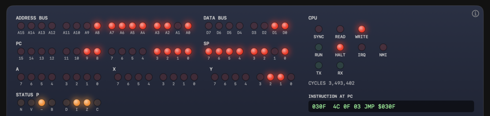
>
> Figure 6-7 The 1st STEP. The high byte of PC has been pushed to `$01FD`
>
> 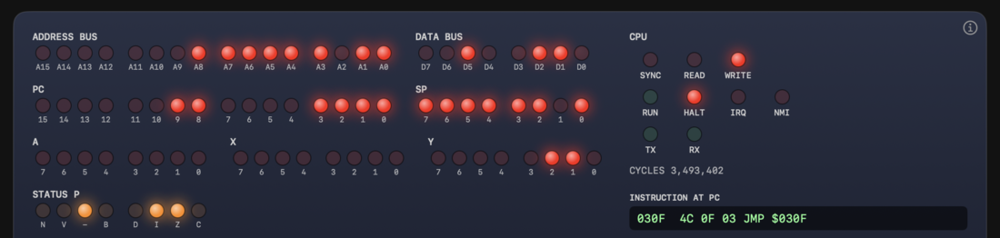
>
> Figure 6-8 The 3rd STEP. P (`$26`) has been pushed to `$01FB`
>
> 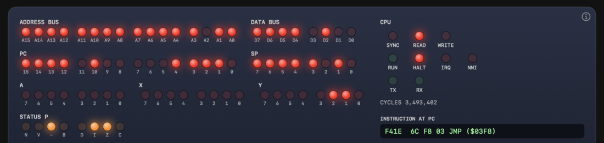
>
> Figure 6-9 The acceptance is complete. PC is `$F41E` (the monitor's `JMP ($03F8)`) and SP is `$FA` (3 bytes pushed)
>
> If you set STEP MODE to INSTR and keep pressing STEP, you can watch the handler run and return. The acceptance finishes in a single STEP.
>
> | STEP | What ran | PC | SP |
> |---|---|---|---|
> | 1st | Acceptance of the interrupt | `$F41E` | `$FA` |
> | 2nd | `JMP ($03F8)` | `$0312` (the handler's `PHA`) | `$FA` |
> | 3rd | `PHA` | `$0313` | `$F9` |
> | 11th | `RTI` | `$030F` | `$FD` |
>
> `PHA` lowers SP to `$F9` (Figure 6-10), and `RTI` returns PC to `$030F` and SP to `$FD` (Figure 6-11). The 4th to 10th steps are the handler's `INC $03F0`, `LDA $A000`, `AND #$02`, `BEQ`, `LDA #$21`, `STA $A001`, and `PLA`.
>
> 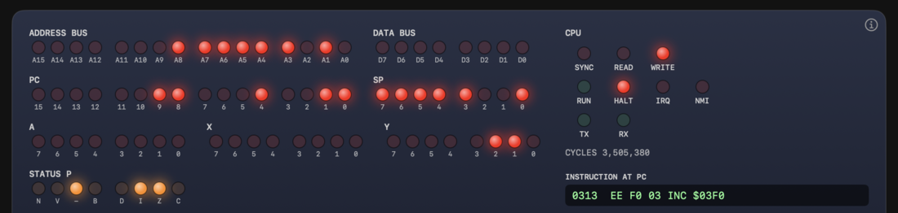
>
> Figure 6-10 After `PHA`. SP becomes `$F9`
>
> 
>
> Figure 6-11 After `RTI`. PC and SP are back to their old values

Watch IRQ with `tutorial/irq_echo.bin`. Run it with `G 0300`, set RUN/STOP to STOP and STEP MODE to INSTR, and type `A` on the terminal. The UART now holds a received character and the I flag is 0, so the next STEP accepts the interrupt.

> **What you can try in Glow65**
>
> | STEP | What ran | PC | IRQ LED |
> |---|---|---|---|
> | 1st | Acceptance of the interrupt | `$F421` | Lit |
> | 2nd | `JMP ($03FA)` | `$033A` | Lit |
> | 3rd | `PHA` | `$033B` | Lit |
> | 4th | `LDA $A001` | `$033E` | Lit. A is `$41` (`A`) |
> | 5th | `CMP #$0D` | `$0340` | Off |
>
> 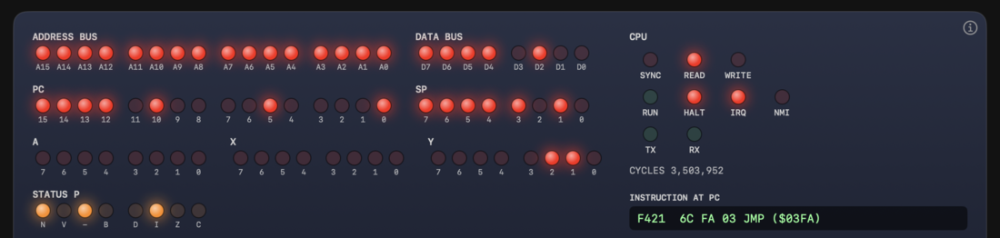
>
> Figure 6-12 Right after IRQ is accepted. PC is `$F421` (the monitor's `JMP ($03FA)`)
>
> Reading the received data with `LDA $A001` lowers the IRQ request. The IRQ LED shows the state of the line before the instruction runs, so it is still lit at the STEP that ran `LDA $A001` (Figure 6-13), and goes out at the next STEP (Figure 6-14).
>
> 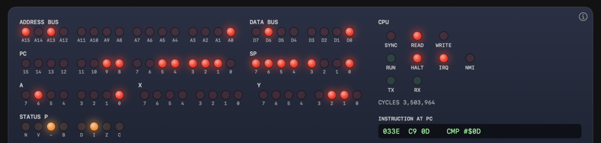
>
> Figure 6-13 After `LDA $A001`. A holds `$41` and the IRQ LED is still lit
>
> 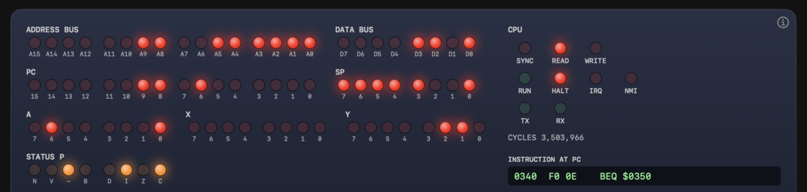
>
> Figure 6-14 After the next STEP. The IRQ LED goes out

The details of the procedure and how to write the programs are in [tutorial chapter 6](../../tutorial/06-interrupts.md).

## 6.4 Reset

A reset throws away the running program and starts again from a fixed state. The Glow65 CPU is in the following state after a reset.

| Item | Value after reset |
|---|---|
| A, X, Y | 0 |
| SP | `$FD` |
| P | `$24` (I is 1, D is 0) |
| PC | The 2 bytes at `$FFFC` and `$FFFD` (low byte first) |

On a real 6502, the internal state of the registers after reset is not defined [1]. The program initializes them first. The Glow65 monitor also runs `SEI`, `CLD`, `LDX #$FF`, and `TXS` at its start, which sets I to 1, D to 0, and SP to `$FF`. It then master-resets the UART and points the NMI and IRQ vectors at a routine that contains only RTI.

The RESET switch keeps the contents of RAM. Turning POWER off and on again clears RAM.

## 6.5 Practice Problems

The answers and explanations are in the next section.

**Problem 1** When P is `$B5`, which flags (N, V, D, I, Z, C) are 1?

**Problem 2** After `CLC`, you perform the following additions. Give N, V, and C after each addition. (1) `$20 + $30` (2) `$60 + $60` (3) `$C0 + $C0`

**Problem 3** When A is `$40`, give C, Z, and N after (1) `CMP #$41`, (2) `CMP #$40`, and (3) `CMP #$3F`.

**Problem 4** With SP at `$FD`, you run `PHA` twice and then `JSR`. What is SP right after entering the subroutine?

**Problem 5** You run the `JSR $0340` (`20 40 03`) at `$0300` with SP at `$FD`. Give the values pushed on the stack and the addresses where they are placed.

**Problem 6** With SP at `$00`, you run `PHA`. At which address is the value of A written? What is SP after the instruction?

**Problem 7** Right before an IRQ is accepted, PC is `$0312`, SP is `$FD`, and P is `$20`. Give SP, the contents of the stack, and P (the value of I) after the acceptance.

**Problem 8** You enabled the UART receive interrupt. What happens if the handler returns with RTI without reading `$A001`?

**Problem 9** In the BRK handler for a BRK at `$0302`, you check the PC pushed on the stack and find `$0304`. What is the address of the signature byte?

**Problem 10** Explain how a handler can tell whether it was entered from BRK or from IRQ.

## 6.6 Answers and Explanations

**Problem 1** N, I, C (and also bit 5 and B).
- `$B5` is `%10110101`. Bits 7 (N), 5, 4 (B), 2 (I), and 0 (C) are 1.

**Problem 2** (1) N = 0, V = 0, C = 0 (2) N = 1, V = 1, C = 0 (3) N = 1, V = 0, C = 1
- (1) The result is `$50`. (2) The result is `$C0`. 96 + 96 = 192 is out of the signed range, so V is 1. (3) The result is `$80` (-64 + -64 = -128 is in range, so V is 0). The sum exceeds `$FF`, so C is 1.

**Problem 3** (1) C = 0, Z = 0, N = 1 (2) C = 1, Z = 1, N = 0 (3) C = 1, Z = 0, N = 0
- (1) `$40 - $41` is negative. A is smaller. (2) They are equal. (3) `$40 - $3F` is 1. A is larger.

**Problem 4** `$F9`
- Two `PHA` take SP from `$FD` to `$FB`. JSR pushes 2 bytes, so SP becomes `$F9`.

**Problem 5** `$03` (high byte) at `$01FD`, and `$02` (low byte) at `$01FC`.
- The value pushed is the address of the last byte of the JSR, `$0302`. The high byte goes first, to `$0100 + $FD = $01FD`, and then the low byte goes to `$01FC`.

**Problem 6** It is written at `$0100`. SP becomes `$FF`.
- The CPU writes at `$0100 + $00 = $0100`, and subtracting 1 from SP wraps from `$00` to `$FF`.

**Problem 7** SP is `$FA`. `$01FD` holds `$03`, `$01FC` holds `$12`, and `$01FB` holds `$20`. I is 1 (P is `$24`).
- The CPU pushes the high byte of PC `$03`, the low byte `$12`, and then P. In the pushed P, B is 0 and bit 5 is 1, so it stays `$20`. After the acceptance I becomes 1, so P is `$24`.

**Problem 8** Even when the handler returns, the request continues. When RTI restores P and I becomes 0, the CPU accepts the IRQ again at once. This repeats.
- IRQ works as a level until the cause disappears. Reading `$A001` clears the cause.

**Problem 9** `$0303`
- The BRK is at `$0302`, and the signature byte is the next address, `$0303`. The pushed PC is `$0304`, the address after the signature byte, so the address of the signature byte is one before PC.

**Problem 10** Check B (bit 4) in the P pushed on the stack. If it is 1, the cause is BRK. If it is 0, the cause is IRQ.
- The P pushed by BRK has B = 1, and the P pushed by IRQ has B = 0. At the start of the handler, read the pushed P with `TSX` and `LDA $0101,X`, and test it with `AND #$10`.

## Sources

1. MOS Technology, "MCS6500 Microcomputer Family Hardware Manual", January 1976 edition: https://www.commodore.ca/wp-content/uploads/2018/11/kim1_hardware.txt

Next chapter: [7. The Memory Map and I/O →](07-memory-io.md)
