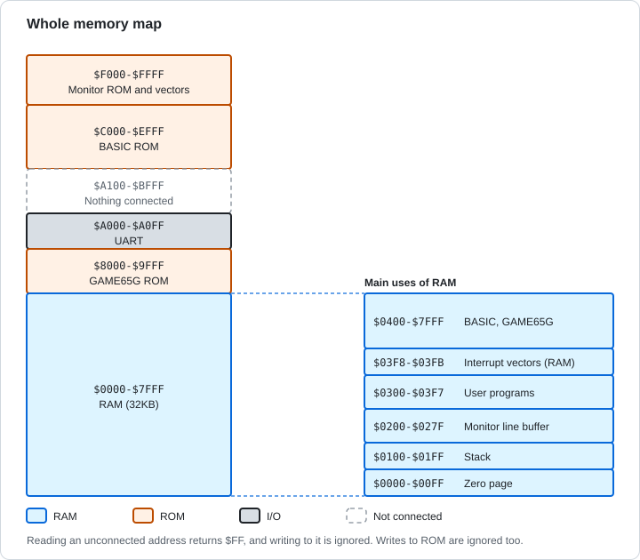
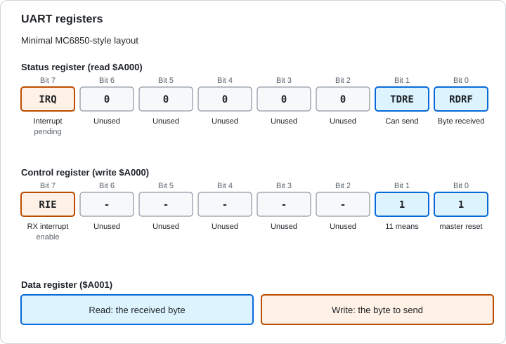
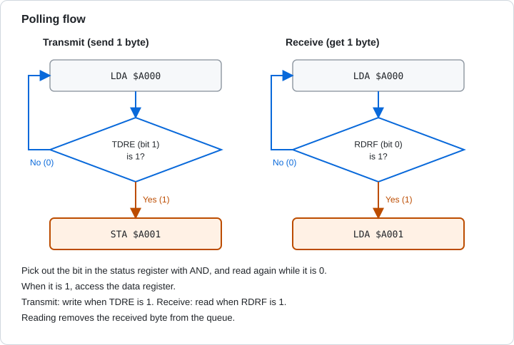

# Chapter 7 The Memory Map and I/O

[English](07-memory-io.md) | [日本語](../ja/07-memory-io.md)

[← 6. Flags, the Stack, and Interrupts](06-flags-stack-interrupts.md)

The CPU can read and write only the byte that an address selects. RAM, ROM, and the devices connected to the keyboard and screen all sit behind addresses. This chapter explains the memory map, which assigns addresses to parts, and memory-mapped I/O, which operates devices through addresses. The examples are the Glow65 UART and the monitor routines.

## 7.1 The Memory Map

### 7.1.1 Assigning Addresses

For every instruction, the CPU puts a 16-bit address on the address bus (Chapter 3). RAM, ROM, and I/O parts are connected behind that address. The **memory map** is the plan that decides which part gets which addresses in the 64KB address space. The circuit that selects a part from an address is called **address decoding**.

The number of addresses given to a part is the size of that part. Some addresses are given to nothing. The differences between RAM, ROM, and I/O are explained in section 2.8 of Chapter 2.

### 7.1.2 The Glow65 Memory Map

| Address | Part | Contents |
|---|---|---|
| `$0000-$7FFF` | RAM | 32KB |
| `$8000-$9FFF` | ROM | GAME65G (about 2.7KB used) |
| `$A000-$A0FF` | UART | Even addresses are status and control, odd addresses are data |
| `$A100-$BFFF` | None | Nothing is connected |
| `$C000-$EFFF` | ROM | Microsoft BASIC (about 8.6KB used) |
| `$F000-$FFFF` | ROM | Monitor, jump table, vectors |



Figure 7-1 The Glow65 memory map.

Reading an address with nothing connected returns `$FF`. A write is ignored. A write to ROM is also ignored.

When the power is turned on, all of RAM becomes 0. The RESET switch keeps the contents of RAM.

> **What you can try in Glow65**
>
> Read the end of RAM right after power-on, the unconnected `$A100` and `$B000`, and the start of ROM at `$F000`. Try writing to ROM with `E`.
>
> ```
> *D 7FF0 7FFF
> 7FF0: 00 00 00 00 00 00 00 00 00 00 00 00 00 00 00 00
> *D A100 A10F
> A100: FF FF FF FF FF FF FF FF FF FF FF FF FF FF FF FF
> *D B000 B00F
> B000: FF FF FF FF FF FF FF FF FF FF FF FF FF FF FF FF
> *E F000 00
> *D F000 F00F
> F000: 4C 0F F0 4C 28 F0 4C 37 F0 4C 4B F1 4C 1A F0 AD
> ```
>
> `$7FF0` is filled with 0. `$A100` and `$B000` are all `FF`. Even after `E F000 00`, `$F000` is still `4C` (the `JMP` instruction).

The UART takes 256 addresses, `$A000` to `$A0FF`. Only the lowest bit of the address chooses between status and control (even) and data (odd). As a result, the two registers appear repeated 128 times each (**mirrors**). This is simple decoding that selects a part by looking at only a rough part of the address.

> **What you can try in Glow65**
>
> Read the status at `$A000` and at `$A0FE` (a mirror). Writing `M` to the odd address `$A003` sends it, the same as writing to `$A001`.
>
> ```
> *E 0300 AD 00 A0 8D F0 03 AD FE A0 8D F1 03 A9 4D 8D 03
> *E 0310 A0 A9 0D 8D 03 A0 A9 0A 8D 03 A0 60
> *G 0300
> M
> *D 03F0 03F1
> 03F0: 02 02 00 00 00 00 00 00 24 F4 24 F4 00 00 00 00
> ```
>
> Both statuses are `02`. `M` appears on the terminal.

### 7.1.3 How RAM Is Used

The RAM from `$0000` to `$7FFF` is divided up by purpose.

| Address | Use |
|---|---|
| `$0000-$00FF` | Zero page. Can be addressed with a 1-byte address. The monitor uses `$F0-$FF`. BASIC keeps the USR vector (`$0A-$0C`) and the vector for the integer and floating-point conversion routines (`$06-$09`), among other things. GAME65G uses `$00-$2C`, and `$80-$B3` for the variables A-Z |
| `$0100-$01FF` | The stack (Chapter 6) |
| `$0200-$027F` | The monitor's line input buffer |
| `$0300-$03F7` | 248 bytes for user programs |
| `$03F8-$03F9` | Address of the NMI handler (low byte first) |
| `$03FA-$03FB` | Address of the IRQ and BRK handler (low byte first) |
| `$0400-$7FFF` | BASIC programs and variables. GAME65G uses `$0400-$05FF` for its input buffers, second stack, and type-ahead buffer, and stores its program from `$0600` |

How BASIC uses the zero page is described in [tutorial chapter 5](../../tutorial/05-usr.md).

## 7.2 Memory-Mapped I/O

I/O is operated the same way as memory: by reading and writing at an address. This method is called **memory-mapped I/O**. No special instructions are needed. `LDA` and `STA` work as they are.

However, I/O addresses behave differently from ordinary memory.

| Difference | Example in the UART |
|---|---|
| Reading changes the state | Reading `$A001` removes the received byte from the queue |
| Reading and writing reach different registers | `$A000` is status when read and control when written. `$A001` is received data when read and transmit data when written |
| A written value may not read back | The value written to `$A001` does not come back when read |
| A value changes regardless of the program | When a character arrives, the status register changes |

> **What you can try in Glow65**
>
> Read 16 bytes from `$A000` with `D`.
>
> ```
> *D A000 A00F
> A000: 02 00 02 00 02 00 02 00 02 00 02 00 02 00 02 00
> ```
>
> Even addresses are the status, `02` (only the transmit-ready bit is 1). Odd addresses are the data, `00` (no received data).

`D` reads every address in the range. Reading an odd address takes out the received byte, if there is one, and removes it from the UART. To observe I/O, have a program read the status and the data, write the results to memory, and then look at them with `D`.

## 7.3 UART

The UART is a device that handles serial communication with the terminal. It sends and receives one byte at a time. The Glow65 UART is a minimal design similar to the MC6850, with two registers, `$A000` and `$A001`.

| Address | Read | Write |
|---|---|---|
| `$A000` | Status register | Control register |
| `$A001` | Received data | Transmit data |



Figure 7-2 The UART registers.

| Register | Bit | Name | Meaning |
|---|---|---|---|
| Status | 0 | RDRF | When 1, there is received data |
| Status | 1 | TDRE | When 1, the UART can transmit |
| Status | 7 | IRQ | When 1, an interrupt is being requested |
| Control | 7 | RIE | When 1, raises IRQ while there is received data |
| Control | 0 and 1 | - | When both are 1 (`%11`), master reset. Discards the received data and also turns off the interrupt enable |

The Glow65 UART never makes transmission wait. TDRE is always 1. If you write your program to check TDRE before writing, it works the same way with a UART that transmits slowly.

### 7.3.1 Polling

A program that reads the status register again and again, waiting for a bit to become 1, is using a method called **polling**.



Figure 7-3 The flow of polling.

Transmit and receive are written as follows. The monitor's `CHROUT` and `CHRIN` follow the same steps.

```
putc:   pha
wait:   lda $A000
        and #$02        ; TDRE
        beq wait
        pla
        sta $A001       ; transmit
        rts

getc:   lda $A000
        and #$01        ; RDRF
        beq getc
        lda $A001       ; receive
        rts
```

> **What you can try in Glow65**
>
> The program waits for a received character. Send `Q` while it runs. It reads `$A000`, `$A001`, and `$A000` in that order and writes the values from `$03F0`.
>
> ```
> *E 0300 AD 00 A0 29 01 F0 F9 AD 00 A0 8D F0 03 AD 01 A0
> *E 0310 8D F1 03 AD 00 A0 8D F2 03 60
> *G 0300
> *D 03F0 03F2
> 03F0: 03 51 02 00 00 00 00 00 24 F4 24 F4 00 00 00 00
> ```
>
> The first status is `03` (RDRF and TDRE), the data is `51` (`Q`), and the status after reading the data is `02`. Reading removes the received data, and RDRF goes back to 0.

> **What you can try in Glow65**
>
> Set RIE (bit 7) of the control register to 1, and do the same thing. The CPU's I stays 1, so no interrupt occurs.
>
> ```
> *E 0300 A9 80 8D 00 A0 AD 00 A0 29 01 F0 F9 AD 00 A0 8D
> *E 0310 F0 03 AD 01 A0 8D F1 03 AD 00 A0 8D F2 03 A9 03
> *E 0320 8D 00 A0 60
> *G 0300
> *D 03F0 03F2
> 03F0: 83 51 02 00 00 00 00 00 24 F4 24 F4 00 00 00 00
> ```
>
> The status is `83`. IRQ (bit 7) is 1, which means an interrupt is being requested. After the data is read, the status goes back to `02`.

> **What you can try in Glow65**
>
> Send two characters (`X` and `Y`). When the UART is ready to receive, write `$03` to the control register and then read the status.
>
> ```
> *E 0300 AD 00 A0 29 01 F0 F9 A9 03 8D 00 A0 AD 00 A0 8D
> *E 0310 F0 03 60
> *G 0300
> *D 03F0 03F0
> 03F0: 02 00 00 00 00 00 00 00 24 F4 24 F4 00 00 00 00
> ```
>
> The status is `02`. The master reset discarded the received data.

> **What you can try in Glow65**
>
> You can follow how the status changes during polling on the panel. Use `echo.bin` from [tutorial chapter 4](../../tutorial/04-echo.md).
>
> 1. Load `tutorial/echo.bin` and run `G 0300` in the monitor. The program repeats `LDA $A000`, `AND #$01`, and `BEQ` while it waits for input.
> 2. Set **RUN/STOP** to STOP to stop the CPU. Set **STEP MODE** to INSTR and press **STEP**.
> 3. At the STEP that ran `LDA $A000`, ADDRESS BUS is `$A000`, DATA BUS is `$02` (only D1 is lit), and A is also `$02`. Only transmit-ready (TDRE) is 1, and there is no received data (Figure 7-4).
> 4. While stopped, type `h` on the terminal. At the next STEP that runs `LDA $A000`, DATA BUS is `$03` (D1 and D0), and A is also `$03`. Received data (RDRF) is now 1 (Figure 7-5).
> 5. Step through `AND #$01` and `BEQ`. It does not branch and goes on to `LDA $A001`. At the STEP that runs `LDA $A001`, ADDRESS BUS is `$A001`, DATA BUS is `$68` (`h`), and A is also `$68` (Figure 7-6).
> 6. At the next `LDA $A000` in the wait for transmit, DATA BUS is back to `$02`. Reading the data made RDRF 0 (Figure 7-7).
>
> 
>
> Figure 7-4 With no received data. Reading `$A000` gives `$02`
>
> 
>
> Figure 7-5 After typing `h`. Reading `$A000` gives `$03`
>
> 
>
> Figure 7-6 Reading `$A001` puts the received `h` (`$68`) in A
>
> 
>
> Figure 7-7 After the data is read. `$A000` is back to `$02`

Receiving with interrupts is covered in [6.3.6](06-flags-stack-interrupts.md) and in [tutorial chapter 6](../../tutorial/06-interrupts.md). Transmitting and receiving by polling are covered in [tutorial chapter 3](../../tutorial/03-uart.md) and [chapter 4](../../tutorial/04-echo.md).

## 7.4 Monitor Routines

The monitor keeps a table of five `JMP` instructions in ROM, starting at `$F000` (the jump table). Each one jumps to a routine. Even if the routine bodies move, these addresses do not change. Call them with `JSR`.

| Address | Name | Input | Output | Action |
|---|---|---|---|---|
| `$F000` | CHRIN | None | A = character | Waits until a character arrives and reads one character |
| `$F003` | CHROUT | A = character | None (A changes) | Drops the most significant bit and sends one character. Waits until it can transmit |
| `$F006` | ISCNTC | None | C = 1 if Ctrl-C, C = 0 otherwise (A changes) | Does not wait. If a character is there, reads one and checks whether it is Ctrl-C (`$03`) |
| `$F009` | Warm start | None | None | Returns to the monitor. Jump with `JMP`, not `JSR` |
| `$F00C` | GETKEY | None | A = character, or A = 0 if none has arrived | Reads one character without waiting |

X and Y are not changed by any of the routines.

> **What you can try in Glow65**
>
> Send `$48` (`H`) and `$C9` with `CHROUT`, then CR (`$0D`) and LF (`$0A`).
>
> ```
> *E 0300 A9 48 20 03 F0 A9 C9 20 03 F0 A9 0D 20 03 F0 A9
> *E 0310 0A 20 03 F0 60
> *G 0300
> HI
> ```
>
> `$C9` is sent as `$49` (`I`), with its most significant bit dropped.

> **What you can try in Glow65**
>
> Wait for one character with `CHRIN` and write it to `$03F0`. Send `z` while it runs.
>
> ```
> *E 0300 20 00 F0 8D F0 03 60
> *G 0300
> *D 03F0 03F0
> 03F0: 7A 00 00 00 00 00 00 00 24 F4 24 F4 00 00 00 00
> ```
>
> You can read `$7A`, the ASCII code of `z`.

> **What you can try in Glow65**
>
> Call `GETKEY` once while no character has arrived and write the result to `$03F0`. Then call it repeatedly until a character arrives. Send `k` while it runs.
>
> ```
> *E 0300 20 0C F0 8D F0 03 20 0C F0 F0 FB 8D F1 03 60
> *G 0300
> *D 03F0 03F1
> 03F0: 00 6B 00 00 00 00 00 00 24 F4 24 F4 00 00 00 00
> ```
>
> `$03F0` is `00`. The routine returned without waiting, so A was 0. `6B` at `$03F1` is `k`.

> **What you can try in Glow65**
>
> Call `ISCNTC` repeatedly until Ctrl-C arrives, and send `!` when it does. While it runs, send `a` and then Ctrl-C (`$03`).
>
> ```
> *E 0300 20 06 F0 90 FB A9 21 20 03 F0 A9 0D 20 03 F0 A9
> *E 0310 0A 20 03 F0 60
> *G 0300
> !
> ```
>
> `a` is read and discarded, the routine returns with C = 0, and the loop continues. Ctrl-C gives C = 1, and `!` appears.

> **What you can try in Glow65**
>
> Write `$77` to `$03F0` and return to the monitor with `JMP $F009`.
>
> ```
> *E 0300 A9 77 8D F0 03 4C 09 F0
> *G 0300
> *D 03F0 03F0
> 03F0: 77 00 00 00 00 00 00 00 24 F4 24 F4 00 00 00 00
> ```
>
> You get back to the monitor prompt without using `RTS`.

The monitor commands are as follows.

| Command | Action |
|---|---|
| `D aaaa [bbbb]` | Memory dump (128 bytes if the end address is omitted) |
| `E aaaa bb bb ...` | Write bytes |
| `L aaaa [bbbb]` | Disassemble (16 instructions if the end address is omitted) |
| `G aaaa` | Call the routine at `aaaa` (returns to the monitor with RTS) |
| `B` | Start BASIC |
| `T` | Start GAME65G |
| `?` | Help |

## 7.5 The Vector Area

The last 6 bytes of ROM (`$FFFA` to `$FFFF`) are the vectors for NMI, reset, and IRQ and BRK. How they work is explained in section 3.7 of Chapter 3 and in section 6.3 of Chapter 6.

## 7.6 Practice Problems

The answers and explanations are in the next section.

**Problem 1** What part is read, and what do you get, when you read each of these addresses? (1) `$0300` (2) `$A0F5` (3) `$B000` (4) `$F000`

**Problem 2** Which UART registers are `$A0A0` and `$A0A1`?

**Problem 3** What happens when you run `STA $F000`?

**Problem 4** You read the status register and got `$03`. What does it tell you?

**Problem 5** You read the status register and got `$83`. What does it tell you?

**Problem 6** Write a routine that uses RDRF in the status register to read one byte into A by receive polling.

**Problem 7** What appears on the terminal after `LDA #$C1` and `JSR $F003`?

**Problem 8** One byte of received data, `Q`, has arrived. The program reads `$A000`, `$A001`, and `$A000` in that order. What are the three values it read?

**Problem 9** You call `JSR $F006` while `a` has arrived. What are C and `a` when it returns?

## 7.7 Answers and Explanations

**Problem 1** (1) RAM. The value you wrote can be read back (`$00` right after power-on). (2) The UART data register. `$00` if there is no received data. (3) Nothing is connected. `$FF`. (4) The monitor ROM. The start of the jump table, `$4C` (`JMP`).
- (1) `$0300` is inside `$0000-$7FFF`. (2) `$A0F5` is inside `$A000-$A0FF`, and it is odd, so it is data. (3) `$B000` is inside `$A100-$BFFF`, which is unconnected. (4) `$F000` is ROM, and `D` shows `4C`.

**Problem 2** `$A0A0` is status when read and control when written. `$A0A1` is received data when read and transmit data when written.
- The UART appears as mirrors in `$A000-$A0FF`. Even addresses are status and control, and odd addresses are data.

**Problem 3** Nothing happens. ROM does not change, and the program goes on to the next instruction.
- Writes to ROM are ignored.

**Problem 4** There is received data (RDRF = 1), and the UART can also transmit (TDRE = 1). No interrupt is requested.
- `$03` is `%00000011`. Bit 0 and bit 1 are 1. Bit 7 (IRQ) is 0.

**Problem 5** There is received data, the UART can transmit, and an interrupt is being requested.
- `$83` is `%10000011`. Bit 7 (IRQ), bit 1 (TDRE), and bit 0 (RDRF) are 1. IRQ becomes 1 when RIE in the control register is 1 and there is unread received data.

**Problem 6**
```
getc:   lda $A000
        and #$01        ; RDRF
        beq getc        ; repeat while 0
        lda $A001       ; when 1, read the data
        rts
```
- Read the status and pick out bit 0 with AND. Repeat while it is 0, and read `$A001` when it becomes 1.

**Problem 7** `A`
- `CHROUT` drops the most significant bit. `$C1` becomes `$41`, the ASCII code of `A`.

**Problem 8** `$03`, `$51`, `$02`
- The first status has RDRF and TDRE, so it is `$03`. Reading `$A001` takes out `Q` (`$51`) and removes the received data. In the second status, RDRF is back to 0, so it is `$02`.

**Problem 9** C is 0, and `a` is discarded.
- `ISCNTC` reads one character if there is one. If it is not `$03`, it returns with C = 0. The character it read is not returned.

Next chapter: [8. Glossary and Index →](08-glossary-index.md)
