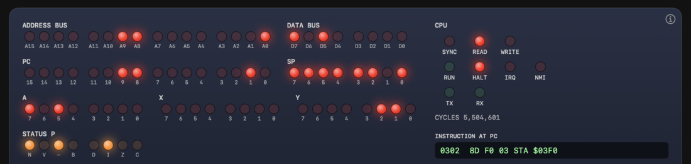
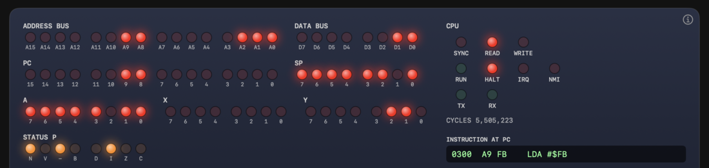

# 第2章 コンピュータの基本

[日本語](02-basics.md) | [English](../en/02-basics.md)

[← 1. 6502 の歴史](01-history.md)

CPU が扱うのは、0 と 1 の並びだけです。この章では、その並びを人間が読み書きする方法を説明します。ビットとバイト、2進数と16進数、負の数、文字、メモリとアドレスを順に扱います。数学の前提は、2 のべき乗(2、4、8、16 ...)と四則演算までです。

各節の末尾に、Glow65 で確かめられる操作を載せています。モニタの使い方は、[README](../../README.ja.md)の「モニタのコマンド」にあります。練習問題と答えは、章末にあります。

## 2.1 ビットとバイト

**ビット**は、0 か 1 のどちらかを持つ、最小の単位です。スイッチの ON と OFF にあたります。

**バイト**は、8 ビットをひとまとめにした単位です。6502 は、1 バイトずつデータを扱います。ビットを 8 個並べると、0 と 1 の組み合わせは 2 の 8 乗で 256 通りになります。

8 個のビットには、右端を 0 番として、左へ 1 番、2 番、...、7 番と番号を付けます。0 番を**最下位ビット**、7 番を**最上位ビット**と呼びます。

## 2.2 2進数

ふだん使う 10 進数は、1 桁ごとに 10 倍になります。345 は、3 x 100 + 4 x 10 + 5 x 1 です。

**2進数**は、1 桁ごとに 2 倍になる数の書き方です。使う数字は 0 と 1 だけです。8 ビットの各桁の重みは、左から次のとおりです。

| ビット番号 | 7 | 6 | 5 | 4 | 3 | 2 | 1 | 0 |
|---|---|---|---|---|---|---|---|---|
| 重み | 128 | 64 | 32 | 16 | 8 | 4 | 2 | 1 |

この本では、2進数の先頭に `%` を付けます。`%01101001` は、重み 64、32、8、1 のビットが 1 なので、64 + 32 + 8 + 1 で 105 です。

**2進数から10進数への変換**は、1 のビットの重みを足します。

**10進数から2進数への変換**は、大きい重みから順に、引けるかどうかを調べます。200 の場合は次のとおりです。

1. 200 から 128 を引ける。残り 72。ビット 7 は 1。
2. 72 から 64 を引ける。残り 8。ビット 6 は 1。
3. 8 は 32 より小さい。ビット 5 は 0。16 より小さい。ビット 4 は 0。
4. 8 から 8 を引ける。残り 0。ビット 3 は 1。
5. 残りはないので、ビット 2、1、0 は 0。

結果は `%11001000` です。

## 2.3 16進数

2進数は、桁数が多くて読みにくくなります。8 ビットで 8 桁、16 ビットでは 16 桁です。そこで、4 ビットずつまとめて 1 桁で書く**16進数**を使います。

4 ビットは 0 から 15 までの 16 通りです。16進数は、1 桁で 0 から 15 を表します。10 から 15 には、アルファベットの A から F を使います。

| 10進 | 2進 | 16進 | | 10進 | 2進 | 16進 |
|---|---|---|---|---|---|---|
| 0 | %0000 | 0 | | 8 | %1000 | 8 |
| 1 | %0001 | 1 | | 9 | %1001 | 9 |
| 2 | %0010 | 2 | | 10 | %1010 | A |
| 3 | %0011 | 3 | | 11 | %1011 | B |
| 4 | %0100 | 4 | | 12 | %1100 | C |
| 5 | %0101 | 5 | | 13 | %1101 | D |
| 6 | %0110 | 6 | | 14 | %1110 | E |
| 7 | %0111 | 7 | | 15 | %1111 | F |

6502 の世界では、16進数の先頭に `$` を付けます。`$A0` は 16進数の A0 です。この本も、これに従います。

**2進数と16進数の変換**は、4 ビットずつ区切って、表を引くだけです。

- `%10100000` を 4 ビットずつに分けると、`1010` と `0000` です。表から、A と 0 です。結果は `$A0` です。
- `$3C` は、3 が `0011`、C が `1100` です。結果は `%00111100` です。

**16進数から10進数への変換**は、上の桁に 16 を掛けて、下の桁を足します。`$A0` は、A が 10 なので 10 x 16 + 0 で 160 です。

**10進数から16進数への変換**は、16 で割ります。商が上の桁、余りが下の桁です。200 を 16 で割ると、商が 12、余りが 8 です。12 は C なので、`$C8` です。

16 ビットの値は、16進数 4 桁で書きます。`$1234` は、上位の 2 桁 `$12` と、下位の 2 桁 `$34` に分けて考えます。

> **コラム: 16進数の書き方いろいろ**
>
> 16進数の書き方は、言語や道具によって違います。6502 のアセンブラでは、`$` を付けるのが一般的です。C 言語などでは `0x` を付けて、`0xA0` と書きます。Intel 系のアセンブラでは、末尾に `h` を付けて `0A0h` と書きます。どれも同じ数を表します。

> **Glow65 で確かめられること**
>
> パネルのデータバスの LED は、D7 から D0 までの 8 個です。バスにある値の各ビットが 1 なら、その LED が点きます。値が `$A0`(`%10100000`)のとき、点くのは D7 と D5 の 2 個です。アドレスバスは A15 から A0 までの 16 個です。
>
> `$A0` を LED で見るには、`LDA #$A0` を実行して、A レジスタの LED を読みます。
>
> 1. モニタで `E 0300 A9 A0 8D F0 03 4C 00 03` を入力し、`G 0300` を実行する。プログラムは、`LDA #$A0`、`STA $03F0`、`JMP $0300` を繰り返す。
> 2. **RUN/STOP** を STOP にして、CPU を止める。**STEP MODE** を INSTR にする。
> 3. **STEP** を押して、INSTRUCTION AT PC が `LDA #$A0` になるまで進め、もう 1 回押す。
>
> `LDA #$A0` を実行した直後は、A の LED で A7 と A5 が点灯します(図 2-1)。DATA BUS も、D7 と D5 が点灯します。直前に読んだオペランドが `$A0` だからです。ADDRESS BUS は、オペランドを読んだ番地 `$0301` です。最上位ビットが 1 なので、N フラグの LED も点灯します。
>
> 
>
> 図 2-1 `LDA #$A0` のあと。A の LED は A7 と A5、DATA BUS は D7 と D5、ADDRESS BUS は `$0301`

## 2.4 数の範囲

8 ビットで表せる数は、すべてのビットが 0 のときの 0 から、すべてが 1 のときの 255 までです。16進数では `$00` から `$FF` です。

16 ビットなら、0 から 65535 まで、`$0000` から `$FFFF` です。65535 は、2 の 16 乗から 1 を引いた数です。

| ビット数 | 範囲(10進) | 範囲(16進) |
|---|---|---|
| 8 | 0 〜 255 | `$00` 〜 `$FF` |
| 16 | 0 〜 65535 | `$0000` 〜 `$FFFF` |

範囲を超える計算をすると、入りきらなかった桁が捨てられます。8 ビットで 255 + 1 を計算すると、結果は 256 ではなく 0 になります。桁があふれたことは、**キャリー**という印(フラグ)に記録されます。キャリーは第6章で説明します。

## 2.5 負の数と2の補数

CPU が持っているのは、ビットの並びだけです。負の数も、ビットの並びで表します。6502 では、**2の補数**という方式を使います。

2の補数では、最上位ビット(ビット 7)が 1 なら負の数、0 なら 0 以上の数と読みます。このビットを**符号ビット**と呼びます。8 ビットで表せる範囲は、-128 から 127 です。

| 2進 | 16進 | 符号なしで読むと | 符号付きで読むと |
|---|---|---|---|
| %00000000 | `$00` | 0 | 0 |
| %00000001 | `$01` | 1 | 1 |
| %01111111 | `$7F` | 127 | 127 |
| %10000000 | `$80` | 128 | -128 |
| %11111111 | `$FF` | 255 | -1 |

同じ `$FF` が、読み方によって 255 にも -1 にもなります。CPU は、どちらで読むかを知りません。プログラムを書く人が決めます。

**負の数の作り方**は、2 つの手順です。-5 の場合は次のとおりです。

1. 5 の 2進数 `%00000101` の、0 と 1 をすべて反転する。`%11111010` になる。
2. 1 を足す。`%11111011`、つまり `$FB` になる。

**確かめ方**は、256 を足して見ることです。`$FB` は 251 で、251 - 256 は -5 です。また、`$FB` に 5 を足すと 256 になり、8 ビットでは 0 に戻ります。

2の補数には、符号付きの数も、符号なしの数と同じ足し算の回路で計算できるという利点があります。

> **Glow65 で確かめられること**
>
> 分岐命令 `BNE` は、飛び先を、次の命令からの距離(符号付き 1 バイト)で持ちます。モニタの `L` で、距離のバイトが飛び先の番地に変わる様子を見られます。
>
> ```
> *E 0300 D0 FB
> *L 0300 0301
> 0300  D0 FB     BNE   $02FD
> ```
>
> `BNE` は 2 バイトの命令なので、次の命令は `$0302` です。距離 `$FB` は -5 です。0302 から 5 戻って `$02FD` になります。`D0 7F`(距離 +127)なら `BNE $0381`、`D0 F0`(距離 -16)なら `BNE $02F2` と表示されます。
>
> 2 の補数は、A の LED でも確かめられます。上の 2.3 と同じ手順で、`E 0300 A9 FB 8D F0 03 4C 00 03` を入力して実行し、`LDA #$FB` のあとで止めます。A の LED は、A2 だけが消灯して、`%11111011`(`$FB`、-5)になります(図 2-2)。最上位ビットが 1 なので、N フラグも点灯します。CPU は、この値を符号なしの 251 とも、符号付きの -5 とも読めます。
>
> 
>
> 図 2-2 `LDA #$FB` のあと。A の LED は A2 以外が点灯

## 2.6 文字コード(ASCII)

コンピュータは、文字も数で表します。どの文字にどの数を割り当てるかを決めた表が**文字コード**です。英数字と記号では、ASCII(アスキー)という割り当てが広く使われています。Glow65 の UART が送受信するのは、ASCII です。

ASCII の主な割り当ては、次のとおりです。

| 文字 | コード | 備考 |
|---|---|---|
| `0` 〜 `9` | `$30` 〜 `$39` | 数字の文字。`0` が `$30`、`9` が `$39` |
| `A` 〜 `Z` | `$41` 〜 `$5A` | 大文字。`A` が `$41` |
| `a` 〜 `z` | `$61` 〜 `$7A` | 小文字。`a` が `$61` |
| CR | `$0D` | 改行(キャリッジリターン)。Return キーで送られる |

数字の文字 `7` は、数の 7 ではなく、コード `$37` です。文字 `7` から数の 7 を得るには、`$30` を引きます。

大文字と小文字は、コードの差がちょうど `$20` です。`A`(`$41`)と `a`(`$61`)がその例です。

ASCII は 7 ビットで足ります。8 ビットのバイトの最上位ビットは、使われません。Glow65 のモニタの `CHROUT` ルーチンは、出力するバイトの最上位ビットを捨てます(README のジャンプテーブル)。

> **Glow65 で確かめられること**
>
> UART のデータは `$A001` に書きます。`LDA #$48`、`STA $A001` を並べたプログラムを作ると、`H`(`$48`)が端末に出ます。次は、`H`、`I`、CR を順に送る 16 バイトのプログラムです。`G` で実行し、最後の `60`(`RTS`)でモニタに戻ります。
>
> ```
> *E 0300 A9 48 8D 01 A0 A9 49 8D 01 A0 A9 0D 8D 01 A0 60
> *G 0300
> HI
> ```
>
> `$0D` を送ると、端末の表示が改行されます。

## 2.7 メモリとアドレス

プログラムとデータは、**メモリ**に置きます。メモリは、1 バイトずつ入る箱が一列に並んだ棚です。箱の一つ一つに、先頭から順に番号を付けます。この番号が**アドレス**(番地)です。

6502 のアドレスは 16 ビットです。表せる番号は、`$0000` から `$FFFF` までの 65,536 個です。1 つの箱が 1 バイトなので、全体で 65,536 バイトになります。1 KB(キロバイト)を 1,024 バイトとすると、これは 64 KB です。この全体を**アドレス空間**と呼びます。

16 ビットのアドレスをメモリに置くには、2 バイト使います。6502 は、**下位のバイトを先**に、上位のバイトを次に置きます。この並べ方を**リトルエンディアン**と呼びます。

たとえば、アドレス `$1234` を `$0300` から置くと、次のようになります。

| アドレス | `$0300` | `$0301` |
|---|---|---|
| 内容 | `$34`(下位) | `$12`(上位) |

見た目の順序と逆なので、読むときは注意してください。

> **Glow65 で確かめられること**
>
> 次の 3 つのコマンドで、メモリの読み書きを確かめられます。
>
> - `E` は、指定したアドレスから、バイトを順に書き込みます。
> - `D` は、メモリの内容を 16 進数で表示します。表示は 16 バイト単位で、開始アドレスから 16 個を出します。
> - `L` は、メモリの内容を命令として読みます。
>
> `$1234` を下位から置く例です。
>
> ```
> *E 0300 34 12
> *D 0300 0301
> 0300: 34 12 00 00 00 00 00 00 00 00 00 00 00 00 00 00
> ```
>
> `$0300` に `34`、`$0301` に `12` が入っています。先頭の 2 バイトが、下位、上位の順です。
>
> BASIC でも、同じことを確認できます。モニタで `B` を入力して BASIC を起動し、Return を 2 回押して、次を入力します。
>
> ```
> POKE 768,52 : POKE 769,18
> PRINT PEEK(769)*256+PEEK(768)
>  4660
> ```
>
> 768 は `$0300`、52 は `$34`、18 は `$12` です。上位バイトに 256 を掛けて下位バイトを足すと、4660 になります。4660 は `$1234` の 10進数です。

16 ビットの値を 2 バイトで置く例は、6502 自身の中にもあります。CPU は、電源が入ったときや割り込みのときに、アドレス `$FFFA` から `$FFFF` までの 6 バイトを読みます。そこには、3 つの飛び先のアドレスが、リトルエンディアンで並んでいます。詳しくは第6章で説明します。

> **Glow65 で確かめられること**
>
> モニタの `D FFF0 FFFF` で、末尾の 6 バイトを見られます。
>
> ```
> *D FFF0 FFFF
> FFF0: FF FF FF FF FF FF FF FF FF FF 1E F4 2A F1 21 F4
> ```
>
> 末尾の 6 バイトは、`1E F4`、`2A F1`、`21 F4` の 3 組です。リトルエンディアンなので、`$F41E`、`$F12A`、`$F421` と読みます。`$FFFC` と `$FFFD` の `$F12A` が、電源投入時に CPU が最初に飛ぶアドレスです。

## 2.8 ROM、RAM、I/O

アドレス空間は、1 種類の部品だけでできているとは限りません。同じアドレスの付け方で、別の役割の部品をつなぎます。

- **RAM**は、読み書きできるメモリです。電源を切ると内容が消えます。プログラムの変数や、作業用のデータを置きます。
- **ROM**は、読み出し専用のメモリです。電源を切っても内容が残ります。起動時に動くプログラムを置きます。
- **I/O**(入出力)は、外の装置との窓口です。メモリのアドレスの一部に、装置が割り当てられます。そのアドレスを読み書きすると、装置とのやり取りになります。この方式を、メモリマップド I/O と呼びます。

Glow65 のアドレス空間は、次のように使います(README の「メモリマップ」と同じ内容です)。

| アドレス | 種類 | 内容 |
|---|---|---|
| `$0000-$7FFF` | RAM | 32KB |
| `$0200-$027F` | RAM の中 | モニタの行入力バッファ |
| `$0300-$03F7` | RAM の中 | 自作プログラム用に空けてある領域 |
| `$03F8-$03F9` | RAM の中 | NMI ハンドラのアドレス |
| `$03FA-$03FB` | RAM の中 | IRQ と BRK のハンドラのアドレス |
| `$0400-$7FFF` | RAM の中 | BASIC か GAME65G のプログラムと変数 |
| `$8000-$9FFF` | ROM | GAME65G |
| `$A000` | I/O | UART の状態と制御 |
| `$A001` | I/O | UART のデータ |
| `$C000-$EFFF` | ROM | Microsoft BASIC(約 8.6KB を使用) |
| `$F000-$FFFF` | ROM | モニタとベクタ(`$FFFA-$FFFF`) |

`$A000-$A0FF` は UART に割り当てられています。偶数番地が状態と制御、奇数番地がデータとして働き、通常使うのは `$A000` と `$A001` です。上の表に載っていないアドレスには、何もつながっていません。そこを読むと `$FF` が返ります。ROM に書き込んでも、内容は変わりません。

UART は、端末とやり取りするための装置です。`$A001` に書いたバイトは端末へ出て、端末から入力されたバイトは `$A001` から読めます。`$A000` は、受信できるか、送信できるかを知らせる状態です。詳しい使い方は、第7章で説明します。

> **Glow65 で確かめられること**
>
> 何もつながっていないアドレスは、`$FF` になります。
>
> ```
> *D B000 B00F
> B000: FF FF FF FF FF FF FF FF FF FF FF FF FF FF FF FF
> ```
>
> ROM への書き込みは、無視されます。`$F000` は ROM で、モニタの先頭の `JMP`(`$4C`)が入っています。
>
> ```
> *E F000 00
> *D F000 F00F
> F000: 4C 0F F0 4C 28 F0 4C 37 F0 4C 4B F1 4C 1A F0 AD
> ```
>
> `E F000 00` のあとも、`$F000` は `4C` のままです。RAM の `$0300` で同じ操作をすると、書いた値が残ります(2.7 の例)。

## 2.9 練習問題

答えと解き方は、次の節にあります。

**問1** 次の 2進数を 10進数にしてください。(1) `%10110101` (2) `%01100110`

**問2** 次の 10進数を 8 ビットの 2進数にしてください。(1) 200 (2) 77

**問3** 次の 16進数を 10進数にしてください。(1) `$2F` (2) `$C8`

**問4** 次の 10進数を 16進数にしてください。(1) 100 (2) 173

**問5** 次の 16進数を 2進数にしてください。(1) `$5A` (2) `$E3`

**問6** `%10010110` を 16進数にしてください。

**問7** 次の数を、8 ビットの 2の補数で 16進数にしてください。(1) -3 (2) -100

**問8** 次の 8 ビットの値を、符号付きの数として 10進数で読んでください。(1) `$F0` (2) `$80`

**問9** 8 ビットで `$7F` に `$01` を足すと `$80` になります。(1) 符号なしの数として読むと、いくつからいくつへの変化ですか。(2) 符号付きの数として読むと、いくつからいくつへの変化ですか。

**問10** 文字列 `HI` の ASCII コードを、16進数で答えてください。文字 `7` のコードは `$37` です。この文字から、数の 7 を得る計算を答えてください。

**問11** `$0300` に `5A`、`$0301` に `02` が入っています。この 2 バイトが 16 ビットのアドレスなら、いくつですか。答えを、Glow65 のモニタで確かめる方法も書いてください。

**問12** 次のアドレスの範囲は、何バイトですか。(1) `$0400` から `$7FFF` まで (2) `$0300` から `$03F7` まで

## 2.10 練習問題の答えと解き方

**問1** (1) 181 (2) 102

- (1) 128 + 32 + 16 + 4 + 1 = 181
- (2) 64 + 32 + 4 + 2 = 102

**問2** (1) `%11001000` (2) `%01001101`

- (1) 本文の 2.2 を参照。128 + 64 + 8 = 200。
- (2) 77 から 64 を引くと 13。13 から 8、4、1 を引くと 0。ビット 6、3、2、0 が 1。

**問3** (1) 47 (2) 200

- (1) 2 x 16 + 15 = 47
- (2) 12 x 16 + 8 = 200

**問4** (1) `$64` (2) `$AD`

- (1) 100 を 16 で割ると、商 6、余り 4。
- (2) 173 を 16 で割ると、商 10、余り 13。10 は A、13 は D。

**問5** (1) `%01011010` (2) `%11100011`

- (1) 5 は `0101`、A は `1010`。
- (2) E は `1110`、3 は `0011`。

**問6** `$96`

- `1001` は 9、`0110` は 6。

**問7** (1) `$FD` (2) `$9C`

- (1) 3 は `%00000011`。反転して `%11111100`、1 を足して `%11111101` で `$FD`。
- (2) 100 は `$64`、`%01100100`。反転して `%10011011`、1 を足して `%10011100` で `$9C`。確かめ: `$9C` は 156 で、156 - 256 は -100。

**問8** (1) -16 (2) -128

- (1) `$F0` は 240。240 - 256 = -16。
- (2) `$80` は 128。128 - 256 = -128。最上位ビットだけが 1 の値が、8 ビットで一番小さい数です。

**問9** (1) 127 から 128 (2) 127 から -128

- 同じビットの変化が、符号なしでは 1 つ増えただけです。符号付きでは、一番大きい数から一番小さい数に変わります。

**問10** `HI` は `$48 $49`。数の 7 は、`$37 - $30 = 7`。

- `H` は `$48`、`I` は `$49`。数字の文字から `$30` を引くと、数になる。

**問11** `$025A`(10進数で 602)

- 下位バイトが先なので、上位は `$02`、下位は `$5A`。
- モニタで確かめる方法は、`E 0300 5A 02` を入力して `D 0300 0301` で内容を表示することです。表示の先頭が `5A 02` になります。
- BASIC なら、`POKE 768,90 : POKE 769,2` のあと `PRINT PEEK(769)*256+PEEK(768)` で、602 になります。

**問12** (1) 31,744 バイト (2) 248 バイト

- (1) `$7FFF - $0400 + 1`。`$7FFF` は 32767、`$0400` は 1024。32767 - 1024 + 1 = 31744。
- (2) `$03F7 - $0300 + 1`。1015 - 768 + 1 = 248。

次の章: [3. CPU の中身 →](03-cpu.md)
