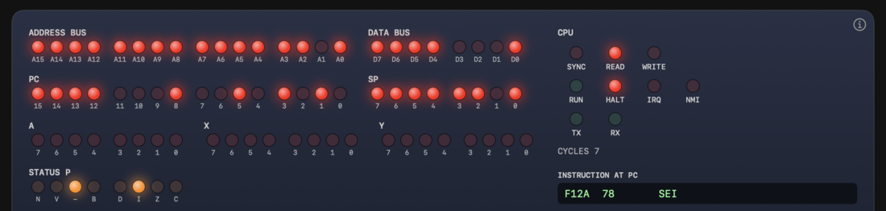
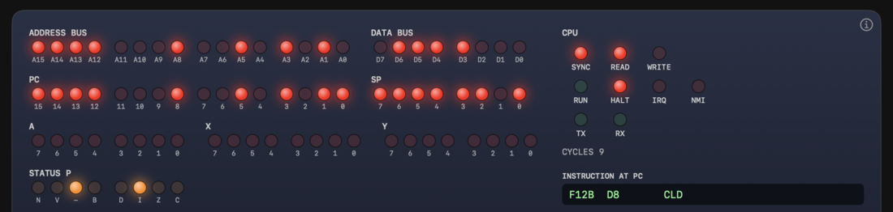
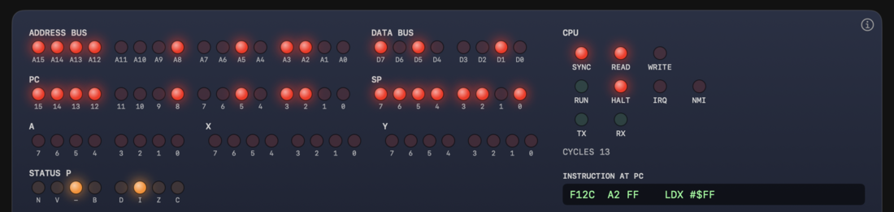
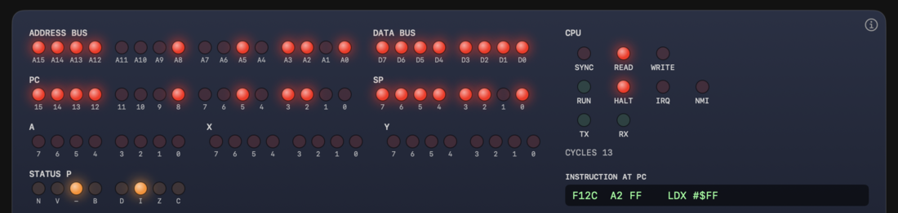
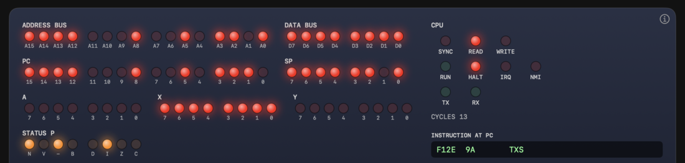
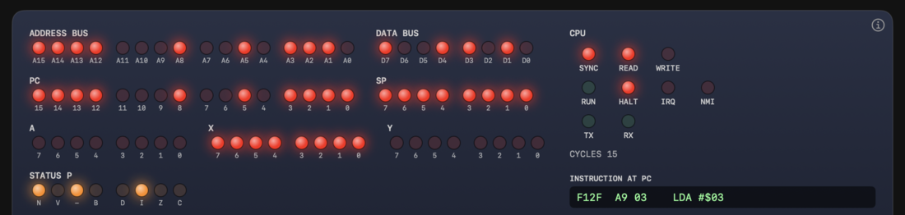

# 第3章 CPU の中身

[日本語](03-cpu.md) | [English](../en/03-cpu.md)

[← 2. コンピュータの基本](02-basics.md)

CPU は、メモリにある命令を 1 つずつ取り出して実行する部品です。この章では、6502 の内部にある記憶領域(レジスタ)と、メモリとの間で信号をやり取りする線(バス)、命令を実行する手順(フェッチと実行)を説明します。

## 3.1 CPU とメモリ

プログラムは、メモリに置いたバイトの列です。CPU は、メモリの先頭から順に命令のバイトを読み、その内容に従って動きます。足し算をする、メモリに値を書く、別の場所へ飛ぶ、といった動きです。

CPU が次に読む場所は、**PC**(プログラムカウンタ)というレジスタが覚えています。命令を 1 つ読むたびに、PC はその命令の長さだけ進みます。

## 3.2 レジスタ

**レジスタ**は、CPU の内部にある、数バイト分の記憶領域です。メモリより速く読み書きできます。6502 のレジスタは、次の 6 つです[1]。

| レジスタ | 幅 | 役割 |
|---|---|---|
| A(アキュムレータ) | 8 ビット | 計算の中心。足し算や比較の対象になる |
| X | 8 ビット | インデックスレジスタ。アドレスにずらしを加えるときなどに使う |
| Y | 8 ビット | X と同じ役割のレジスタ |
| SP(スタックポインタ) | 8 ビット | スタックの現在位置。スタックは `$0100-$01FF` を使う |
| PC(プログラムカウンタ) | 16 ビット | 次に実行する命令のアドレス |
| P(ステータス) | 8 ビット | 直前の命令の結果を表す、フラグの集まり |

A、X、Y は、プログラムが自由に使えます。SP は第6章で扱います。X と Y の使い方は第4章で扱います。

### フラグ

P は、1 ビットずつに意味があります。1 ビットを**フラグ**と呼びます。上位のビットから、次のように並んでいます。

| ビット | 7 | 6 | 5 | 4 | 3 | 2 | 1 | 0 |
|---|---|---|---|---|---|---|---|---|
| 名前 | N | V | - | B | D | I | Z | C |
| 意味 | ネガティブ。結果の最上位ビットが 1 | オーバーフロー。符号付きの結果が範囲を超えた | 未使用 | ブレーク | 10進モード | 割り込み禁止 | ゼロ。結果が 0 | キャリー。桁あふれ |

各フラグの働きは、第6章で説明します。ここでは、**N と Z** を覚えてください。A や X に値が入る命令の多くは、その値が 0 なら Z を 1 に、最上位ビットが 1 なら N を 1 にします。

### リセット後の値

CPU は、リセット(電源投入や RESET スイッチ)のあとに、決まった状態から動き出します。Glow65 では、リセット後の値は次のとおりです。

| レジスタ | リセット後の値 |
|---|---|
| A、X、Y | 0 |
| SP | `$FD` |
| P | `$24`(`%00100100`)。I フラグが 1、ビット 5 が 1 |
| PC | アドレス `$FFFC` と `$FFFD` にある 2 バイト(下位が先) |

PC が `$FFFC` と `$FFFD` から決まる仕組みは、3.7 で説明します。実機の 6502 では、リセット後のレジスタの内部状態は決まっておらず、プログラムが初期化する必要があります[1]。

> **Glow65 で確かめられること**
>
> パネルには、PC、SP、A、X、Y と、ステータスの 8 個のフラグの LED があります。ステータスの LED は、左から `N`、`V`、`-`、`B`、`D`、`I`、`Z`、`C`(ビット 7 から 0)の順に並んでいます。LED は、値の 1 のビットが点灯し、0 のビットは消灯します。
>
> リセット直後の状態は、次の手順で見られます。
>
> 1. **POWER** を ON にする。
> 2. **RUN/STOP** を STOP にして、CPU を止める。
> 3. **RESET** を押す。
>
> リセットした CPU は、止まったまま、次の状態になります。
>
> | 表示 | LED | 読み取れる値 |
> |---|---|---|
> | PC | 15、14、13、12、8、5、3、1 が点灯 | `$F12A` |
> | SP | 7、6、5、4、3、2、0 が点灯 | `$FD` |
> | A、X、Y | すべて消灯 | 0 |
> | STATUS P | `-` と `I` が点灯 | `$24` |
> | ADDRESS BUS | A1 以外が点灯 | `$FFFD` |
> | DATA BUS | D7、D6、D5、D4、D0 が点灯 | `$F1` |
> | CYCLES | 7 | |
> | INSTRUCTION AT PC | `F12A  78  SEI` | |
>
> 最後に読んだのは `$FFFD` で、その値 `$F1` が PC の上位バイトになりました。READ と HALT の LED が点灯し、RUN の LED は消灯しています。PC の `$F12A` は、`$FFFC` の `2A` と `$FFFD` の `F1` から決まった値です(3.7)。
>
> 
>
> 図 3-1 リセット直後のパネル

## 3.3 バス

CPU とメモリの間は、複数の線でつながっています。この線の束を**バス**と呼びます。

| バス・信号 | 本数 | 役割 |
|---|---|---|
| アドレスバス | 16 本(A0 〜 A15) | CPU が、どの番地を読み書きするかを伝える |
| データバス | 8 本(D0 〜 D7) | 読み書きするバイトが流れる |
| R/W | 1 本 | 読み出し(Read)なら 1、書き込み(Write)なら 0 |
| SYNC | 1 本 | 命令の最初の 1 バイト(オペコード)を読んでいるとき 1 |

アドレスバスの 16 本は、第2章の 16 ビットのアドレスに対応します。データバスの 8 本は、1 バイトの 8 ビットに対応します[1]。

R/W は、CPU がメモリを**読む**のか**書く**のかを示します。メモリを読むときは、CPU がアドレスを出し、メモリがデータバスにバイトを出します。書くときは、CPU がアドレスとバイトの両方を出します。

SYNC は、いま読んでいるバイトが、命令の最初のバイトであることを示します。命令の途中のバイトを読むとき、また書き込みのときは、SYNC は出ません[1]。

**CPU は、1 回のクロック(サイクル)で、バスに 1 回アクセスします**。読むか書くかのどちらかです[1]。

> **Glow65 で確かめられること**
>
> パネルには、ADDRESS BUS の LED が A0 から A15 の 16 個、DATA BUS の LED が D0 から D7 の 8 個あります。READ、WRITE、SYNC の LED もあります。READ はメモリを読んでいるとき、WRITE は書いているとき、SYNC はオペコードを読んでいるときに光ります。1 kHz 以下の SPEED では、バスアクセスが 1 つずつ表示されます。

## 3.4 フェッチと実行

CPU は、同じ手順を繰り返して、プログラムを実行します。

1. **フェッチ(取り出し)**: PC の番地から、命令の最初の 1 バイト(**オペコード**)を読む。PC を 1 進める。
2. **オペランドの取り出し**: オペコードが、さらにバイトを必要とするなら、続けて読む。読むたびに PC を 1 進める。オペランドとは、命令が使う値や、番地を表すバイトのことです。
3. **実行**: 命令の動作を行う。レジスタを変える、メモリに書く、PC を別の場所にする、などです。

オペコードを読んだ時点で、CPU はその命令に必要なバイト数と動作を知ります。次は、チュートリアル第1章の 5 行のプログラムを実行したときの、バスアクセスの表です。

```
0300  A9 00        LDA #$00
0302  8D F0 03     STA $03F0
0305  18           CLC
0306  69 01        ADC #$01
0308  4C 02 03     JMP $0302
```

| # | アドレス | データ | 読み/書き | SYNC | 命令 |
|---|---|---|---|---|---|
| 1 | `$0300` | `A9` | 読み | ○ | `LDA #$00` |
| 2 | `$0301` | `00` | 読み | | |
| 3 | `$0302` | `8D` | 読み | ○ | `STA $03F0` |
| 4 | `$0303` | `F0` | 読み | | |
| 5 | `$0304` | `03` | 読み | | |
| 6 | `$03F0` | `00` | 書き | | |
| 7 | `$0305` | `18` | 読み | ○ | `CLC` |
| 8 | `$0306` | `69` | 読み | ○ | `ADC #$01` |
| 9 | `$0307` | `01` | 読み | | |
| 10 | `$0308` | `4C` | 読み | ○ | `JMP $0302` |
| 11 | `$0309` | `02` | 読み | | |
| 12 | `$030A` | `03` | 読み | | |

SYNC が付くのは、命令の最初のバイトを読むときだけです。`STA $03F0` は、オペコードと 2 バイトのアドレスで 3 回読み、そのあとの 1 回で書きます。

### サイクルとクロック

CPU の動きは、**クロック**という一定間隔の信号で進みます。クロックの 1 周期が 1 **サイクル**です。クロックが 1 MHz なら、1 秒に 100 万サイクルです。1 サイクルは 1 マイクロ秒です。

命令の実行にかかるサイクル数は、命令によって違います。MOS 社の資料では、2 サイクルから 7 サイクルの命令があります[1]。`LDA #$00` は 2 サイクル、`STA $03F0` は 4 サイクルです。

実機の 6502 は、`CLC` のような 1 バイトの命令でも 2 サイクルかかり、次のバイトをもう 1 回読みます。これは結果に使われません[1]。Glow65 は、この余分な読み出しを再現しません。表で `CLC` のアクセスが 1 回なのはそのためです。サイクルのカウンタは、実機と同じ 2 だけ進みます。

> **コラム: SYNC を使ったシングルステップ**
>
> MOS 社の資料には、SYNC 信号の使い方が書かれています。SYNC が 1 になるのは、オペコードを読むサイクルです。そのとき、CPU の RDY という端子を 0 にすると、CPU はその状態で止まります。RDY を 1 に戻すと再開します。この仕組みで、命令を 1 つずつ実行するシングルステップを作れます[1]。Glow65 の STEP スイッチも、命令やバスアクセスを 1 つずつ進めるための機能です。

> **Glow65 で確かめられること**
>
> パネルで、サイクル単位の動きを追えます。3.2 の手順でリセットしたあと、**STEP MODE** を CYCLE にして、**STEP** を 1 回ずつ押します。CPU は、モニタの先頭のプログラム(`SEI`、`CLD`、`LDX #$FF`、`TXS`)を実行します。
>
> | STEP | ADDRESS BUS | DATA BUS | SYNC | その STEP で起きたこと |
> |---|---|---|---|---|
> | 押す前 | `$FFFD` | `$F1` | | リセットの読み出し(3.2) |
> | 1 回目 | `$F12A` | `$78` | 点灯 | `SEI` のオペコードを読んだ。1 回の読み出しで終わる命令なので、PC は `$F12B` に進み、INSTRUCTION AT PC は `CLD` になる |
> | 2 回目 | `$F12B` | `$D8` | 点灯 | `CLD` のオペコードを読んだ。PC は `$F12C` |
> | 3 回目 | `$F12C` | `$A2` | 点灯 | `LDX #$FF` のオペコードを読んだ |
> | 4 回目 | `$F12D` | `$FF` | 消灯 | `LDX` のオペランドを読んだ |
> | 5 回目 | `$F12D` | `$FF` | 消灯 | バスは変わらず、`LDX` の結果が表示に反映される |
>
> 3 回目と 4 回目の間、PC は `$F12C` のままで、X は 0 のままです。2 バイトの命令では、**命令を読み終えるまで、PC、レジスタ、フラグは、実行前の値を示します**。5 回目の STEP で、X が `$FF`、N フラグが点灯、PC が `$F12E`(INSTRUCTION AT PC は `TXS`)になります。
>
> CYCLES は、命令の最初のバスアクセスで、その命令のサイクル数だけ進みます。`SEI` の STEP で 7 から 9 になり、`CLD` で 11、`LDX #$FF` の 3 回目で 13 になります。
>
> 
>
> 図 3-2 STEP 1 回目。`SEI` のオペコードを読んだところ
>
> 
>
> 図 3-3 STEP 3 回目。`LDX #$FF` のオペコードを読んだところ。PC は `$F12C`、X は 0 のまま
>
> 
>
> 図 3-4 STEP 4 回目。`LDX` のオペランドを読んだところ。SYNC は消灯し、X はまだ 0
>
> 
>
> 図 3-5 STEP 5 回目。バスは変わらず、X が `$FF`、N が点灯、PC が `$F12E` になる
>
> SPEED を 10 Hz にして RUN にすると、同じ動きが連続して流れます。アドレスバスの下位の LED は、PC が進むたびに変わります。
>
> STEP MODE を INSTR にすると、STEP を 1 回押すごとに 1 命令進みます。バスには、その命令の最後のバスアクセスが残ります。手順の詳細は、[チュートリアル第1章](../../tutorial/README.ja.md)にあります。
>
> 自分のプログラムを遅くして見るときは、パネルの G SPEED が使えます。G SPEED を 10 Hz にしておくと、モニタの `G` で起動したプログラムだけが 10 Hz で動き、モニタへの入力は速いままです。モニタのプロンプトに戻ると(RTS、RESET)、SPEED は元の速度に戻ります。

## 3.5 命令の構成

命令は、1 バイトのオペコードと、0 から 2 バイトのオペランドでできています。命令の長さは、1 バイトから 3 バイトです。

| 長さ | 構成 | 例 |
|---|---|---|
| 1 バイト | オペコードだけ | `AA`(`TAX`) |
| 2 バイト | オペコード + 1 バイト | `A9 00`(`LDA #$00`) |
| 3 バイト | オペコード + 2 バイト(下位が先) | `8D F0 03`(`STA $03F0`) |

長さは、オペコードで決まります。同じ `LDA` でも、`A9` は 2 バイトで、`AD` は 3 バイトです。オペランドの意味(値そのものか、番地か)は、**アドレッシングモード**で決まります。第4章で詳しく扱います。

3 バイトの命令で、番地は、第2章のリトルエンディアンで置きます。`8D F0 03` の `F0 03` は、番地 `$03F0` です。

> **Glow65 で確かめられること**
>
> モニタの `E` でバイトを書き、`L` で命令として読みます。
>
> ```
> *E 0300 A9 00 8D F0 03
> *L 0300 0304
> 0300  A9 00     LDA   #$00
> 0302  8D F0 03  STA   $03F0
> ```
>
> `L 0300 0304` は、`$0300` から `$0304` までの範囲を逆アセンブルします。`LDA` が 2 バイト、`STA` が 3 バイトであることが、アドレスの増え方でわかります。
>
> 同じバイト列でも、先頭の位置を変えると、別の命令になります。
>
> ```
> *E 0300 AD 34 12 A9 10 8D 00 04 AA
> *L 0300 0308
> 0300  AD 34 12  LDA   $1234
> 0303  A9 10     LDA   #$10
> 0305  8D 00 04  STA   $0400
> 0308  AA        TAX
> ```
>
> `AD 34 12` は 3 バイトの `LDA $1234` です。`34 12` は、リトルエンディアンで `$1234` になります。

## 3.6 命令の実行例

次のプログラムを、バスの動きとレジスタ・フラグの変化で追います。

```
0300  A9 80        LDA #$80
0302  AA           TAX
0303  8D F0 03     STA $03F0
0306  8E F1 03     STX $03F1
0309  60           RTS
```

| 命令 | バスアクセス | A | X | N | Z | メモリの変化 |
|---|---|---|---|---|---|---|
| `LDA #$80` | 読み 2 回(オペコード、値) | `$80` | 変わらない | 1 | 0 | なし |
| `TAX` | 読み 1 回(オペコード) | `$80` | `$80` | 1 | 0 | なし |
| `STA $03F0` | 読み 3 回、書き 1 回 | `$80` | `$80` | 1 | 0 | `$03F0` が `$80` |
| `STX $03F1` | 読み 3 回、書き 1 回 | `$80` | `$80` | 1 | 0 | `$03F1` が `$80` |

- `LDA #$80` は、A に `$80` を入れます。`$80` は最上位ビットが 1 なので、N が 1 になります。値は 0 ではないので、Z は 0 です。
- `TAX` は、A の値を X にコピーします。A はそのままです。X に入った `$80` に従って、N と Z が決まります。
- `STA` と `STX` は、レジスタの値をメモリに書きます。レジスタとフラグは変わりません。
- `RTS` は、`G` で呼んだモニタに戻る命令です。第6章で扱います。

値が 0 の場合は、Z が 1 に、N が 0 になります。`LDA #$00` のあとは、Z だけが 1 です。

> **Glow65 で確かめられること(パネル)**
>
> 3.2 の手順でリセットし、STEP MODE を INSTR にして STEP を押すと、1 命令ずつ進みます。モニタの先頭のプログラムで、レジスタとフラグの変化を見られます。
>
> | STEP | 実行した命令 | レジスタ・フラグの変化 | ADDRESS BUS / DATA BUS | 次の命令 |
> |---|---|---|---|---|
> | 1 回目 | `SEI` | 変化なし(I フラグはもともと 1) | `$F12A` / `$78`(SYNC 点灯) | `CLD`(`$F12B`) |
> | 2 回目 | `CLD` | 変化なし(D フラグはもともと 0) | `$F12B` / `$D8`(SYNC 点灯) | `LDX #$FF`(`$F12C`) |
> | 3 回目 | `LDX #$FF` | X が `$FF` になり、N が点灯する | `$F12D` / `$FF`(`LDX` のオペランド) | `TXS`(`$F12E`) |
> | 4 回目 | `TXS` | SP が `$FF` になる(SP の LED がすべて点灯)。N は点灯のまま | `$F12E` / `$9A`(SYNC 点灯) | `LDA #$03`(`$F12F`) |
> | 5 回目 | `LDA #$03` | A が `$03` になる(ビット 1、0 が点灯)。N が消灯 | `$F130` / `$03` | `STA $A000`(`$F131`) |
>
> `LDX #$FF` の `$FF` は、最上位ビットが 1 なので、N が点灯します。`TXS` は、X の値を SP にコピーするだけで、フラグは変えません。`LDA #$03` は、最上位ビットが 0 で、0 でもない値なので、N も Z も点灯しません。
>
> STEP の回数は、3.2 の手順でリセットした直後から数えています。
>
> 
>
> 図 3-6 3 回目の STEP のあと。`LDX #$FF` が実行され、X が `$FF`、N が点灯
>
> 
>
> 図 3-7 4 回目の STEP のあと。`TXS` が実行され、SP の LED がすべて点灯

> **Glow65 で確かめられること(モニタ)**
>
> モニタには、レジスタを表示するコマンドがありません。プログラムが結果をメモリに書き、`D` で読みます。
>
> まず、上の 5 命令を実行します。
>
> ```
> *E 0300 A9 80 AA 8D F0 03 8E F1 03 60
> *L 0300 0309
> 0300  A9 80     LDA   #$80
> 0302  AA        TAX
> 0303  8D F0 03  STA   $03F0
> 0306  8E F1 03  STX   $03F1
> 0309  60        RTS
> *G 0300
> *D 03F0 03F1
> 03F0: 80 80 00 00 00 00 00 00 24 F4 24 F4 00 00 00 00
> ```
>
> `$03F0` と `$03F1` が、どちらも `80` です。`D` は 16 バイト単位で表示するため、続く `24 F4 24 F4` は、モニタの割り込みベクタです。第6章で説明します。
>
> 次に、フラグを調べます。`PHP` は P をスタックに積み、`PLA` は積んだ値を A に取り出す命令です。`PHP` は、ビット 4(B)とビット 5 を 1 にして積みます。この 2 つを除いた、N と Z を見ます。
>
> ```
> *E 0300 A9 80 08 68 8D F0 03 A9 00 08 68 8D F1 03 60
> *G 0300
> *D 03F0 03F1
> 03F0: B4 36 00 00 00 00 00 00 24 F4 24 F4 00 00 00 00
> ```
>
> `LDA #$80` のあとの P は `$B4`(`%10110100`)で、N が 1 です。`LDA #$00` のあとの P は `$36`(`%00110110`)で、Z が 1 です。どちらも、I フラグ(ビット 2)は 1 です。

## 3.7 リセットと割り込みのベクタ

CPU は、リセットや割り込みのとき、メモリ上の決まった場所から、飛び先のアドレスを読みます。この場所が**ベクタ**です。アドレス空間の最後の 6 バイトにあります[1]。

| アドレス | 用途 |
|---|---|
| `$FFFA` `$FFFB` | NMI(マスクできない割り込み) |
| `$FFFC` `$FFFD` | リセット |
| `$FFFE` `$FFFF` | IRQ と BRK |

各ベクタは、2 バイトで、下位が先です。リセットのあと、CPU は `$FFFC` と `$FFFD` を読み、その 16 ビットのアドレスを PC に入れます。プログラムは、そのアドレスから始まります。割り込みの詳細は、第6章で説明します。

Glow65 では、ベクタはモニタの ROM にあります(第2章の `D FFF0 FFFF` の例を参照)。

## 3.8 練習問題

答えと解き方は、次の節にあります。

**問1** PC と A のレジスタの幅は、それぞれ何ビットですか。

**問2** Glow65 でリセットした直後の SP と P の値を、16 進数で答えてください。P で 1 になっているフラグは何ですか。

**問3** リセットのあと、CPU が最初に実行する命令のアドレスは、どこから決まりますか。Glow65 で `$FFFC` と `$FFFD` に `2A F1` が入っているとき、PC はいくつになりますか。

**問4** `STA $03F0`(`8D F0 03`)を 1 回実行するときの、バスアクセスの回数を、読みと書きに分けて答えてください。SYNC が 1 になるのは何回ですか。

**問5** バイト列 `A9 10 8D 00 04 AA` を、命令に分けてください。それぞれの命令の長さと、全体のバイト数も答えてください。

**問6** `LDA #$00` を実行したあとに 1 になるのは、N と Z のどちらですか。`LDA #$FF` のあとは、どちらですか。

**問7** Glow65 で `E 0300 A2 05 8E F0 03 60` を入力し、`G 0300` で実行して、`D 03F0 03F0` を入力すると、`$03F0` の値はいくつになりますか。

**問8** 3.6 の方法で P を読んだところ、`$B4` でした。1 になっているフラグを、すべて答えてください。

**問9** `A9 7F 08 68 8D F0 03 60` を実行したあとの `$03F0` は、いくつですか。

## 3.9 練習問題の答えと解き方

**問1** PC は 16 ビット、A は 8 ビット。

- PC は、16 ビットのアドレスを持ちます。A は、1 バイトのデータを扱います。

**問2** SP は `$FD`、P は `$24`。1 になっているのは I フラグ(ビット 2)とビット 5。

- `$24` は `%00100100` です。ビット 5 は未使用で常に 1 です。ビット 2 が I です。

**問3** `$FFFC` と `$FFFD` から決まる。PC は `$F12A`。

- 下位バイトが先なので、`$FFFC` の `2A` が下位、`$FFFD` の `F1` が上位です。

**問4** 読み 3 回、書き 1 回。SYNC は 1 回。

- 読み: オペコード `8D`、下位 `F0`、上位 `03`。書き: `$03F0` への 1 回。SYNC はオペコードを読むときだけです。

**問5** `A9 10` = `LDA #$10`(2 バイト)、`8D 00 04` = `STA $0400`(3 バイト)、`AA` = `TAX`(1 バイト)。合計 6 バイト。

- `A9` の後ろに値 1 バイト、`8D` の後ろにアドレス 2 バイト、`AA` はオペランドなし。

**問6** `LDA #$00` のあとは Z、`LDA #$FF` のあとは N。

- `$00` は 0 なので Z が 1。`$FF` は最上位ビットが 1 なので N が 1。

**問7** `$05`。

- `A2 05` は `LDX #$05`、`8E F0 03` は `STX $03F0`、`60` は `RTS`。X の 5 が `$03F0` に書かれます。

**問8** N、I。このほかに、PHP が積むときに 1 にするビット 4(B)とビット 5。

- `$B4` は `%10110100`。ビット 7(N)、5、4(B)、2(I)が 1 です。

**問9** `$34`。

- `LDA #$7F` は、最上位ビットが 0 で、0 でもない値なので、N と Z はどちらも 0 です。I(ビット 2)は 1、ビット 4 と 5 は PHP が 1 にします。`%00110100` で `$34` です。

## 出典

1. MOS Technology, "MCS6500 Microcomputer Family Hardware Manual", 1976年1月版: https://www.commodore.ca/wp-content/uploads/2018/11/kim1_hardware.txt

次の章: [4. アドレッシングモード →](04-addressing.md)
