# 第4章 アドレッシングモード

[← 3. CPU の中身](03-cpu.md)

命令のオペランドは、「どのメモリの値を対象にするか」を決めます。その決め方を**アドレッシングモード**と呼びます。6502 には 13 のモードがあります。

この章では、モードごとに、書き方、バイト数、実効アドレスの求め方を、図で説明します。

## 4.1 アドレッシングモードとは

同じ `LDA`(A レジスタに値を読み込む命令)でも、モードが違えば、動作もバイト数も違います。第3章の 3.5 で見たように、命令の長さはオペコードで決まります。モードは、オペコードに含まれています。

| 書き方 | モード | オペコード | バイト数 |
|---|---|---|---|
| `LDA #$10` | イミディエイト | `A9` | 2 |
| `LDA $10` | ゼロページ | `A5` | 2 |
| `LDA $10,X` | ゼロページ X | `B5` | 2 |
| `LDA $0400` | アブソリュート | `AD` | 3 |
| `LDA $0410,X` | アブソリュート X | `BD` | 3 |
| `LDA $0420,Y` | アブソリュート Y | `B9` | 3 |
| `LDA ($20,X)` | インデックスト・インダイレクト | `A1` | 2 |
| `LDA ($30),Y` | インダイレクト・インデックスト | `B1` | 2 |

オペランドが指すメモリの番地を、**実効アドレス**と呼びます。CPU は、実効アドレスを求めてから、その番地を読み書きします。アドレッシングモードの違いは、実効アドレスの求め方の違いです。

### 図の見方

この章の図は、すべて同じ部品でできています。

- 上の段: 命令のバイト列。左端がオペコード、青い枠がオペランドです。
- 左: レジスタ。橙の枠が、結果を受け取るレジスタです。
- 中央の白い枠: 実効アドレスを求める計算です。
- 右: メモリ。アドレスと中身が並び、青い枠が対象のバイトです。
- 矢印の番号: CPU が行う手順の順番です。橙の矢印は、結果がレジスタに入る動きです。

### 実行例の形

この章の実行例は、同じ形です。命令の結果を `STA $03F0` でメモリに書き、`RTS` でモニタに戻ります。`G 0300` で実行し、`D 03F0 03F0` で `$03F0` の値を読みます。`D` は 16 バイト単位で表示するので、行の先頭のバイトが結果です。続く `24 F4 24 F4` は、モニタの割り込みベクタです。

プログラムは `$0300` に置きます。データは、`E` で RAM に書きます。

> **Glow65 で確かめられること**
>
> 次のバイト列を `$0300` に書き、`L` で読むと、モードの書き方がそのまま表示されます。
>
> ```
> *E 0300 E8 0A A9 10 A5 10 B5 10 B6 10 AD 00 04 BD 10 04 B9 20 04 6C 30 04 A1 20 B1 30 D0 FE
> *L 0300 0319
> 0300  E8        INX
> 0301  0A        ASL   A
> 0302  A9 10     LDA   #$10
> 0304  A5 10     LDA   $10
> 0306  B5 10     LDA   $10,X
> 0308  B6 10     LDX   $10,Y
> 030A  AD 00 04  LDA   $0400
> 030D  BD 10 04  LDA   $0410,X
> 0310  B9 20 04  LDA   $0420,Y
> 0313  6C 30 04  JMP   ($0430)
> 0316  A1 20     LDA   ($20,X)
> 0318  B1 30     LDA   ($30),Y
> ```

## 4.2 オペランドを持たないモード

### インプライド(Implied)

オペランドがなく、オペコードだけの命令です。命令の名前が、対象(レジスタやフラグ)を含んでいます。`INX`(X に 1 を足す)、`TAX`、`CLC` などです。長さは 1 バイトです。

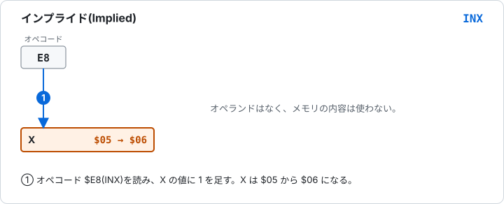

図 4-1 インプライド(`INX`)。メモリの内容は使わない。

> **Glow65 で確かめられること**
>
> ```
> *E 0300 A2 05 E8 8E F0 03 60
> *G 0300
> *D 03F0 03F0
> 03F0: 06 00 00 00 00 00 00 00 24 F4 24 F4 00 00 00 00
> ```
>
> `LDX #$05` で X が 5 になり、`INX` で 6 になります。

### アキュムレータ(Accumulator)

操作の対象が、A レジスタそのものです。`ASL A`(左に 1 ビットずらす)、`LSR A`、`ROL A`、`ROR A` の 4 命令がこのモードを持ちます(65C02 では `INC A` と `DEC A` が加わります)。長さは 1 バイトです。

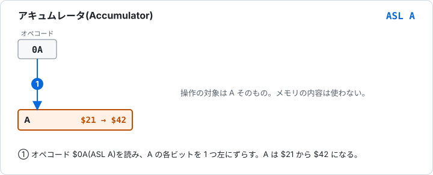

図 4-2 アキュムレータ(`ASL A`)。

> **Glow65 で確かめられること**
>
> ```
> *E 0300 A9 21 0A 8D F0 03 60
> *G 0300
> *D 03F0 03F0
> 03F0: 42 00 00 00 00 00 00 00 24 F4 24 F4 00 00 00 00
> ```
>
> `$21`(`%00100001`)を左に 1 ビットずらすと、`$42`(`%01000010`)になります。

## 4.3 イミディエイト(Immediate)

オペランドの値が、そのまま使われます。メモリの番地ではありません。書き方は、値の前に `#` を付けます。

| 項目 | 内容 |
|---|---|
| 書き方 | `LDA #$10` |
| 機械語 | `A9 10` |
| バイト数 | 2 |
| 実効アドレス | なし。オペランドが値そのもの |

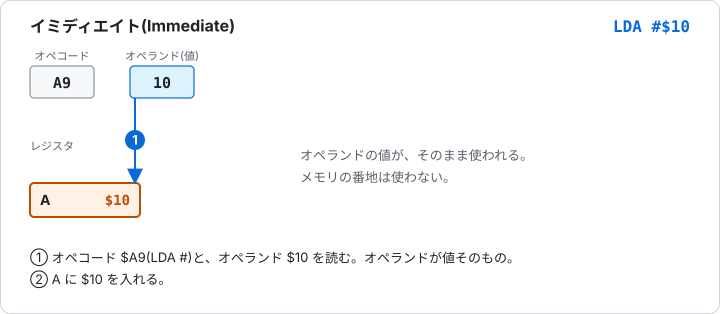

図 4-3 イミディエイト(`LDA #$10`)。

`LDA #$10` は「A に値 `$10` を入れる」、`LDA $10` は「アドレス `$0010` の内容を A に入れる」です。`#` の有無で、意味が変わります。

> **Glow65 で確かめられること**
>
> ```
> *E 0300 A9 10 8D F0 03 60
> *G 0300
> *D 03F0 03F0
> 03F0: 10 00 00 00 00 00 00 00 24 F4 24 F4 00 00 00 00
> ```

## 4.4 ゼロページ系のモード

ゼロページ(先頭の 256 バイト、`$0000-$00FF`)は、1 バイトのオペランドで指定できます。命令が短くなり、実行も速くなります。

### ゼロページ(Zero Page)

| 項目 | 内容 |
|---|---|
| 書き方 | `LDA $10` |
| 機械語 | `A5 10` |
| バイト数 | 2 |
| 実効アドレス | `$0010`(上位バイトは `$00`) |

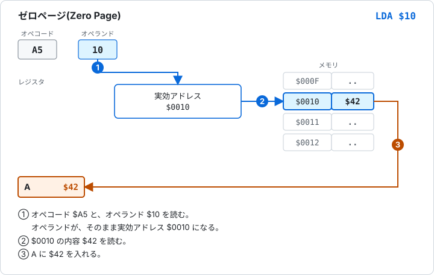

図 4-4 ゼロページ(`LDA $10`)。

> **Glow65 で確かめられること**
>
> ```
> *E 0010 42
> *E 0300 A5 10 8D F0 03 60
> *G 0300
> *D 03F0 03F0
> 03F0: 42 00 00 00 00 00 00 00 24 F4 24 F4 00 00 00 00
> ```

### ゼロページ X(Zero Page,X)

オペランドに X の値を足した番地を使います。配列のように、並んだデータを順に読むときに使います。

| 項目 | 内容 |
|---|---|
| 書き方 | `LDA $10,X` |
| 機械語 | `B5 10` |
| バイト数 | 2 |
| 実効アドレス | オペランド + X。結果は 256 で割った余り(`$FF` を超えたら `$00` に戻る) |

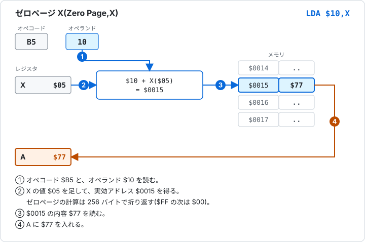

図 4-5 ゼロページ X(`LDA $10,X`)。X が `$05` のとき、`$0015` を読む。

計算の結果は、ゼロページの中に収まります。`LDA $FF,X` で X が `$02` なら、実効アドレスは `$0101` ではなく `$0001` です。足した結果が `$FF` を超えると、`$00` から数え直します[1]。

> **Glow65 で確かめられること**
>
> ```
> *E 0015 77
> *E 0300 A2 05 B5 10 8D F0 03 60
> *G 0300
> *D 03F0 03F0
> 03F0: 77 00 00 00 00 00 00 00 24 F4 24 F4 00 00 00 00
> ```
>
> 折り返しは、次のように確かめられます。`LDA $FF,X` は `$0001` を、2 バイト目が `$00` のアブソリュート X の `LDA $00FF,X` は `$0101` を読みます。
>
> ```
> *E 0001 7B
> *E 0101 3D
> *E 0300 A2 02 B5 FF 8D F0 03 60
> *G 0300
> *D 03F0 03F0
> 03F0: 7B 00 00 00 00 00 00 00 24 F4 24 F4 00 00 00 00
> *E 0300 A2 02 BD FF 00 8D F0 03 60
> *G 0300
> *D 03F0 03F0
> 03F0: 3D 00 00 00 00 00 00 00 24 F4 24 F4 00 00 00 00
> ```

### ゼロページ Y(Zero Page,Y)

ゼロページ X と同じで、足すレジスタが Y です。このモードを持つ命令は、`LDX` と `STX` だけです。

| 項目 | 内容 |
|---|---|
| 書き方 | `LDX $10,Y` |
| 機械語 | `B6 10` |
| バイト数 | 2 |
| 実効アドレス | オペランド + Y。256 で折り返す |

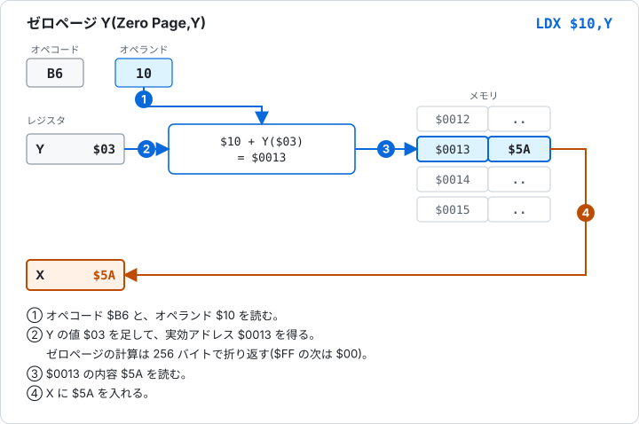

図 4-6 ゼロページ Y(`LDX $10,Y`)。結果は X に入る。

> **Glow65 で確かめられること**
>
> ```
> *E 0013 5A
> *E 0300 A0 03 B6 10 8E F0 03 60
> *G 0300
> *D 03F0 03F0
> 03F0: 5A 00 00 00 00 00 00 00 24 F4 24 F4 00 00 00 00
> ```

## 4.5 アブソリュート系のモード

64KB のどの番地でも、2 バイトのオペランドで指定できます。オペランドは、リトルエンディアン(下位が先)です。

### アブソリュート(Absolute)

| 項目 | 内容 |
|---|---|
| 書き方 | `LDA $0400` |
| 機械語 | `AD 00 04` |
| バイト数 | 3 |
| 実効アドレス | オペランドの 2 バイト(`$0400`) |

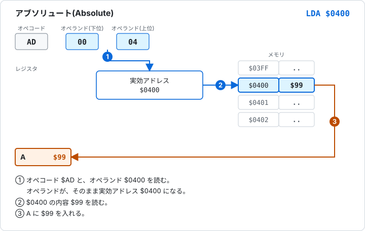

図 4-7 アブソリュート(`LDA $0400`)。

> **Glow65 で確かめられること**
>
> ```
> *E 0400 99
> *E 0300 AD 00 04 8D F0 03 60
> *G 0300
> *D 03F0 03F0
> 03F0: 99 00 00 00 00 00 00 00 24 F4 24 F4 00 00 00 00
> ```

### アブソリュート X(Absolute,X)

2 バイトのオペランドに、X の値を足した番地を使います。

| 項目 | 内容 |
|---|---|
| 書き方 | `LDA $0410,X` |
| 機械語 | `BD 10 04` |
| バイト数 | 3 |
| 実効アドレス | オペランド + X(16 ビットの足し算) |

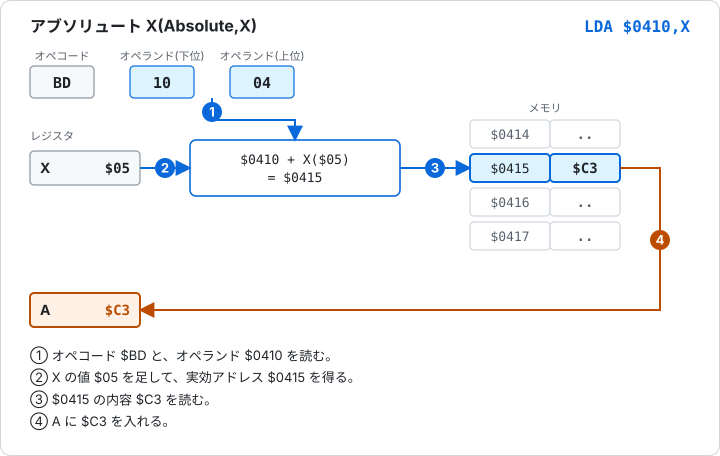

図 4-8 アブソリュート X(`LDA $0410,X`)。

足した結果が、元の番地と別のページ(上位バイトが違う番地)になることを、**ページをまたぐ**と呼びます。`LDA $04FF,X` で X が `$01` なら、実効アドレスは `$0500` で、ページをまたぎます。実機の 6502 は、`LDA` などの読み出し命令でページをまたぐと、1 サイクル余分にかかります[1]。`STA` などの書き込み命令は、またがなくても、いつも長いほうのサイクル数です。

> **Glow65 で確かめられること**
>
> ```
> *E 0415 C3
> *E 0300 A2 05 BD 10 04 8D F0 03 60
> *G 0300
> *D 03F0 03F0
> 03F0: C3 00 00 00 00 00 00 00 24 F4 24 F4 00 00 00 00
> ```
>
> ページをまたぐ場合も、読み出す値は同じように求まります。
>
> ```
> *E 0500 5E
> *E 0300 A2 01 BD FF 04 8D F0 03 60
> *G 0300
> *D 03F0 03F0
> 03F0: 5E 00 00 00 00 00 00 00 24 F4 24 F4 00 00 00 00
> ```

### アブソリュート Y(Absolute,Y)

アブソリュート X と同じで、足すレジスタが Y です。

| 項目 | 内容 |
|---|---|
| 書き方 | `LDA $0420,Y` |
| 機械語 | `B9 20 04` |
| バイト数 | 3 |
| 実効アドレス | オペランド + Y |


図 4-9 アブソリュート Y(`LDA $0420,Y`)。

> **Glow65 で確かめられること**
>
> ```
> *E 0422 3C
> *E 0300 A0 02 B9 20 04 8D F0 03 60
> *G 0300
> *D 03F0 03F0
> 03F0: 3C 00 00 00 00 00 00 00 24 F4 24 F4 00 00 00 00
> ```

## 4.6 インダイレクト(Indirect)

オペランドの番地に収められた 2 バイトを、飛び先として使います。このモードを持つ命令は、`JMP` だけです。

| 項目 | 内容 |
|---|---|
| 書き方 | `JMP ($0430)` |
| 機械語 | `6C 30 04` |
| バイト数 | 3 |
| 飛び先 | `$0430` の 1 バイトが下位、`$0431` の 1 バイトが上位 |

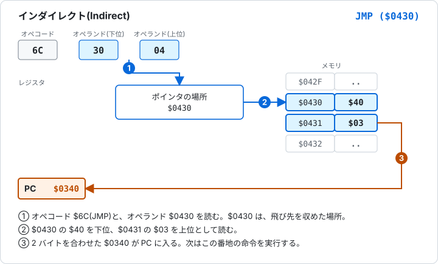

図 4-10 インダイレクト(`JMP ($0430)`)。結果は PC に入る。

NMOS 6502 には、このモードの癖があります。ポインタが、ページの最後のバイト(`$xxFF`)にあるときです。上位バイトは、次のページの先頭ではなく、**同じページの先頭**から読まれます。`JMP ($04FF)` なら、下位を `$04FF` から、上位を `$0500` ではなく `$0400` から読みます。65C02 では、この癖が直っています。

> **Glow65 で確かめられること**
>
> ```
> *E 0430 40 03
> *E 0340 A9 AB 8D F0 03 60
> *E 0300 6C 30 04
> *G 0300
> *D 03F0 03F0
> 03F0: AB 00 00 00 00 00 00 00 24 F4 24 F4 00 00 00 00
> ```
>
> `$0340` から始まるプログラムが `$AB` を書きます。
>
> ページの最後のバイトの癖は、次のように確かめられます。`$04FF` に `40`、`$0500` に `05`、`$0400` に `03` を置きます。上位バイトを `$0500` から読めば `$0540` に、`$0400` から読めば `$0340` に飛びます。
>
> ```
> *E 04FF 40
> *E 0500 05
> *E 0400 03
> *E 0340 A9 AB 8D F0 03 60
> *E 0540 A9 CD 8D F0 03 60
> *E 0300 6C FF 04
> *G 0300
> *D 03F0 03F0
> 03F0: AB 00 00 00 00 00 00 00 24 F4 24 F4 00 00 00 00
> ```
>
> 既定の NMOS 6502 では、`$0340` に飛んで `AB` が書かれます。`glow65-cli --cpu 65c02` で同じ操作をすると、`$0540` に飛んで `CD` が書かれます。

## 4.7 インデックスト・インダイレクト(Indexed Indirect)

ゼロページに、番地(2 バイト)を並べた表を置きます。命令は、表の中から X 番目の番地を取り出し、その番地の内容を使います。`(zp,X)` と書きます。

| 項目 | 内容 |
|---|---|
| 書き方 | `LDA ($20,X)` |
| 機械語 | `A1 20` |
| バイト数 | 2 |
| 実効アドレス | ゼロページの `$20 + X` にある 2 バイト(下位が先)。足した結果は 256 で折り返す |

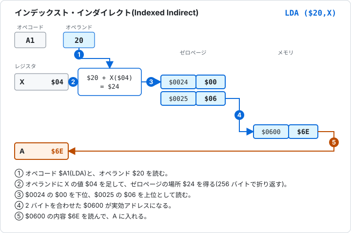

図 4-11 インデックスト・インダイレクト(`LDA ($20,X)`)。ゼロページの `$0024` と `$0025` に、番地 `$0600` が収められている。

X は、表の何番目かを選びます。番地は 2 バイトなので、X を 2 ずつ増やして使います。

> **Glow65 で確かめられること**
>
> ```
> *E 0024 00 06
> *E 0600 6E
> *E 0300 A2 04 A1 20 8D F0 03 60
> *G 0300
> *D 03F0 03F0
> 03F0: 6E 00 00 00 00 00 00 00 24 F4 24 F4 00 00 00 00
> ```

## 4.8 インダイレクト・インデックスト(Indirect Indexed)

ゼロページにある 2 バイトの番地を基準にして、Y の値を足します。`(zp),Y` と書きます。メモリ上の配列の先頭番地をゼロページに置き、Y で要素を選ぶ使い方ができます。

| 項目 | 内容 |
|---|---|
| 書き方 | `LDA ($30),Y` |
| 機械語 | `B1 30` |
| バイト数 | 2 |
| 実効アドレス | ゼロページの `$30` にある 2 バイト(下位が先)を基準の番地として、Y を足す |

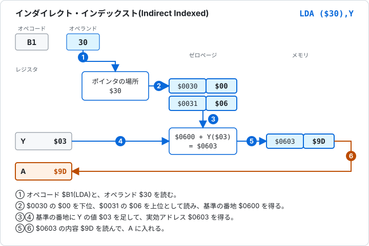

図 4-12 インダイレクト・インデックスト(`LDA ($30),Y`)。基準の番地 `$0600` に Y の `$03` を足す。

基準の番地に Y を足した結果が別のページになると、実機の 6502 は 1 サイクル余分にかかります[1]。

> **Glow65 で確かめられること**
>
> ```
> *E 0030 00 06
> *E 0603 9D
> *E 0300 A0 03 B1 30 8D F0 03 60
> *G 0300
> *D 03F0 03F0
> 03F0: 9D 00 00 00 00 00 00 00 24 F4 24 F4 00 00 00 00
> ```

## 4.9 リラティブ(Relative)

分岐命令(`BNE`、`BEQ`、`BCC` など)が使うモードです。オペランドは、符号付きの 1 バイトで、**次の命令の番地からの距離**を表します。範囲は -128 から +127 です。負の数は、第2章の 2 の補数で表します。

| 項目 | 内容 |
|---|---|
| 書き方 | `BNE $0306`(アセンブラが距離を計算する) |
| 機械語 | `D0 02` |
| バイト数 | 2 |
| 飛び先 | 命令を読み終えた PC + 距離 |

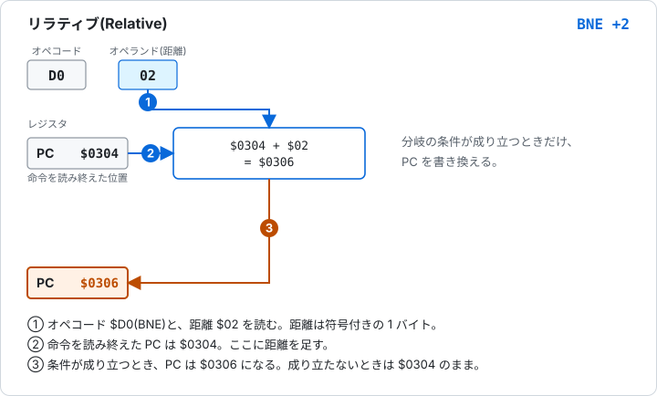

図 4-13 リラティブ(`BNE`)。距離 `$02` のとき、飛び先は `$0306`。

距離は、命令の先頭ではなく、命令を読み終えた位置から測ります。`D0 02` は 2 バイトの命令なので、`$0302` にあれば、読み終えた PC は `$0304` です。距離が `$FB`(-5)なら、`$0304` から 5 戻って `$02FF` です。

条件が成り立たなければ、分岐しないで次の命令に進みます。実行に必要なサイクル数は、条件が成り立たないとき 2、成り立つと 3、成り立って別のページに飛ぶと 4 です。

> **Glow65 で確かめられること**
>
> ```
> *E 0300 A9 01 D0 02 A9 EE 8D F0 03 60
> *L 0300 0309
> 0300  A9 01     LDA   #$01
> 0302  D0 02     BNE   $0306
> 0304  A9 EE     LDA   #$EE
> 0306  8D F0 03  STA   $03F0
> 0309  60        RTS
> *G 0300
> *D 03F0 03F0
> 03F0: 01 00 00 00 00 00 00 00 24 F4 24 F4 00 00 00 00
> ```
>
> `LDA #$01` のあと、Z フラグは 0 です。`BNE` は分岐し、`LDA #$EE` を飛ばして `$0306` へ進みます。`$03F0` には `01` が書かれます。
>
> 後ろへ戻る分岐もあります。`BNE $0302` は、距離が `$FD`(-3)です。
>
> ```
> *E 0300 A2 03 CA D0 FD 8E F0 03 60
> *L 0300 0308
> 0300  A2 03     LDX   #$03
> 0302  CA        DEX
> 0303  D0 FD     BNE   $0302
> 0305  8E F0 03  STX   $03F0
> 0308  60        RTS
> ```
>
> `DEX` で X を 1 ずつ減らし、0 になるまで `$0302` に戻ります。

## 4.10 全モードの一覧

サイクル数は、`LDA` など、そのモードを持つ代表的な命令の値です。`+` は、読み出し命令でページをまたぐと 1 サイクル増えることを表します。

| モード | 書き方 | バイト数 | サイクル数 | 例 |
|---|---|---|---|---|
| インプライド | (なし) | 1 | 2 | `INX` |
| アキュムレータ | `A` | 1 | 2 | `ASL A` |
| イミディエイト | `#$nn` | 2 | 2 | `LDA #$10` |
| ゼロページ | `$nn` | 2 | 3 | `LDA $10` |
| ゼロページ X | `$nn,X` | 2 | 4 | `LDA $10,X` |
| ゼロページ Y | `$nn,Y` | 2 | 4 | `LDX $10,Y` |
| アブソリュート | `$nnnn` | 3 | 4 | `LDA $0400` |
| アブソリュート X | `$nnnn,X` | 3 | 4 + | `LDA $0410,X` |
| アブソリュート Y | `$nnnn,Y` | 3 | 4 + | `LDA $0420,Y` |
| インダイレクト | `($nnnn)` | 3 | 5 | `JMP ($0430)` |
| インデックスト・インダイレクト | `($nn,X)` | 2 | 6 | `LDA ($20,X)` |
| インダイレクト・インデックスト | `($nn),Y` | 2 | 5 + | `LDA ($30),Y` |
| リラティブ | `$nnnn` | 2 | 2(成立 3、別ページ 4) | `BNE $0306` |

`LDA` 以外の命令では、サイクル数が変わることがあります。たとえば `STA $0410,X` は 5 サイクルで、ページをまたがなくても同じです。命令ごとのサイクル数は、第5章の命令リファレンスにまとめます。

## 4.11 65C02 で加わるモード

65C02 では、次のモードと命令が加わります。`BIT` や `INC` など、6502 にあった命令が新しいモードを持つ場合も含みます。

| モード | 書き方 | バイト数 | 例 |
|---|---|---|---|
| ゼロページ・インダイレクト | `($nn)` | 2 | `LDA ($12)` |
| アブソリュート X・インダイレクト | `($nnnn,X)` | 3 | `JMP ($1234,X)` |
| ゼロページ X(新しい命令) | `$nn,X` | 2 | `BIT $10,X` |
| イミディエイト(新しい命令) | `#$nn` | 2 | `BIT #$10` |
| アキュムレータ(新しい命令) | `A` | 1 | `INC A` |
| リラティブ(新しい命令) | `$nnnn` | 2 | `BRA $0309` |
| ゼロページ・リラティブ | `$nn,$nnnn` | 3 | `BBR0 $10,$030C` |

`BRA` は、いつも分岐する命令です。`BBR0` は、ゼロページの値のビット 0 が 0 のときに分岐します。Glow65 は、パネルの CPU スイッチ(または起動オプション `--cpu 65c02`)で 65C02 にできます。65C02 では、モニタの `L` がこれらの命令を表示します。

> **Glow65 で確かめられること**
>
> ```
> glow65-cli --cpu 65c02
> *E 0300 B2 12 7C 34 12 34 10 89 10 80 FE 0F 10 FE 1A
> *L 0300 030E
> 0300  B2 12     LDA   ($12)
> 0302  7C 34 12  JMP   ($1234,X)
> 0305  34 10     BIT   $10,X
> 0307  89 10     BIT   #$10
> 0309  80 FE     BRA   $0309
> 030B  0F 10 FE  BBR0  $10,$030C
> 030E  1A        INC   A
> ```

## 4.12 練習問題

答えと解き方は、次の節にあります。

**問1** 次の命令のアドレッシングモードを答えてください。(1) `STA $0300,X` (2) `LDX $20,Y` (3) `JMP ($0430)` (4) `LDA ($20,X)` (5) `LDA #$05`

**問2** 次の命令の長さ(バイト数)を答えてください。(1) `LDA $0410,X` (2) `LDA ($20),Y` (3) `INX` (4) `BNE $0306` (5) `LDA #$05`

**問3** X が `$05` のとき、`LDA $10,X` が読む番地はどこですか。

**問4** X が `$20` のとき、`LDA $F0,X`(ゼロページ X)が読む番地はどこですか。`LDA $00F0,X`(アブソリュート X)が読む番地は、どこですか。

**問5** Y が `$FF` のとき、`LDA $0420,Y` が読む番地はどこですか。ページをまたぎますか。

**問6** ゼロページの `$0042` に `00`、`$0043` に `07` が入っています。X が `$02` のとき、`LDA ($40,X)` が読む番地はどこですか。

**問7** ゼロページの `$0050` に `FF`、`$0051` に `05` が入っています。Y が `$01` のとき、`LDA ($50),Y` が読む番地はどこですか。ページをまたぎますか。

**問8** `$0310` にある `BNE`(`D0 F0`)の飛び先はどこですか。

**問9** `$06FF` に `50`、`$0700` に `05`、`$0600` に `04` が入っています。`JMP ($06FF)` の飛び先は、NMOS 6502 と 65C02 で、それぞれどこですか。

## 4.13 練習問題の答えと解き方

**問1** (1) アブソリュート X (2) ゼロページ Y (3) インダイレクト (4) インデックスト・インダイレクト (5) イミディエイト
- (1) 2 バイトの番地に `,X`。(2) 1 バイトの番地に `,Y`。`LDX` が持つモードです。(3) `JMP` だけが持つモードで、括弧の中は番地。(4) 括弧の中に `,X` があるのは `(zp,X)`。(5) `#` は値そのもの。

**問2** (1) 3 バイト (2) 2 バイト (3) 1 バイト (4) 2 バイト (5) 2 バイト
- (1) オペコードと 2 バイトの番地。(2) オペコードとゼロページの 1 バイト。(3) オペランドなし。(4) 分岐は距離の 1 バイト。(5) オペコードと値の 1 バイト。

**問3** `$0015`
- `$10 + $05 = $15`。上位バイトは `$00`。

**問4** ゼロページ X は `$0010`。アブソリュート X は `$0110`。
- ゼロページ X は、`$F0 + $20 = $110` を 256 で折り返して `$10`。アブソリュート X は折り返さず、`$00F0 + $20 = $0110`。

**問5** `$051F`。ページをまたぐ。
- `$0420 + $FF = $051F`。上位バイトが `$04` から `$05` に変わります。

**問6** `$0700`
- `$40 + $02 = $42`。`$0042` の `00` が下位、`$0043` の `07` が上位で、`$0700`。

**問7** `$0600`。ページをまたぐ。
- 基準の番地は、`$0050` の `FF` が下位、`$0051` の `05` が上位で `$05FF`。Y を足して `$0600`。上位バイトが `$05` から `$06` に変わります。

**問8** `$0302`
- `BNE` は 2 バイトの命令なので、読み終えた PC は `$0312`。`$F0` は -16。`$0312 - 16 = $0302`。

**問9** NMOS 6502 は `$0450`。65C02 は `$0550`。
- NMOS は、下位を `$06FF`(`50`)、上位を同じページの先頭 `$0600`(`04`)から読んで `$0450`。65C02 は、上位を `$0700`(`05`)から読んで `$0550`。

## 出典

1. MOS Technology, "MCS6500 Microcomputer Family Hardware Manual", 1976年1月版: https://www.commodore.ca/wp-content/uploads/2018/11/kim1_hardware.txt

## 次の章

第5章「命令リファレンス」は準備中です。
