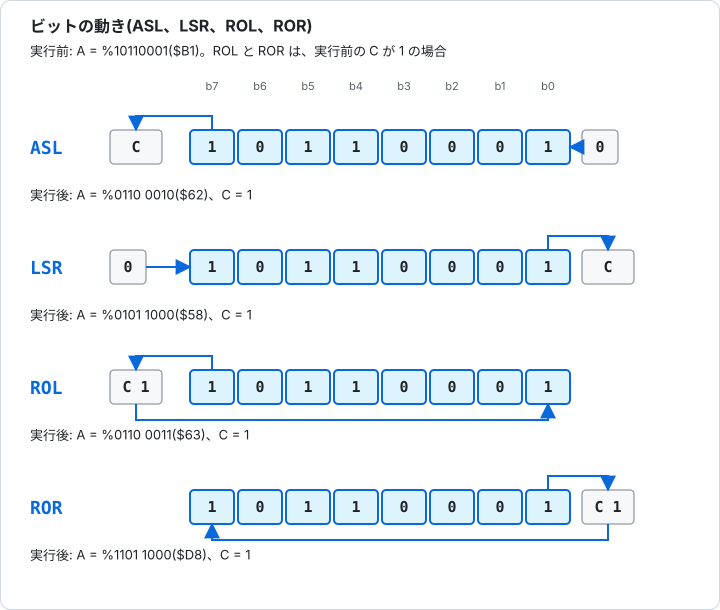
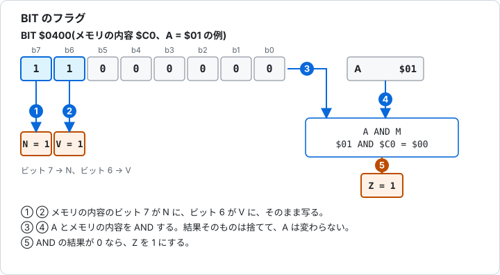

# 5.4 論理演算とシフト

[← 5.3 算術演算と比較](05-3-arithmetic.md) &nbsp;·&nbsp; [5.5 分岐とジャンプ →](05-5-branch-jump.md) &nbsp;·&nbsp; [章の入口](05-reference.md)

ビットごとの論理演算(AND、OR、XOR)と、ビットを横にずらすシフト、キャリーを含めて回すローテートを扱う分類です。

シフトとローテートは、図 5-1 のように、キャリー(C)を出入口にします。アキュムレータとメモリの、どちらにも使えます。



図 5-1 ASL、LSR、ROL、ROR のビットの動き。



図 5-2 BIT が N、V、Z を決める流れ。

<a id="and"></a>

### AND(Logical AND)論理積

A とメモリの値を、ビットごとに AND します。両方のビットが 1 のときだけ 1 になります。特定のビットを取り出す(それ以外を 0 にする)ときに使います。N と Z が変わります。

**影響するフラグ**

<!-- flags:AND -->
| N | V | D | I | Z | C |
|---|---|---|---|---|---|
| ○ | - | - | - | ○ | - |
<!-- /flags:AND -->

**オペコード**

<!-- opcodes:AND -->
| アドレッシングモード | 書き方 | オペコード | バイト数 | サイクル数 |
|---|---|---|---|---|
| イミディエイト | `AND #$nn` | `$29` | 2 | 2 |
| ゼロページ | `AND $nn` | `$25` | 2 | 3 |
| ゼロページ X | `AND $nn,X` | `$35` | 2 | 4 |
| アブソリュート | `AND $nnnn` | `$2D` | 3 | 4 |
| アブソリュート X | `AND $nnnn,X` | `$3D` | 3 | 4+ |
| アブソリュート Y | `AND $nnnn,Y` | `$39` | 3 | 4+ |
| インデックスト・インダイレクト | `AND ($nn,X)` | `$21` | 2 | 6 |
| インダイレクト・インデックスト | `AND ($nn),Y` | `$31` | 2 | 5+ |
<!-- /opcodes:AND -->

**使い方の例**

```
        LDA #$B5
        AND #$0F
```

`$B5 AND $0F` は `$05` です。下位 4 ビットだけが残ります。

```
        LDA #$F0
        AND #$3C
```

`$F0 AND $3C` は `$30` です。

<a id="ora"></a>

### ORA(Logical OR)論理和

A とメモリの値を、ビットごとに OR します。どちらかのビットが 1 なら 1 になります。特定のビットを 1 にするときに使います。N と Z が変わります。

**影響するフラグ**

<!-- flags:ORA -->
| N | V | D | I | Z | C |
|---|---|---|---|---|---|
| ○ | - | - | - | ○ | - |
<!-- /flags:ORA -->

**オペコード**

<!-- opcodes:ORA -->
| アドレッシングモード | 書き方 | オペコード | バイト数 | サイクル数 |
|---|---|---|---|---|
| イミディエイト | `ORA #$nn` | `$09` | 2 | 2 |
| ゼロページ | `ORA $nn` | `$05` | 2 | 3 |
| ゼロページ X | `ORA $nn,X` | `$15` | 2 | 4 |
| アブソリュート | `ORA $nnnn` | `$0D` | 3 | 4 |
| アブソリュート X | `ORA $nnnn,X` | `$1D` | 3 | 4+ |
| アブソリュート Y | `ORA $nnnn,Y` | `$19` | 3 | 4+ |
| インデックスト・インダイレクト | `ORA ($nn,X)` | `$01` | 2 | 6 |
| インダイレクト・インデックスト | `ORA ($nn),Y` | `$11` | 2 | 5+ |
<!-- /opcodes:ORA -->

**使い方の例**

```
        LDA #$30
        ORA #$05
```

`$30 ORA $05` は `$35` です。

```
        LDA #$00
        ORA #$80
```

`$80` の ORA で、最上位ビットが 1 になります。N が 1 です。

<a id="eor"></a>

### EOR(Exclusive OR)排他的論理和

A とメモリの値を、ビットごとに XOR(排他的論理和)します。ビットが違うときだけ 1 になります。特定のビットを反転するときに使います。N と Z が変わります。

**影響するフラグ**

<!-- flags:EOR -->
| N | V | D | I | Z | C |
|---|---|---|---|---|---|
| ○ | - | - | - | ○ | - |
<!-- /flags:EOR -->

**オペコード**

<!-- opcodes:EOR -->
| アドレッシングモード | 書き方 | オペコード | バイト数 | サイクル数 |
|---|---|---|---|---|
| イミディエイト | `EOR #$nn` | `$49` | 2 | 2 |
| ゼロページ | `EOR $nn` | `$45` | 2 | 3 |
| ゼロページ X | `EOR $nn,X` | `$55` | 2 | 4 |
| アブソリュート | `EOR $nnnn` | `$4D` | 3 | 4 |
| アブソリュート X | `EOR $nnnn,X` | `$5D` | 3 | 4+ |
| アブソリュート Y | `EOR $nnnn,Y` | `$59` | 3 | 4+ |
| インデックスト・インダイレクト | `EOR ($nn,X)` | `$41` | 2 | 6 |
| インダイレクト・インデックスト | `EOR ($nn),Y` | `$51` | 2 | 5+ |
<!-- /opcodes:EOR -->

**使い方の例**

```
        LDA #$FF
        EOR #$0F
```

`$FF EOR $0F` は `$F0` です。`$0F` のビットが反転します。

```
        LDA #$5A
        EOR #$5A
```

同じ値どうしの XOR は `$00` です。Z が 1 になります。

<a id="bit"></a>

### BIT(Bit Test)ビットテスト

A とメモリの値を AND して、結果が 0 なら Z を 1 にします。結果そのものは捨てて、A は変わりません。メモリの値のビット 7 が N に、ビット 6 が V に、そのまま写ります。

**影響するフラグ**

<!-- flags:BIT -->
| N | V | D | I | Z | C |
|---|---|---|---|---|---|
| M7 | M6 | - | - | ○ | - |
<!-- /flags:BIT -->

**オペコード**

<!-- opcodes:BIT -->
| アドレッシングモード | 書き方 | オペコード | バイト数 | サイクル数 |
|---|---|---|---|---|
| ゼロページ | `BIT $nn` | `$24` | 2 | 3 |
| アブソリュート | `BIT $nnnn` | `$2C` | 3 | 4 |
<!-- /opcodes:BIT -->

**使い方の例**

前提: メモリの `$0400` に `$C0` が入っている。

```
        LDA #$01
        BIT $0400
```

メモリの値 `$C0` はビット 7 と 6 が 1 なので、N と V が 1 になります。`$01 AND $C0` は 0 なので、Z も 1 です。

前提: メモリの `$0400` に `$3F` が入っている。

```
        LDA #$01
        BIT $0400
```

メモリの値 `$3F` は、ビット 7 と 6 が 0 なので、N と V が 0 になります。`$01 AND $3F` は 1 なので、Z は 0 です。

BIT は、A を壊さずにビットを調べるときに使います。N と V は、A ではなく、メモリの値で決まります。

<a id="asl"></a>

### ASL(Arithmetic Shift Left)算術左シフト

左に 1 ビットずらします。最上位ビットが C に出て、最下位ビットには 0 が入ります。値が 2 倍になります(256 を超えた分は C に出ます)。N、Z、C が変わります。

**影響するフラグ**

<!-- flags:ASL -->
| N | V | D | I | Z | C |
|---|---|---|---|---|---|
| ○ | - | - | - | ○ | ○ |
<!-- /flags:ASL -->

**オペコード**

<!-- opcodes:ASL -->
| アドレッシングモード | 書き方 | オペコード | バイト数 | サイクル数 |
|---|---|---|---|---|
| アキュムレータ | `ASL A` | `$0A` | 1 | 2 |
| ゼロページ | `ASL $nn` | `$06` | 2 | 5 |
| ゼロページ X | `ASL $nn,X` | `$16` | 2 | 6 |
| アブソリュート | `ASL $nnnn` | `$0E` | 3 | 6 |
| アブソリュート X | `ASL $nnnn,X` | `$1E` | 3 | 7 |
<!-- /opcodes:ASL -->

**使い方の例**

```
        LDA #$81
        ASL A
```

`%10000001` が `%00000010` になります。最上位ビットだった 1 が、C に出ます。

前提: メモリの `$0400` に `$40` が入っている。

```
        ASL $0400
```

`$0400` の `$40` が `$80` になります。N が 1、C が 0 です。

<a id="lsr"></a>

### LSR(Logical Shift Right)論理右シフト

右に 1 ビットずらします。最下位ビットが C に出て、最上位ビットには 0 が入ります。値が 2 分の 1 になります(端数は C に出ます)。N は、いつも 0 になります。Z、C も変わります。

**影響するフラグ**

<!-- flags:LSR -->
| N | V | D | I | Z | C |
|---|---|---|---|---|---|
| 0 | - | - | - | ○ | ○ |
<!-- /flags:LSR -->

**オペコード**

<!-- opcodes:LSR -->
| アドレッシングモード | 書き方 | オペコード | バイト数 | サイクル数 |
|---|---|---|---|---|
| アキュムレータ | `LSR A` | `$4A` | 1 | 2 |
| ゼロページ | `LSR $nn` | `$46` | 2 | 5 |
| ゼロページ X | `LSR $nn,X` | `$56` | 2 | 6 |
| アブソリュート | `LSR $nnnn` | `$4E` | 3 | 6 |
| アブソリュート X | `LSR $nnnn,X` | `$5E` | 3 | 7 |
<!-- /opcodes:LSR -->

**使い方の例**

```
        LDA #$03
        LSR A
```

`$03` が `$01` になります。最下位ビットだった 1 が、C に出ます。

```
        LDA #$80
        LSR A
```

`$80` が `$40` になります。C は 0 です。

<a id="rol"></a>

### ROL(Rotate Left)左ローテート

C を含めて、左に 1 ビット回します。最上位ビットが C に出て、元の C が最下位ビットに入ります。N、Z、C が変わります。

**影響するフラグ**

<!-- flags:ROL -->
| N | V | D | I | Z | C |
|---|---|---|---|---|---|
| ○ | - | - | - | ○ | ○ |
<!-- /flags:ROL -->

**オペコード**

<!-- opcodes:ROL -->
| アドレッシングモード | 書き方 | オペコード | バイト数 | サイクル数 |
|---|---|---|---|---|
| アキュムレータ | `ROL A` | `$2A` | 1 | 2 |
| ゼロページ | `ROL $nn` | `$26` | 2 | 5 |
| ゼロページ X | `ROL $nn,X` | `$36` | 2 | 6 |
| アブソリュート | `ROL $nnnn` | `$2E` | 3 | 6 |
| アブソリュート X | `ROL $nnnn,X` | `$3E` | 3 | 7 |
<!-- /opcodes:ROL -->

**使い方の例**

```
        SEC
        LDA #$80
        ROL A
```

C が 1 のとき、`$80` は `$01` になります。元の C の 1 が最下位ビットに入り、最上位ビットだった 1 が C に出ます。

```
        CLC
        LDA #$40
        ROL A
```

C が 0 のとき、`$40` は `$80` になります。N が 1 です。

前提: メモリの `$0400` から `81 42` が入っている。

```
        ASL $0400
        ROL $0401
```

16 ビットの値を左にずらします。`$4281` を `ASL` と `ROL` で 2 倍にして、`$8502` を得ます。下位の ASL で出た C が、上位の ROL の最下位ビットに入ります。

<a id="ror"></a>

### ROR(Rotate Right)右ローテート

C を含めて、右に 1 ビット回します。最下位ビットが C に出て、元の C が最上位ビットに入ります。N、Z、C が変わります。

**影響するフラグ**

<!-- flags:ROR -->
| N | V | D | I | Z | C |
|---|---|---|---|---|---|
| ○ | - | - | - | ○ | ○ |
<!-- /flags:ROR -->

**オペコード**

<!-- opcodes:ROR -->
| アドレッシングモード | 書き方 | オペコード | バイト数 | サイクル数 |
|---|---|---|---|---|
| アキュムレータ | `ROR A` | `$6A` | 1 | 2 |
| ゼロページ | `ROR $nn` | `$66` | 2 | 5 |
| ゼロページ X | `ROR $nn,X` | `$76` | 2 | 6 |
| アブソリュート | `ROR $nnnn` | `$6E` | 3 | 6 |
| アブソリュート X | `ROR $nnnn,X` | `$7E` | 3 | 7 |
<!-- /opcodes:ROR -->

**使い方の例**

```
        SEC
        LDA #$01
        ROR A
```

C が 1 のとき、`$01` は `$80` になります。N が 1、C も 1 です。

```
        CLC
        LDA #$01
        ROR A
```

C が 0 のとき、`$01` は `$00` になります。Z が 1、C が 1 です。

シフトとローテートのアブソリュート X(例: `ASL $0410,X`)は、メモリを読んでから書き戻す命令です。ページをまたがなくても、またぐ場合と同じサイクル数です。

> **Glow65 で確かめられること**
>
> `AND`、`ORA`、`EOR` の結果を、`$03F0`、`$03F1`、`$03F2` に書きます。
>
> ```
> *E 0300 A9 B5 29 0F 8D F0 03 A9 30 09 05 8D F1 03 A9 FF
> *E 0310 49 0F 8D F2 03 60
> *G 0300
> *D 03F0 03F2
> 03F0: 05 35 F0 00 00 00 00 00 24 F4 24 F4 00 00 00 00
> ```
>
> `$B5 AND $0F` は `05`、`$30 ORA $05` は `35`、`$FF EOR $0F` は `F0` です。

> **Glow65 で確かめられること**
>
> `$0400` と `$0401` に `$4281`(下位が先なので `81 42`)を置き、`ASL` と `ROL` で 2 倍にします。
>
> ```
> *E 0400 81 42
> *E 0300 0E 00 04 2E 01 04 60
> *G 0300
> *D 0400 0401
> 0400: 02 85 00 00 00 00 00 00 00 00 00 00 00 00 00 00
> ```
>
> `$0400` が `02`、`$0401` が `85` で、答えは `$8502` です。

> **Glow65 で確かめられること**
>
> `$0400` に `$C0` を置き、`LDA #$01` のあと `BIT $0400` を実行して、P を `$03F0` に書きます。
>
> ```
> *E 0400 C0
> *E 0300 A9 01 2C 00 04 08 68 8D F0 03 60
> *G 0300
> *D 03F0 03F0
> 03F0: F6 00 00 00 00 00 00 00 24 F4 24 F4 00 00 00 00
> ```
>
> `$F6` は `%11110110` です。N(ビット 7)、V(ビット 6)、Z(ビット 1)が 1 になっています。ビット 5 と B(ビット 4)は PHP が 1 にし、I(ビット 2)も 1 です。

---

[← 5.3 算術演算と比較](05-3-arithmetic.md) &nbsp;·&nbsp; [5.5 分岐とジャンプ →](05-5-branch-jump.md) &nbsp;·&nbsp; [章の入口](05-reference.md)
