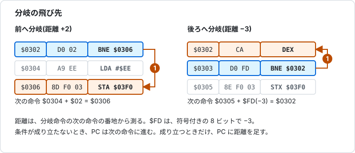
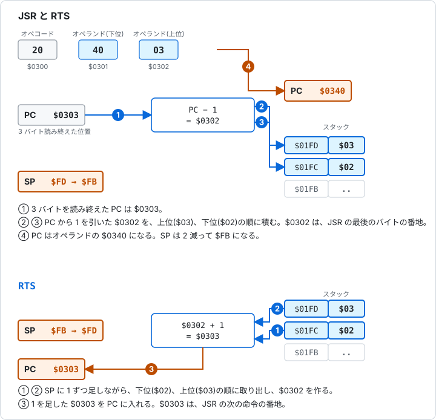
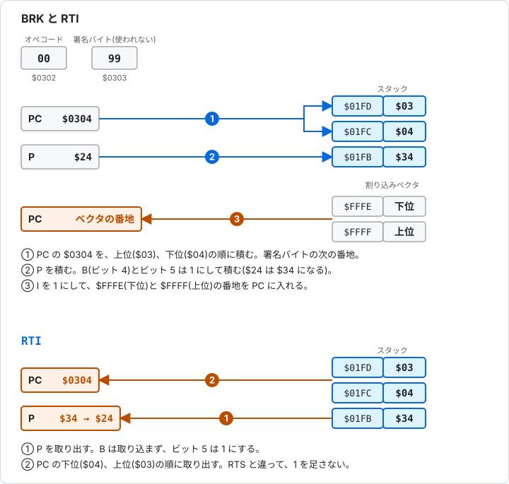

# 5.5 分岐とジャンプ

[日本語](05-5-branch-jump.md) | [English](../en/05-5-branch-jump.md)

[← 5.4 論理演算とシフト](05-4-logic-shift.md) &nbsp;·&nbsp; [5.6 スタックとフラグ操作 →](05-6-stack-flags.md) &nbsp;·&nbsp; [章の入口](05-reference.md)

実行の流れを変える命令です。条件分岐(BCC、BCS、BEQ、BNE、BMI、BPL、BVC、BVS)は、フラグを見て、次の命令の番地からの距離だけ飛びます。JMP は、指定の番地へ無条件に飛びます。

JSR と RTS は、サブルーチン(呼び出して使う小さなプログラム)の呼び出しと復帰です。BRK と RTI は、割り込みの入口と出口です。これらはスタックを使います。



図 5-3 分岐の飛び先。前へも後ろへも飛べる。



図 5-4 JSR と RTS。積まれる戻り番地は、JSR の最後のバイトの番地。



図 5-5 BRK と RTI。

分岐命令は、フラグを変えません。距離は、符号付きの 1 バイトで、-128 から +127 です。サイクル数は、条件が成り立たないとき 2、成り立つと 3、成り立って別のページへ飛ぶと 4 です[1]。

<a id="bcc"></a>

### BCC(Branch if Carry Clear)C が 0 なら分岐

C が 0 のとき、分岐します。CMP で「未満」の判定にも使います。

**影響するフラグ**

<!-- flags:BCC -->
| N | V | D | I | Z | C |
|---|---|---|---|---|---|
| - | - | - | - | - | - |
<!-- /flags:BCC -->

**オペコード**

<!-- opcodes:BCC -->
| アドレッシングモード | 書き方 | オペコード | バイト数 | サイクル数 |
|---|---|---|---|---|
| リラティブ | `BCC label` | `$90` | 2 | 2 (+1,+2) |
<!-- /opcodes:BCC -->

**使い方の例**

```
        CLC
        LDX #$00
        BCC skip
        LDX #$EE
skip:   NOP
```

C が 0 なので分岐し、`LDX #$EE` を飛ばします。X は `$00` のままです。

<a id="bcs"></a>

### BCS(Branch if Carry Set)C が 1 なら分岐

C が 1 のとき、分岐します。CMP で「以上」の判定にも使います。

**影響するフラグ**

<!-- flags:BCS -->
| N | V | D | I | Z | C |
|---|---|---|---|---|---|
| - | - | - | - | - | - |
<!-- /flags:BCS -->

**オペコード**

<!-- opcodes:BCS -->
| アドレッシングモード | 書き方 | オペコード | バイト数 | サイクル数 |
|---|---|---|---|---|
| リラティブ | `BCS label` | `$B0` | 2 | 2 (+1,+2) |
<!-- /opcodes:BCS -->

**使い方の例**

```
        CLC
        LDX #$00
        BCS skip
        LDX #$EE
skip:   NOP
```

C が 0 なので分岐しません。`LDX #$EE` が実行されて、X は `$EE` になります。

<a id="beq"></a>

### BEQ(Branch if Equal)Z が 1 なら分岐

Z が 1 のとき、分岐します。直前の結果が 0、または CMP で等しかったときです。

**影響するフラグ**

<!-- flags:BEQ -->
| N | V | D | I | Z | C |
|---|---|---|---|---|---|
| - | - | - | - | - | - |
<!-- /flags:BEQ -->

**オペコード**

<!-- opcodes:BEQ -->
| アドレッシングモード | 書き方 | オペコード | バイト数 | サイクル数 |
|---|---|---|---|---|
| リラティブ | `BEQ label` | `$F0` | 2 | 2 (+1,+2) |
<!-- /opcodes:BEQ -->

**使い方の例**

```
        LDX #$00
        LDA #$00
        BEQ skip
        LDX #$EE
skip:   NOP
```

`LDA #$00` で Z が 1 になっているので、分岐します。X は `$00` のままです。

<a id="bne"></a>

### BNE(Branch if Not Equal)Z が 0 なら分岐

Z が 0 のとき、分岐します。ループの終わりの判定によく使います。

**影響するフラグ**

<!-- flags:BNE -->
| N | V | D | I | Z | C |
|---|---|---|---|---|---|
| - | - | - | - | - | - |
<!-- /flags:BNE -->

**オペコード**

<!-- opcodes:BNE -->
| アドレッシングモード | 書き方 | オペコード | バイト数 | サイクル数 |
|---|---|---|---|---|
| リラティブ | `BNE label` | `$D0` | 2 | 2 (+1,+2) |
<!-- /opcodes:BNE -->

**使い方の例**

```
        LDY #$00
        LDX #$03
loop:   INY
        DEX
        BNE loop
```

`DEX` で X が 0 になるまで、`INY` を繰り返します。3 回まわって、Y が `$03` になります。

<a id="bmi"></a>

### BMI(Branch if Minus)N が 1 なら分岐

N が 1 のとき、分岐します。直前の結果の最上位ビットが 1 のときです。

**影響するフラグ**

<!-- flags:BMI -->
| N | V | D | I | Z | C |
|---|---|---|---|---|---|
| - | - | - | - | - | - |
<!-- /flags:BMI -->

**オペコード**

<!-- opcodes:BMI -->
| アドレッシングモード | 書き方 | オペコード | バイト数 | サイクル数 |
|---|---|---|---|---|
| リラティブ | `BMI label` | `$30` | 2 | 2 (+1,+2) |
<!-- /opcodes:BMI -->

**使い方の例**

```
        LDX #$00
        LDA #$80
        BMI skip
        LDX #$EE
skip:   NOP
```

`LDA #$80` で N が 1 になっているので、分岐します。X は `$00` のままです。

<a id="bpl"></a>

### BPL(Branch if Plus)N が 0 なら分岐

N が 0 のとき、分岐します。

**影響するフラグ**

<!-- flags:BPL -->
| N | V | D | I | Z | C |
|---|---|---|---|---|---|
| - | - | - | - | - | - |
<!-- /flags:BPL -->

**オペコード**

<!-- opcodes:BPL -->
| アドレッシングモード | 書き方 | オペコード | バイト数 | サイクル数 |
|---|---|---|---|---|
| リラティブ | `BPL label` | `$10` | 2 | 2 (+1,+2) |
<!-- /opcodes:BPL -->

**使い方の例**

```
        LDX #$00
        LDA #$7F
        BPL skip
        LDX #$EE
skip:   NOP
```

`LDA #$7F` で N が 0 になっているので、分岐します。X は `$00` のままです。

<a id="bvc"></a>

### BVC(Branch if Overflow Clear)V が 0 なら分岐

V が 0 のとき、分岐します。

**影響するフラグ**

<!-- flags:BVC -->
| N | V | D | I | Z | C |
|---|---|---|---|---|---|
| - | - | - | - | - | - |
<!-- /flags:BVC -->

**オペコード**

<!-- opcodes:BVC -->
| アドレッシングモード | 書き方 | オペコード | バイト数 | サイクル数 |
|---|---|---|---|---|
| リラティブ | `BVC label` | `$50` | 2 | 2 (+1,+2) |
<!-- /opcodes:BVC -->

**使い方の例**

```
        CLV
        LDX #$00
        BVC skip
        LDX #$EE
skip:   NOP
```

`CLV` で V が 0 になっているので、分岐します。X は `$00` のままです。

<a id="bvs"></a>

### BVS(Branch if Overflow Set)V が 1 なら分岐

V が 1 のとき、分岐します。

**影響するフラグ**

<!-- flags:BVS -->
| N | V | D | I | Z | C |
|---|---|---|---|---|---|
| - | - | - | - | - | - |
<!-- /flags:BVS -->

**オペコード**

<!-- opcodes:BVS -->
| アドレッシングモード | 書き方 | オペコード | バイト数 | サイクル数 |
|---|---|---|---|---|
| リラティブ | `BVS label` | `$70` | 2 | 2 (+1,+2) |
<!-- /opcodes:BVS -->

**使い方の例**

```
        CLV
        LDX #$00
        BVS skip
        LDX #$EE
skip:   NOP
```

`CLV` で V が 0 なので分岐しません。`LDX #$EE` が実行されて、X は `$EE` になります。

<a id="jmp"></a>

### JMP(Jump)ジャンプ

指定の番地へ飛びます。フラグは変わりません。アブソリュートとインダイレクトのモードがあります。

**影響するフラグ**

<!-- flags:JMP -->
| N | V | D | I | Z | C |
|---|---|---|---|---|---|
| - | - | - | - | - | - |
<!-- /flags:JMP -->

**オペコード**

<!-- opcodes:JMP -->
| アドレッシングモード | 書き方 | オペコード | バイト数 | サイクル数 |
|---|---|---|---|---|
| アブソリュート | `JMP $nnnn` | `$4C` | 3 | 3 |
| インダイレクト | `JMP ($nnnn)` | `$6C` | 3 | 5 |
<!-- /opcodes:JMP -->

**使い方の例**

```
        LDA #$00
        JMP skip
        LDA #$EE
skip:   LDX #$11
```

`LDA #$EE` を飛ばして、`LDX #$11` から実行します。A は `$00` のままです。

インダイレクト(`JMP ($nnnn)`)は、NMOS 6502 では、ポインタがページの最後のバイト(`$xxFF`)にあるときの動作に癖があります。第4章 4.6 で説明しています。

<a id="jsr"></a>

### JSR(Jump to Subroutine)サブルーチン呼び出し

次の命令の番地から 1 を引いた値(JSR の最後のバイトの番地)をスタックに積み、指定の番地へ飛びます。上位バイト、下位バイトの順に積みます[1]。フラグは変わりません。

**影響するフラグ**

<!-- flags:JSR -->
| N | V | D | I | Z | C |
|---|---|---|---|---|---|
| - | - | - | - | - | - |
<!-- /flags:JSR -->

**オペコード**

<!-- opcodes:JSR -->
| アドレッシングモード | 書き方 | オペコード | バイト数 | サイクル数 |
|---|---|---|---|---|
| アブソリュート | `JSR $nnnn` | `$20` | 3 | 6 |
<!-- /opcodes:JSR -->

**使い方の例**

```
        LDA #$00
        JSR $0340
        TAX
```

`$0340` にあるサブルーチン:

```
        LDA #$AB
        RTS
```

`$0340` のサブルーチンが A を `$AB` にして戻ります。戻ったあとの `TAX` で、X も `$AB` になります。

```
        JSR $0340
```

`$0340` にあるサブルーチン:

```
        TSX
        LDA $0101,X
        STA $03E4
        LDA $0102,X
        STA $03E5
        RTS
```

サブルーチンの中で、スタックに積まれた戻り番地を読みます。`$0300` の JSR の最後のバイトの番地 `$0302` が積まれているので、下位は `$02`、上位は `$03` です。

<a id="rts"></a>

### RTS(Return from Subroutine)サブルーチンから戻る

スタックから戻り番地を取り出し、1 を足して PC に入れます[1]。JSR の次の命令へ戻ります。フラグは変わりません。

**影響するフラグ**

<!-- flags:RTS -->
| N | V | D | I | Z | C |
|---|---|---|---|---|---|
| - | - | - | - | - | - |
<!-- /flags:RTS -->

**オペコード**

<!-- opcodes:RTS -->
| アドレッシングモード | 書き方 | オペコード | バイト数 | サイクル数 |
|---|---|---|---|---|
| インプライド | `RTS` | `$60` | 1 | 6 |
<!-- /opcodes:RTS -->

**使い方の例**

```
        LDX #$00
        LDA #$03
        PHA
        LDA #$0A
        PHA
        RTS
        LDX #$EE
        LDY #$01
```

`$030A` を自分で積んで RTS を実行すると、`$030A` の 1 つ先の `$030B`(`LDY #$01`)から続きます。`LDX #$EE` は飛ばされます。

JSR が積む値は、次の命令の番地より 1 小さい値です。RTS が 1 を足します。戻り番地をスタックに自分で積んで RTS を使うと、その番地の次から実行を続けられます。

<a id="brk"></a>

### BRK(Break)ブレーク

ソフトウェア割り込みを起こします。PC(BRK の番地 + 2)と、B を 1 にした P をスタックに積み、I を 1 にして、`$FFFE` と `$FFFF` の番地へ飛びます。

**影響するフラグ**

<!-- flags:BRK -->
| N | V | D | I | Z | C |
|---|---|---|---|---|---|
| - | - | - | 1 | - | - |
<!-- /flags:BRK -->

**オペコード**

<!-- opcodes:BRK -->
| アドレッシングモード | 書き方 | オペコード | バイト数 | サイクル数 |
|---|---|---|---|---|
| インプライド | `BRK` | `$00` | 1 | 7 |
<!-- /opcodes:BRK -->

**使い方の例**

```
        LDX #$00
        LDY #$00
        BRK
        .byte $99
        LDY #$55
```

`$0340` にある割り込みハンドラ:

```
        TSX
        LDA $0101,X
        STA $03E4
        LDA $0102,X
        STA $03E5
        LDA $0103,X
        STA $03E6
        LDX #$77
        RTI
```

`BRK` の次の 1 バイトは署名バイトで、使われません。戻り番地は、署名バイトの次の `$0306` です。ハンドラが X を `$77` にして RTI で戻るので、`LDY #$55` が続きます。

BRK は 1 バイトの命令ですが、PC が 2 バイト分進みます。次のバイトは、BRK の種類を示す署名として使えます。

Glow65 のモニタは、`$FFFE` と `$FFFF` のベクタから、RAM の `$03FA` と `$03FB` にあるハンドラの番地へ飛びます。この例では、`E 03FA 40 03` で、ハンドラの番地を `$0340` にしています。割り込みは第6章で説明します。

<a id="rti"></a>

### RTI(Return from Interrupt)割り込みから戻る

スタックから P、PC の下位、PC の上位の順に取り出して、割り込みから戻ります。RTS と違って、PC に 1 を足しません。P の B(ビット 4)は取り込まれません。

**影響するフラグ**

<!-- flags:RTI -->
| N | V | D | I | Z | C |
|---|---|---|---|---|---|
| 復元 | 復元 | 復元 | 復元 | 復元 | 復元 |
<!-- /flags:RTI -->

**オペコード**

<!-- opcodes:RTI -->
| アドレッシングモード | 書き方 | オペコード | バイト数 | サイクル数 |
|---|---|---|---|---|
| インプライド | `RTI` | `$40` | 1 | 6 |
<!-- /opcodes:RTI -->

**使い方の例**

`BRK` の例のハンドラは、最後の `RTI` で、署名バイトの次の `$0306` に戻ります。

> **Glow65 で確かめられること**
>
> `INY` と `DEX` を、`BNE` で 3 回繰り返します。`L` で `BNE $0304` の飛び先を確かめられます。
>
> ```
> *E 0300 A0 00 A2 03 C8 CA D0 FC 8C F0 03 60
> *L 0300 030A
> 0300  A0 00     LDY   #$00
> 0302  A2 03     LDX   #$03
> 0304  C8        INY
> 0305  CA        DEX
> 0306  D0 FC     BNE   $0304
> 0308  8C F0 03  STY   $03F0
> *G 0300
> *D 03F0 03F0
> 03F0: 03 00 00 00 00 00 00 00 24 F4 24 F4 00 00 00 00
> ```
>
> `D0 FC` の距離 `$FC` は -4 です。次の命令 `$0308` から 4 戻って、`$0304` になります。

> **Glow65 で確かめられること**
>
> `$0340` のサブルーチンが、スタックに積まれた戻り番地を `$03F2` と `$03F3` に書きます。
>
> ```
> *E 0340 BA BD 01 01 8D F2 03 BD 02 01 8D F3 03 60
> *E 0300 20 40 03 60
> *L 0300 0300
> 0300  20 40 03  JSR   $0340
> *G 0300
> *D 03F2 03F3
> 03F2: 02 03 00 00 00 00 24 F4 24 F4 00 00 00 00 00 00
> ```
>
> 下位の `02` と上位の `03` で、積まれた値は `$0302` です。`JSR` の最後のバイトの番地です。

> **Glow65 で確かめられること**
>
> `BRK` で `$0340` のハンドラへ飛び、積まれた戻り番地を `$03F2`(上位)と `$03F3`(下位)に書いて、RTI で戻ります。
>
> ```
> *E 03FA 40 03
> *E 0340 BA BD 03 01 8D F2 03 BD 02 01 8D F3 03 A2 77 40
> *E 0300 A2 00 A0 00 00 99 A0 55 8E F0 03 8C F1 03 60
> *L 0300 0304
> 0300  A2 00     LDX   #$00
> 0302  A0 00     LDY   #$00
> 0304  00        BRK
> *G 0300
> *D 03F0 03F3
> 03F0: 77 55 03 06 00 00 00 00 24 F4 40 03 00 00 00 00
> ```
>
> `$03F0` と `$03F1` は、戻ったあとの X と Y で、`77` と `55` です。`$03F2` と `$03F3` は戻り番地で、`$0306` です。署名バイトの `$0305` の次の番地です。なお、`$03FA` と `$03FB` の `40 03` は、この例で書いたハンドラの番地です。

## 出典

1. MOS Technology, "MCS6500 Microcomputer Family Hardware Manual", 1976年1月版: https://www.commodore.ca/wp-content/uploads/2018/11/kim1_hardware.txt

---

[← 5.4 論理演算とシフト](05-4-logic-shift.md) &nbsp;·&nbsp; [5.6 スタックとフラグ操作 →](05-6-stack-flags.md) &nbsp;·&nbsp; [章の入口](05-reference.md)
