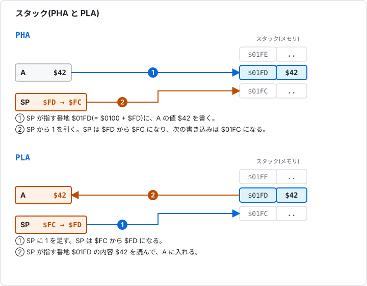

# 5.6 スタックとフラグ操作

[日本語](05-6-stack-flags.md) | [English](../en/05-6-stack-flags.md)

[← 5.5 分岐とジャンプ](05-5-branch-jump.md) &nbsp;·&nbsp; [章の入口](05-reference.md)

スタックは、`$0100` から `$01FF` のメモリを、後から入れたものを先に取り出す順(後入れ先出し)で使う領域です。SP(スタックポインタ)が、次に書く番地の下位バイトを指します。積むときは、書いてから SP を 1 減らします。取り出すときは、SP を 1 増やしてから読みます。

この分類には、スタックに積む命令(PHA、PHP)、取り出す命令(PLA、PLP)、フラグを直接変える命令、何もしない NOP が入ります。



図 5-6 PHA と PLA。スタックは、大きい番地から小さい番地へ伸びる。

<a id="pha"></a>

### PHA(Push Accumulator)A を積む

A の値を `$0100 + SP` に書いて、SP から 1 を引きます。A もフラグも変わりません。

**影響するフラグ**

<!-- flags:PHA -->
| N | V | D | I | Z | C |
|---|---|---|---|---|---|
| - | - | - | - | - | - |
<!-- /flags:PHA -->

**オペコード**

<!-- opcodes:PHA -->
| アドレッシングモード | 書き方 | オペコード | バイト数 | サイクル数 |
|---|---|---|---|---|
| インプライド | `PHA` | `$48` | 1 | 3 |
<!-- /opcodes:PHA -->

**使い方の例**

```
        LDA #$42
        PHA
        TSX
        LDA $0101,X
        STA $03E4
        LDA #$00
        PLA
```

A の `$42` を積んだあと、`TSX` で SP を X に読み、`LDA $0101,X` で SP の 1 つ上の番地を読むと、積んだ `$42` が見つかります。そのあと A を `$00` にして、`PLA` で `$42` に戻します。

<a id="pla"></a>

### PLA(Pull Accumulator)A に取り出す

SP に 1 を足して、`$0100 + SP` の値を A に入れます。N と Z が、取り出した値で決まります。

**影響するフラグ**

<!-- flags:PLA -->
| N | V | D | I | Z | C |
|---|---|---|---|---|---|
| ○ | - | - | - | ○ | - |
<!-- /flags:PLA -->

**オペコード**

<!-- opcodes:PLA -->
| アドレッシングモード | 書き方 | オペコード | バイト数 | サイクル数 |
|---|---|---|---|---|
| インプライド | `PLA` | `$68` | 1 | 4 |
<!-- /opcodes:PLA -->

**使い方の例**

```
        LDA #$42
        PHA
        LDA #$00
        PLA
```

積んでおいた `$42` が、`PLA` で A に戻ります。N も Z も 0 になります。

<a id="php"></a>

### PHP(Push Processor Status)P を積む

P をスタックに積みます。積む値は、B(ビット 4)とビット 5 を 1 にした P です。P は変わりません。

**影響するフラグ**

<!-- flags:PHP -->
| N | V | D | I | Z | C |
|---|---|---|---|---|---|
| - | - | - | - | - | - |
<!-- /flags:PHP -->

**オペコード**

<!-- opcodes:PHP -->
| アドレッシングモード | 書き方 | オペコード | バイト数 | サイクル数 |
|---|---|---|---|---|
| インプライド | `PHP` | `$08` | 1 | 3 |
<!-- /opcodes:PHP -->

**使い方の例**

```
        SEI
        CLD
        CLV
        LDA #$01
        SEC
        PHP
        PLA
```

`SEI`、`CLD`、`CLV`、`LDA #$01`、`SEC` で、C と I だけが 1 の状態にして積みます。取り出した値は `$35`(`%00110101`)です。ビット 5 と B が 1 になっています。

<a id="plp"></a>

### PLP(Pull Processor Status)P に取り出す

スタックから取り出した値で、P を置き換えます。取り出した値の B(ビット 4)は取り込まず、ビット 5 は 1 のままです。N、V、D、I、Z、C が、すべて取り出した値になります。

**影響するフラグ**

<!-- flags:PLP -->
| N | V | D | I | Z | C |
|---|---|---|---|---|---|
| 復元 | 復元 | 復元 | 復元 | 復元 | 復元 |
<!-- /flags:PLP -->

**オペコード**

<!-- opcodes:PLP -->
| アドレッシングモード | 書き方 | オペコード | バイト数 | サイクル数 |
|---|---|---|---|---|
| インプライド | `PLP` | `$28` | 1 | 4 |
<!-- /opcodes:PLP -->

**使い方の例**

```
        SEC
        PHP
        CLC
        PLP
```

`SEC` のあと P を積み、`CLC` で C を 0 にしてから、`PLP` で戻します。C は 1 に戻ります。

```
        LDA #$C3
        PHA
        PLP
```

`$C3`(`%11000011`)を積んで `PLP` で取り込むと、N、V、Z、C が 1 になり、D が 0 になります。

PHP と PLP は、割り込みやサブルーチンの前後で、フラグを保存して戻すときに使います。

<a id="clc"></a>

### CLC(Clear Carry Flag)C を 0 にする

C を 0 にします。ADC の前に使います。

**影響するフラグ**

<!-- flags:CLC -->
| N | V | D | I | Z | C |
|---|---|---|---|---|---|
| - | - | - | - | - | 0 |
<!-- /flags:CLC -->

**オペコード**

<!-- opcodes:CLC -->
| アドレッシングモード | 書き方 | オペコード | バイト数 | サイクル数 |
|---|---|---|---|---|
| インプライド | `CLC` | `$18` | 1 | 2 |
<!-- /opcodes:CLC -->

**使い方の例**

```
        SEC
        CLC
```

C が 0 になります。

<a id="sec"></a>

### SEC(Set Carry Flag)C を 1 にする

C を 1 にします。SBC の前に使います。

**影響するフラグ**

<!-- flags:SEC -->
| N | V | D | I | Z | C |
|---|---|---|---|---|---|
| - | - | - | - | - | 1 |
<!-- /flags:SEC -->

**オペコード**

<!-- opcodes:SEC -->
| アドレッシングモード | 書き方 | オペコード | バイト数 | サイクル数 |
|---|---|---|---|---|
| インプライド | `SEC` | `$38` | 1 | 2 |
<!-- /opcodes:SEC -->

**使い方の例**

```
        CLC
        SEC
```

C が 1 になります。

<a id="cli"></a>

### CLI(Clear Interrupt Disable)I を 0 にする

I を 0 にします。割り込み(IRQ)を受け付けるようになります。

**影響するフラグ**

<!-- flags:CLI -->
| N | V | D | I | Z | C |
|---|---|---|---|---|---|
| - | - | - | 0 | - | - |
<!-- /flags:CLI -->

**オペコード**

<!-- opcodes:CLI -->
| アドレッシングモード | 書き方 | オペコード | バイト数 | サイクル数 |
|---|---|---|---|---|
| インプライド | `CLI` | `$58` | 1 | 2 |
<!-- /opcodes:CLI -->

**使い方の例**

```
        SEI
        CLI
```

I が 0 になります。

<a id="sei"></a>

### SEI(Set Interrupt Disable)I を 1 にする

I を 1 にします。割り込み(IRQ)を受け付けなくなります。

**影響するフラグ**

<!-- flags:SEI -->
| N | V | D | I | Z | C |
|---|---|---|---|---|---|
| - | - | - | 1 | - | - |
<!-- /flags:SEI -->

**オペコード**

<!-- opcodes:SEI -->
| アドレッシングモード | 書き方 | オペコード | バイト数 | サイクル数 |
|---|---|---|---|---|
| インプライド | `SEI` | `$78` | 1 | 2 |
<!-- /opcodes:SEI -->

**使い方の例**

```
        CLI
        SEI
```

I が 1 になります。

<a id="cld"></a>

### CLD(Clear Decimal Mode)D を 0 にする

D を 0 にします。ADC と SBC が 2 進数で計算するようになります。

**影響するフラグ**

<!-- flags:CLD -->
| N | V | D | I | Z | C |
|---|---|---|---|---|---|
| - | - | 0 | - | - | - |
<!-- /flags:CLD -->

**オペコード**

<!-- opcodes:CLD -->
| アドレッシングモード | 書き方 | オペコード | バイト数 | サイクル数 |
|---|---|---|---|---|
| インプライド | `CLD` | `$D8` | 1 | 2 |
<!-- /opcodes:CLD -->

**使い方の例**

```
        SED
        CLD
```

D が 0 になります。

<a id="sed"></a>

### SED(Set Decimal Mode)D を 1 にする

D を 1 にします。ADC と SBC が BCD で計算するようになります。

**影響するフラグ**

<!-- flags:SED -->
| N | V | D | I | Z | C |
|---|---|---|---|---|---|
| - | - | 1 | - | - | - |
<!-- /flags:SED -->

**オペコード**

<!-- opcodes:SED -->
| アドレッシングモード | 書き方 | オペコード | バイト数 | サイクル数 |
|---|---|---|---|---|
| インプライド | `SED` | `$F8` | 1 | 2 |
<!-- /opcodes:SED -->

**使い方の例**

```
        CLD
        SED
```

D が 1 になります。

10進モードを使ったら、CLD で戻します。D が 1 のままだと、あとの足し算と引き算の結果が変わります。

<a id="clv"></a>

### CLV(Clear Overflow Flag)V を 0 にする

V を 0 にします。V を 1 にする命令は、6502 にはありません。ADC、SBC、BIT が、結果に応じて 1 にします。

**影響するフラグ**

<!-- flags:CLV -->
| N | V | D | I | Z | C |
|---|---|---|---|---|---|
| - | 0 | - | - | - | - |
<!-- /flags:CLV -->

**オペコード**

<!-- opcodes:CLV -->
| アドレッシングモード | 書き方 | オペコード | バイト数 | サイクル数 |
|---|---|---|---|---|
| インプライド | `CLV` | `$B8` | 1 | 2 |
<!-- /opcodes:CLV -->

**使い方の例**

```
        CLC
        LDA #$7F
        ADC #$01
        CLV
```

`ADC` で `$7F + $01 = $80` となり、V が 1 になったあとに、`CLV` で 0 に戻ります。N は 1 のままです。

<a id="nop"></a>

### NOP(No Operation)何もしない

何もしません。1 バイトの命令で、2 サイクルかかります。レジスタもフラグも変わりません。

**影響するフラグ**

<!-- flags:NOP -->
| N | V | D | I | Z | C |
|---|---|---|---|---|---|
| - | - | - | - | - | - |
<!-- /flags:NOP -->

**オペコード**

<!-- opcodes:NOP -->
| アドレッシングモード | 書き方 | オペコード | バイト数 | サイクル数 |
|---|---|---|---|---|
| インプライド | `NOP` | `$EA` | 1 | 2 |
<!-- /opcodes:NOP -->

**使い方の例**

```
        LDA #$80
        NOP
```

`NOP` のあとも、A の `$80` と N の 1 が変わりません。

NOP は、プログラムの途中を一時的に空ける、実行時間を調整する、などに使います。

> **Glow65 で確かめられること**
>
> `SEI`、`CLD`、`CLV`、`LDA #$01`、`SEC` のあと `PHP` で積み、`PLA` で A に取り出して、`$03F0` に書きます。
>
> ```
> *E 0300 78 D8 B8 A9 01 38 08 68 8D F0 03 60
> *G 0300
> *D 03F0 03F0
> 03F0: 35 00 00 00 00 00 00 00 24 F4 24 F4 00 00 00 00
> ```
>
> `$35` は `%00110101` です。C(ビット 0)と I(ビット 2)が 1 で、ビット 5 と B(ビット 4)は PHP が 1 にしています。

> **Glow65 で確かめられること**
>
> `PHA` と `PLA` で、A の値を退避して戻します。`LDA #$00` で A を消したあとも、`PLA` で `$42` が戻ります。
>
> ```
> *E 0300 A9 42 48 A9 00 68 8D F0 03 60
> *G 0300
> *D 03F0 03F0
> 03F0: 42 00 00 00 00 00 00 00 24 F4 24 F4 00 00 00 00
> ```

> **Glow65 で確かめられること**
>
> `SEC`、`PHP`、`CLC`、`PLP` で、C を保存して戻します。
>
> ```
> *E 0300 38 08 18 28 08 68 8D F0 03 60
> *G 0300
> *D 03F0 03F0
> 03F0: 35 00 00 00 00 00 00 00 24 F4 24 F4 00 00 00 00
> ```
>
> `$35` は、C が 1 に戻っていることを示します。

---

[← 5.5 分岐とジャンプ](05-5-branch-jump.md) &nbsp;·&nbsp; [章の入口](05-reference.md)

次の章: [6. フラグ、スタック、割り込み →](06-flags-stack-interrupts.md)
