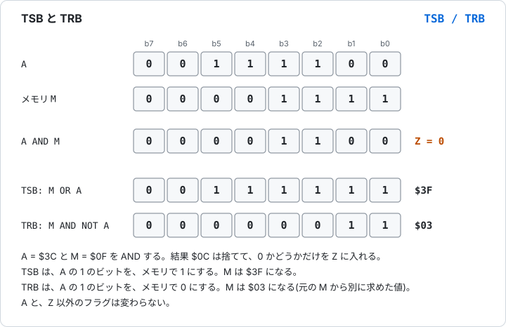
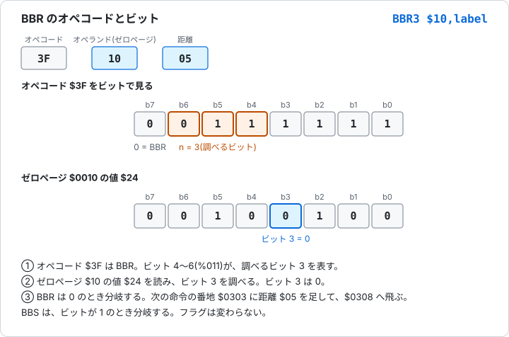
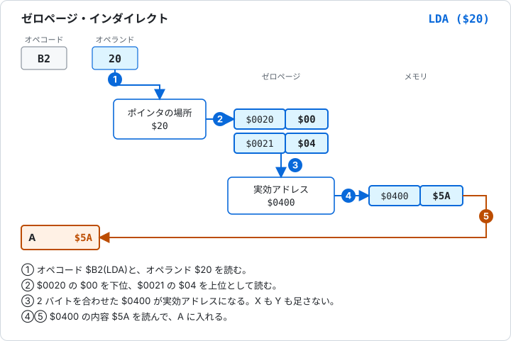

# 5.7 65C02 の追加命令

[日本語](05-7-65c02.md) | [English](../en/05-7-65c02.md)

[← 5.6 スタックとフラグ操作](05-6-stack-flags.md) &nbsp;·&nbsp; [章の入口](05-reference.md)

65C02 は、6502 の改良版です。6502 は NMOS という方式で作られ、65C02 は CMOS という方式で作られています。CMOS は、消費電力が少ない方式です。6502 の公式の 151 オペコードは、65C02 にもあります。65C02 は、それに新しい命令とモードを足し、いくつかの動作を直しています。

Glow65 の 65C02 は、WDC 社の W65C02S と同じ命令を持ちます。基本の 65C02 の命令に、Rockwell 社が足した BBR、BBS、RMB、SMB と、WDC 社が足した WAI、STP を加えたものです。

## 6502 との違い

新しい命令は 14 個あります。一覧は、「新しい命令の一覧」にあります。

新しいモードは 3 つあります。ゼロページ・インダイレクト `($nn)`、アブソリュート X・インダイレクト `($nnnn,X)`、ゼロページ・リラティブ `$nn,label` です。`INC A`、`DEC A`、`BIT #$nn`、`BIT $nn,X`、`BIT $nnnn,X` のように、6502 の命令が新しい形を持つ場合もあります。

動作は、次の点が変わっています。

| 項目 | NMOS 6502 | 65C02 |
|---|---|---|
| `JMP ($xxFF)` | 上位バイトを、同じページの先頭から読む。5 サイクル | 上位バイトを、ポインタの次の番地から読む。6 サイクル |
| 割り込み(IRQ、NMI、BRK)を受け付けたとき | D は変わらない | D を 0 にする |
| 10進モードの ADC | Z は 2 進で足した結果から、N は途中の値から決まる | N と Z は、調整後の A から決まる。1 サイクル増える |
| 10進モードの SBC | N と Z は、2 進で引いた結果から決まる | N と Z は、調整後の A から決まる。1 サイクル増える |
| ASL、LSR、ROL、ROR の `$nnnn,X` | 7 サイクル | 6 サイクル。別のページへ出ると 7 |
| 未定義のオペコード | Glow65 では、1 バイトで 2 サイクルの NOP | すべて NOP。長さとサイクル数は、オペコードごとに決まっている |

D を 0 にする変更は、割り込みハンドラの中が、10進モードの影響を受けないようにするためです。`JMP ($xxFF)` の動作は、第4章の「インダイレクト」で説明しています。

## Glow65 で 65C02 を動かす

パネルの **CPU** スイッチで、6502 と 65C02 を選びます。スイッチは、POWER が OFF のときだけ動かせます。コマンドラインでは、`glow65-cli --cpu 65c02` と指定します。指定しないときは 6502 です。

65C02 を選んだときだけ、モニタの `L` コマンドが、新しい命令を逆アセンブルします。6502 では、同じバイトが `.BYTE` と表示されます。

> **Glow65 で確かめられること**
>
> 同じ 5 バイトを、65C02 と 6502 で逆アセンブルします。`$CB` は WAI、`$DB` は STP です。
>
> 65C02:
>
> ```
> *E 0300 1A DA FA CB DB
> *L 0300 0304
> 0300  1A        INC   A
> 0301  DA        PHX
> 0302  FA        PLX
> 0303  CB        WAI
> 0304  DB        STP
> ```
>
> 6502:
>
> ```
> *E 0300 1A DA FA CB DB
> *L 0300 0304
> 0300  1A        .BYTE $1A
> 0301  DA        .BYTE $DA
> 0302  FA        .BYTE $FA
> 0303  CB        .BYTE $CB
> 0304  DB        .BYTE $DB
> ```

実行したときの違いも見ます。次のプログラムは、`INC A` で A を 1 増やし、`PHX` と `PLX` で X をスタックに積んで戻し、`STZ` で `$03F2` に 0 を書きます。`$03F2` には、先に `$FF` を入れておきます。

```
        LDA #$05
        INC A
        STA $03F0
        LDX #$07
        PHX
        LDX #$00
        PLX
        STX $03F1
        STZ $03F2
        RTS
```

> **Glow65 で確かめられること**
>
> 65C02:
>
> ```
> *E 03F2 FF
> *E 0300 A9 05 1A 8D F0 03 A2 07 DA A2 00 FA 8E F1 03 9C F2 03 60
> *G 0300
> *D 03F0 03F2
> 03F0: 06 07 00 00 00 00 00 00 24 F4 24 F4 00 00 00 00
> ```
>
> 6502 では、同じバイトを入れても結果が変わります。`1A`、`DA`、`FA`、`9C` は何もしない命令として実行され、`$03F2` の `$FF` は書き換わりません。
>
> ```
> *E 03F2 FF
> *E 0300 A9 05 1A 8D F0 03 A2 07 DA A2 00 FA 8E F1 03 9C F2 03 60
> *G 0300
> *D 03F0 03F2
> 03F0: 05 00 FF 00 00 00 00 00 24 F4 24 F4 00 00 00 00
> ```

ca65 でアセンブルするときは、ソースの先頭に `.setcpu "65C02"` を書きます。`Tools/assemble.sh` で、`$0300` に置くバイナリにできます。

```
        .setcpu "65C02"
        LDA #$05
        INC A
```

## 新しい命令の一覧

<!-- list65 -->
| ニーモニック | 名前 | 機能 | 影響するフラグ |
|---|---|---|---|
| [BRA](#bra) | Branch Always(いつも分岐) | いつも分岐する | なし |
| [PHX](#phx) | Push X Register(X を積む) | X をスタックに積む | なし |
| [PHY](#phy) | Push Y Register(Y を積む) | Y をスタックに積む | なし |
| [PLX](#plx) | Pull X Register(X に取り出す) | スタックから X に取り出す | N Z |
| [PLY](#ply) | Pull Y Register(Y に取り出す) | スタックから Y に取り出す | N Z |
| [STZ](#stz) | Store Zero(0 を書く) | メモリに 0 を書く | なし |
| [TRB](#trb) | Test and Reset Bits(ビットを調べて 0 にする) | A とメモリを AND して Z を決め、A の 1 のビットをメモリで 0 にする | Z |
| [TSB](#tsb) | Test and Set Bits(ビットを調べて 1 にする) | A とメモリを AND して Z を決め、A の 1 のビットをメモリで 1 にする | Z |
| [WAI](#wai) | Wait for Interrupt(割り込みを待つ) | 割り込みが来るまで止まる | なし |
| [STP](#stp) | Stop the Clock(停止) | RESET まで止まる | なし |
| [BBR](#bbr) | Branch on Bit Reset(ビットが 0 なら分岐) | ゼロページの値のビット n が 0 のとき分岐する | なし |
| [BBS](#bbs) | Branch on Bit Set(ビットが 1 なら分岐) | ゼロページの値のビット n が 1 のとき分岐する | なし |
| [RMB](#rmb) | Reset Memory Bit(メモリのビットを 0 にする) | ゼロページの値のビット n を 0 にする | なし |
| [SMB](#smb) | Set Memory Bit(メモリのビットを 1 にする) | ゼロページの値のビット n を 1 にする | なし |
<!-- /list65 -->

`BBR`、`BBS`、`RMB`、`SMB` は、ビット番号ごとに別のオペコードを持ちます。`BBR0` から `BBR7` のように、番号を付けて書きます。

## 新しい命令

<a id="bra"></a>

### BRA(Branch Always)いつも分岐

条件なしで、いつも分岐します。距離は、ほかの分岐命令と同じく、符号付きの 1 バイトで、-128 から +127 です。フラグは変わりません。

サイクル数は 3 です。飛び先が別のページにあると 4 です。

**影響するフラグ**

<!-- flags:BRA -->
| N | V | D | I | Z | C |
|---|---|---|---|---|---|
| - | - | - | - | - | - |
<!-- /flags:BRA -->

**オペコード**

<!-- opcodes:BRA -->
| アドレッシングモード | 書き方 | オペコード | バイト数 | サイクル数 |
|---|---|---|---|---|
| リラティブ | `BRA label` | `$80` | 2 | 3 (+1) |
<!-- /opcodes:BRA -->

**使い方の例**

```
        LDX #$00
        BRA skip
        LDX #$EE
skip:   STX $03F0
```

`BRA` は必ず分岐するので、`LDX #$EE` を飛ばします。X は `$00` のままです。6502 では、いつも分岐させたいとき、`JMP` を使うか、フラグが決まっている分岐命令を使っていました。`BRA` は 2 バイトで済み、置く場所が変わっても書き換えが要りません。

> **Glow65 で確かめられること**
>
> ```
> *E 0300 A2 00 80 02 A2 EE 8E F0 03 60
> *G 0300
> *D 03F0 03F0
> 03F0: 00 00 00 00 00 00 00 00 24 F4 24 F4 00 00 00 00
> ```

<a id="phx"></a>

### PHX(Push X Register)X を積む

X の値を `$0100 + SP` に書いて、SP から 1 を引きます。X もフラグも変わりません。6502 では、X を積むとき、`TXA` と `PHA` を使うので、A が壊れました。

**影響するフラグ**

<!-- flags:PHX -->
| N | V | D | I | Z | C |
|---|---|---|---|---|---|
| - | - | - | - | - | - |
<!-- /flags:PHX -->

**オペコード**

<!-- opcodes:PHX -->
| アドレッシングモード | 書き方 | オペコード | バイト数 | サイクル数 |
|---|---|---|---|---|
| インプライド | `PHX` | `$DA` | 1 | 3 |
<!-- /opcodes:PHX -->

**使い方の例**

```
        LDX #$07
        PHX
        LDX #$00
        PLX
```

X の `$07` を積んでから X を `$00` にして、`PLX` で `$07` に戻します。

<a id="phy"></a>

### PHY(Push Y Register)Y を積む

Y の値をスタックに積みます。動作は PHX と同じで、対象が Y です。

**影響するフラグ**

<!-- flags:PHY -->
| N | V | D | I | Z | C |
|---|---|---|---|---|---|
| - | - | - | - | - | - |
<!-- /flags:PHY -->

**オペコード**

<!-- opcodes:PHY -->
| アドレッシングモード | 書き方 | オペコード | バイト数 | サイクル数 |
|---|---|---|---|---|
| インプライド | `PHY` | `$5A` | 1 | 3 |
<!-- /opcodes:PHY -->

**使い方の例**

```
        LDY #$33
        PHY
        LDY #$00
        PLY
        STY $03F0
```

Y の `$33` を積んで、Y を `$00` にしたあと、`PLY` で `$33` に戻します。`$03F0` には `$33` が書かれます。

> **Glow65 で確かめられること**
>
> ```
> *E 0300 A0 33 5A A0 00 7A 8C F0 03 60
> *G 0300
> *D 03F0 03F0
> 03F0: 33 00 00 00 00 00 00 00 24 F4 24 F4 00 00 00 00
> ```

<a id="plx"></a>

### PLX(Pull X Register)X に取り出す

SP に 1 を足して、`$0100 + SP` の値を X に入れます。N と Z が、取り出した値で決まります。

**影響するフラグ**

<!-- flags:PLX -->
| N | V | D | I | Z | C |
|---|---|---|---|---|---|
| ○ | - | - | - | ○ | - |
<!-- /flags:PLX -->

**オペコード**

<!-- opcodes:PLX -->
| アドレッシングモード | 書き方 | オペコード | バイト数 | サイクル数 |
|---|---|---|---|---|
| インプライド | `PLX` | `$FA` | 1 | 4 |
<!-- /opcodes:PLX -->

**使い方の例**

`PHX` の例を見てください。`PLX` で X が `$07` に戻り、N と Z は 0 になります。

<a id="ply"></a>

### PLY(Pull Y Register)Y に取り出す

スタックから Y に取り出します。N と Z が、取り出した値で決まります。

**影響するフラグ**

<!-- flags:PLY -->
| N | V | D | I | Z | C |
|---|---|---|---|---|---|
| ○ | - | - | - | ○ | - |
<!-- /flags:PLY -->

**オペコード**

<!-- opcodes:PLY -->
| アドレッシングモード | 書き方 | オペコード | バイト数 | サイクル数 |
|---|---|---|---|---|
| インプライド | `PLY` | `$7A` | 1 | 4 |
<!-- /opcodes:PLY -->

**使い方の例**

`PHY` の例を見てください。`PLY` で Y が `$33` に戻ります。

<a id="stz"></a>

### STZ(Store Zero)メモリに 0 を書く

メモリに 0 を書きます。レジスタもフラグも変わりません。6502 では、メモリを 0 にするのに、A を `$00` にして `STA` を使うので、A が壊れました。

**影響するフラグ**

<!-- flags:STZ -->
| N | V | D | I | Z | C |
|---|---|---|---|---|---|
| - | - | - | - | - | - |
<!-- /flags:STZ -->

**オペコード**

<!-- opcodes:STZ -->
| アドレッシングモード | 書き方 | オペコード | バイト数 | サイクル数 |
|---|---|---|---|---|
| ゼロページ | `STZ $nn` | `$64` | 2 | 3 |
| ゼロページ X | `STZ $nn,X` | `$74` | 2 | 4 |
| アブソリュート | `STZ $nnnn` | `$9C` | 3 | 4 |
| アブソリュート X | `STZ $nnnn,X` | `$9E` | 3 | 5 |
<!-- /opcodes:STZ -->

**使い方の例**

```
        LDA #$55
        STZ $03F2
```

`$03F2` が `$00` になります。A は `$55` のままです。実行例は、「Glow65 で 65C02 を動かす」にあります。

<a id="trb"></a>

### TRB(Test and Reset Bits)ビットを調べて 0 にする

A とメモリの値を AND して、結果が 0 のときだけ Z を 1 にします。結果そのものは捨てます。そのあと、メモリの値のうち、A で 1 のビットを 0 にして書き戻します。A は変わりません。



図 5-9 TSB と TRB。A の 1 のビットが、メモリの書き換え位置を決める。

**影響するフラグ**

<!-- flags:TRB -->
| N | V | D | I | Z | C |
|---|---|---|---|---|---|
| - | - | - | - | ○ | - |
<!-- /flags:TRB -->

**オペコード**

<!-- opcodes:TRB -->
| アドレッシングモード | 書き方 | オペコード | バイト数 | サイクル数 |
|---|---|---|---|---|
| ゼロページ | `TRB $nn` | `$14` | 2 | 5 |
| アブソリュート | `TRB $nnnn` | `$1C` | 3 | 6 |
<!-- /opcodes:TRB -->

**使い方の例**

```
        LDA #$0F
        STA $20
        LDA #$3C
        TRB $20
```

`$20` の `$0F` と A の `$3C` を AND すると `$0C` で、0 ではないので Z は 0 です。A の 1 のビットを `$20` で 0 にして、`$20` は `$03` になります。

<a id="tsb"></a>

### TSB(Test and Set Bits)ビットを調べて 1 にする

A とメモリの値を AND して、結果が 0 のときだけ Z を 1 にします。そのあと、メモリの値のうち、A で 1 のビットを 1 にして書き戻します。A は変わりません。

**影響するフラグ**

<!-- flags:TSB -->
| N | V | D | I | Z | C |
|---|---|---|---|---|---|
| - | - | - | - | ○ | - |
<!-- /flags:TSB -->

**オペコード**

<!-- opcodes:TSB -->
| アドレッシングモード | 書き方 | オペコード | バイト数 | サイクル数 |
|---|---|---|---|---|
| ゼロページ | `TSB $nn` | `$04` | 2 | 5 |
| アブソリュート | `TSB $nnnn` | `$0C` | 3 | 6 |
<!-- /opcodes:TSB -->

**使い方の例**

```
        LDA #$0F
        STA $20
        LDA #$3C
        TSB $20
```

`$20` は `$0F | $3C = $3F` になります。Z は 0 です。

TSB と TRB は、メモリの特定のビットを 1 つの命令で立てたり落としたりするときに使います。調べる命令と書き換える命令を、続けて書く必要がありません。

> **Glow65 で確かめられること**
>
> `$20` に `$0F` を置き、A に `$3C` を入れて、`TSB` のあとの `$20` を `$03F0`、`TRB` のあとの `$20` を `$03F1` に書きます。
>
> ```
> *E 0300 A9 0F 85 20 A9 3C 04 20 A6 20 8E F0 03 14 20 A6 20 8E F1 03 60
> *L 0300 0310
> 0300  A9 0F     LDA   #$0F
> 0302  85 20     STA   $20
> 0304  A9 3C     LDA   #$3C
> 0306  04 20     TSB   $20
> 0308  A6 20     LDX   $20
> 030A  8E F0 03  STX   $03F0
> 030D  14 20     TRB   $20
> 030F  A6 20     LDX   $20
> *G 0300
> *D 03F0 03F1
> 03F0: 3F 03 00 00 00 00 00 00 24 F4 24 F4 00 00 00 00
> ```
>
> `TSB` のあとが `$3F`、続く `TRB` のあとが `$03` です。`TRB` は、`TSB` で立てたビットのうち、A の 1 のビットを落とします。

<a id="wai"></a>

### WAI(Wait for Interrupt)割り込みを待つ

実行を止めて、割り込みを待ちます。NMI か IRQ の信号が来ると、再開します。フラグは変わりません。

I が 0 のときは、割り込みを受け付けて、ハンドラを実行します。ハンドラが RTI で戻ると、WAI の次の命令から続きます。I が 1 のときは、割り込みを受け付けずに、WAI の次の命令へ進みます。

待っている間、CPU はバスに触れません。Glow65 では、パネルの HALT LED が点灯します。待ちの間、1 ステップは 1 サイクルです。

**影響するフラグ**

<!-- flags:WAI -->
| N | V | D | I | Z | C |
|---|---|---|---|---|---|
| - | - | - | - | - | - |
<!-- /flags:WAI -->

**オペコード**

<!-- opcodes:WAI -->
| アドレッシングモード | 書き方 | オペコード | バイト数 | サイクル数 |
|---|---|---|---|---|
| インプライド | `WAI` | `$CB` | 1 | 3 |
<!-- /opcodes:WAI -->

**使い方の例**

```
        CLI
        WAI
        INX
```

I を 0 にして、割り込みを待ちます。割り込みが来てハンドラが戻ったあとで、`INX` が実行されます。

<a id="stp"></a>

### STP(Stop the Clock)停止

CPU を止めます。RESET を押すまで、再開しません。NMI や IRQ が来ても、再開しません。フラグは変わりません。

止まっている間、CPU はバスに触れません。Glow65 では、WAI と同じく、パネルの HALT LED が点灯します。

**影響するフラグ**

<!-- flags:STP -->
| N | V | D | I | Z | C |
|---|---|---|---|---|---|
| - | - | - | - | - | - |
<!-- /flags:STP -->

**オペコード**

<!-- opcodes:STP -->
| アドレッシングモード | 書き方 | オペコード | バイト数 | サイクル数 |
|---|---|---|---|---|
| インプライド | `STP` | `$DB` | 1 | 3 |
<!-- /opcodes:STP -->

**使い方の例**

```
        LDA #$01
        STA $03F0
        STP
```

`$03F0` に書いたあと、CPU が止まります。

<a id="bbr"></a>

### BBR(Branch on Bit Reset)ビットが 0 なら分岐

ゼロページの値のビット n を調べて、0 のときに分岐します。n は 0 から 7 で、`BBR0` から `BBR7` の 8 つのオペコードがあります。命令は 3 バイトで、オペコード、ゼロページの番地、分岐の距離の順に並びます。

距離は、次の命令の番地から測ります。ほかの分岐命令と同じです。フラグは変わりません。

調べるビットの番号 n は、オペコードのビット 4 から 6 に入っています。`$3F` は `%0011 1111` で、ビット 6 から 4 が `011` なので、`BBR3` です。



図 5-10 BBR3。ゼロページ `$10` の値 `$24` のビット 3 は 0 なので、分岐する。

サイクル数は 5 です。分岐するとき 1 増え、別のページへ飛ぶとさらに 1 増えます。

**影響するフラグ**

<!-- flags:BBR -->
| N | V | D | I | Z | C |
|---|---|---|---|---|---|
| - | - | - | - | - | - |
<!-- /flags:BBR -->

**オペコード**

<!-- opcodes:BBR -->
| アドレッシングモード | 書き方 | オペコード | バイト数 | サイクル数 |
|---|---|---|---|---|
| ゼロページ・リラティブ | `BBR0 $nn,label` | `$0F` | 3 | 5 (+1,+2) |
| ゼロページ・リラティブ | `BBR1 $nn,label` | `$1F` | 3 | 5 (+1,+2) |
| ゼロページ・リラティブ | `BBR2 $nn,label` | `$2F` | 3 | 5 (+1,+2) |
| ゼロページ・リラティブ | `BBR3 $nn,label` | `$3F` | 3 | 5 (+1,+2) |
| ゼロページ・リラティブ | `BBR4 $nn,label` | `$4F` | 3 | 5 (+1,+2) |
| ゼロページ・リラティブ | `BBR5 $nn,label` | `$5F` | 3 | 5 (+1,+2) |
| ゼロページ・リラティブ | `BBR6 $nn,label` | `$6F` | 3 | 5 (+1,+2) |
| ゼロページ・リラティブ | `BBR7 $nn,label` | `$7F` | 3 | 5 (+1,+2) |
<!-- /opcodes:BBR -->

**使い方の例**

```
        LDA #$00
        STA $10
        SMB3 $10
        LDX #$00
        BBS3 $10,yes
        BRA done
yes:    LDX #$AA
done:   STX $03F0
```

`SMB3` でゼロページ `$10` のビット 3 を 1 にしてから、`BBS3` で調べて `yes` へ分岐します。X は `$AA` になります。

BBR と BBS は、A も X も使わずに、ゼロページのビットを調べられます。

<a id="bbs"></a>

### BBS(Branch on Bit Set)ビットが 1 なら分岐

ゼロページの値のビット n を調べて、1 のときに分岐します。`BBS0` から `BBS7` の 8 つのオペコードがあります。命令の長さ、距離の測り方、サイクル数、ビット番号の入り方は、BBR と同じです。BBR との違いは、オペコードのビット 7 が 1 であることです。

**影響するフラグ**

<!-- flags:BBS -->
| N | V | D | I | Z | C |
|---|---|---|---|---|---|
| - | - | - | - | - | - |
<!-- /flags:BBS -->

**オペコード**

<!-- opcodes:BBS -->
| アドレッシングモード | 書き方 | オペコード | バイト数 | サイクル数 |
|---|---|---|---|---|
| ゼロページ・リラティブ | `BBS0 $nn,label` | `$8F` | 3 | 5 (+1,+2) |
| ゼロページ・リラティブ | `BBS1 $nn,label` | `$9F` | 3 | 5 (+1,+2) |
| ゼロページ・リラティブ | `BBS2 $nn,label` | `$AF` | 3 | 5 (+1,+2) |
| ゼロページ・リラティブ | `BBS3 $nn,label` | `$BF` | 3 | 5 (+1,+2) |
| ゼロページ・リラティブ | `BBS4 $nn,label` | `$CF` | 3 | 5 (+1,+2) |
| ゼロページ・リラティブ | `BBS5 $nn,label` | `$DF` | 3 | 5 (+1,+2) |
| ゼロページ・リラティブ | `BBS6 $nn,label` | `$EF` | 3 | 5 (+1,+2) |
| ゼロページ・リラティブ | `BBS7 $nn,label` | `$FF` | 3 | 5 (+1,+2) |
<!-- /opcodes:BBS -->

**使い方の例**

`BBR` の例を見てください。`BBS3 $10,yes` は、`$10` のビット 3 が 1 のときに、`yes` へ分岐します。

<a id="rmb"></a>

### RMB(Reset Memory Bit)メモリのビットを 0 にする

ゼロページの値のビット n を 0 にします。n は 0 から 7 で、`RMB0` から `RMB7` の 8 つのオペコードがあります。ほかのビットは変わりません。フラグも変わりません。

**影響するフラグ**

<!-- flags:RMB -->
| N | V | D | I | Z | C |
|---|---|---|---|---|---|
| - | - | - | - | - | - |
<!-- /flags:RMB -->

**オペコード**

<!-- opcodes:RMB -->
| アドレッシングモード | 書き方 | オペコード | バイト数 | サイクル数 |
|---|---|---|---|---|
| ゼロページ | `RMB0 $nn` | `$07` | 2 | 5 |
| ゼロページ | `RMB1 $nn` | `$17` | 2 | 5 |
| ゼロページ | `RMB2 $nn` | `$27` | 2 | 5 |
| ゼロページ | `RMB3 $nn` | `$37` | 2 | 5 |
| ゼロページ | `RMB4 $nn` | `$47` | 2 | 5 |
| ゼロページ | `RMB5 $nn` | `$57` | 2 | 5 |
| ゼロページ | `RMB6 $nn` | `$67` | 2 | 5 |
| ゼロページ | `RMB7 $nn` | `$77` | 2 | 5 |
<!-- /opcodes:RMB -->

**使い方の例**

```
        LDA #$FF
        STA $10
        RMB0 $10
        RMB7 $10
```

`$10` は `$FF` から、ビット 0 とビット 7 が 0 になって、`$7E` になります。

> **Glow65 で確かめられること**
>
> ```
> *E 0300 A9 FF 85 10 07 10 77 10 60
> *L 0304 0306
> 0304  07 10     RMB0  $10
> 0306  77 10     RMB7  $10
> *G 0300
> *D 0010 0010
> 0010: 7E 00 00 00 00 00 00 00 00 00 00 00 00 00 00 00
> ```

<a id="smb"></a>

### SMB(Set Memory Bit)メモリのビットを 1 にする

ゼロページの値のビット n を 1 にします。`SMB0` から `SMB7` の 8 つのオペコードがあります。ほかのビットは変わりません。フラグも変わりません。

**影響するフラグ**

<!-- flags:SMB -->
| N | V | D | I | Z | C |
|---|---|---|---|---|---|
| - | - | - | - | - | - |
<!-- /flags:SMB -->

**オペコード**

<!-- opcodes:SMB -->
| アドレッシングモード | 書き方 | オペコード | バイト数 | サイクル数 |
|---|---|---|---|---|
| ゼロページ | `SMB0 $nn` | `$87` | 2 | 5 |
| ゼロページ | `SMB1 $nn` | `$97` | 2 | 5 |
| ゼロページ | `SMB2 $nn` | `$A7` | 2 | 5 |
| ゼロページ | `SMB3 $nn` | `$B7` | 2 | 5 |
| ゼロページ | `SMB4 $nn` | `$C7` | 2 | 5 |
| ゼロページ | `SMB5 $nn` | `$D7` | 2 | 5 |
| ゼロページ | `SMB6 $nn` | `$E7` | 2 | 5 |
| ゼロページ | `SMB7 $nn` | `$F7` | 2 | 5 |
<!-- /opcodes:SMB -->

**使い方の例**

`BBR` の例の `SMB3 $10` は、`$10` のビット 3 を 1 にします。`$10` が `$00` だったので、`$08` になります。

> **Glow65 で確かめられること**
>
> `SMB3` で `$10` のビット 3 を 1 にして、`BBS3` で分岐し、X に `$AA` を入れて `$03F0` に書きます。
>
> ```
> *E 0300 A9 00 85 10 B7 10 A2 00 BF 10 02 80 02 A2 AA 8E F0 03 60
> *L 0304 030C
> 0304  B7 10     SMB3  $10
> 0306  A2 00     LDX   #$00
> 0308  BF 10 02  BBS3  $10,$030D
> 030B  80 02     BRA   $030F
> *G 0300
> *D 03F0 03F0
> 03F0: AA 00 00 00 00 00 00 00 24 F4 24 F4 00 00 00 00
> *D 0010 0010
> 0010: 08 00 00 00 00 00 00 00 00 00 00 00 00 00 00 00
> ```
>
> `BBS3` の距離 `$02` は、次の命令の番地 `$030B` に足されて、`$030D` になります。

## 6502 の命令に加わるモード

次の命令は、6502 にもありました。65C02 では、新しいモードを持ちます。

<a id="inc-a"></a>

### INC A

A に 1 を足します。6502 の `INC` は、メモリにしか使えませんでした。65C02 では、A に直接使えます。

**影響するフラグ**

<!-- flags:INC -->
| N | V | D | I | Z | C |
|---|---|---|---|---|---|
| ○ | - | - | - | ○ | - |
<!-- /flags:INC -->

**オペコード**

<!-- opcodes:INC -->
| アドレッシングモード | 書き方 | オペコード | バイト数 | サイクル数 |
|---|---|---|---|---|
| アキュムレータ | `INC A` | `$1A` | 1 | 2 |
<!-- /opcodes:INC -->

**使い方の例**

```
        LDA #$05
        INC A
```

A が `$06` になります。実行例は、「Glow65 で 65C02 を動かす」にあります。

<a id="dec-a"></a>

### DEC A

A から 1 を引きます。

**影響するフラグ**

<!-- flags:DEC -->
| N | V | D | I | Z | C |
|---|---|---|---|---|---|
| ○ | - | - | - | ○ | - |
<!-- /flags:DEC -->

**オペコード**

<!-- opcodes:DEC -->
| アドレッシングモード | 書き方 | オペコード | バイト数 | サイクル数 |
|---|---|---|---|---|
| アキュムレータ | `DEC A` | `$3A` | 1 | 2 |
<!-- /opcodes:DEC -->

**使い方の例**

```
        LDA #$00
        DEC A
```

A が `$FF` になり、N が 1、Z が 0 になります。

<a id="zp-indirect"></a>

### ゼロページ・インダイレクト `($nn)`

ORA、AND、EOR、ADC、STA、LDA、CMP、SBC が、このモードを持ちます。ゼロページの 2 バイトを、実効アドレスとして使います。`($nn),Y` と違って、Y は足しません。



図 5-11 ゼロページ・インダイレクト(`LDA ($20)`)。実効アドレスは `$0400`。

フラグの変化と動作は、それぞれの命令と同じです。サイクル数は、どの命令も 5 です。ADC と SBC は、10進モードのとき 1 増えます。

**オペコード**

<!-- opcodes:ZPIND -->
| アドレッシングモード | 書き方 | オペコード | バイト数 | サイクル数 |
|---|---|---|---|---|
| ゼロページ・インダイレクト | `ORA ($nn)` | `$12` | 2 | 5 |
| ゼロページ・インダイレクト | `AND ($nn)` | `$32` | 2 | 5 |
| ゼロページ・インダイレクト | `EOR ($nn)` | `$52` | 2 | 5 |
| ゼロページ・インダイレクト | `ADC ($nn)` | `$72` | 2 | 5 |
| ゼロページ・インダイレクト | `STA ($nn)` | `$92` | 2 | 5 |
| ゼロページ・インダイレクト | `LDA ($nn)` | `$B2` | 2 | 5 |
| ゼロページ・インダイレクト | `CMP ($nn)` | `$D2` | 2 | 5 |
| ゼロページ・インダイレクト | `SBC ($nn)` | `$F2` | 2 | 5 |
<!-- /opcodes:ZPIND -->

**使い方の例**

```
        LDA ($20)
        STA $03F0
```

`$0020` に `00`、`$0021` に `04` が入っているとき、`LDA ($20)` は `$0400` を読みます。`$0400` が `$5A` なら、A は `$5A` になります。

6502 で、同じことをするには、Y を `$00` にして `LDA ($20),Y` と書く必要がありました。

> **Glow65 で確かめられること**
>
> ```
> *E 0020 00 04
> *E 0400 5A
> *E 0300 B2 20 8D F0 03 60
> *L 0300 0300
> 0300  B2 20     LDA   ($20)
> *G 0300
> *D 03F0 03F0
> 03F0: 5A 00 00 00 00 00 00 00 24 F4 24 F4 00 00 00 00
> ```

<a id="bit-modes"></a>

### BIT の新しいモード

BIT に、イミディエイト `#$nn`、ゼロページ X `$nn,X`、アブソリュート X `$nnnn,X` が加わります。

ゼロページ X とアブソリュート X は、[BIT](05-4-logic-shift.md#bit) と同じように、N、V、Z を変えます。アブソリュート X は、別のページへ出ると 1 サイクル増えます。

イミディエイトの BIT は、Z だけを変えます。N と V は変わりません。値そのものが対象なので、メモリのビット 7 と 6 を写す意味がないためです。

**影響するフラグ(ゼロページ X、アブソリュート X)**

<!-- flags:BIT -->
| N | V | D | I | Z | C |
|---|---|---|---|---|---|
| M7 | M6 | - | - | ○ | - |
<!-- /flags:BIT -->

**影響するフラグ(イミディエイト)**

<!-- flags:BIT-IMM -->
| N | V | D | I | Z | C |
|---|---|---|---|---|---|
| - | - | - | - | ○ | - |
<!-- /flags:BIT-IMM -->

**オペコード**

<!-- opcodes:BIT -->
| アドレッシングモード | 書き方 | オペコード | バイト数 | サイクル数 |
|---|---|---|---|---|
| イミディエイト | `BIT #$nn` | `$89` | 2 | 2 |
| ゼロページ X | `BIT $nn,X` | `$34` | 2 | 4 |
| アブソリュート X | `BIT $nnnn,X` | `$3C` | 3 | 4+ |
<!-- /opcodes:BIT -->

**使い方の例**

```
        LDA #$01
        BIT #$80
        PHP
        PLA
        STA $03F0
```

`$01` と `$80` を AND すると 0 なので、Z が 1 になります。N は 0 のままです。`BIT $10` で、メモリが `$80` のときは、N が 1 になります。

> **Glow65 で確かめられること**
>
> 前半は `BIT #$80`、後半は、`$10` に `$80` を置いた `BIT $10` です。どちらも A は `$01` で、AND の結果は 0 です。P を取り出して、`$03F0` と `$03F1` に書きます。
>
> ```
> *E 0300 A9 01 89 80 08 68 8D F0 03 A9 80 85 10 A9 01 24 10 08
> *E 0312 68 8D F1 03 60
> *G 0300
> *D 03F0 03F1
> 03F0: 36 B6 00 00 00 00 00 00 24 F4 24 F4 00 00 00 00
> ```
>
> `$36` は `%00110110` で、Z(ビット 1)が 1、N(ビット 7)は 0 です。`$B6` は `%10110110` で、N も 1 です。

<a id="jmp-abs-x"></a>

### JMP のアブソリュート X・インダイレクト `($nnnn,X)`

`$nnnn + X` の番地にある 2 バイトを、飛び先として使います。ジャンプテーブル(飛び先の番地を並べた表)から、X で選んだ項目へ飛べます。番地は 2 バイトなので、X は 2 ずつ増やします。サイクル数は 6 です。

`JMP ($nnnn)` は、動作が 1 つ変わっています。上位バイトを、ポインタの次の番地から読みます。6502 では、ポインタがページの最後(`$xxFF`)にあると、同じページの先頭から読んでいました。サイクル数は 5 から 6 になります。

**影響するフラグ**

フラグは変わりません。

**オペコード**

<!-- opcodes:JMP -->
| アドレッシングモード | 書き方 | オペコード | バイト数 | サイクル数 |
|---|---|---|---|---|
| インダイレクト | `JMP ($nnnn)` | `$6C` | 3 | 6 |
| アブソリュート X・インダイレクト | `JMP ($nnnn,X)` | `$7C` | 3 | 6 |
<!-- /opcodes:JMP -->

**使い方の例**

```
        LDX #$02
        JMP ($0340,X)
```

X が `$02` なので、`$0342` と `$0343` の 2 バイトが飛び先です。`$0340` から、`$0320`、`$0330` の順に表を置くと、`$0330` へ飛びます。

> **Glow65 で確かめられること**
>
> `$0340` に 2 つの番地(`$0320`、`$0330`)を置き、それぞれのコードが `$03F0` に `$11` と `$22` を書きます。X は `$02` なので、2 つ目の `$0330` へ飛びます。
>
> ```
> *E 0340 20 03 30 03
> *E 0330 A9 22 8D F0 03 60
> *E 0320 A9 11 8D F0 03 60
> *E 0300 A2 02 7C 40 03
> *L 0300 0302
> 0300  A2 02     LDX   #$02
> 0302  7C 40 03  JMP   ($0340,X)
> *G 0300
> *D 03F0 03F0
> 03F0: 22 00 00 00 00 00 00 00 24 F4 24 F4 00 00 00 00
> ```

<a id="shift-abs-x"></a>

### ASL、LSR、ROL、ROR のアブソリュート X

動作は変わりません。サイクル数が、7 から 6 に減ります。別のページへ出ると、1 増えて 7 になります。

**オペコード**

<!-- opcodes:SHIFT -->
| アドレッシングモード | 書き方 | オペコード | バイト数 | サイクル数 |
|---|---|---|---|---|
| アブソリュート X | `ASL $nnnn,X` | `$1E` | 3 | 6+ |
| アブソリュート X | `LSR $nnnn,X` | `$5E` | 3 | 6+ |
| アブソリュート X | `ROL $nnnn,X` | `$3E` | 3 | 6+ |
| アブソリュート X | `ROR $nnnn,X` | `$7E` | 3 | 6+ |
<!-- /opcodes:SHIFT -->

## 未定義だったオペコード

6502 の未定義のオペコードは、65C02 では、すべて NOP になります。長さとサイクル数は、オペコードごとに決まっています。レジスタもフラグも変わりません。メモリは読みません。

<!-- opcodes:NOP -->
| バイト数 | サイクル数 | オペコード |
|---|---|---|
| 1 | 1 | `$03`, `$0B`, `$13`, `$1B`, `$23`, `$2B`, `$33`, `$3B`, `$43`, `$4B`, `$53`, `$5B`, `$63`, `$6B`, `$73`, `$7B`, `$83`, `$8B`, `$93`, `$9B`, `$A3`, `$AB`, `$B3`, `$BB`, `$C3`, `$D3`, `$E3`, `$EB`, `$F3`, `$FB` |
| 2 | 2 | `$02`, `$22`, `$42`, `$62`, `$82`, `$C2`, `$E2` |
| 2 | 3 | `$44` |
| 2 | 4 | `$54`, `$D4`, `$F4` |
| 3 | 4 | `$DC`, `$FC` |
| 3 | 8 | `$5C` |
<!-- /opcodes:NOP -->

## 10進モードの違い

10進モードの `ADC` と `SBC` で、N と Z の決まり方が違います。次のプログラムは、`$99 + $01` を 10進モードで足します。

```
        SED
        CLC
        LDA #$99
        ADC #$01
        PHP
        STA $03F0
        PLA
        STA $03F1
        CLD
```

答えは `$00` で、C が 1 になります。結果が 0 なので、Z は 1 になるのが自然です。

> **Glow65 で確かめられること**
>
> A の値を `$03F0` に、`ADC` 直後の P を `$03F1` に書きます。
>
> 65C02:
>
> ```
> *E 0300 F8 18 A9 99 69 01 08 8D F0 03 68 8D F1 03 D8 60
> *G 0300
> *D 03F0 03F1
> 03F0: 00 3F 00 00 00 00 00 00 24 F4 24 F4 00 00 00 00
> ```
>
> 6502:
>
> ```
> *E 0300 F8 18 A9 99 69 01 08 8D F0 03 68 8D F1 03 D8 60
> *G 0300
> *D 03F0 03F1
> 03F0: 00 BD 00 00 00 00 00 00 24 F4 24 F4 00 00 00 00
> ```
>
> どちらも A は `$00` です。65C02 の P は `$3F`(`%00111111`)で、N が 0、Z が 1、C が 1 です。6502 の P は `$BD`(`%10111101`)で、N が 1、Z が 0、C が 1 です。6502 では、A が `$00` なのに Z が 0 になります。

## 練習問題

答えと解き方は、次の節にあります。

**問1** 次の命令を機械語(16進数のバイト列)に直してください。(1) `STZ $0310` (2) `INC A` (3) `LDA ($30)` (4) `BBS5 $40,label`(`label` は、この命令の次の命令の番地から 2 バイト先)

**問2** `$0310` に `80 F4` があります。65C02 での飛び先はどこですか。

**問3** ゼロページ `$10` に `$81`(`%10000001`)が入っています。`BBR0`、`BBR1`、`BBS6`、`BBS7` のうち、分岐するのはどれですか。

**問4** A が `$0F`、ゼロページ `$21` が `$F0` のとき、`TSB $21` と `TRB $21` を、それぞれ実行します。実行後の `$21` と Z を答えてください。2 つの命令は、それぞれ `$F0` の状態から実行するものとします。

**問5** ゼロページ `$30` に `00`、`$31` に `05` が入っています。`$0500` は `$7E`、`$0501` は `$9C` です。Y が `$01` のとき、`LDA ($30)` と `LDA ($30),Y` で A に入る値は、それぞれ何ですか。

**問6** バイト列 `A9 05 1A 8D F0 03 60` を `$0300` に置いて実行します。`$03F0` に書かれる値は、65C02 と 6502 で、それぞれ何ですか。

## 練習問題の答えと解き方

**問1** (1) `9C 10 03` (2) `1A` (3) `B2 30` (4) `DF 40 02`

- (1) `STZ` のアブソリュートは `$9C`。番地は、下位から先に並べて `10 03`。(2) `INC A` は 1 バイトで `$1A`。(3) ゼロページ・インダイレクトの `LDA` は `$B2`。(4) `BBS5` は `$DF`(ビット 4 から 6 が `101`、ビット 7 が 1)。続けて、ゼロページの番地 `40`、距離 `02` を並べる。

**問2** `$0306`

- `80 F4` は 2 バイトの命令なので、読み終えた PC は `$0312`。`$F4` は -12。`$0312 - 12 = $0306`。

**問3** `BBR1` と `BBS7`

- `$81` は、ビット 7 と 0 が 1 で、ほかが 0。`BBR0` は、ビット 0 が 1 なので分岐しない。`BBR1` は、ビット 1 が 0 なので分岐する。`BBS6` は、ビット 6 が 0 なので分岐しない。`BBS7` は、ビット 7 が 1 なので分岐する。

**問4** `TSB $21` は `$FF` で、Z は 1。`TRB $21` は `$F0` のままで、Z は 1。

- どちらも、AND の結果は `$0F AND $F0 = $00` なので、Z は 1。TSB は A の 1 のビット(下位 4 ビット)を立てるので、`$F0 OR $0F = $FF`。TRB は A の 1 のビットを落とすが、`$F0` の下位 4 ビットは、すでに 0 なので変わらない。

**問5** `LDA ($30)` は `$7E`。`LDA ($30),Y` は `$9C`。

- `$30` と `$31` から、基準の番地は `$0500`。`($30)` は、Y を足さないので `$0500` を読み、`$7E`。`($30),Y` は、Y の `$01` を足して `$0501` を読み、`$9C`。

**問6** 65C02 は `$06`。6502 は `$05`。

- 65C02 では、`1A` が `INC A` なので、A が `$05` から `$06` になる。6502 では、`1A` が未定義のオペコードで、何もしないので、A は `$05` のまま。

---

[← 5.6 スタックとフラグ操作](05-6-stack-flags.md) &nbsp;·&nbsp; [章の入口](05-reference.md)

次の章: [6. フラグ、スタック、割り込み →](06-flags-stack-interrupts.md)
