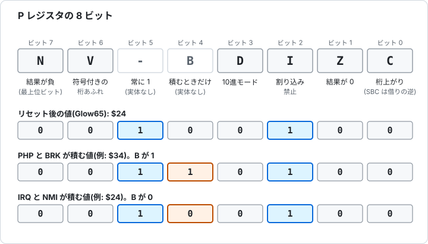
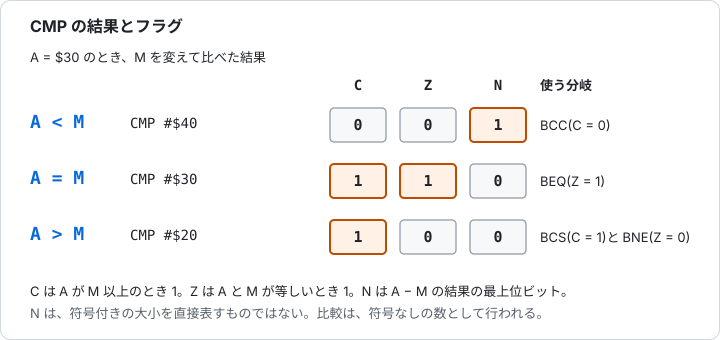
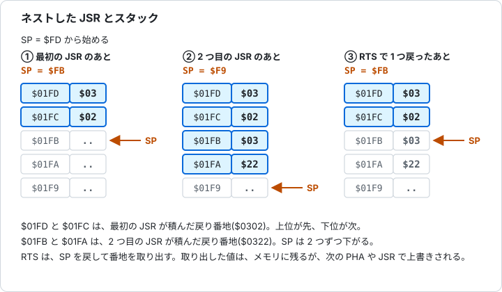
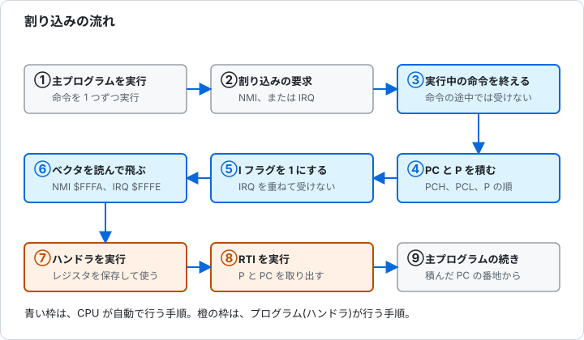
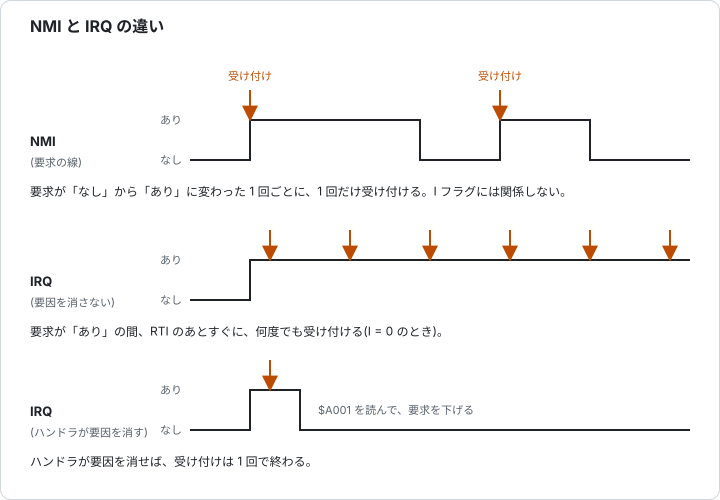

# 第6章 フラグ、スタック、割り込み

[← 5. 命令リファレンス](05-reference.md)

第3章から第5章で、レジスタと命令を見ました。この章では、それらの裏で働く 3 つの仕組みを説明します。結果を覚えておく**フラグ**、戻り番地や一時的な値をしまう**スタック**、実行中のプログラムを中断して別の処理に移る**割り込み**です。最後に、動き出しの条件を決める**リセット**を説明します。

手を動かして試す割り込みの演習は、[チュートリアル第6章](../../tutorial/06-interrupts.ja.md)にあります。この章は、その背景と全体像です。

## 6.1 フラグ(P レジスタ)

P レジスタは 8 ビットで、1 ビットずつが**フラグ**です。実体のあるフラグは、N、V、D、I、Z、C の 6 つです。ビット 5 とビット 4(B)は、P の中に実体がありません。



図 6-1 P レジスタの 8 ビット。

### 6.1.1 N と Z(結果のフラグ)

**N**(ネガティブ)は、直前の結果の最上位ビット(ビット 7)のコピーです。符号付きの数として読むと、1 なら負です。**Z**(ゼロ)は、結果が 0 のとき 1 になります。

ロード、転送、足し算、論理演算、シフト、増減の命令が、結果に応じて N と Z を変えます。ストアと分岐、ジャンプの命令は、変えません。第3章 3.6 の例が、この続きです。

### 6.1.2 C(キャリー)

**C** は、8 ビットに収まらなかった桁を持つフラグです。命令ごとに、次のように使われます。

| 命令 | C の働き |
|---|---|
| ADC | 結果が `$FF` を超えると 1。足し算のときは、C も足される |
| SBC | 引き算で借りがないと 1。借りがあると 0。引き算の前に SEC で 1 にする |
| ASL、ROL | 最上位ビットが C に出る |
| LSR、ROR | 最下位ビットが C に出る |
| ROL、ROR | 元の C が、空いたビットに入る |
| CMP、CPX、CPY | レジスタが値以上のとき 1 |

16 ビットの足し算では、下位バイトの ADC が出した C を、上位バイトの ADC が受け取ります。この受け渡しは、5.3 の 16 ビットの例と、[チュートリアル第2章](../../tutorial/02-addition.ja.md)にあります。

> **Glow65 で確かめられること**
>
> `$FF + $01`、`$30 - $50`、`$50 - $30` のあとの P を、`$03F0` から順に書きます。
>
> ```
> *E 0300 18 A9 FF 69 01 08 68 8D F0 03 38 A9 30 E9 50 08
> *E 0310 68 8D F1 03 38 A9 50 E9 30 08 68 8D F2 03 60
> *G 0300
> *D 03F0 03F2
> 03F0: 37 B4 35 00 00 00 00 00 24 F4 24 F4 00 00 00 00
> ```
>
> `$37` は C と Z が 1(`$FF + $01` が 0 になり、桁があふれた)、`$B4` は C が 0 で N が 1(`$30 - $50` で借りが出た)、`$35` は C が 1(`$50 - $30` は借りなし)です。

### 6.1.3 V(オーバーフロー)

**V** は、符号付きの数として計算したときの桁あふれを示します。8 ビットの符号付きの数は、-128 から 127 です。同じ符号の 2 つの数を足して、結果の符号が変わると、V が 1 になります。

| 計算 | 結果 | 符号付きで読むと | V |
|---|---|---|---|
| `$50 + $50` | `$A0` | 80 + 80 = 160(範囲を超える) | 1 |
| `$7F + $01` | `$80` | 127 + 1 = 128(範囲を超える) | 1 |
| `$50 + $10` | `$60` | 80 + 16 = 96(範囲内) | 0 |
| `$80 + $80` | `$00` | -128 + -128 = -256(範囲を超える) | 1 |

符号なしの数として見るときは C、符号付きの数として見るときは V を見ます。同じ足し算でも、2 つのフラグは別の意味を持ちます。たとえば `$80 + $80` は、符号なしの 128 + 128 = 256 で C も 1 です。

> **Glow65 で確かめられること**
>
> 4 つの足し算の P を、`$03F0` から順に書きます。足す前に `CLC` で C を 0 にします。
>
> ```
> *E 0300 18 A9 50 69 50 08 68 8D F0 03 18 A9 7F 69 01 08
> *E 0310 68 8D F1 03 18 A9 50 69 10 08 68 8D F2 03 18 A9
> *E 0320 80 69 80 08 68 8D F3 03 60
> *G 0300
> *D 03F0 03F3
> 03F0: F4 F4 34 77 00 00 00 00 24 F4 24 F4 00 00 00 00
> ```
>
> `$F4` は N と V が 1、`$34` は N と V が 0 です。`$77` は V、Z、C が 1 で、N は 0 です(`$80 + $80` は `$00` に C を出す)。

### 6.1.4 D(10進モード)

**D** が 1 のとき、ADC と SBC は、各 4 ビットを 0 から 9 の数字として計算します(BCD)。`$09 + $01` は、`$0A` ではなく `$10` になります。例は、5.3 の 10進モードの説明にあります。

Glow65 の CPU は、既定で NMOS 6502 の動作をします。NMOS 6502 では、10進モードでの N、V、Z は、結果と一致しない場合があります。また、NMOS 6502 は、割り込みを受け付けても、D を変えません。ハンドラで足し算や引き算を使うなら、ハンドラの先頭で CLD を実行します。

> **Glow65 で確かめられること**
>
> `SED` のあと、P を `$03F0` に書き、`CLD` のあと、もう一度 `$03F1` に書きます。
>
> ```
> *E 0300 F8 08 68 8D F0 03 D8 08 68 8D F1 03 60
> *G 0300
> *D 03F0 03F1
> 03F0: 3C 34 00 00 00 00 00 00 24 F4 24 F4 00 00 00 00
> ```
>
> D はビット 3 です。`$3C`(`%00111100`)は D が 1、`$34`(`%00110100`)は D が 0 です。

### 6.1.5 I(割り込み禁止)

**I** が 1 の間、CPU は IRQ を受け付けません。NMI は、I に関係なく受け付けます。SEI で 1 に、CLI で 0 にします。リセットのあとは 1 で、割り込みを受け付けた直後も 1 です。

### 6.1.6 B とビット 5

B(ビット 4)は、P の中にあるフラグではありません。PHP と BRK が P をスタックに積むときだけ、B が 1 になります。IRQ と NMI が積む P では、B は 0 です。ハンドラは、積まれた P の B を見て、BRK から来たのか、IRQ から来たのかを区別できます。

ビット 5 は、いつも 1 です。PLP と RTI は、取り出した値の B を取り込まず、ビット 5 を 1 のままにします。図 6-1 の下の 2 つの行が、積む値の違いです。

### 6.1.7 条件分岐が見るフラグ

条件分岐の命令は、フラグを 1 つ見て、分岐するかを決めます。

| 命令 | 見るフラグ | 分岐する条件 |
|---|---|---|
| BCC | C | 0 |
| BCS | C | 1 |
| BEQ | Z | 1 |
| BNE | Z | 0 |
| BMI | N | 1 |
| BPL | N | 0 |
| BVC | V | 0 |
| BVS | V | 1 |

### 6.1.8 比較(CMP)のあと

CMP は、A から値を引いた結果を捨てて、フラグだけを変えます。A が値以上のとき C が 1、等しいとき Z が 1 です。N は、A - 値の結果の最上位ビットです。



図 6-2 CMP のあとのフラグと分岐。

A が値より小さいとき C が 0、等しいとき Z が 1、大きいとき C が 1 で Z が 0 です。符号なしの数の大小は、C と Z で判断します。N は、符号付きの大小を直接表しません。

> **Glow65 で確かめられること**
>
> `LDA #$30` のあと、`CMP #$30`、`CMP #$40`、`CMP #$20` の P を、`$03F0` から順に書きます。
>
> ```
> *E 0300 A9 30 C9 30 08 68 8D F0 03 A9 30 C9 40 08 68 8D
> *E 0310 F1 03 A9 30 C9 20 08 68 8D F2 03 60
> *G 0300
> *D 03F0 03F2
> 03F0: 37 B4 35 00 00 00 00 00 24 F4 24 F4 00 00 00 00
> ```
>
> `$37` は C と Z が 1(等しい)、`$B4` は C が 0(小さい)、`$35` は C が 1 で Z が 0(大きい)です。

## 6.2 スタック

### 6.2.1 場所と SP

スタックは、メモリの `$0100` から `$01FF` の 256 バイトです。後から入れた値を、先に取り出します(後入れ先出し)。SP(スタックポインタ)は 8 ビットで、`$0100` に SP を足した番地が、次に書く場所です。

積むときは、その場所に書いてから、SP を 1 減らします。取り出すときは、SP に 1 を足してから、その番地を読みます。スタックは、大きい番地から小さい番地へ伸びます。図は、5.6 の図 5-6 にあります。

Glow65 の CPU は、リセットで SP を `$FD` にします。モニタは、リセットの直後に SP を `$FF` にします。モニタの `G` で呼んだプログラムは、戻り番地(2 バイト)が積まれたあとの `$FD` から始まります。

### 6.2.2 スタックに積まれるもの

| 動作 | 積むもの | 取り出す命令 |
|---|---|---|
| PHA | A(1 バイト) | PLA |
| PHP | P(1 バイト、B とビット 5 が 1) | PLP |
| JSR | 戻り番地(2 バイト。JSR の最後のバイトの番地。上位が先) | RTS(1 を足して PC に入れる) |
| BRK、IRQ、NMI | PC の上位、PC の下位、P(3 バイト) | RTI |

> **Glow65 で確かめられること**
>
> 3 つの値を `PHA` で積み、`TSX` で SP を読みます。スタックページを `$0500` にコピーして、`PLA` で 3 つ取り出します。
>
> ```
> *E 0300 A9 11 48 A9 22 48 A9 33 48 BA 8E F0 03 A2 0F BD
> *E 0310 F0 01 9D 00 05 CA 10 F7 68 8D F1 03 68 8D F2 03
> *E 0320 68 8D F3 03 60
> *G 0300
> *D 03F0 03F3
> 03F0: FA 33 22 11 00 00 00 00 24 F4 24 F4 00 00 00 00
> *D 0500 050F
> 0500: 00 00 00 00 00 00 00 00 00 00 00 33 22 11 37 F2
> ```
>
> `$03F0` は積んだあとの SP で、`$FA` です。`$03F1` から `$03F3` は、取り出した順に `33`、`22`、`11` で、積んだ順の逆です。`$0500` のコピーでは、`$050B` から `$050D` が `$01FB` から `$01FD` にあたり、`33 22 11` が下の番地から並んでいます。続く `37 F2` は、モニタの `G` が積んだ戻り番地です。

### 6.2.3 JSR を重ねたとき

サブルーチンの中から、別のサブルーチンを呼べます。戻り番地は、呼ぶたびにスタックに積まれ、RTS のたびに、新しいほうから取り出されます。



図 6-3 JSR を 2 回重ねたときのスタック。

> **Glow65 で確かめられること**
>
> `$0300` のプログラムが `$0320` のサブルーチンを呼び、`$0320` が `$0330` を呼びます。`$0330` は SP を `$03F0` に書き、スタックページを `$0500` にコピーします。
>
> ```
> *E 0320 20 30 03 60
> *E 0330 BA 8E F0 03 A2 0F BD F0 01 9D 00 05 CA 10 F7 60
> *E 0300 20 20 03 60
> *G 0300
> *D 03F0 03F0
> 03F0: F9 00 00 00 00 00 00 00 24 F4 24 F4 00 00 00 00
> *D 0500 050F
> 0500: 00 00 00 00 00 00 00 00 00 00 22 03 02 03 37 F2
> ```
>
> `$03F0` の `F9` は、2 つ目の JSR のあとの SP です。コピーの `$050A` から `$050D` が `22 03 02 03` で、`$01FA` から `$01FD` にあたります。上位が `$01FD` の `03`、下位が `$01FC` の `02` で、最初の JSR の戻り番地 `$0302`、`$01FB` と `$01FA` が 2 つ目の `$0322` です。

### 6.2.4 SP の折り返し

SP は 8 ビットなので、`$00` の次は `$FF` に戻ります。スタックは、`$0100` から `$01FF` の中で回り、ほかのページには出ません。積みすぎると、古い値が上書きされます。

> **Glow65 で確かめられること**
>
> SP を `$00` にして `PHA` を実行します。`$03F0` に元の SP、`$03F1` に積んだあとの SP を書き、`$0100` を読みます。
>
> ```
> *E 0300 BA 8E F0 03 A2 00 9A A9 AA 48 BA 8E F1 03 AE F0
> *E 0310 03 9A 60
> *G 0300
> *D 03F0 03F1
> 03F0: FD FF 00 00 00 00 00 00 24 F4 24 F4 00 00 00 00
> *D 0100 0100
> 0100: AA 00 00 00 00 00 00 00 00 00 00 00 00 00 00 00
> ```
>
> `$03F0` の `FD` は元の SP、`$03F1` の `FF` は積んだあとの SP です。A の `$AA` は、`$0100` に書かれています。

### 6.2.5 TSX と TXS

TSX は SP を X に読み、TXS は X を SP に書きます。SP を書き換えると、スタックの位置が変わります。モニタの下で動かすプログラムは、SP を変えたら、モニタに戻る前に元の値へ戻します。

`$0100` から `$01FF` は、スタック専用にします。ここに変数を置くと、積んだ値で壊れます。Glow65 では、`$0200` から `$027F` がモニタの行入力バッファ、`$0300` から `$03F7` が自作プログラム用の領域です。

## 6.3 割り込み

### 6.3.1 4 つの割り込み

CPU が、実行中のプログラムを中断して処理を移す原因は、4 つあります。

| 名前 | 発生源 | I でマスク | トリガ | ベクタ | 積む P の B |
|---|---|---|---|---|---|
| NMI | パネルの NMI ボタン | されない | エッジ(変化の 1 回) | `$FFFA` `$FFFB` | 0 |
| IRQ | UART の受信割り込み | される | レベル(要求が続く間) | `$FFFE` `$FFFF` | 0 |
| BRK | BRK 命令 | されない(必ず実行する) | なし | `$FFFE` `$FFFF` | 1 |
| リセット | RESET スイッチ | されない | なし | `$FFFC` `$FFFD` | 積まない |

ベクタは、飛び先の番地を 2 バイトで持つ場所です(下位が先)。BRK と IRQ は、同じベクタを共有します。

### 6.3.2 受け付けの手順

割り込みの要求は、実行中の命令が終わってから受け付けます[1]。受け付けた CPU は、次のことを自動で行います。

1. PC の上位、PC の下位、P の順に、スタックに積む。
2. I を 1 にする。
3. ベクタの番地を読んで、PC に入れる。
4. ハンドラ(割り込み処理のプログラム)が始まる。

積まれる PC は、IRQ と NMI では次に実行する命令の番地、BRK では BRK の番地に 2 を足した番地です。ハンドラは、RTI で終わります。RTI は、P と PC を取り出し、PC に 1 を足さずに戻ります。フラグも元に戻ります。

実機の 6502 は、受け付けに 7 サイクルかけます。Glow65 は、余分なダミーリードを再現しないので、バスアクセスは 5 回に見えます。



図 6-4 割り込みの流れ。

### 6.3.3 NMI と IRQ の違い

NMI は、要求が「なし」から「あり」に変わった 1 回ごとに、1 回だけ受け付けます。I フラグに関係なく受け付けます。

IRQ は、要求が続いている間、I が 0 なら、何度でも受け付けます。ハンドラが要因を消さずに RTI で戻ると、すぐにまた受け付けます。RTI が P を戻すので、I も 0 に戻るからです。



図 6-5 NMI と IRQ の違い。

> **Glow65 で確かめられること**
>
> UART の受信割り込みを許可して、1 文字を送ります。ハンドラは、`$A001` を読まずに、`$03F2` を 1 ずつ増やして RTI で戻ります。5 回目に、`$A001` を読んで、割り込みを止めます。
>
> ```
> *E 0340 EE F2 03 AD F2 03 C9 05 D0 08 AD 01 A0 A9 00 8D
> *E 0350 00 A0 40
> *E 0300 78 A9 40 8D FA 03 A9 03 8D FB 03 A9 00 8D F2 03
> *E 0310 8D F1 03 A9 80 8D 00 A0 58 AD F2 03 C9 05 D0 F9
> *E 0320 78 A9 00 8D 00 A0 60
> *G 0300
> *D 03F2 03F2
> 03F2: 05 00 00 00 00 00 24 F4 40 03 00 00 00 00 00 00
> ```
>
> 1 文字の受信で、ハンドラが 5 回呼ばれました。要因(未読の受信データ)が残っていたからです。

### 6.3.4 BRK

BRK は、プログラムから割り込みを起こす命令です。IRQ のベクタを使い、I でマスクされません。BRK の次の 1 バイトは、署名バイトです。CPU は、このバイトを使わずに飛ばします(積まれる PC は、BRK の番地 + 2)。ハンドラが、積まれた PC を読めば、署名バイトの番地は PC の 1 つ前です。

> **Glow65 で確かめられること**
>
> BRK のハンドラが、スタックに積まれた P を `$03F0` に書きます。
>
> ```
> *E 03FA 40 03
> *E 0340 BA BD 01 01 8D F0 03 40
> *E 0300 A2 00 A0 00 00 99 A0 55 60
> *G 0300
> *D 03F0 03F0
> 03F0: 36 00 00 00 00 00 00 00 24 F4 40 03 00 00 00 00
> ```
>
> `$36` は `%00110110` で、B(ビット 4)が 1 です。Z と I も 1 です。

### 6.3.5 ハンドラの書き方

CPU が保存するのは、PC と P だけです。ハンドラが A、X、Y を使うなら、先頭で保存し、RTI の前に戻します。戻すときは、積んだ逆の順に取り出します。

```
handler:
        pha             ; A を保存
        txa
        pha             ; X を保存
        ...             ; 処理
        pla
        tax             ; X を戻す
        pla             ; A を戻す
        rti
```

次の例は、UART の受信割り込みで呼ばれるハンドラです。積まれた P を `$03F0` に、ハンドラの中の I を `$03F2` に書きます。主プログラムは、`$03F1` が 1 になるまで待ちます。

> **Glow65 で確かめられること**
>
> 1 文字を送ると、ハンドラが呼ばれます。
>
> ```
> *E 0340 48 8A 48 BA BD 03 01 8D F0 03 08 68 29 04 8D F2
> *E 0350 03 AD 01 A0 A9 01 8D F1 03 68 AA 68 40
> *E 0300 78 A9 40 8D FA 03 A9 03 8D FB 03 A9 00 8D F1 03
> *E 0310 A9 80 8D 00 A0 58 AD F1 03 F0 FB 78 A9 00 8D 00
> *E 0320 A0 60
> *G 0300
> *D 03F0 03F2
> 03F0: 22 01 04 00 00 00 00 00 24 F4 40 03 00 00 00 00
> ```
>
> `$03F0` の `22` は、積まれた P です。B(ビット 4)が 0、I(ビット 2)が 0、ビット 5 が 1、Z が 1 です。`$03F1` の `01` は、ハンドラが立てた終了の印です。`$03F2` の `04` は、ハンドラの中の I が 1 だったことを示します。

### 6.3.6 Glow65 の割り込み

ベクタは、ROM の `$FFFA` から `$FFFF` にあり、書き換えられません。モニタは、NMI と IRQ(と BRK)を、RAM の 2 つのアドレスを経由して、ユーザーのハンドラへ飛ばします。

| RAM のアドレス | 内容 |
|---|---|
| `$03F8` `$03F9` | NMI ハンドラの番地(下位が先) |
| `$03FA` `$03FB` | IRQ と BRK のハンドラの番地(下位が先) |

モニタは、リセットのとき、この 2 つを、RTI だけのルーチンに向けます。自分のハンドラを使うときは、番地を書き込みます。

UART の割り込みは、制御レジスタ(`$A000` に書く)のビット 7 で許可します。許可されていて、未読の受信データがある間、IRQ の要求が出ます。状態レジスタ(`$A000` を読む)のビット 7 は、割り込みを要求している印です。`$A001` を読むと、要求が下がります。NMI は、パネルの NMI ボタンで起こします。

> **Glow65 で確かめられること**
>
> `tutorial/irq_echo.bin` を `$0300` に読み込んで実行し、`A`、`B`、Enter を送ります。
>
> ```
> *G 0300
> AB
> *D 03F0 03F2
> 03F0: CA E9 0D 00 00 00 00 00 24 F4 3A 03 00 00 00 00
> ```
>
> 文字は、割り込みで呼ばれるハンドラがエコーします。`$03F0` と `$03F1` は、その間に主プログラムが数えた値で、実行ごとに変わります。`$03F2` の `0D` は、Enter を受け取った印です。

NMI と IRQ をパネルで観察する手順は、[チュートリアル第6章](../../tutorial/06-interrupts.ja.md)にあります。

## 6.4 リセット

リセットは、実行中のプログラムを捨てて、決まった状態から始め直します。Glow65 の CPU は、リセットで次の状態になります。

| 項目 | リセット後の値 |
|---|---|
| A、X、Y | 0 |
| SP | `$FD` |
| P | `$24`(I が 1、D が 0) |
| PC | `$FFFC` と `$FFFD` の 2 バイト(下位が先) |

実機の 6502 は、リセット後のレジスタの内部状態が決まっていません[1]。プログラムが、最初に初期化します。Glow65 のモニタも、先頭で `SEI`、`CLD`、`LDX #$FF`、`TXS` を実行して、I を 1、D を 0、SP を `$FF` にします。続けて、UART をマスタリセットし、NMI と IRQ のベクタを RTI だけのルーチンに向けます。

RESET スイッチは、RAM の内容を保ちます。POWER を入れ直すと、RAM が消えます。

## 6.5 練習問題

答えと解き方は、次の節にあります。

**問1** P が `$B5` のとき、1 になっているフラグ(N、V、D、I、Z、C)を答えてください。

**問2** `CLC` のあと、次の足し算をします。足したあとの N、V、C を答えてください。(1) `$20 + $30` (2) `$60 + $60` (3) `$C0 + $C0`

**問3** A が `$40` のとき、(1) `CMP #$41`、(2) `CMP #$40`、(3) `CMP #$3F` のあとの C、Z、N を答えてください。

**問4** SP が `$FD` のとき、`PHA` を 2 回実行して、`JSR` を実行しました。サブルーチンに入った直後の SP はいくつですか。

**問5** `$0300` の `JSR $0340`(`20 40 03`)を、SP が `$FD` のときに実行します。スタックに積まれる値と、置かれる番地を答えてください。

**問6** SP が `$00` のとき、`PHA` を実行します。A の値は、どの番地に書かれますか。実行後の SP はいくつですか。

**問7** IRQ を受け付ける直前の状態が、PC `$0312`、SP `$FD`、P `$20` でした。受け付けたあとの SP、スタックの内容、P(I の値)を答えてください。

**問8** UART の受信割り込みを許可しました。ハンドラが `$A001` を読まずに RTI で戻ると、何が起きますか。

**問9** `$0302` にある BRK のハンドラで、スタックに積まれた PC を調べたところ `$0304` でした。署名バイトの番地は、どこですか。

**問10** ハンドラに入ったとき、BRK から来たのか、IRQ から来たのかを区別する方法を答えてください。

## 6.6 練習問題の答えと解き方

**問1** N、I、C(このほか、ビット 5 と B)。
- `$B5` は `%10110101`。ビット 7(N)、5、4(B)、2(I)、0(C)が 1。

**問2** (1) N = 0、V = 0、C = 0 (2) N = 1、V = 1、C = 0 (3) N = 1、V = 0、C = 1
- (1) 結果 `$50`。 (2) 結果 `$C0`。96 + 96 = 192 は符号付きの範囲を超えるので V が 1。 (3) 結果 `$80`(-64 + -64 = -128 は範囲内なので V は 0)。`$FF` を超えるので C が 1。

**問3** (1) C = 0、Z = 0、N = 1 (2) C = 1、Z = 1、N = 0 (3) C = 1、Z = 0、N = 0
- (1) `$40 - $41` は負。A が小さい。 (2) 等しい。 (3) `$40 - $3F` は 1。A が大きい。

**問4** `$F9`
- `PHA` 2 回で `$FD` から `$FB`。JSR は 2 バイトを積むので `$F9`。

**問5** `$01FD` に `$03`(上位)、`$01FC` に `$02`(下位)。
- 積む値は、JSR の最後のバイトの番地 `$0302`。上位を先に、`$0100 + $FD = $01FD` に書き、次に下位を `$01FC` に書く。

**問6** `$0100` に書かれる。SP は `$FF` になる。
- `$0100 + $00 = $0100` に書いて、SP から 1 を引くと、`$00` の次の `$FF` に戻る。

**問7** SP は `$FA`。`$01FD` に `$03`、`$01FC` に `$12`、`$01FB` に `$20`。I は 1(P は `$24`)。
- PC の上位 `$03`、下位 `$12`、P の順に積む。積む P は、B が 0、ビット 5 が 1 なので `$20` のまま。受け付けたあと、I が 1 になるので、P は `$24`。

**問8** ハンドラが戻っても、要求が続いている。RTI が P を戻して I が 0 になると、CPU は、すぐに、また IRQ を受け付ける。この繰り返しになる。
- IRQ は、要因が消えるまで、レベルで働く。要因を消すには、`$A001` を読む。

**問9** `$0303`
- BRK は `$0302`、署名バイトは次の `$0303`。積まれた PC は、署名バイトの次の `$0304` なので、署名バイトの番地は、PC の 1 つ前。

**問10** スタックに積まれた P の、B(ビット 4)を調べる。1 なら BRK、0 なら IRQ。
- BRK が積む P は B = 1、IRQ が積む P は B = 0。ハンドラの先頭で、`TSX` と `LDA $0101,X` で積まれた P を読み、`AND #$10` で調べる。

## 出典

1. MOS Technology, "MCS6500 Microcomputer Family Hardware Manual", 1976年1月版: https://www.commodore.ca/wp-content/uploads/2018/11/kim1_hardware.txt

## 次の章

第7章「メモリマップと I/O」は準備中です。
