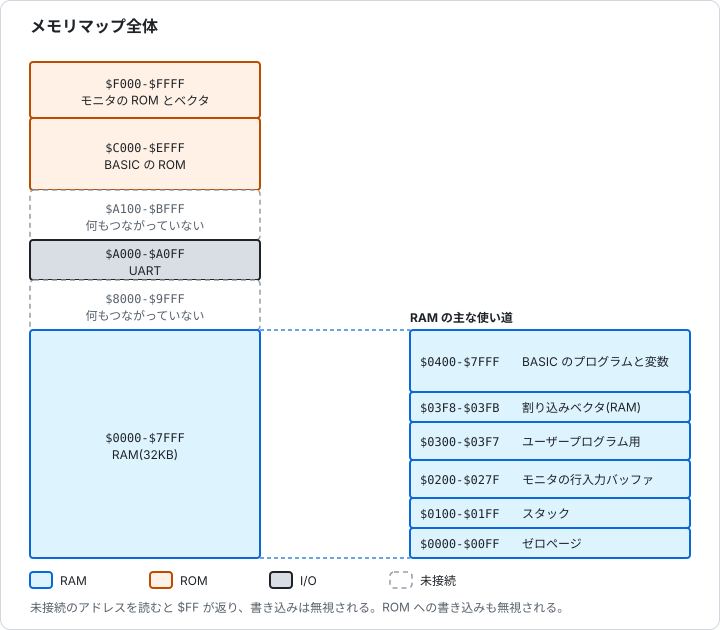
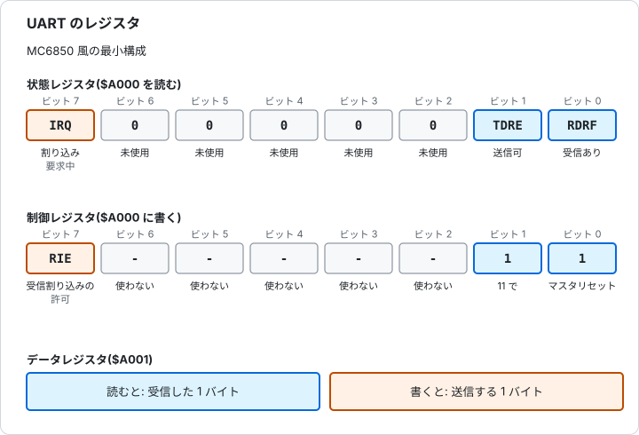
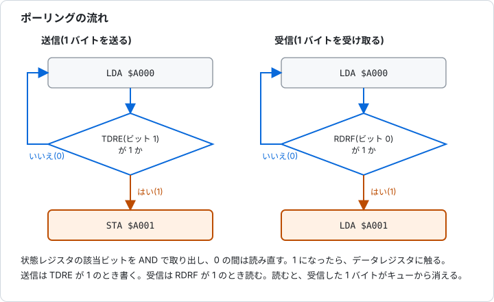
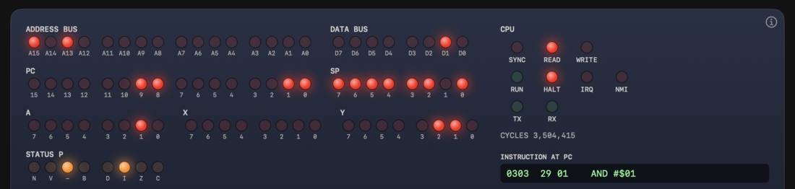
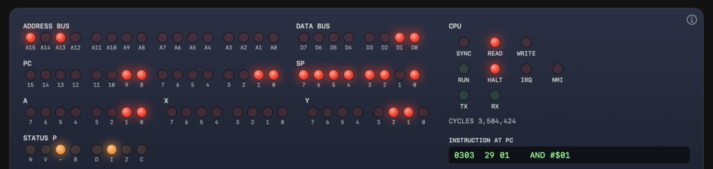
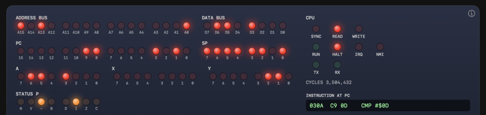
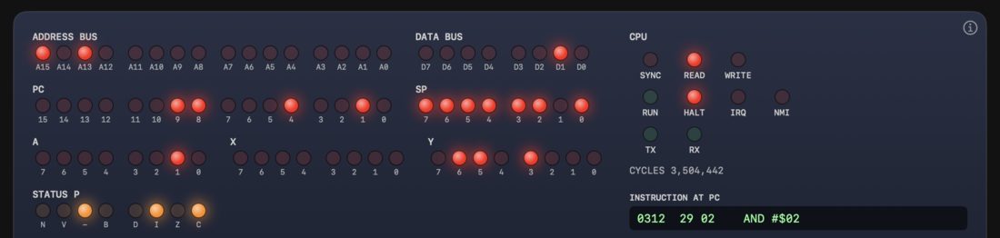

# 第7章 メモリマップと I/O

[日本語](07-memory-io.md) | [English](../en/07-memory-io.md)

[← 6. フラグ、スタック、割り込み](06-flags-stack-interrupts.md)

CPU が読み書きできるのは、アドレスで指定したバイトだけです。RAM も ROM も、キーボードや画面につながる装置も、アドレスの先にあります。この章では、アドレスを部品に割り振るメモリマップと、装置を操作するメモリマップド I/O を、Glow65 の UART とモニタのルーチンを例に説明します。

## 7.1 メモリマップ

### 7.1.1 アドレスの割り振り

CPU は、命令のたびに、16 ビットのアドレスをアドレスバスに出します(第3章)。そのアドレスの先には、RAM、ROM、I/O の部品がつながっています。64KB のアドレス空間を、どの部品にどのアドレスで割り当てるかを決めたものが、**メモリマップ**です。アドレスから部品を選ぶ回路を、**アドレスデコード**と呼びます。

部品に割り当てるアドレスの数が、その部品の大きさです。何も割り当てないアドレスもあります。RAM、ROM、I/O の違いは、第2章 2.8 で説明しています。

### 7.1.2 Glow65 のメモリマップ

| アドレス | 部品 | 内容 |
|---|---|---|
| `$0000-$7FFF` | RAM | 32KB |
| `$8000-$9FFF` | なし | 何もつながっていない |
| `$A000-$A0FF` | UART | 偶数のアドレスが状態と制御、奇数のアドレスがデータ |
| `$A100-$BFFF` | なし | 何もつながっていない |
| `$C000-$EFFF` | ROM | Microsoft BASIC(約 8.6KB を使用) |
| `$F000-$FFFF` | ROM | モニタ、ジャンプテーブル、ベクタ |



図 7-1 Glow65 のメモリマップ。

何もつながっていないアドレスを読むと、`$FF` が返ります。書き込みは無視されます。ROM への書き込みも、無視されます。

電源を入れると、RAM 全体が 0 になります。RESET スイッチは、RAM の内容を保ちます。

> **Glow65 で確かめられること**
>
> 電源を入れた直後の RAM の末尾、何もつながっていない `$8000` と `$A100`、ROM の先頭の `$F000` を読みます。ROM には `E` で書き込みます。
>
> ```
> *D 7FF0 7FFF
> 7FF0: 00 00 00 00 00 00 00 00 00 00 00 00 00 00 00 00
> *D 8000 800F
> 8000: FF FF FF FF FF FF FF FF FF FF FF FF FF FF FF FF
> *D A100 A10F
> A100: FF FF FF FF FF FF FF FF FF FF FF FF FF FF FF FF
> *E F000 00
> *D F000 F00F
> F000: 4C 0F F0 4C 28 F0 4C 37 F0 4C 4B F1 4C 1A F0 AD
> ```
>
> `$7FF0` は 0 で埋まっています。`$8000` と `$A100` は、すべて `FF` です。`E F000 00` のあとも、`$F000` は `4C`(`JMP` の命令)のままです。

UART は、`$A000` から `$A0FF` の 256 アドレスを占めます。アドレスの下位 1 ビットだけで、状態と制御(偶数)、データ(奇数)を選びます。そのため、2 つのレジスタが、128 回ずつ繰り返し見えます(**鏡像**)。アドレスを粗く見るだけで部品を選ぶ、単純なデコードです。

> **Glow65 で確かめられること**
>
> `$A000` と、`$A0FE`(鏡像)の状態を読みます。奇数の `$A003` に `M` を書くと、`$A001` に書いたときと同じように送信されます。
>
> ```
> *E 0300 AD 00 A0 8D F0 03 AD FE A0 8D F1 03 A9 4D 8D 03
> *E 0310 A0 A9 0D 8D 03 A0 A9 0A 8D 03 A0 60
> *G 0300
> M
> *D 03F0 03F1
> 03F0: 02 02 00 00 00 00 00 00 24 F4 24 F4 00 00 00 00
> ```
>
> 2 つの状態が、どちらも `02` です。端末には、`M` が出ます。

### 7.1.3 RAM の使い分け

RAM の `$0000` から `$7FFF` は、用途ごとに使い分けます。

| アドレス | 用途 |
|---|---|
| `$0000-$00FF` | ゼロページ。1 バイトのアドレスで指定できる。モニタが `$F0-$FF` を使う。BASIC は、USR のベクタ(`$0A-$0C`)や、整数と浮動小数点の変換ルーチンのベクタ(`$06-$09`)などを置く |
| `$0100-$01FF` | スタック(第6章) |
| `$0200-$027F` | モニタの行入力バッファ |
| `$0300-$03F7` | ユーザープログラム用の 248 バイト |
| `$03F8-$03F9` | NMI ハンドラの番地(下位が先) |
| `$03FA-$03FB` | IRQ と BRK のハンドラの番地(下位が先) |
| `$0400-$7FFF` | BASIC のプログラムと変数 |

ゼロページの BASIC の使い方は、[チュートリアル第5章](../../tutorial/05-usr.ja.md)にあります。

## 7.2 メモリマップド I/O

I/O は、メモリと同じように、アドレスを指定した読み書きで操作します。この方式を、**メモリマップド I/O** と呼びます。専用の命令は要りません。`LDA` や `STA` が、そのまま使えます。

ただし、I/O のアドレスは、ふつうのメモリと違う動きをします。

| 違い | UART の例 |
|---|---|
| 読むと状態が変わる | `$A001` を読むと、受信した 1 バイトがキューから消える |
| 読みと書きで、別のレジスタになる | `$A000` は、読むと状態、書くと制御。`$A001` は、読むと受信データ、書くと送信データ |
| 書いた値が、そのまま読めるとは限らない | `$A001` に書いた値は、読んでも出てこない |
| 値が、プログラムと関係なく変わる | 文字が届くと、状態レジスタが変わる |

> **Glow65 で確かめられること**
>
> `D` で `$A000` から 16 バイトを読みます。
>
> ```
> *D A000 A00F
> A000: 02 00 02 00 02 00 02 00 02 00 02 00 02 00 02 00
> ```
>
> 偶数のアドレスが状態で `02`(送信可のビットだけが 1)、奇数のアドレスがデータで `00`(受信データがない)です。

`D` は、範囲のすべてのアドレスを読みます。奇数のアドレスの読み出しは、受信データがあれば、それを取り出して消します。I/O を観察するときは、プログラムで状態とデータを読み、結果をメモリに書いてから、`D` で見ます。

## 7.3 UART

UART は、端末とのシリアル通信を受け持つ装置です。1 バイトずつ、送信と受信を行います。Glow65 の UART は、MC6850 に似た最小の構成で、`$A000` と `$A001` の 2 つのレジスタを持ちます。

| アドレス | 読む | 書く |
|---|---|---|
| `$A000` | 状態レジスタ | 制御レジスタ |
| `$A001` | 受信データ | 送信データ |



図 7-2 UART のレジスタ。

| レジスタ | ビット | 名前 | 意味 |
|---|---|---|---|
| 状態 | 0 | RDRF | 1 のとき、受信データがある |
| 状態 | 1 | TDRE | 1 のとき、送信できる |
| 状態 | 7 | IRQ | 1 のとき、割り込みを要求している |
| 制御 | 7 | RIE | 1 で、受信データがある間、IRQ を出す |
| 制御 | 0 と 1 | - | 両方 1(`%11`)でマスタリセット。受信データを捨て、割り込みの許可も切る |

Glow65 の UART は、送信を待たせません。TDRE は、いつも 1 です。書く前に TDRE を調べる手順にしておくと、送信が遅い UART でも同じ手順で動きます。

### 7.3.1 ポーリング

状態レジスタを、プログラムが繰り返し読んで、ビットが 1 になるのを待つ方法を、**ポーリング**と呼びます。



図 7-3 ポーリングの流れ。

送信と受信は、次のように書きます。モニタの `CHROUT` と `CHRIN` も、同じ手順です。

```
putc:   pha
wait:   lda $A000
        and #$02        ; TDRE
        beq wait
        pla
        sta $A001       ; 送信
        rts

getc:   lda $A000
        and #$01        ; RDRF
        beq getc
        lda $A001       ; 受信
        rts
```

> **Glow65 で確かめられること**
>
> プログラムが、受信を待ちます。実行中に `Q` を送ります。`$A000`、`$A001`、`$A000` の順に読み、値を `$03F0` から書きます。
>
> ```
> *E 0300 AD 00 A0 29 01 F0 F9 AD 00 A0 8D F0 03 AD 01 A0
> *E 0310 8D F1 03 AD 00 A0 8D F2 03 60
> *G 0300
> *D 03F0 03F2
> 03F0: 03 51 02 00 00 00 00 00 24 F4 24 F4 00 00 00 00
> ```
>
> 1 回目の状態は `03`(RDRF と TDRE)、データは `51`(`Q`)、データを読んだあとの状態は `02` です。読むと、受信データが消えて、RDRF が 0 に戻ります。

> **Glow65 で確かめられること**
>
> 制御レジスタの RIE(ビット 7)を 1 にしてから、同じことをします。CPU の I は 1 のままなので、割り込みは起きません。
>
> ```
> *E 0300 A9 80 8D 00 A0 AD 00 A0 29 01 F0 F9 AD 00 A0 8D
> *E 0310 F0 03 AD 01 A0 8D F1 03 AD 00 A0 8D F2 03 A9 03
> *E 0320 8D 00 A0 60
> *G 0300
> *D 03F0 03F2
> 03F0: 83 51 02 00 00 00 00 00 24 F4 24 F4 00 00 00 00
> ```
>
> 状態が `83` です。IRQ(ビット 7)が 1 で、割り込みを要求している印です。データを読むと、`02` に戻ります。

> **Glow65 で確かめられること**
>
> 2 文字(`X` と `Y`)を送り、受信できる状態になったら、制御レジスタに `$03` を書いて、状態を読みます。
>
> ```
> *E 0300 AD 00 A0 29 01 F0 F9 A9 03 8D 00 A0 AD 00 A0 8D
> *E 0310 F0 03 60
> *G 0300
> *D 03F0 03F0
> 03F0: 02 00 00 00 00 00 00 00 24 F4 24 F4 00 00 00 00
> ```
>
> 状態は `02` です。マスタリセットで、受信データが捨てられました。

> **Glow65 で確かめられること**
>
> ポーリングで状態が変わる様子を、パネルで追えます。[チュートリアル第4章](../../tutorial/04-echo.ja.md)の `echo.bin` を使います。
>
> 1. `tutorial/echo.bin` を読み込んで、モニタで `G 0300` を実行する。プログラムは、`LDA $A000`、`AND #$01`、`BEQ` を繰り返して、受信を待つ。
> 2. **RUN/STOP** を STOP にして、CPU を止める。**STEP MODE** を INSTR にして、**STEP** を押す。
> 3. `LDA $A000` を実行した STEP では、ADDRESS BUS が `$A000`、DATA BUS が `$02`(D1 だけ点灯)で、A も `$02` になる。送信可(TDRE)だけが 1 で、受信データはありません(図 7-4)。
> 4. 停止したまま、端末に `h` を入力する。次に `LDA $A000` を実行した STEP では、DATA BUS が `$03`(D1 と D0)になり、A も `$03` になる。受信あり(RDRF)が 1 になりました(図 7-5)。
> 5. `AND #$01` と `BEQ` を進めると、分岐しないで、`LDA $A001` に進む。`LDA $A001` を実行した STEP では、ADDRESS BUS が `$A001`、DATA BUS が `$68`(`h`)で、A も `$68` になる(図 7-6)。
> 6. そのあとの送信待ちの `LDA $A000` では、DATA BUS が `$02` に戻る。データを読むと、RDRF が 0 になりました(図 7-7)。
>
> 
>
> 図 7-4 受信データがないとき。`$A000` を読むと `$02`
>
> 
>
> 図 7-5 `h` を入力したあと。`$A000` を読むと `$03`
>
> 
>
> 図 7-6 `$A001` を読むと、受信した `h`(`$68`)が A に入る
>
> 
>
> 図 7-7 データを読んだあと。`$A000` は `$02` に戻る

割り込みを使った受信は、[6.3.6](06-flags-stack-interrupts.md) と[チュートリアル第6章](../../tutorial/06-interrupts.ja.md)にあります。ポーリングによる送受信は、[チュートリアル第3章](../../tutorial/03-uart.ja.md)と[第4章](../../tutorial/04-echo.ja.md)にあります。

## 7.4 モニタのルーチン

モニタは、ROM の `$F000` から、5 つのルーチンへ飛ぶ `JMP` を並べています(ジャンプテーブル)。ルーチンの本体の場所が変わっても、このアドレスは変わりません。`JSR` で呼びます。

| アドレス | 名前 | 入力 | 出力 | 動作 |
|---|---|---|---|---|
| `$F000` | CHRIN | なし | A = 文字 | 文字が届くまで待って、1 文字読む |
| `$F003` | CHROUT | A = 文字 | なし(A は変わる) | 最上位ビットを捨てて、1 文字送る。送信できるまで待つ |
| `$F006` | ISCNTC | なし | C = 1 なら Ctrl-C、C = 0 ならそれ以外(A は変わる) | 待たない。文字があれば 1 文字読み、Ctrl-C(`$03`)かを調べる |
| `$F009` | ウォームスタート | なし | なし | モニタに戻る。`JSR` ではなく `JMP` で飛ぶ |
| `$F00C` | GETKEY | なし | A = 文字、届いていなければ A = 0 | 待たずに、1 文字読む |

X と Y は、どのルーチンでも変わりません。

> **Glow65 で確かめられること**
>
> `CHROUT` で `$48`(`H`)と `$C9` を送り、続けて CR(`$0D`)と LF(`$0A`)を送ります。
>
> ```
> *E 0300 A9 48 20 03 F0 A9 C9 20 03 F0 A9 0D 20 03 F0 A9
> *E 0310 0A 20 03 F0 60
> *G 0300
> HI
> ```
>
> `$C9` は、最上位ビットを捨てた `$49`(`I`)として送られます。

> **Glow65 で確かめられること**
>
> `CHRIN` で 1 文字を待ち、`$03F0` に書きます。実行中に `z` を送ります。
>
> ```
> *E 0300 20 00 F0 8D F0 03 60
> *G 0300
> *D 03F0 03F0
> 03F0: 7A 00 00 00 00 00 00 00 24 F4 24 F4 00 00 00 00
> ```
>
> `z` の ASCII コード `$7A` が読めます。

> **Glow65 で確かめられること**
>
> `GETKEY` を、文字が届いていないときに 1 回呼び、`$03F0` に書きます。そのあと、文字が届くまで繰り返し呼びます。実行中に `k` を送ります。
>
> ```
> *E 0300 20 0C F0 8D F0 03 20 0C F0 F0 FB 8D F1 03 60
> *G 0300
> *D 03F0 03F1
> 03F0: 00 6B 00 00 00 00 00 00 24 F4 24 F4 00 00 00 00
> ```
>
> `$03F0` は `00` です。待たずに戻ったので、A が 0 になりました。`$03F1` の `6B` は、`k` です。

> **Glow65 で確かめられること**
>
> `ISCNTC` を、Ctrl-C が届くまで繰り返し呼び、届いたら `!` を送ります。実行中に、`a` と Ctrl-C(`$03`)を送ります。
>
> ```
> *E 0300 20 06 F0 90 FB A9 21 20 03 F0 A9 0D 20 03 F0 A9
> *E 0310 0A 20 03 F0 60
> *G 0300
> !
> ```
>
> `a` は読み捨てられて C = 0 で戻り、ループは続きます。Ctrl-C で C = 1 になって、`!` が出ます。

> **Glow65 で確かめられること**
>
> `$03F0` に `$77` を書き、`JMP $F009` でモニタに戻ります。
>
> ```
> *E 0300 A9 77 8D F0 03 4C 09 F0
> *G 0300
> *D 03F0 03F0
> 03F0: 77 00 00 00 00 00 00 00 24 F4 24 F4 00 00 00 00
> ```
>
> `RTS` を使わずに、モニタのプロンプトに戻ります。

モニタのコマンドは、次のとおりです。

| コマンド | 動作 |
|---|---|
| `D aaaa [bbbb]` | メモリダンプ(終了アドレスを省くと 128 バイト) |
| `E aaaa bb bb ...` | バイトを書き込む |
| `L aaaa [bbbb]` | 逆アセンブル(終了アドレスを省くと 16 命令) |
| `G aaaa` | `aaaa` のルーチンを呼ぶ(RTS でモニタに戻る) |
| `B` | BASIC を起動 |
| `?` | ヘルプ |

## 7.5 ベクタ領域

ROM の最後の 6 バイト(`$FFFA` から `$FFFF`)は、NMI、リセット、IRQ と BRK のベクタです。仕組みは、第3章 3.7 と、第6章 6.3 で説明しています。

## 7.6 練習問題

答えと解き方は、次の節にあります。

**問1** 次のアドレスを読むと、どの部品の、何が読めますか。(1) `$0300` (2) `$A0F5` (3) `$9000` (4) `$F000`

**問2** `$A0A0` と `$A0A1` は、それぞれ UART のどのレジスタですか。

**問3** `STA $F000` を実行すると、どうなりますか。

**問4** 状態レジスタを読んだら、`$03` でした。何がわかりますか。

**問5** 状態レジスタを読んだら、`$83` でした。何がわかりますか。

**問6** 受信ポーリングで、1 バイトを読んで A に入れるルーチンを、状態レジスタの RDRF を使って書いてください。

**問7** `LDA #$C1`、`JSR $F003` を実行すると、端末に何が出ますか。

**問8** 受信データ `Q` が 1 バイト届いています。プログラムが `$A000`、`$A001`、`$A000` の順に読むと、読んだ 3 つの値は何ですか。

**問9** `a` が届いている状態で `JSR $F006` を呼ぶと、戻ったときの C と、`a` はどうなりますか。

## 7.7 練習問題の答えと解き方

**問1** (1) RAM。書いた値が読める(電源投入直後は `$00`) (2) UART のデータレジスタ。受信データがなければ `$00` (3) 何もつながっていない。`$FF` (4) モニタの ROM。ジャンプテーブルの先頭で、`$4C`(`JMP`)
- (1) `$0300` は `$0000-$7FFF` の中。 (2) `$A0F5` は `$A000-$A0FF` の中で、奇数なので、データ。 (3) `$8000-$9FFF` は未接続。 (4) `$F000` は ROM で、`D` で `4C` と読める。

**問2** `$A0A0` は、読むと状態、書くと制御。`$A0A1` は、読むと受信データ、書くと送信データ。
- UART は `$A000-$A0FF` に鏡像で見える。偶数が状態と制御、奇数がデータ。

**問3** 何も起きない。ROM は変わらず、プログラムは次の命令に進む。
- ROM への書き込みは無視される。

**問4** 受信データがあり(RDRF = 1)、送信もできる(TDRE = 1)。割り込みの要求はない。
- `$03` は `%00000011`。ビット 0 とビット 1 が 1。ビット 7(IRQ)は 0。

**問5** 受信データがあり、送信もできて、割り込みを要求している。
- `$83` は `%10000011`。ビット 7(IRQ)、ビット 1(TDRE)、ビット 0(RDRF)が 1。IRQ は、制御の RIE が 1 で、未読の受信データがあるときに 1 になる。

**問6**
```
getc:   lda $A000
        and #$01        ; RDRF
        beq getc        ; 0 なら繰り返す
        lda $A001       ; 1 なら、データを読む
        rts
```
- 状態を読み、ビット 0 を AND で取り出す。0 の間は繰り返し、1 になったら `$A001` を読む。

**問7** `A`
- `CHROUT` は、最上位ビットを捨てる。`$C1` は `$41` になり、`A` の ASCII コード。

**問8** `$03`、`$51`、`$02`
- 1 回目の状態は、RDRF と TDRE で `$03`。`$A001` を読むと、`Q`(`$51`)が取り出されて、受信データが消える。2 回目の状態は、RDRF が 0 に戻って `$02`。

**問9** C は 0 で、`a` は読み捨てられる。
- `ISCNTC` は、文字があれば 1 文字読む。`$03` でなければ C を 0 にして戻る。読んだ文字は、返らない。

次の章: [8. 用語集と索引 →](08-glossary-index.md)
